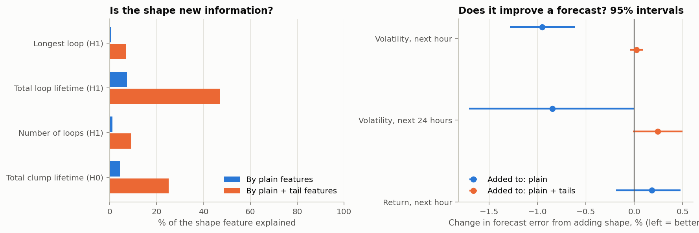

# BTC results, November 17, 2026

One study (`studies/b01_shape_vs_volatility.py`) on the Binance BTCUSDT 5-minute bars already on disk: January 2024 – October 2026, 24,550 hourly decision points, 20,230 of them scored. The earlier pilot scored 348 one-minute forecasts from a single night, which is too few to detect an effect of the size found here.

Words used below:

- **Delay cloud**: take the last 24 hours of 5-minute returns, standardise them, and plot each return against the return 15 and 30 minutes later. The result is a cloud of points in 3 dimensions.
- **Shape features**: persistence summaries of that cloud. H1 counts loops, H0 counts clumps. Because the returns are standardised first, these do not simply measure volatility.
- **Standard baseline**: recent volatility over 1 hour, 4 hours, 24 hours and 7 days (known as the HAR model), plus recent returns, autocorrelation, volume and hour of day.
- **Tail measures**: three plain numbers describing how fat-tailed the same 24 hours were: kurtosis, the average absolute move relative to volatility, and the share of all variance in the single largest move.

## Finding

**The shape of BTC's recent path does help forecast volatility, but only because it is a rough measure of how fat-tailed the last day was. Plain tail measures do twice as well, and once they are included the shape adds nothing.**

| What is added to the forecast | Change in error, next-hour volatility | Change in error, next-24-hour volatility |
|---|---:|---:|
| Shape features, added to the standard baseline | −0.95% (−1.28 to −0.61) | −0.85% (−1.71 to 0.00) |
| Tail measures, added to the standard baseline | −2.01% (−2.57 to −1.46) | −1.57% (−2.97 to −0.16) |
| Shape features, added to baseline + tail measures | +0.02% (−0.04 to 0.09) | +0.24% (−0.01 to 0.50) |

Negative is better; brackets are 95% intervals. The model is refitted every 30 days on all earlier data and scored on the next 30 days.

**What it means.**

- The standard baseline is strong: it cuts next-hour forecast error by 63% against a constant forecast, so a 1–2% gain on top of it is small but real.
- The shape features look like new information at first (the baseline explains only 1–7% of them). Tail measures explain up to 47%, and that shared part is the useful part.
- For the **next hour's return** the shape features do nothing: error changes by +0.18% (−0.19 to 0.48).
- A usable by-product: adding tail measures to a HAR volatility forecast for BTC improves it by about 2%, with an interval that excludes zero.

This is the same pattern as the equity study: TDA pointed at something real, and a plain measure of the same thing did better.

## What the earlier BTC work established

- The data pipeline is sound: 2.8 years of Binance bars, one full-depth Deribit day, and a 25-hour recording of the Kalshi BTC perpetual order book (21.7 million book updates) that replays exactly.
- Unstandardised loop lifetime is mostly volatility (rank correlation 0.82), which is why this study standardises first.
- A next-minute return test on 348 forecasts found no gain from shape features. With this few forecasts it could not have found one.

## Next

1. **Stop testing return prediction with shape features.** Two tests, one small and one large, found nothing.
2. **If the BTC study continues, make it about the order book.** That is where the data is unusual, and it merges this study with the liquidity study. It needs weeks of recording, not 25 hours.
