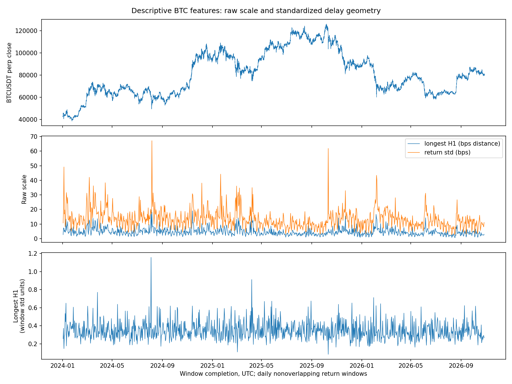
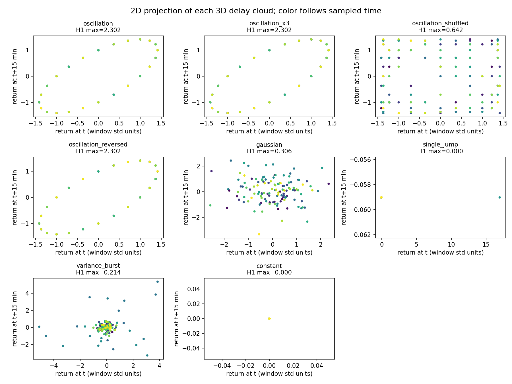

# Initial BTC feature engineering

Executed October 29, 2026 with [feature_engineering.py](../../feature_engineering.py). This is a descriptive feature study, with no forecast labels, trained model or performance estimate.

**Result:** 1,030 daily feature rows from the continuous Binance BTCUSDT five-minute series, 2024–October 2026. Longest raw H1 lifetime has Spearman correlation **0.820** with window return standard deviation; standardized H1 lifetime has **−0.051**. Removing scale changes the interpretation, without proving new predictive information.

Each point cloud is made from a 24-hour window of log returns in basis points: three coordinates separated by 15 minutes, then at most 128 deterministic evenly spaced points. The same cloud is analyzed in raw and window-standardized units. Ripser computes full Vietoris–Rips H0/H1 diagrams. Infinite H0 intervals are counted separately, never summed into finite lifetimes. Windows use 288 returns and 289 source closes, advancing 288 returns. Adjacent windows share a boundary close but no return. The first feature ends Jan 2, 2024 at 00:05 UTC; the last ends Oct 27, 2026 at 00:05 UTC. Remaining bars are an unfinished final window.

Feature families:

- Finite H0/H1 counts, longest lifetime and total lifetime; essential interval counts.
- Return standard deviation, realized volatility, mean, largest return and largest squared-return share.
- Sample ACF at lags 1/3/12, dominant Fourier power share, spectral entropy.
- Quote volume and taker-buy BTC-volume share over the same return window.

| Control | Longest standardized H1 | Interpretation |
|---|---:|---|
| Oscillation | 2.302 | Repeated states form an organized loop |
| Same oscillation, amplitude ×3 | 2.302 | Standardization removes uniform amplitude scaling |
| Same values shuffled | 0.642 | Same variance/distribution, different delay geometry |
| Oscillation reversed in time | 2.302 | The representation loses time direction |
| Gaussian noise | 0.306 | Noise can create loops, too |
| One jump | 0.000 | A large move does not require a loop |
| Variance burst | 0.214 | Volatility change differs from this periodic example |

The spectrum also clearly identifies the oscillation: its dominant-power share is 1.0 versus 0.045 after shuffling. This does not demonstrate a distinction unavailable to conventional summaries. The controls each use one fixed seed/example; these are not inferential tests. Point reduction can miss rare observations. Raw versus standardized features, lag, dimension and point selection need sensitivity checks before downstream use.

Artifacts: [feature table](features_daily.csv), [control values](controls.csv), [descriptive Spearman matrix](spearman_descriptive.csv), [example diagrams](example_diagrams.json), [specification](specification.json), and [validation](validation.json). Scale, reversal, constant-input, finite-output and prefix-invariance checks passed. Prefix invariance checks that removing later data leaves earlier features unchanged; it does not prove historical delivery-time availability. Every displayed period is development data; no held-out performance is claimed.
