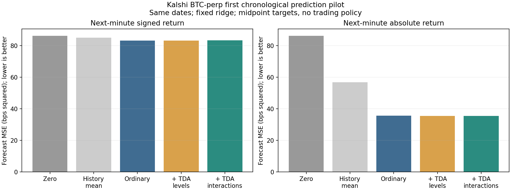
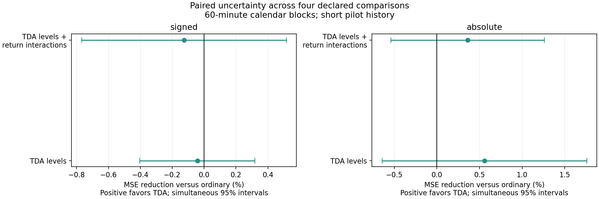
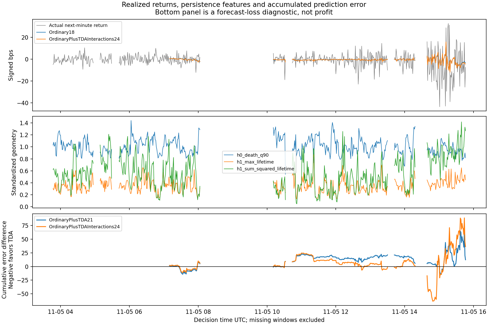

# First Kalshi BTC perpetual return prediction test

Executed November 5, 2026, using the existing `tda` environment and a frozen list of closed recorder files. The specification was saved before extracting outcomes and fitting models.

**Result:** the tested TDA features do not establish an improvement in next-minute return prediction. The primary TDA model slightly worsens signed-return MSE by 0.126% versus ordinary features. It improves absolute-return MSE by 0.361%, with uncertainty including no benefit. This is an initial chronological pilot on one short recording, not a validated trading signal.

## What was predicted

At each UTC minute boundary, predict `10000 × log(midpoint[t+60 seconds] / midpoint[t])`. The midpoint is halfway between the Kalshi BTC-perp best bid and ask, converted using saved contract metadata. The target is in basis points; one basis point is 0.01%.

- **Primary:** signed next-minute midpoint return, including direction.
- **Secondary:** absolute value of that return, measuring move size.

No position, trading threshold, simulated fill, P&L curve or annualized return was introduced. These are midpoint-price forecasts, distinct from executable trade returns. The liquidity Reeb graphs and their centered smoothing are not inputs.

## Frozen data and timing

We used 26 finalized gzip files, thirteen common hourly segments per source, spanning roughly November 5 at 03:36–16:00 UTC. Locally that is November 4 at 10:36 p.m. through November 5 at 11 a.m. Indianapolis. Live partial files and subsequently closed files were excluded. The existing recorder was left running.

The five-second clock uses the latest previously received book checkpoint, at most 7.5 seconds old. Coinbase context uses a previous reference sample at most one second old, with total recorded quote age at most two seconds. This is receipt-time as-of sampling, not exchange-synchronous quotes. Kalshi checkpoints summarize the retained event stream at approximately five-second intervals; we did not replace them with future interpolated prices.

Each feature window contains 600 seconds, or 120 five-second returns. Eligibility requires fresh valid quotes and unchanged source-specific connection epochs throughout the feature window and the subsequent one-minute label. Explicit gaps and invalid intervals are masked. No returns are filled through missing observations. Future label completeness is an evaluation filter, not information available for a live trading decision.

| Sample item | Count |
|---|---:|
| Five-second clock points | 8,917 |
| Clock points passing quote and gap checks | 7,326 |
| Eligible one-minute decisions | 528 |
| Initial completed labels required for training | 180 |
| Scored forecast decisions | 348 |
| Expanding refit dates | 12 |

Of the candidate minute decisions, 11 lack a complete beginning/end window, 182 fail missingness/staleness/gap checks, and 22 cross connection epochs. A stale checkpoint can reflect a quiet unchanged book as well as an interruption; these counts are not all diagnosed outages.

Scored decisions run **07:10–15:46 UTC**, or **2:10–10:46 a.m. Indianapolis**, with excluded intervals left missing. Adjacent labels are nonoverlapping one-minute returns, but neighboring feature windows share most observations and outcomes can remain serially dependent.

## Models and feature mapping

| Model | Inputs |
|---|---|
| Zero | Always predict zero |
| History mean | Mean of completed training targets, updated on the same refit dates |
| Ordinary18 | Fifteen ordinary features and three fixed return interactions |
| Ordinary plus TDA21 | Ordinary18 plus three persistence summaries; fixed ablation |
| Ordinary plus TDA interactions24 | Ordinary18 plus three summaries and their interactions with recent return; primary augmented model |

Ordinary inputs are past 5/30/60/600-second returns; ten-minute return standard deviation, lag-one autocorrelation, dominant spectral-power share and spectral entropy; current spread and depth imbalance within ten basis points; preceding-minute trade notional, count and reported-taker-side imbalance; prior Coinbase one-minute return; and current perp-versus-spot midpoint difference. Baseline interactions multiply the past one-minute return by volatility, autocorrelation and spectral concentration.

The trade imbalance codes reported `taker_side=bid` as positive and `ask` as negative, weighted by reported trade notional. This is a field-coded signed fraction, without inferring cancellations or hidden orders. The public perp [trade schema](https://docs.kalshi.com/margin-ws/websockets/public-trades) supplies that field. Duplicate trade IDs are removed; trade windows use receipt timestamps in `(t−60 seconds, t]`.

For TDA, center and standardize the preceding 120 returns within their own window. Form **116 three-dimensional delay points**: `[return now, return 10 seconds earlier, return 20 seconds earlier]`. Compute Euclidean Vietoris–Rips H0/H1 with Ripser, without point subsampling. Retain:

1. The 90th percentile of finite H0 death distances.
2. The longest finite H1 lifetime.
3. The sum of squared finite H1 lifetimes.

Infinite bars are excluded; empty finite diagrams contribute zero. Standardization separates shape from volatility, which the ordinary model already receives. H0 here is a connectivity statistic, not uniquely new information beyond conventional connectivity methods. Loops are geometric features, not automatically market cycles.

Reflection of all returns preserves persistence, so these three summaries do not inherently distinguish up from down. The primary augmented model therefore also multiplies each summary by the signed past one-minute return. This tests whether geometry changes the response to a recent rise or fall. The fixed levels-only model tests the contribution without those interactions; its point rank is not used to select a winner.

All feature models use ridge regression with training-only population means and standard deviations. The objective is average squared target error plus `sum(beta²)`, with an unpenalized intercept, equivalent to sklearn `alpha=n_train`. Fits expand using completed targets and update every thirty eligible decisions. The two targets are fitted separately with identical memberships. There is no hyperparameter, horizon or feature-window search.

## Forecast results



MSE is measured in squared basis points; lower is better. These are prediction losses, not percentages of money earned or lost.

| Model | Signed-return MSE | Absolute-return MSE |
|---|---:|---:|
| Zero | 86.2602 | 86.2602 |
| History mean | 85.1050 | 56.7826 |
| Ordinary18 | **83.2255** | 35.6629 |
| Ordinary plus TDA21 | 83.2609 | **35.4639** |
| Ordinary plus TDA interactions24 | 83.3303 | 35.5341 |

Ordinary inputs have 3.52% lower signed-return point error than zero and 2.21% lower than the historical mean. Their absolute-return point error is 37.19% below the historical-mean predictor. These descriptive comparisons do not establish generalization; uncertainty testing was declared for the incremental TDA question.

Direction accuracy on the 345 nonzero outcomes is 52.46% for Ordinary18 and 51.88% for the primary augmented model. Three unchanged-price outcomes are excluded from this directional summary. Zero forecasts abstain from direction, so their zero sign-match score should not be interpreted as a competing directional accuracy. Direction accuracy is descriptive, not evidence of profitable trades.

## Did TDA add useful prediction



Positive reduction means better prediction. Simultaneous 95% intervals cover the two TDA additions and both targets as one four-comparison family.

| Addition versus Ordinary18 | Signed-return MSE reduction | Simultaneous 95% interval | Absolute-return MSE reduction | Simultaneous 95% interval |
|---|---:|---:|---:|---:|
| Three TDA summaries | −0.043% | [−0.403%, +0.318%] | +0.558% | [−0.642%, +1.757%] |
| Summaries plus return interactions | −0.126% | [−0.767%, +0.515%] | +0.361% | [−0.538%, +1.260%] |

**Interpretation:** the primary signed-return test is slightly unfavorable. Both absolute-return estimates are slightly favorable, but neither excludes zero, including under pointwise intervals. No tested augmentation establishes useful incremental prediction. The much larger ordinary-feature magnitude improvement deserves preservation as a pilot observation, without choosing new settings from this same record.

Uncertainty uses 2,000 paired circular block resamples of sixty consecutive **calendar-minute slots**. Missing eligible/scored windows remain missing; gaps are not compressed into adjacent observations. The simultaneous bands use the maximum standardized bootstrap deviation across the four comparisons. They condition on saved predictions without refitting models. The denominator for percentage reduction is the original ordinary-model MSE; intervals are transformed paired-loss intervals with that denominator held fixed. This short record contains very few independent hour-scale episodes, so the bootstrap cannot establish dependable performance across market conditions.



The top panel compares realized signed returns with forecasts, the middle shows the three persistence summaries, and the bottom accumulates signed-target loss differences versus Ordinary18. Negative cumulative difference favors TDA. Blank intervals are excluded data, not a trading pause. The bottom panel is not profit.

## Validation and decision

The [independent audit](audit.json) reconstructed all **72 feature-model target fits** across twelve refit dates, all 3,480 saved forecast rows including references, training memberships and completed labels. Maximum feature-model prediction discrepancy was 1.03e−13 bps; interval discrepancy was 3.00e−15. All 528 labels, all as-of joins, trade-window accounting and selected persistence calculations were checked. Nine windows passed sign-reflection, amplitude-scaling and past-only feature checks; the constant-input control passed.

All 26 frozen files passed SHA-256, gzip CRC and recorded-row-count checks. Selected independent exact-decimal raw replay checked 485,664 records and matched 311 checkpoints; the late file was checked as a 250,000-row prefix, not a complete independent replay of every raw delta. Checks validate the saved-stream calculations, not independent exchange-wide completeness.

**Decision:** retain the ordinary baseline and this fixed TDA comparison as the first predictive benchmark. Do not infer a profitable gate, tune another geometry to rescue these results, or treat subsequently collected observations as an untouched holdout after inspecting them. A later confirmation should preserve the declared horizon, inputs and model and predeclare its evaluation interval. This run did not stop or modify collection and did not touch equity results.

## Evidence and reproduction

- [Specification written before outcome extraction](specification.json)
- [Input file validation](input_validation.json) and [eligibility counts](eligibility.json)
- [Features and targets](features_and_targets.csv)
- [All forecasts and losses](walk_forward_predictions.csv)
- [Forecast metrics](forecast_metrics.csv) and [paired comparisons](paired_comparisons.csv)
- [Exact training memberships](training_membership.json) and [coefficients](coefficients.csv)
- [Analysis source](../kalshi_perp_return_prediction_2026_11_05.py) and [independent audit source](../audit_kalshi_perp_return_prediction_2026_11_05.py)

From the project root, with the frozen local input files retained:

```sh
/Users/derickshi/anaconda3/envs/tda/bin/python btc/experiments/kalshi_perp_return_prediction_2026_11_05.py
/Users/derickshi/anaconda3/envs/tda/bin/python btc/experiments/audit_kalshi_perp_return_prediction_2026_11_05.py
```

The input manifest stays fixed when reproducing; later recorder files are never added automatically. No network or credential access is needed to reproduce this analysis.
