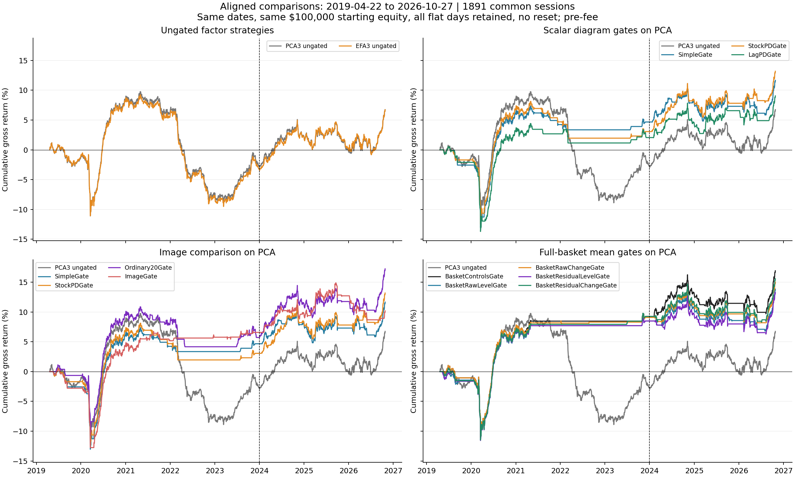
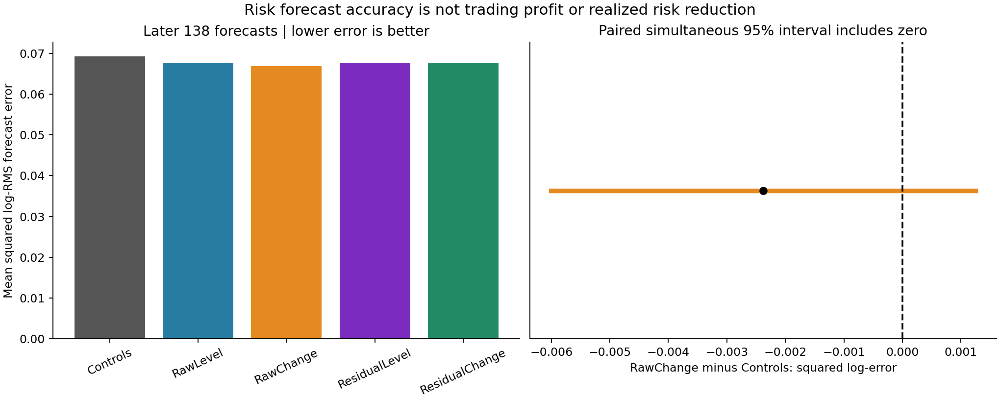
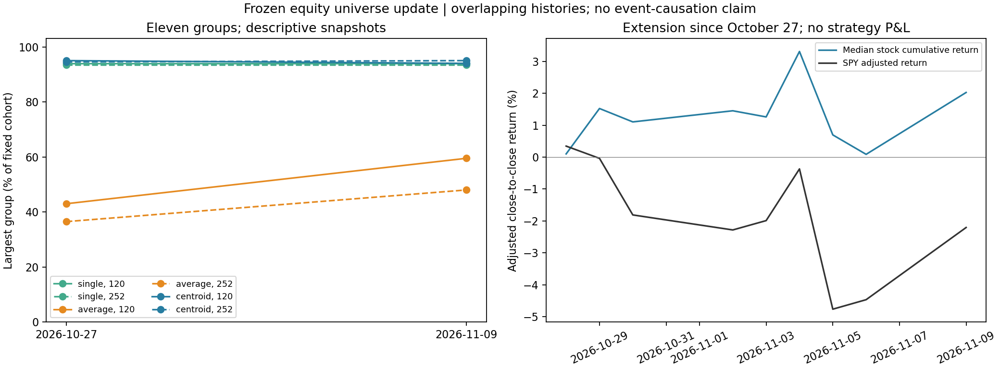

# Equity research: consolidated methods and findings

Updated November 10, 2026. **This is the single consolidated equity document:** the research sequence, intuitive findings, linkage explanation, reconciled performance tables, complete saved method specifications, and the latest data update are included here. Linked source files remain the reproducible evidence. The numbered entries follow the research sequence. Entries 01–09 summarize October 28 work; entries 10–15 record the October 29 broader rerun, regime/image tests, coordinate review, full-basket day states, and matched EFA/PCA comparison. Entry 13 is a review; entries 14–15 are executed experiments. Entry 16 tests an approximation of a user-supplied index sell-off strategy and adds separate VIX context. Entry 17 compares VIX with the original factor-neutral strategy's returns and risk. Entry 18 investigates the user-selected 20–30 VIX band as a fixed exploratory filter. Entry 19 revisits historical TDA regime studies and their use alongside VIX; it adds a review and context alignment. Entry 20 executes the matched ordinary-controls/VIX/TDA comparison with separate risk and mean targets. Entry 21 tests local current-residual-shock merge trees for next-session stock forecasts. Entry 22 tests labeled relationship changes and signed portfolio exposures against covariance and average linkage. Entry 23 refreshes prices through November 9, compares centroid linkage, and addresses the user's recent deleveraging hypothesis.

**Reading guide:** [linkage and centroids](#single-linkage-rips-and-the-proposed-average-point), [latest refresh](#23--refresh-through-november-9-and-examine-the-unwind-question), [reconciled result tables](#appendix-a--reconciled-performance-and-risk-findings), [full experiment specifications](#appendix-b--complete-executed-method-specifications). Earlier strategy/forecast results still end October 27; only entry 23 uses the refreshed vintage.

**Documentation cleanup, November 10:** this is the current consolidated reference. Six older summary/proposal documents now start with **OUTDATED** notices explaining exactly which project-status claims have been superseded and linking to the executed work. Fifteen disposable Python cache files were removed; historical datasets, experiments and notebooks were retained. See the [maintenance record](../REPOSITORY_CLEANUP.md#november-10-equity-documentation-cleanup). This is housekeeping, not another research experiment.

**Validation review, October 29:** use [EQUITY_VALIDATION.md](EQUITY_VALIDATION.md) for reconciled metrics and aligned graphs. Eight existing audits and additional legacy reconstructions passed. All fifty figures embedded in eleven notebooks match saved project images. No numerical discrepancy was found in the audited results; earlier presentations mixed periods, portfolios and risk definitions. This review adds no new strategy experiment.

## Where we stand

**November 10 refresh:** a separate full raw/adjusted vintage now covers 200 unchanged stocks plus SPY through November 9: 2,729 sessions, nine new dates, no internal/trailing gaps. All 106 response pages and adjacent-return checks pass. The old vintage is intact; 55,674 old adjusted bars differ in the new vendor vintage, so histories were not spliced. On the nine new sessions SPY returned −2.20%, but the median stock returned +2.02%. At K=11 the newest 120-session largest group contains 188 stocks under H0/single, 119 under average, and 188 under centroid linkage. Centroid linkage is a distinct tested descriptive comparator, not an equivalent shortcut to average linkage. The short extension does not establish a regime or the cause of the selloff. Contemporary reporting supports investigating deleveraging; specific factor neutrality and causal attribution remain unverified. See entry 23 and its fully included report below.

**November5 labeled relationship/exposure test:** attaching actual signed holdings to complete H0/single-linkage stock hierarchies gives favorable squared-return forecasting point increments beyond covariance/VIX controls and average linkage. H0 beyond the average tree has QLIKE differences−0.00270 earlier and−0.00523 later, with both simultaneous intervals spanning zero. Later downside improves in point estimate, earlier downside worsens; mean MSE worsens0.410%/0.161%. All1,176 fits and34,956 forecast losses pass audit. This retains stock identities and position alignment, but establishes neither an incremental effect nor a new allocation policy. [Report and figures](experiments/tda_relationship_exposure/README.md), entry22 below.

**November5 local residual-shock test:** current-shock H0 branch prominence/support produce essentially no mean-prediction gain beyond ordinary peer measures and VIX: later improvement0.0043%, simultaneous interval[−0.0021%,+0.0107%], with slightly worse earlier error. Ordinary graph inputs improve individual absolute-relative-move forecasts0.761% earlier and0.177% later; TDA adds negligible earlier benefit and slightly worsens later error. The graph construction distinguishes connected and separated synthetic shocks and retains named branches, but no stock-selection policy follows. All294 ridge refits and saved forecasts reconstruct independently; original holdings/returns are preserved. [Report and four figures](experiments/tda_residual_shock/README.md), entry21 below.

**November 5 matched VIX/TDA follow-up:** the risk hint survives adding VIX, but remains uncertain. On identical original dates and completed-label memberships, VIX reduces later squared log-RMS forecast error by0.95% versus ordinary controls; four cached TDA additions reduce it a further2.16–3.64%. All paired intervals span zero. Mean forecasts barely improve, and all feature models lose to historical-mean prediction later. The independent audit passed all5,306 fits. No trading gate, sizing policy or return ledger changed. [Executed report and figures](experiments/tda_vix_matched/README.md), entry20 below.

**Regime-literature context:** prior studies use day-return landscapes, correlation-network persistence and diagram changes to describe stress, compare distributions, forecast risk or set exposure. Those differ from forecasting this portfolio's mean. Full-basket day states and diagram changes are already tested; full all-layer landscape L1 is exactly one quarter of our squared-lifetime sum. The November4 review aligned all490 anchors to VIX and proposed the comparison now executed in entry20. [Review, illustrations and source caveats](literature/tda_regimes_vix_2026-11-04/README.md).

**November 4 fixed VIX20–30 follow-up:** the user-selected band raises full PCA CAGR from 0.68% to 1.26% and reduces drawdown from 16.99% to 9.33%, while trading 625/2,446 days. Its full volatility-matched comparison is also favorable in point return. Later it returns 1.21% versus always-on 3.37%, with a lower Sharpe and fewer active days. Deleting2020 leaves only 0.27% gate CAGR; deleting2022 reverses its CAGR advantage over always-on. Target means and primary increments remain uncertain, and adding the explicit band indicator does not establish better forecasts. Keep the fixed band as an exploratory benchmark, with no boundary tuning or promotion as a validated gate. [Detailed follow-up](experiments/factor_vix_20_30/README.md).

**November 4 factor/VIX comparison:** prior-session VIX correlates +0.322 with the absolute PCA-strategy return and −0.020 with its signed return. Higher VIX clearly coincides with greater observed risk, but conditional mean signs vary by era. Adding lagged VIX to past S&P volatility/return controls worsens full chronological mean-forecast MSE by 2.00% and improves absolute-return MSE by a small, uncertain 1.80%; all declared simultaneous incremental forecast intervals span zero. EFA agrees. Keep VIX among ordinary state controls for future TDA comparisons, without inferring a profitable gate or sizing policy. [Full findings and audit](experiments/factor_reversal_vix/README.md).

**November 4 index-reversal check:** a specified approximation of a LinkedIn strategy shows strong QQQ/SPY rebound means with optimistic same-close decisions, but the causal next-open versions have mean intervals including zero. This is market-direction reversal, not evidence overturning the residual-factor findings below. Free Cboe VIX history and lagged features are now saved separately; no VIX/TDA gate is established. See [entry 16 and its report](experiments/index_selloff_reversal/README.md).

**Stocks in this basket have repeatable peer relationships. The broader 200-stock daily strategy has positive later gross point estimates, unlike the original thirty-stock result, but its mean intervals still include zero. Average linkage is the stronger tested way to divide the broad basket into peer groups; that structural advantage does not establish a trading-return advantage.**

The first persistence-based regime test and a fixed persistence-image follow-up are complete. Three stock-loading diagram summaries give a modest favorable later estimate versus simple state predictors, and lagged-state features give almost no trading improvement; neither establishes an incremental benefit. Replacing the three summaries with a richer image/histogram representation increased later forecast error and reduced point trading performance. The representations preserve different measured distinctions, but a demonstrated improvement in conditional return prediction remains missing.

The literature review motivated a different object: days in return coordinates and changes between diagrams. The user then proposed using the full stock basket instead of another four-index replication. That comparison is complete: 120 day points in 182 stock-return coordinates, with raw/residual and level/change versions. Later risk point errors improve 2.2–3.4%, but no incremental effect is established; mean prediction and all four later gates fail to beat their matched controls convincingly. See entries 13–14.

The subsequent EFA-versus-PCA factor check is also complete. With the same SPY exposure, three additional factors, signal, weights, and execution, EFA gives 3.54% later gross CAGR versus 3.37% for PCA. Its paired mean increment is only +0.065 bps/day, interval [−0.104,+0.263]. Future residual correlations and factor-space stability are almost unchanged. It does not materially change the conclusion that this short-term reversal premise is unconfirmed. See entry 15.

The later return must be kept in full-history context: February 2017–October 2026 EFA gross CAGR is only **0.66%**, PCA **0.68%**, and EFA's maximum drawdown is **17.1%**. [Continuous profit chart](experiments/equity_efa_overall_profit/README.md). Zero net dollars and estimated factor constraints are not zero gross exposure or zero risk.

Two separate risk observations should also stay visible. The stock-diagram mean gate lowers later realized volatility from always-on PCA's 3.80% to 3.21%, with almost unchanged point CAGR, while trading only 69.4% of days. An ordinary gate also lowers volatility, to 3.18% at 67.2% activity. Full-basket RawChange instead lowers a risk predictor's squared log-RMS error by 3.44%; that predictor never changes positions. The first measures the returns of a trading policy, the second the accuracy of a forecast. Neither establishes reliable incremental TDA value over its matched control.

Those are separate findings:

| Question | What our work supports |
|---|---|
| Are there common movements and recognizable peers? | Yes. PCA, correlations, and clustering reveal them, and past-formed groups retain future correlation structure. |
| Do relative losers subsequently catch up with their peers? | Not reliably established for our one-day signal and tested 1/5/20-session holds. |
| Does the tested H0 construction improve on ordinary clustering? | No incremental advantage established. Average linkage has stronger future correlation separation at every declared cut/lookback in the expanded study. |
| Do diagram features help predict favorable strategy regimes? | Not established in the first scalar-summary or image tests; all declared simultaneous incremental uncertainty intervals include zero. |
| Does full-basket day geometry predict strategy risk or mean? | Modest favorable later risk point estimates, no established incremental effect; mean and trading improvements remain absent. |
| Does EFA improve the factor estimate or reversal strategy versus matched PCA? | No established advantage; three-factor spans are usually closely aligned and the later gross-return increment is small and uncertain. |

The useful positive result is persistent structure. The unresolved step is turning a relative move into a forecast. The negative incremental result concerns the particular H0 construction, not every possible use of TDA.

## Which document should I read?

| Document | Its job |
|---|---|
| **This consolidated running document** | Contain the whole research story, findings, reconciled metrics, linkage math and full specifications; links supply original evidence. |
| [EQUITY_VALIDATION.md](EQUITY_VALIDATION.md) | Give reconciled performance/risk numbers, common-calendar graphs, definitions and validation evidence. |
| [EQUITY_PROGRESS_REPORT.md](EQUITY_PROGRESS_REPORT.md) | **OUTDATED summary:** retain the October 29 progress snapshot; use this consolidated document for the complete current findings. |
| [EQUITY_NEXT_STEPS.md](EQUITY_NEXT_STEPS.md) | State the current decision and open choices. Completed work belongs in this log, not in a growing stack of old plans. |
| [EQUITY_INTUITION.md](EQUITY_INTUITION.md) | Original correlation/PCA explanation, with **OUTDATED project status** clearly marked. It is about the first descriptive notebook, not the entire project. |
| [MEAN_REVERSION_SCOPE.md](MEAN_REVERSION_SCOPE.md) | Separate return reversal, equilibrium price spreads, and multi-year valuation questions. |
| [PERSISTENCE_REGIME_IDEAS.md](PERSISTENCE_REGIME_IDEAS.md) | Explain stock exposure points versus day/state points and the PCA geometry identity; its **OUTDATED proposal status** points to completed tests. |
| [TDA regime and coordinate review](literature/tda_regimes_and_coordinate_design_2026-10-29.md) | Compare prior papers' exact point objects/dimensions with ours; separate a proposed next construction from completed tests. |
| Each experiment's README and notebook, linked below | Supply exact settings, full results, plots, uncertainty, and reproduction instructions. |
| [START_HERE.md](../START_HERE.md) | Keep project-wide context and rules across equity, BTC, and liquidity studies. |

## What average linkage actually does

**Average linkage is a rule for building groups: merge the two groups whose members are closest on average.** “Linkage” just means the rule for deciding how far apart two groups are once some stocks have already been grouped.

First we need a distance between each pair of stocks. In our experiments, we compare their prior daily return histories after fitting out SPY and standardizing each stock. More positively correlated residual histories get smaller distances. This measures similarity of historical movement, not how close their dollar share prices are.

The grouping algorithm then works from the bottom up:

1. Start with each stock in its own group.
2. For any two groups, list **every stock-to-stock distance across the groups** and take their arithmetic average. If one group has three stocks and the other has two, average all six cross-group distances.
3. Merge the two groups with the smallest average distance.
4. Recalculate distances involving that new group and repeat. Keeping the merges gives the tree. Stopping when eleven groups remain gives an eleven-group partition; eleven is our chosen cut, not a number the algorithm discovers as economically correct.

Here is a **hypothetical distance example**, not measured stock data. Suppose A, B, and C have already formed a group. D and E are still separate:

| Pair | Distance |
|---|---:|
| D to A | 0.40 |
| D to B | 0.30 |
| D to C | 0.20 |
| D to E | 0.25 |

Average linkage says D is `(0.40 + 0.30 + 0.20) / 3 = 0.30` away from the ABC group. D is only 0.25 away from E, so **between those two candidate merges it prefers joining D and E**. The actual next merge always depends on comparing every candidate group pair.

**Single linkage, which corresponds to our H0 components, uses only the closest cross-group pair.** It calls D only 0.20 away from ABC because of C. Between the same candidates, it prefers attaching D to ABC. A series of such short connections can pull a large chain together even when its distant endpoints are not close.

That difference is why we compare the methods. Average linkage considers how well groups match across all their member pairs; single linkage asks whether there is one short bridge. Average linkage can still make uneven groups and does not globally optimize all possible partitions. In our measured basket it produced stronger future peer separation, rather than being guaranteed superior by definition.

**The word “average” here refers to pairwise distances.** It does not mean averaging stock prices, buying an equal-weight portfolio, or taking average returns as a trading signal. Portfolio weighting is a separate step.

### Single linkage, Rips, and the proposed average point

**Yes: the connected components of our ordinary Rips filtration follow single linkage. Your average-point proposal is centroid linkage, a different grouping rule.** For two current groups A and B, the three distances are:

| Method | Group distance | What can trigger a merge? |
|---|---|---|
| Single linkage | `min d(a,b)` over a in A, b in B | One short cross-group bridge |
| Average linkage | `sum d(a,b) / (|A| |B|)` | The average of every cross-group pair is small |
| Centroid linkage | `norm(mu_A - mu_B)` | The two arithmetic-mean coordinate vectors are close |

At each step, merge the current group pair with the smallest distance under the chosen rule. Average linkage does compare one point with every member when one group is a singleton; once both groups have multiple members, it averages **all** cross-group combinations. The [SciPy linkage definitions](https://docs.scipy.org/doc/scipy/reference/generated/scipy.cluster.hierarchy.linkage.html) provide implementation references for these three rules.

**Why Rips H0 gives single linkage.** At distance threshold epsilon, retain each original point and add every original pair edge with distance at most epsilon. One edge joining two components immediately makes them one component. A connected chain at positions `0, 0.9, 1.8` is therefore one component at epsilon 1, although its endpoints are 1.8 apart. Single linkage records precisely this connectivity rule. A minimum spanning tree retains the merge distances and connected components; the original pilot checked that equivalence.

This equivalence concerns **H0**, not the whole Rips complex. A higher-dimensional simplex enters only once *all* edges among its vertices are present: its filtration value is the largest pair distance. The three chain points above have no filled triangle at epsilon 1. This all-pair simplex requirement does not turn H0 into complete linkage. H1 also depends on cycles and their fillings; a single-linkage tree alone cannot recover it. Here epsilon means edge-distance threshold; radius-based conventions may differ by a factor of two. [GUDHI Rips definition](https://gudhi.inria.fr/doc/3.12.0/group__rips__complex.html).

**Why a centroid changes the answer.** Consider two small hypothetical groups in a plane:

```text
B: (-1,4) -------- (1,4)      center (0,4)

A: (-1,0) -------- (1,0)      center (0,0)
```

Both groups form internally at distance 2. Their four cross distances are `4, sqrt(20), sqrt(20), 4`. Thus single distance is **4**, average distance is **4.236**, and centroid distance is **4**. At a threshold of 4.1, single and centroid would join these groups, but average would not. These are valid alternative rules, not two ways of calculating the same quantity. The example is arithmetic, not an observed stock configuration.

A center describes location but loses within-group spread and arrangement. Two differently dispersed groups can have the same center. For Euclidean coordinates, a useful exact identity is:

```text
mean over all cross pairs of ||a-b||^2
  = ||mu_A-mu_B||^2
    + mean within A of ||a-mu_A||^2
    + mean within B of ||b-mu_B||^2
```

This follows by expanding each squared norm; the centered cross terms average to zero. Even the average **squared** distance therefore needs the two spreads in addition to the center distance. Ordinary average linkage averages distances rather than their squares, so this identity is an explanation of the lost information, not a replacement formula for our implementation.

**What is an average stock point?** In these experiments, each stock is its standardized prior SPY-residual-return history divided by `sqrt(L-1)`. Average these vectors in that same coordinate space. Their Euclidean distances are our `sqrt(2*(1-rho))`. An average dollar share price has no role. Full eigenvalue-weighted PCA coordinates preserve this geometry too; a truncated representation changes it. Do not normalize the centroid to unit length after averaging: that would define another criterion, closer to comparing correlations of aggregate histories.

After joining A and B, use the size-weighted center `mu_(A union B) = (|A| mu_A + |B| mu_B) / (|A|+|B|)`. Giving a two-stock and a twenty-stock group equal weights would not produce the mean of their 22 original points.

There is a further geometric reason to inspect centroid behavior here: individual standardized stock vectors have norm one, while averaging imperfectly aligned vectors moves a centroid inside that unit sphere. A broad group's center can therefore become close to many other points without those stocks being mutually similar. This is a possible mechanism for large centroid groups, not an independently established explanation of the measured group sizes.

**The intended computational shortcut already exists for average linkage.** Keep the previously computed group distances and update exactly:

```text
D_average(A union B, C)
  = (|A| D_average(A,C) + |B| D_average(B,C)) / (|A|+|B|)
```

The cross pairs simply split into pairs from A and from B, which proves the update. We need not revisit all original pairs at every merge. Thus using centers is unnecessary to avoid repeated all-pair averaging. Efficient hierarchical-clustering algorithms are covered by [Müllner's algorithm paper](https://arxiv.org/abs/1109.2378); the exact average-distance update above follows directly from the definition.

**Why “merge when the average gets close enough” needs care.** Moving a centroid after a merge can make its next merge distance *smaller* than a previous distance. An equilateral triangle of side 2 demonstrates this: merge any pair at 2, then its midpoint is only `sqrt(3)` from the third point. Centroid trees can therefore have decreasing merge heights. They still define a sequence of nested groups, but those raw heights do not give the increasing-threshold connectivity filtration of the original Rips metric. Our descriptive comparison stops after N−11 merges, rather than treating centroid heights as an ordinary horizontal filtration cut. In the real refreshed snapshots this issue occurs: 39–46 decreasing-height steps per centroid tree.

**What our evidence says.** Previous future-correlation comparisons favor average linkage over the tested H0 partitions; they did not test centroid linkage. Entry 23 now adds a small centroid comparison on the same full stock vectors. Centroid still puts 188–190 of 200 names into its largest group at the latest eleven-group cuts. This establishes how the proposed rule behaves in these snapshots, not a general verdict or a centroid trading-return result.

## The central idea in plain language

We started with the possibility that some stock moves are temporary deviations from what similar stocks are doing. Identify the common movement, measure what is left, and ask whether that leftover move subsequently reverses.

As a **hypothetical arithmetic example**, suppose a stock rises 3% while its fitted common movement is 2%. The approximately one-percentage-point difference is its residual: it did better than this particular model expected. A contrarian signal would short relative winners and buy relative losers, while balancing the selected exposures.

But a residual is not automatically a pricing mistake. The stock could give back its relative gain, or new information could justify it permanently. Both are compatible with having moved closely with peers in the past. The actual experiments use the specified log-return signal and weighted regression; the numbers above only illustrate the idea.

We therefore need to separate **describing shared movement**, **predicting a reversal**, and **constructing a portfolio that neutralizes selected exposures**. Success at one does not establish the other two.

## 01 — Collect a daily panel and see what moves together

**Question.** Is there enough visible structure to make a peer-based equity study worthwhile?

**What we did.** Downloaded 30 selected stocks, five in each of six manual groups, plus SPY. The panel spans January 2016–October 27, 2026. The first descriptive analysis used only 2016–2023. We saved raw and vendor-adjusted daily bars and daily returns locally.

**What we learned.** Stocks share substantial common movement, and stocks within our manual groups tend to have closer return relationships than stocks in different groups. Fitting out SPY did not erase all peer structure. For example, the last development window's mean residual correlation was about 0.359 within manual groups and 0.0015 between them. Correlations also changed with the historical window.

**Intuition.** Some of a stock's daily move resembles a broad market move. Some resembles a smaller set of peers. Looking only at raw correlations mixes those patterns together; removing a fitted SPY component helps us inspect what remains.

**Limit.** Correlation is co-movement, not catch-up. These are selected surviving stocks, not a historically investable universe reconstructed at each date.

**Evidence:** [initial notebook](equity_correlation_pca.ipynb), [findings](experiments/equity_correlation_pca/README.md), [original data](../market_data/datasets/equity_daily_30_2016_2026-10-27/README.md).

## 02 — Use PCA to summarize common return patterns

**Question.** Can a few directions describe much of the basket's movement?

**What we did.** Standardized each stock's returns so high-volatility names did not dominate simply because their percentage moves were larger. PCA then found combinations with the greatest sample variance, subject to nonredundant perpendicular directions.

**What we learned.** In the 2016–2023 reference fit, PC1 captured 43.6% of standardized variance and its score correlated 0.928 with SPY. The first three PCs captured about 60.8%; the first ten about 80.4%.

**Intuition.** PCA finds recurring ways the whole list of returns changes. PC1 looked like broad common movement because all stocks loaded positively and its score closely tracked SPY. Other components described contrasts among sets of stocks. The coefficients describe a direction; each day's score says how strongly that day's returns line up with it.

**Limit.** Capturing 80% of variance means reconstructing much of the observed movement. It does not mean predicting 80% of future returns. A component is not automatically an economic cause. Its sign is arbitrary, and its identity can change with the sample. Uncorrelated fitted scores are not necessarily independent.

**Decision.** Keep PCA as a useful linear baseline. Do not add PCs merely to reach a variance percentage and assume the remaining returns will reverse.

**Evidence:** [detailed intuitive walkthrough](EQUITY_INTUITION.md), [component results](experiments/equity_correlation_pca/pca_variance.csv).

## 03 — Implement the intended residual-reversal strategy correctly

**Question.** Can we buy relative underperformers and short relative outperformers while neutralizing selected common exposures?

**What we did.** Verified the cross-sectional weighted-regression construction from the intended *151 Trading Strategies* sections. Each regression row is a stock at the signal time. Historical data supplies exposure columns and inverse-variance weights; the current return vector supplies the signal.

The compact version is `residual = current returns - fitted common returns`, then **holdings proportional to minus W times that residual**, scaled to a fixed total absolute exposure. W contains the positive regression weights. Trading the unweighted residual after a weighted fit would generally lose the neutrality property.

**Intuition.** The regression identifies the part of today's return pattern explained by the selected common exposures. Its leftover vector provides the contrarian direction. The weighting and portfolio construction make the longs and shorts balance against those particular exposure columns.

**Important distinctions.** Dollar neutrality, SPY-beta neutrality, and PCA neutrality are different constraints. PC1 resembles SPY in the descriptive fit but is not identical to it. Estimated factor neutrality does not remove every possible future risk, and it does not create an expected return. Neutralizing all independent stock directions would leave nothing to trade.

**Evidence:** [verified strategy and math](literature/residual_mean_reversion_151_2026-10-28.md).

## 04 — Run the first frozen reversal backtest

**Question.** Does that particular contrarian signal earn a positive gross return with a feasible information sequence?

**What we did.** Used 120 prior sessions ending before the signal day to fit exposures. Compared dollar/SPY neutrality with dollar/SPY plus three residual PCs. Observed the signal day's close-to-close return, then entered at the next vendor daily-bar open and exited at that day's close. Targets had unit gross exposure and no individual position cap.

**What we learned.** Over 708 later execution dates in 2024–October 2026, mean gross returns were about **-1.29 bps/day** for SPY-only and **-0.65 bps/day** with three residual PCs. Both mean intervals included zero. The PCA version had lower later volatility, but no positive return edge was established.

**Intuition.** The portfolio can satisfy its neutrality equations and still have a weak forecast. Removing common risk is not the same as locating temporary errors. Nor does a negative estimate with a wide interval prove that the true expected return is negative.

**Limit.** These are idealized fractional-dollar targets at vendor bar prices, not verified auction fills. One stock's largest target reached about 46% of gross exposure. All current interpretation is pre-fee; assumed fees do not explain these already weak gross results.

**Evidence:** [backtest notebook](equity_residual_backtest.ipynb), [specification and results](experiments/equity_residual_backtest/README.md), [current gross summary](experiments/equity_residual_backtest/gross_report/performance.csv).

## 05 — Check the obvious explanations for that result

**Question.** Did the signal work only in certain periods, reverse before entry, or need more factors removed?

**What we did.** Inspected the gross profit path and calendar returns; examined fixed SPY trend/volatility states; measured hypothetical overnight contributions; and reported an exploratory grid of 0, 1, 3, 5, and 10 residual PCs.

**What we learned.** There were profitable stretches, but the tested regime descriptions did not identify a reliably positive switch. Hypothetical overnight contrarian contributions were negative on average in both original periods; we did not find an aggregate positive overnight reversal that our next-open entry had simply missed. Increasing the combined SPY-plus-PC reconstruction to roughly 80% of raw training stock-return variance did not make the later mean positive. That coverage measure differs from the standardized full-period PCA percentages in entry 02.

**Intuition.** A profitable year is an observation, not a rule for recognizing the next profitable year. Movement occurring overnight is not necessarily predictable profit. Better reconstruction of the past is not necessarily a better return forecast.

**Decision.** Missing positive overnight reversal and insufficient PC count were not supported as simple fixes. The diagnostics did not identify the true economic cause. We did not measure crowding or establish that statistical arbitrage generally is “drying up.”

**Evidence:** [profit graph and diagnostics](experiments/equity_residual_diagnostics/README.md).

## 06 — Test H0 as a way of defining peers

**Question.** Could a dependence hierarchy provide useful peers beyond manual groups or PCA?

**What we did.** Represented each stock by its prior SPY-residual return history, standardized to emphasize correlation rather than volatility. Close points are stocks with similar historical residual moves. Compared six manual groups, six average-linkage groups, six H0/single-linkage components, and an exposure-count-matched PCA baseline under the same trading timing and weighting.

**What H0 means here.** Start with separate stock vertices. As the distance threshold rises, connect close stocks; H0 records when connected components merge. For this construction, that is the **single-linkage hierarchy**, not a new clustering algorithm. Average linkage instead compares average distances between members of groups.

**What we learned.** H0 and single linkage produced identical groups and holdings, as they should. The six-component H0 cut often put most stocks in one component: its later largest group averaged 21.6 of 30 stocks. No peer definition established a positive later gross mean.

**Intuition.** Single linkage can connect A to B and B to C even if A and C are not particularly similar. Repeating that process creates a chain. A persistent merged component can therefore be too broad to serve as a useful all-member peer group. A singleton is also consequential: imposing neutrality to a group containing only one stock forces that stock's holding to zero.

**Coordinate lesson.** Full eigenvalue-weighted PCA coordinates preserve the same correlation distances; they do not supply independent new information. Truncation changes the geometry. Plain full eigenvector rows are equally distant from one another and are unsuitable as a similarity map. Adding the complete PCA coordinates to their source return coordinates duplicates the same geometry.

**Evidence:** [H0 notebook](equity_h0_peers.ipynb), [construction, controls, and results](experiments/equity_h0_peers/README.md).

## 07 — Check the whole hierarchy rather than blaming one cut

**Question.** Did six groups hide useful smaller branches?

**What we did.** On the 30-stock panel, inspected all group counts, changed historical windows, resampled blocks of days, compared future correlation structure with group-size-matched random labels, and checked whether exact named branches recur anywhere in perturbed trees.

**What we learned.** Yes: stable local groups existed inside the poor global partition. But all 126 later stable H0 branch occurrences also appeared in average-linkage trees, and 119 were stable under both. Average linkage had stronger future coherence at many broader cuts. A narrow H0-favorable result at 27 groups left about 25.6 stocks isolated and did not support a broadly useful partition.

**Intuition.** Cutting a tree horizontally forces one global partition. Looking at branches separately can expose a good small group even when the global cut is unhelpful. However, finding a repeatable local set is different from showing that H0 uniquely finds it or that its relative returns reverse.

**Limit.** “126 occurrences” repeats groups across dates and can include nested groups. It is not 126 independent discoveries. Persistence across distance thresholds is not duration in calendar time or a statistical confidence level.

**Evidence:** [whole-hierarchy notebook](equity_h0_scale_robustness.ipynb), [findings](experiments/equity_h0_scale_robustness/README.md).

## 08 — Directly test catch-up over one day, one week, and about one month

**Question.** Do bigger residual moves predict opposite subsequent moves, perhaps over a longer hold? Does having stable peers help?

**What we did.** Compared manual peers, average-linkage peers, and PCA on the same 30 stocks at fixed 1/5/20-session horizons. Entered after the signal at the next vendor-bar open, held the initial sleeves, and kept formation exposures fixed for outcome attribution. Also compared high- versus lower-stability peer assignments using past-only window variations.

**What we learned.** Every overall response-slope and gross-event-mean interval included zero in both periods. Some estimates favored reversal: later manual five-session gross return was **+3.66 bps/event**, interval **[-0.56,+7.97]**; later PCA twenty-session return was **+6.84**, interval **[-3.60,+16.78]**. Stable-peer versus lower-stability response differences were also unresolved.

**Intuition.** If relative losers reliably caught up, a plot of today's residual against the future relative return would slope downward. The estimated relationships were too uncertain to establish that pattern. A positive mean with an interval spanning zero is worth recording, but it is not a validated winning horizon.

**Limit.** These are overlapping event responses, not the compounded returns of a funded strategy opening new multi-day positions every day. Twenty-session returns consume more time and cannot be compared with daily returns as if capital usage were the same. Initial neutrality can drift over a hold. All horizons used a common complete-outcome date sample and consistent vendor-adjusted price proxies, so these figures need not match the earlier raw-price one-day pilot's sample averages.

**Decision.** Neither a longer hold nor the tested peer-stability split established a simple repair. This does not prove a random walk or long-run price mean reversion; those are different hypotheses. See [the scope explanation](MEAN_REVERSION_SCOPE.md).

**Evidence:** [response notebook](equity_reversal_response.ipynb), [plots, timing, intervals, and interpretation](experiments/equity_reversal_response/README.md).

## 09 — Expand to 200 stocks and test structural generalization

**Question.** Were the peer-structure findings just an artifact of our small hand-picked basket?

**What we did.** Downloaded 200 equity securities plus SPY using a documented current-size rule from published IVV holdings and current Alpaca asset metadata. All original 30 names were retained. The calendar stayed 2016–October 2026: 182 stocks have complete history and 18 start later. A SPY-only earlier-history probe returned no pre-2016 bars from the tested account/feed, so this added breadth rather than years.

For the structural comparison, required 272 complete prior returns and used the same eligible stocks for both 120- and 252-session fits. Scored 6/11/20/40 groups against a common subsequent twenty-session correlation target. There were 121 nonoverlapping target blocks: 86 development and 35 later, with 182–200 eligible stocks per anchor. No new trading strategy was run.

**What we learned.** Repeatable peer relationships extend to the larger basket. The H0 giant component also persists. Later-period results at the matched eleven-group count, with a 252-session history:

| Measurement | H0 / single linkage | Average linkage | Snapshot sectors |
|---|---:|---:|---:|
| Largest group, mean stocks | 185.6 | 77.9 | 41.2 |
| Future within-minus-between correlation | 0.0625 | 0.2098 | 0.1452 |

The eligible basket averaged 198.7 names in this period. At every declared cut and both lookbacks, average linkage had a larger future correlation gap; the paired approximate simultaneous intervals supported that difference in both periods. At matched K=11 it also exceeded the broad sector gap, although partition sizes and which pairs are classified as peers still differ.

**Intuition.** A useful peer definition should put stocks together that continue to resemble one another more than stocks outside the group. Average linkage does that more effectively under this metric. Broad sector labels capture some relationships, while the data-derived grouping preserves additional detail. That is a statement about return organization, not a prediction that yesterday's loser will rebound.

Small named branches remained robust. Under later 252-session H0 fits, AEP/DUK/SO, AMAT/KLAC/LRCX, COP/CVX/EOG/XOM, and MPC/PSX/VLO met the past-only stability diagnostic at all 35 anchors. Yet **486 of 496** stable H0 occurrences also appeared under average linkage, and **436** were stable under both. There are a few H0-only occurrences; no extra usefulness was established for them.

Longer histories increased measured resampling agreement, but did not fix H0 chaining or establish an optimal lookback. The comparison uses different dates and admission rules from the 30-stock study, so it is not a controlled estimate of the effect of adding names alone.

**Decision.** Retain average linkage as the stronger tested structural baseline. Keep labeled branches for interpretation. The larger basket supplies no new evidence of reversal profitability and no reason by itself to add H1 or select more trading thresholds.

**Evidence:** [expanded dataset](../market_data/datasets/equity_daily_expanded_2016_2026-10-27/README.md), [structural notebook](equity_expanded_structure.ipynb), [full findings and independent audit](experiments/equity_expanded_structure/README.md).

## 10 — Rerun PCA and residual reversal on the broader panel; define the regime question

**Date: October 29, 2026. Question.** Does the original strategy behave differently with more stocks? Could a persistence representation help identify when this fixed style performs well?

**What we did.** The user accepted the existing 200-stock panel rather than collecting 300. Reran descriptive PCA and the original SPY-only/three-PC daily strategies, plus declared sector, average-linkage, and ten-PC comparisons. Kept 120 sessions as the primary fit and reported a 252-session sensitivity. Daily admission requires 272 complete prior returns, with the same eligible stocks across broader models/lookbacks. Original thirty-stock controls use identical dates and reproduce their old returns.

**PCA result.** The 2016–2023 descriptive fit includes the 182 names available throughout that reference interval. PC1 captures **41.23%** of standardized variation and correlates **0.9738** with SPY; ten PCs capture **61.27%**, versus **80.43%** on the original thirty. The same small number of directions leaves more of the larger basket's movement unrepresented. This is a reconstruction observation, not a forecast or an optimal factor-count recommendation.

**Trading result.** On the same 708 later execution dates as the original backtest, primary 120-session gross means changed:

| Model | Original 30, bps/day | Expanded panel, bps/day | Expanded approximate pointwise 95% interval |
|---|---:|---:|---:|
| SPY only | -1.291 | +1.143 | [-0.692,+3.395] |
| SPY + 3 residual PCs | -0.646 | +1.343 | [-0.530,+3.452] |

The 252-session three-PC estimate is **+1.560 bps/day**, interval **[-0.244,+3.535]**. Every declared daily mean interval includes zero. Some paired broad-minus-original differences favor the broader construction, but neither a validated standalone edge nor a winning model/lookback is established. Effective gross breadth is about ninety names for later 120-session three-PC positions versus sixteen in the original basket.

**Intuition.** The original small basket's negative result did not carry over unchanged. More positions and different fitted factors produced a different observed portfolio. However, neither the stronger point estimate nor the more diversified weights explain an economic mechanism or repair current-survivor selection. The earlier average-linkage coherence result describes peer organization; it does not make that grouping a proven superior trading signal.

**Timing/sample limit.** The separate 1/5/20-session frozen-sleeve tests still have intervals including zero. Their common later sample has 689 dates, rather than the daily strategy's 708. For primary three-PC positions, full raw daily mean is +1.343; common-date raw mean is +0.905 and adjusted mean +0.903. The nineteen omitted tail dates averaged +17.225 raw bps/day and contribute materially to the primary mean. We reported them, not a rule selected to identify them. Longer frozen holds are also different from asking how twenty successive daily strategy trades perform.

**Persistence representation result.** We checked one historical snapshot: stock points in full residual histories, stock points in three weighted factor loadings, and day points in three factor-score coordinates. Full weighted loading coordinates reproduce the original correlation distances. Truncation changes what variation survives; changing points from stocks to days changes the question. An additional synthetic control shows identical unordered observations can have opposite time-order patterns while their ordinary point-cloud H0 remains unchanged; lag coordinates can distinguish the transitions.

**Decision and proposed next question.** The broader strategy is a more favorable, still unconfirmed gross baseline. The user's regime idea should target **future performance of one fixed daily strategy using only past information**, comparing a simple state model with the same model plus a few declared persistence summaries. Stock factor coefficients describe exposure geometry; lagged factor-score states address temporal dynamics more directly. No persistence-conditioned profitability model or trading gate was fitted in this step.

**Evidence:** [executed notebook and profit plots](equity_expanded_pca_reversal.ipynb), [full results, sample bridge, and audit](experiments/equity_expanded_pca_reversal/README.md), [factor-coordinate and regime proposal](PERSISTENCE_REGIME_IDEAS.md).

## 11 — Test persistence as a predictor of favorable strategy states

**Date: October 29, 2026. Question.** Can a diagram tell us when the existing daily residual-reversal strategy will perform better, beyond ordinary measures of market conditions?

**What we did.** Kept the 200-stock, 120-session SPY-plus-three-PC strategy fixed. Every five sessions, predicted the average gross return of its next twenty daily trades. A positive forecast meant running the original daily strategy over the next five sessions; a nonpositive forecast meant remaining flat. All days, including flat zero-return days, stayed in the performance calendar.

Compared the mean of completed historical target windows, a simple state forecast, and the same simple forecast with three stock-loading or three lagged-state persistence summaries. The simple inputs included volatility, correlation, PC concentration, lag-one dependence, spectral concentration, trailing strategy returns, strategy stock count, and the clouds' scales. The fitted model was a **linear forecast with a fixed coefficient-shrinkage penalty**, often called ridge regression. We did not optimize that penalty or the trading threshold after seeing profit.

**Representation controls.** Fixed a reference cohort of 182 stocks using the first formation's prior history. Stock points used three weighted factor loadings. Lagged-state points used three whitened factor scores from each day and the preceding day, giving 119 transition points. Each cloud was normalized by its own median pair distance. Common shuffling of historical days left the stock-loading diagram unchanged but changed the lagged-state diagram. Uniform return scaling left both unchanged. Reversing time also left both unchanged: the lag cloud retains transition geometry but not the arrow of time. These are measured representation distinctions, not evidence of profitable states.

**What we learned.** There were 379 past-only forecasts, starting April 18, 2019. Later calendar results, before fees:

| Rule | Active days | Mean gross bps/calendar day |
|---|---:|---:|
| Always trade the fixed strategy | 100.0% | 1.343 |
| Simple state forecast gate | 67.2% | 0.933 |
| Simple + stock-loading diagrams | 69.4% | 1.344 |
| Simple + lagged-state diagrams | 58.1% | 0.953 |

The paired later increment over the simple model was **+0.411 bps/day** for stock diagrams, approximate simultaneous interval **[-0.213,+1.035]**, and **+0.020** for lagged-state diagrams, interval **[-0.799,+0.839]**. All incremental intervals included zero in both periods. Stock diagrams achieved almost the always-on point mean with lower observed volatility, but their higher point Sharpe is not a validated superiority claim.

Forecast accuracy was also unconvincing. Later average squared prediction errors were **32.277** for the historical-mean forecast, **33.347** for simple states, **32.812** with stock diagrams, and **34.493** with lagged states. Lower is better. Neither augmentation established improvement over the simple model; both complex variants had worse point error than the historical-mean baseline later.

**Intuition.** A regime model needs to separate periods where this fixed strategy is expected to perform well from periods where it is not. Later, the simple model's positive and nonpositive forecasts corresponded to almost the same realized next20 mean: **1.156 versus 1.113 bps/day**. Stock diagrams widened that descriptive gap slightly; lagged-state diagrams reversed the desired ordering. The representation can respond to different shapes without recognizing a useful return regime.

**Limits and decision.** Training used only target windows completed by each decision, with training-only scaling. Later models learned from earlier completed later-period labels as time passed. Targets overlap, and the current-survivor universe and examined dates remain. Independent reconstruction verified all forecasts, memberships, gates, diagram summaries, and paired intervals. **Do not promote either gate as an established improvement or search more settings simply to rescue this profit curve.** Keep the result as a bounded benchmark; another representation needs a concrete distinction and an appropriate simple comparator.

**Evidence:** [executed regime notebook](equity_persistence_regimes.ipynb), [full findings, calibration, and audit](experiments/equity_persistence_regimes/README.md), [original conceptual proposal](PERSISTENCE_REGIME_IDEAS.md).

## 12 — Preserve more diagram detail with a persistence image

**Date: October 29, 2026. Question.** Did the first regime test throw away useful information by compressing an entire stock diagram into just three numbers?

**What we did.** Reused exactly the same saved stock diagrams and fixed daily portfolio. For H1, placed a smooth Gaussian bump at each diagram point in birth/lifetime coordinates, weighted each bump by lifetime, and integrated them into a **4×4 grid**. Each of the sixteen pixel values becomes one regression input. For H0, all components start at scale zero, so four one-dimensional bins describe their merge distances. The infinite H0 interval is excluded. Together that adds twenty inputs to the same simple state model.

**Intuition.** The diagram is a collection of events: a loop appears at one connection distance and disappears at another. An image describes where those events concentrate. Two diagrams can have the same longest loop and sum of squared lifetimes while those loops start at different scales; the image can distinguish them. The smooth bumps prevent a tiny point movement from abruptly moving all its weight into another pixel. Neither image axis is elapsed time, and longer-lived loops are not established economic signals.

The grid was calibrated once from the first forecast's 104 completed training anchors, without choosing settings against profits. The same expanding completed-label training, fixed ridge penalty, zero forecast threshold, next20 target, and next5 active/flat decisions were retained. We also added an ordinary control with twenty conventional distance/correlation quantiles. No alternate image resolution, bandwidth, or lag-image model was searched.

**What we learned.** On the same 708 later calendar days, all gross/pre-fee:

| Rule | Annualized compounded return | Sharpe versus zero | Active days |
|---|---:|---:|---:|
| Always trade | 3.37% | 0.89 | 100.0% |
| Simple state gate | 2.33% | 0.74 | 67.2% |
| Three stock-diagram summaries | 3.39% | 1.06 | 69.4% |
| Twenty ordinary distance/correlation inputs | 3.75% | 1.10 | 82.1% |
| Persistence image plus H0 bins | 1.19% | 0.43 | 55.9% |

Later forecast MSE rose from **32.812** with three summaries to **38.103** with the image. Lower is better. The image had slightly better earlier point forecast error, so the favorable earlier comparison did not carry into the later period. The image-minus-three-summary later trading mean was **−0.857 bps/calendar day**, approximate simultaneous interval **[−2.451,+0.737]**. All declared simultaneous incremental intervals span zero, and all daily mean intervals span zero. Ordinary20's favorable point ranking is not a validated winner.

The gate's later selection also had the wrong descriptive ordering: the underlying strategy averaged **0.870 bps on days it traded and 1.942 bps on days it skipped**. That explains the missed positive returns in its curve, but those realized group averages were unavailable at decision time and do not identify the cause of the forecast failure.

**What the checks rule out.** All 379 forecasts, exact completed training memberships, every gate return, metrics, and uncertainty bands reconcile independently. All 490 image vectors were independently reconstructed, and numerical integration confirmed the Gaussian calculation. The old baselines match exactly. Only three of 30,270 H1 points fall outside the fixed grid; median retained weighted Gaussian mass is 88.6%, with the remainder including expected tails beyond the image boundaries. This is not evidence of widespread range overflow. It does not prove that this grid or smoothing was the best choice.

**Limit.** We have not identified why the image forecast was worse later. Extra estimation noise, weak economic relevance of these shapes, or an unsuitable representation are possibilities, not measured causes. Overlapping windows and already examined dates remain; more pixels do not create more independent market history. This single negative comparison is not a verdict on every persistence-image application.

**Decision.** Retain this as a negative incremental result. Keep the fixed daily strategy as the benchmark and the gates as unconfirmed variants. Do not enlarge the image or select profitable pixels just to repair the observed curve; a new experiment needs a distinct justified question or new observations.

**Evidence:** [executed image notebook](equity_persistence_images.ipynb), [full intuitive findings and profit plots](experiments/equity_persistence_images/README.md), [frozen specification](experiments/equity_persistence_images/specification.json), [independent audit](experiments/equity_persistence_images/independent_audit.json).

## 13 — Revisit regime research before choosing more diagram features

**Date: October 29, 2026. Question.** Were we using a point object and coordinates suited to regime changes, and what do previous studies suggest? This entry records a focused primary-source review, not new model results.

**What we checked.** The classic four-index crash construction uses **days as points and four simultaneous returns as coordinates**. Correlation-network studies instead use assets as vertices and correlation-derived distances. A cryptocurrency study uses **four consecutive returns of one series** as its coordinates. The accessible Baitinger–Flegel preprint describes **day clouds in 10 or 30 industry-return dimensions**, then compares successive diagrams to construct a turbulence indicator. These are distinct constructions, despite all using persistent homology. Exact source links, method details, and access limits are in the review below.

**Our dimensions.** The image study used **182 stock points with three weighted residual-PCA loading coordinates each**. The earlier lag-state study used **119 adjacent-day pairs with six coordinates**. The image's sixteen pixels were downstream regression inputs, not additional coordinates of the stock cloud. H1 is the type of shape being tracked, not the input coordinate count.

The three retained directions cover a median **27.63% of standardized SPY-residual variance** across 142 later formation anchors. This is a rolling residual-geometry statistic, not the raw descriptive PCA coverage. It makes the truncation substantial; it does not establish that adding dimensions improves prediction.

**Intuition.** Stock-loading geometry asks how exposures are arranged. A return-day cloud asks what combinations of moves occurred. Diagram distance asks how much that arrangement or distribution changed. A model can describe the current shape without measuring its speed of change. Our image test encoded one stock geometry more fully; it did not test every possible market-state object.

SPY removal, residual standardization, factor whitening, and median-distance scaling deliberately suppress some market/amplitude distinctions. These choices may be suitable for isolating shape, while being unsuitable for a stress detector. They are not demonstrated causes of the gate's weak performance, and the simple model already retains several volatility, correlation, concentration, and scale controls. Also, estimated market-neutral holdings can still have performance that depends on market conditions.

**What changes—and what does not.** A separate market-state/change comparison now has a concrete motivation. Prior reported risk/allocation benefits do not show that stress means low expected return for our reversal portfolio. Replacing our squared-lifetime sum by the full landscape L1 norm alone would not change its information: the latter is exactly one quarter of that sum on the same finite diagram. Changing the object or measuring change is more substantive than renaming the existing scalar.

**Recommended next question, not executed.** Start with a small day-return cloud with transparent index-proxy coordinates and a fixed window, compare amplitude-preserving and shape-normalized versions, and measure one declared diagram change. First test a risk target against strong volatility/covariance/change controls; separately test whether it predicts the fixed strategy's mean. Do not assume a stress signal supplies a profitable on/off gate. Four ETF-proxy coordinates and sixty days are a proposed benchmark, not an optimized or validated choice; three additional ETF histories would need checking/collection. No new data or backtest was run for this review.

**Limits.** The papers differ in objectives, horizons, normalization, and evidence. An accessible 2019 preprint partly resolves the turbulence paper's earlier access limitation, without establishing identity with its final journal version. A newer working paper's predictive controls omit lagged volatility, so its stress-forecast claim is not yet a strong-volatility-baseline comparison. Our already examined historical dates remain exploratory regardless of the new representation.

**Evidence:** [primary-source comparison, exact dimensions, deductions, and proposed design](literature/tda_regimes_and_coordinate_design_2026-10-29.md), [earlier broad review](../literature/financial_tda_review_2026-10-12.md), [current executed geometry source](experiments/equity_persistence_regimes.py).

## 14 — Let each day contain the entire stock basket

**Date: October 29, 2026. Question.** Rather than repeat a four-index crash study, does a day cloud using the actual basket's complete returns help describe and predict our strategy's changing conditions?

**What we did.** Used each historical day as one point with **182 stock-return coordinates**, over a fixed prior **120-day window**. This is a 120×182 matrix: days are rows and stocks are columns. The reference names were fixed from initially available history. There is no PCA truncation, changing coordinate count, filled data, or new download. The daily trading portfolio stays unchanged.

Tested raw market-inclusive returns and standardized SPY residuals. For each, tested current H1 summaries and diagram changes over five sessions. A diagram distance measures the minimum cost of moving/matching loop events, including their appearance/disappearance. Those rolling windows share 115 days, so changes can reflect entering/leaving observations as well as broader state changes. We compared against 33 shared ordinary state, volatility, covariance/change, distance, and MST controls; H0 merge distances are already MST information.

**Separate targets.** First forecast the next twenty strategy returns' **RMS**, the square root of average squared returns, on a log scale. Both big gains and losses raise it. Separately forecast their mean and apply the old positive-mean five-session gate. We did not turn the strategy off based on high predicted risk or assume turbulence is unprofitable.

**What we learned.** On the same 138 later complete forecasts, all four additions reduced squared log-RMS point error by **2.2–3.4%**. The raw-change variant gives 0.06686 versus 0.06924 for Controls, paired difference **−0.00238**, simultaneous interval **[−0.00600,+0.00124]**. Earlier effects are much smaller and not uniformly favorable. Every declared simultaneous interval includes zero. These are error reductions, not reduced realized risk or increased profit.

Later mean-return forecasts barely change. Gross/pre-fee gate CAGR/Sharpe:

| Rule | CAGR | Sharpe versus zero |
|---|---:|---:|
| Always trade | 3.37% | 0.89 |
| Matched ordinary controls | 2.44% | 0.79 |
| Add raw current geometry | 1.72% | 0.57 |
| Add raw geometry changes | 1.90% | 0.63 |
| Add residual current geometry | 1.55% | 0.52 |
| Add residual geometry changes | 2.02% | 0.66 |

All four later gate point increments are unfavorable relative to Controls, with simultaneous intervals spanning zero. The old three-summary gate remains a different, frozen feature-set comparison; we have not chosen a winner across experiments by Sharpe.

**Intuition.** A feature can help estimate how large future strategy moves may be without identifying whether their average will be positive. This experiment supplies a weak favorable risk estimate, not a measured profitable regime. We also checked that high dimension did not make every day equally distant: later pair-distance relative spreads are about 0.25 raw and 0.21 residual. Effective covariance ranks are about eleven and twenty-five, respectively; these measure variance concentration, not true economic factor counts.

**Verification and limits.** Independent reconstruction checks all 491 state windows including the initial comparison window, all diagram-change distances via a separate transport linear program, and all 4,548 target/model/date fits with scikit-learn. Labels, chronology, memberships, gate returns, statistics, and uncertainty bands reconcile. The survivor basket, overlapping histories/targets, examined dates, single window/lag, fixed learner, and untested stochastic significance of loops remain. An unordered day cloud still loses within-window order; measuring diagram change does not recover every temporal dependency.

**Decision.** Keep the full-basket construction as a completed benchmark. Do not promote a risk signal or trading gate from these estimates, or search more dimensions merely to obtain a better curve. A subsequent experiment must distinguish risk forecasting from mean prediction and identify what additional temporal or economic distinction it tests. The earlier ETF-proxy reproduction remains unrun, not an outstanding authorized task.

**Evidence:** [executed full-basket notebook](equity_full_basket_states.ipynb), [full findings, plots, and specification](experiments/equity_full_basket_states/README.md), [independent audit](experiments/equity_full_basket_states/independent_audit.json).

## 15 — Replace PCA factors with exploratory factor analysis

**Date: October 29, 2026. Question.** Does explicitly separating shared variation from stock-specific noise produce better common factors and a more convincing reversal signal?

**What we did.** Matched the expanded 200-candidate portfolio with **SPY plus three additional factors**, using 120 prior observations and the same daily admission rule. PCA takes leading directions of standardized SPY-residual returns. EFA estimates three common-factor loadings and a different unique variance for each stock. Neither gives the factors identified economic causes or makes the residual a temporary pricing error by definition.

Converted both sets of loadings to raw-return exposure units. Kept the one-day return signal, cross-sectional WLS, inverse total-return variance weights, minus-W-times-residual holdings, next raw open-to-close execution, and unit gross fixed. EFA uniqueness estimates did not replace portfolio weights, and its posterior scores did not become a new signal. There was no TDA gate, count/rotation search, or new download.

**What we learned.** All 2,446 EFA fits converged, median 10.5 iterations and maximum 77. Later daily results are gross/pre-fee:

| Model | Mean bps/day | Approximate 95% interval | Gross CAGR | Sharpe versus zero |
|---|---:|---:|---:|---:|
| SPY + 3 PCA directions | 1.343 | [−0.764,+3.335] | 3.37% | 0.89 |
| SPY + 3 EFA factors | 1.408 | [−0.703,+3.382] | 3.54% | 0.93 |

The primary paired EFA-minus-PCA mean is **+0.065 bps/day**, approximate 95% interval **[−0.104,+0.263]**. Earlier it is −0.040, interval [−0.126,+0.039]. The slight later point improvement is not an established advantage. New bootstrap draws change interval endpoints; every PCA point return and holding matches the frozen baseline.

**Overall profit view.** The full continuous trading ledger begins February 3, 2017 and ends October 27, 2026. EFA's gross CAGR is **0.66%**, with **17.14%** maximum drawdown and **0.19** Sharpe versus zero; $100,000 becomes about **$106,550**. PCA's full CAGR is **0.68%**. The quoted 3.54% is the stronger 2024-onward subperiod, not the whole run. The [continuous profit/drawdown chart](experiments/equity_efa_overall_profit/README.md) has no reset at the 2024 boundary. With 1× gross exposure the initially balanced portfolio holds approximately $50,000 long and $50,000 short per $100,000 equity; net-dollar/SPY/factor neutrality does not remove all risk. This is a reporting view of the same saved ledger, not a new backtest.

**Factor diagnosis.** Median later overlap between the fitted raw three-factor spaces is **0.970**, on a scale where one means the same span after allowing rotations. This is similarity of estimated spaces, not 97% economic-factor accuracy. Later future mean absolute WLS-residual correlation is **0.20614 PCA versus 0.20646 EFA**. Average stability across diagnostic blocks is **0.8765 versus 0.8802**. Both paired simultaneous intervals span zero; EFA has no consistent structural advantage. Future coefficients are used only in ex-post diagnostic decompositions, never to form trades.

**Direct reversal check.** EFA's later 1/5/20-session frozen-sleeve means are +0.968, +0.236, and −2.946 bps. Every standalone event mean and response-slope interval includes zero. Some twenty-session paired pointwise differences favor EFA, but the declared simultaneous three-horizon intervals include zero; the EFA twenty-session point mean remains negative. The event sample has 689 later dates versus 708 in the daily ledger, with adjusted marks and a common complete twenty-day requirement.

**Intuition.** EFA was a sensible alternative because its covariance model gives each stock its own noise allowance. In this particular fit it usually identifies a closely aligned factor span, with little change in future co-movement left over. Small changes in the residuals can move portfolio returns without establishing that the new residuals reliably reverse. Better factor modeling and positive expected catch-up remain separate claims.

**Verification and limits.** Independent reconstruction checks every WLS portfolio and Gaussian training likelihood, thirteen separate EFA refits, an EM likelihood step, all price ledgers, structural diagnostics, metrics and uncertainty. Original data and frozen PCA results are intact. One count/lookback, Gaussian/diagonal-noise assumptions, a short rolling sample, noisy twenty-day correlations, the survivor basket, and examined history limit generalization. Convergence is not proof of a true model or global optimum.

**Decision.** Keep PCA as the established project baseline and EFA as a completed matched alternative. EFA does not materially alter the finding that reliable short-term residual reversal is unconfirmed. Do not infer a TDA gate or another factor-count/rotation search from its slightly higher later point CAGR.

**Evidence:** [executed EFA/PCA notebook](equity_efa_vs_pca.ipynb), [full findings, profit curves and exact design](experiments/equity_efa_vs_pca/README.md), [independent audit](experiments/equity_efa_vs_pca/independent_audit.json).

## 16 — Check a three-day index sell-off rule and VIX availability

**Date: November 4, 2026. Question.** Does the LinkedIn claim—buy after a volatility-scaled three-day Nasdaq-100 decline and exit on the first up day—have support in our available data? Can Alpaca supply VIX for context?

**What we did.** The post does not disclose its exact parameters, and LinkedIn did not expose a fuller specification. Fixed a transparent approximation before the new backtest: three-day close return at most −1.5 times sqrt(3) times the preceding twenty daily returns' sample volatility; exit on the first later positive close-to-close day. Kept existing SPY data, downloaded QQQ separately over the same 2,720 sessions, and tested four timing conventions. Reported every declared 10/20/60-day, 1/1.5/2-threshold, consecutive/nonconsecutive sensitivity, raw-price control, ordinary-entry first-up exit, fixed-next-day response and shifted-signal comparison. Original factor results are unchanged. All performance is gross/pre-fee.

**Result.** In 2020–October 27, 2026, ideal-close QQQ has 71 completed trades, 83.1% winners, 1.62-session average hold and +0.942% mean trade return, approximate twenty-session-block interval [+0.445%,+1.492%]. SPY has 73, 80.8%, 1.67 sessions and +0.652%, interval [+0.355%,+0.946%]. All eighteen adjusted-price sensitivity variants have positive later ideal-close point means. Full-history QQQ/SPY ideal-close CAGR is 8.85%/4.45%, distinct from later 10.01%/7.11%. QQQ ideal-close has no negative later calendar year, but that property fails under delayed execution.

**Timing and intuition.** The completed closing price determines both the entry condition and first-up exit. Daily bars cannot establish a fill at that same observed price. Entry-only delay retains 78%/64% of QQQ/SPY later mean return, so our approximation does not confirm that most return vanishes before the next open. Delaying both decisions gives +0.404% QQQ and +0.037% SPY per trade, with both intervals spanning zero and losing years appearing. Ordinary entries with the same optimistic first-up exit already win around 73–74% of later trades; a high winner percentage alone is weak evidence. The sell-off-conditioned fixed-next-day means also exceed ordinary-day means, so the observation is broader than a win-rate artifact, while remaining exploratory.

**VIX.** Alpaca's current official announcement explicitly excludes index values from its market-data offering despite VIX-option trading support. Downloaded Cboe's free VIX daily series into a separate context dataset and saved previous-equity-session VIX with past-only realized volatility. Higher-VIX bins show larger unscaled rebound means but contain only ten/eleven later high-VIX trades and confound return magnitude with volatility. No incremental predictive effect or VIX gate is established.

**Capital/benchmark follow-up, November 4.** Each active trade commits the full account; roughly 6.5% active sessions is not a 6.5% capital requirement. On the full 2016–October 2026 calendar, $100,000 becomes $450,937 holding SPY, $159,940 using ideal-close SPY reversal, and $95,939 using causal-open SPY reversal. A descriptive, hindsight-calibrated daily rebalanced 43.20% SPY / 56.80% zero-yield cash portfolio matches the ideal-close strategy's observed daily volatility and earns 6.61% annually versus its 4.45%, with greater drawdown (15.78% versus 12.80%). QQQ's ideal-close 8.85% CAGR compares favorably with a matched passive SPY/cash 6.95%, but its causal 3.32% is below the matched passive 5.70%. These checks do not establish a deployable advantage and introduce no new strategy fit. [Capital explanation, full comparisons and reproduction](experiments/index_selloff_reversal/CAPITAL_COMPARISON.md).

**Limits and decision.** This supports investigating market-wide rebounds; it does not validate the author's exact rule, 1995 training history, costs, preregistration, t statistic, pre-1995 regime claim or forced-selling mechanism. QQQ and SPY are correlated ETF proxies. These dates were already examined and are not a new holdout. Keep this direction distinct from relative-stock residual reversal, and do not select thresholds or retrofit VIX into the frozen factor/TDA studies from this result. A subsequent executable close rule would need a defined pre-close information cutoff and intraday/fill evidence; VIX can be a specified ordinary state control in a separately authorized factor test.

**Evidence:** [full report and timing chart](experiments/index_selloff_reversal/README.md), [frozen approximation](experiments/index_selloff_reversal/specification.json), [results](experiments/index_selloff_reversal/summary.csv), [audit reconstructing all 1,716 primary ledger rows](experiments/index_selloff_reversal/audit.json), [QQQ/VIX dataset and source documentation](../market_data/datasets/mean_reversion_context_2026-11-04/README.md).

## 17 — Compare factor-neutral reversal returns with VIX

**Date: November 4, 2026. Question.** Does VIX explain when the original short-term factor-neutral mean-reversion strategy performs well or poorly? Is the distinction about mean returns, risk, or both?

**What we did.** Kept the frozen 120-session SPY-plus-PCA3 strategy and matched EFA3 version unchanged: existing 2,446 next-open-to-close daily returns, unit gross, flat overnight. Aligned Cboe VIX on the complete equity calendar and used the previous-session close/change for entry-available comparisons. Fixed prior-VIX bins below15/15–20/20–30/at-least30, a high20-minus-low20 mean contrast, and a same-day change diagnostic. Added descriptive HAC regressions and one expanding forecast check against prior S&P return/realized-volatility controls, with 504 initial training days and 21-session refits. No prediction changes holdings or exposure; all returns remain gross/pre-fee.

**What we learned.** Full-sample PCA prior-VIX correlation is −0.020 with signed daily return but +0.322 with its absolute value. Mean returns by VIX bin are +0.17, −0.41, +1.97, and −1.75 bps/day; every full-sample bin interval includes zero. Daily standard deviations rise from 17.85 to 21.68, 25.43, and 52.29 bps. The fixed high20-minus-low20 mean difference is +1.38 bps, interval [−2.62,+6.05]; later it is +3.76, [−1.72,+9.03]. The at-least30 mean changes from −3.46 bps before2024 to +14.09 later, but only fifteen later days qualify and twelve fall in April2025. Its favorable pointwise interval is not evidence from fifteen independent stress episodes.

**Prediction and timing.** Previous-session VIX changes have weak full signed-return correlation (+0.023); same-day changes have a small negative correlation (−0.063) and are unavailable for the morning decision. After controlling for past realized S&P volatility and returns, log prior VIX retains an in-sample association with absolute strategy return, not an established signed-return effect. In 1,942 chronological forecast dates beginning February6,2019, adding both VIX inputs increases signed-return MSE 2.00% and decreases absolute-return MSE 1.80%. Later improvements are only 0.14% and 1.76%. EFA closely agrees. All declared four-comparison simultaneous forecast intervals include zero with both sixty- and twenty-session blocks. A weak mean forecast is not translated into a trading gate.

**Intuition.** Balancing fitted SPY/factor exposures does not make residual portfolio risk constant. VIX distinguishes environments in which this fixed-gross strategy experiences different-sized outcomes more clearly than environments with reliably different profit signs. This is a measured risk association, not identification of forced selling, a tradable VIX exposure, or proof that a volatility-based position-size rule improves outcomes.

**Limits and decision.** These are already examined dates and current-survivor stocks. Regime bins contain clustered days; interval estimates remain approximate, especially in the fifteen-day later stress bin. Forecasts test one fixed linear construction, not every possible VIX feature. Include VIX as an ordinary state control when assessing any future TDA risk feature; do not adopt a VIX gate, choose a new threshold, or claim incremental predictive value from the small favorable risk point estimate. Original strategy profitability conclusions remain unchanged.

**Verification and evidence.** Independent source checks reconstruct every daily feature; statsmodels reproduces all 48 HAC fits and all 23,304 expanding forecast rows. Frozen-return provenance, temporal boundaries, conditional moments, paired losses and input/output hashes pass. [Full report and four figures](experiments/factor_reversal_vix/README.md), [specification](experiments/factor_reversal_vix/specification.json), [conditional results](experiments/factor_reversal_vix/conditional_returns.csv), [forecast comparisons](experiments/factor_reversal_vix/forecast_comparisons.csv), [audit](experiments/factor_reversal_vix/audit.json).

## 18 — Investigate the user-selected VIX20–30 band

**Date: November 4, 2026. Question.** Does the positive mean in the 20–30 VIX group translate into a useful factor-neutral portfolio policy, rather than just a favorable selected-day statistic?

**What we did.** After the user identified this band in entry17, fixed the rule at 20<=previous-session VIX<30, using unchanged PCA/EFA next-open-to-close holdings at unit gross and zero-yield cash otherwise. No boundary search, leverage, original strategy rerun or new data. Compared always-on, outside-band, all original bins, and constant strategy fractions matching average exposure or realized daily volatility. Calibrated fractions are hindsight descriptive controls. Checked annual contributions, contiguous active episodes and known episode origins/ages, single-year omissions, symmetric five-best/five-worst-day deletions, controlled regressions, and one expanding forecast addition of a binary band indicator. This is a post-discovery follow-up on already examined history, not a fresh holdout.

**Result.** On the full February2017–October2026 calendar, PCA gate CAGR/volatility/Sharpe/drawdown is **1.26%/2.04%/0.62/9.33%**, versus always-on **0.68%/3.92%/0.19/16.99%**. It trades625/2,446 days (25.55%); $100,000 becomes $112,894 rather than $106,801. On active days it commits the full 1x-gross account, approximately half long/half short. The +1.97bps active-day mean becomes +0.504bps per whole-calendar day. Later, activity is110/708 days, gate CAGR/Sharpe **1.21%/0.71**, below always-on **3.37%/0.89**, while drawdown falls to2.01% from5.41%. EFA is similar: full1.23% versus0.66%, later1.28% versus3.54%.

**Exposure/risk controls.** A constant52.15% fraction of always-on matches the full gate's realized volatility but earns0.37%, with9.22% drawdown. Thus the favorable full point return is not explained solely by lower measured risk; the gate does not improve drawdown versus this matched control. Later the analogous constant45.47% fraction earns1.54%, exceeding the gate's1.21%, with2.48% versus2.01% drawdown. Average-exposure matching is a different question: concentrating exposure on more volatile days produces more risk than a constant25.55% allocation.

**Concentration.** The active-day mean stays positive under every single-year omission, but deleting2020 reduces gate CAGR to0.27% and selected-day mean to0.51bps. Deleting2022 reverses the gated/always CAGR ranking to2.14% versus2.34%. There are110 contiguous active episodes; two2020 episodes account for56.2% of the net arithmetic sum. These are consecutive separate intraday sleeves, never overnight-held positions. Removing five best full-history days leaves0.79% gate CAGR, but removing five best later days leaves only0.05%. These are ex-post diagnostics with symmetric worst-day checks, not tradable exclusions.

**No stable refinement found or selected.** Full episode-origin means are similar when entering from below20 versus cooling from30plus (+1.91/+2.04bps), but later are +4.74/−2.37, with only four later cooling episodes. Episode-age bins are preserved descriptively without adopting a new age rule. After ordinary controls, the full band coefficient still has an interval including zero. Adding the binary band indicator to the fixed smooth-VIX forecast improves full mean MSE0.13% and worsens later MSE0.25%; every paired forecast interval spans zero. This directly checks the nonlinearity omitted by entry17's smooth feature set.

**Uncertainty and decision.** Full PCA gate-minus-always mean is +0.205bps/calendar day, pointwise block60 interval [−0.925,+1.305]; volatility-matched increment is +0.348, [−0.215,+0.870]. Conditional target mean, calendar mean and original-band simultaneous comparisons remain unresolved. Report favorable full estimates, reduced exposure/risk and positive year-omission signs, alongside temporal concentration and later underperformance. Keep20–30 as a fixed exploratory reference; do not optimize boundaries or promote a validated policy. New observations or suitable independent history are needed for confirmation.

**Evidence.** [Full report, three figures and capital interpretation](experiments/factor_vix_20_30/README.md), [design and post-selection status](experiments/factor_vix_20_30/specification.json), [policy metrics](experiments/factor_vix_20_30/performance.csv), [uncertainty](experiments/factor_vix_20_30/inference.csv), [forecast test](experiments/factor_vix_20_30/forecast_comparison.csv), [independent audit](experiments/factor_vix_20_30/audit.json). The audit reconstructs all48 policy/period results and39,136 curve rows, daily episode states, year deletion diagnostics, twelve HAC models and all7,768 nonlinear forecast rows, with frozen source provenance intact.

## 19 — Revisit historical TDA regimes with VIX in the comparison

**Date: November4,2026. Question.** How have researchers actually used TDA to identify regimes, what do landscapes and other graphs preserve, and how should those ideas apply to this strategy alongside VIX?

**What we reviewed.** Rechecked primary texts for Gidea's correlation networks, Gidea–Katz return-cloud landscapes, Aguilar–Ensor mean landscapes, Baitinger–Flegel turbulence allocation, Ismail and coauthors' warning thresholds, Valdivia's later-crash generalization check, and Souto's volatility forecasts. Read Bubenik's landscape construction/identity, inspected relevant PDF figures, and examined the public PH-RV example at the commit cited by its paper. Distinguish published previews, accessible author preprints, reported successes and our own methodological inferences.

**What it means.** Historical studies supply positive structural/risk/allocation precedents, but a detected market transition does not determine the expected return of our market-neutral reversal sleeve. VIX appears in several of these studies as a benchmark or control. Valdivia documents limits to the classic norm-warning pattern across later crashes. In Souto's public illustrative code, the assigned date precedes some inputs used in the diagram comparison, so it needs correction before reuse; this is not a blanket invalidation or reproduction of the paper's separate empirical work.

**Avoid repeating old features under a new name.** The all-layer L1 landscape of finite bars equals sum(lifetime²)/4, so the corresponding scalar information is already in our tested features. Full landscape curves, norms and distances are distinct; even a norm difference of zero need not imply an unchanged curve. Scalar/image tests and the120day182coordinate raw/residual level/change study are already complete. The latter's favorable2.2–3.4% later risk-error point reductions remain uncertain, and no profitable gate was established. A different representation would need a stated distinction, not just a new label.

**How VIX can fit.** Keep entry-available VIX level/change and the already-selected20–30 indicator as ordinary state inputs. Compare original controls, controls+VIX, and controls+VIX+each original TDA augmentation using identical completed-label fits and separate risk/mean targets. That particular matched comparison remains unexecuted. Do not append unscaled VIX levels to return coordinates or equate VIX-prediction accuracy with reversal profitability. State/Mapper-style graphs can visualize historical configurations, with training-only construction and no profitable-cluster selection from the whole history.

**Concrete artifacts.** Added a synthetic landscape/function/scale illustration and a hypothetical equal-VIX/equal-average-correlation network example, with mathematical checks. Aligned all490 cached TDA anchors to VIX known before first execution, preserving original topology history-end dates, with no missing context and unchanged source hashes. This plot/panel is descriptive and contains no future-return labels. No TDA models, portfolios or gates were rerun.

**Decision and evidence.** Retain regime dependence as a relevant hypothesis; evaluate topology beyond VIX/realized-volatility/correlation controls before new representation or threshold searches. The hypothesis that some same-VIX states have more favorable reversal remains a question. [Full literature synthesis and figures](literature/tda_regimes_vix_2026-11-04/README.md), [proposed comparison, NOT executed](literature/tda_regimes_vix_2026-11-04/proposed_comparison.json), [aligned context panel](literature/tda_regimes_vix_2026-11-04/cached_tda_vix_context.csv), [alignment validation](literature/tda_regimes_vix_2026-11-04/context_validation.json), [source/access provenance](literature/tda_regimes_vix_2026-11-04/review_provenance.json).

## 20 — Test existing TDA forecasts beyond ordinary controls and VIX

**Date: November5,2026. Question.** Does the cached topology predict future strategy risk or mean beyond the original controls plus entry-available VIX level/change and the fixed20–30 indicator?

**What we did.** Reused all490 cached anchors, original379 forecast dates, exact expanding completed-label memberships, fixed ridge penalty and training-only scaling. Compared historical mean, original33 controls, controls+VIX36, and each of four existing TDA additions. Scored identical233 development and138 later complete labels. Targets remain next20-session mean daily gross return and log RMS return, evaluated separately. No topology, holdings or trading rules were recomputed.

**Result: risk.** VIX reduces later squared log-RMS point error by0.95%. Beyond that VIX baseline, raw levels/raw changes/residual levels/residual changes reduce it by2.60%/3.64%/2.48%/2.16%. Raw changes' paired loss difference is−0.002493, simultaneous95% interval[−0.006090,+0.001103]. Its combined improvement over original controls is4.55%. Native RMS MAE is4.844bps for controls,4.790 withVIX,4.720 withrawchanges. Earlier TDA increments beyondVIX range from−0.23% to+0.51%.

**Result: mean.** Later TDA increments beyondVIX range from−1.08% to+0.29%. Historical-mean MSE32.277bps² is below every feature model's34.886–35.367. VIX alone gives a small0.41% later mean-error reduction but worsens earlier error0.93%. All paired intervals, pointwise and simultaneous, include zero for both targets.

**Intuition.** VIX does not absorb the entire favorable later topology risk point estimate. That leaves a possible incremental risk signal, without establishing a dependable one or a mapping from risk to expected profitability. Lower forecast error is not lower realized strategy risk, and high risk can coexist with either favorable or unfavorable returns.

**Limits and decision.** Circular12-anchor blocks account for overlapping outcomes, but138 later forecasts are not138 independent regimes. This is already examined current-survivor history; the20–30 feature was selected after seeing earlier outcomes. Retain every model's result without selecting a point winner or inventing a trading-off rule. No new gate or sizing result follows from this experiment.

**Evidence.** [Report and three figures](experiments/tda_vix_matched/README.md), [pre-run specification](experiments/tda_vix_matched/specification.json), [metrics](experiments/tda_vix_matched/forecast_metrics.csv), [paired uncertainty](experiments/tda_vix_matched/paired_comparisons.csv), [independent audit](experiments/tda_vix_matched/audit.json). The audit refits all5,306 predictions with sklearn (maximum discrepancy2.49e-14), checks VIX alignment against sources, reconstructs completed targets and every metric/interval, reproduces original controls, and verifies protected-source hashes.

## 21 — Map today's residual shocks onto a past stock graph

**Date: November5,2026. Question.** Does local shock topology change the next-session reversal response beyond ordinary peer shocks, sector context and VIX?

**What we did.** Reconstructed the original2,446 SPY+PCA3 strategy dates and469,308 stock events. Built a daily undirected union of each stock's five strongest positively correlated SPY-residual peers, using120 prior sessions. Ran positive/negative H0 filtrations over current standardized residual severity, recording each assigned peak's prominence and pre-merge support. This changes the filtration from correlation distance to the current signal on a labeled graph. Features retain branch identities, with explicit zero caps. A same-histogram chain control distinguishes connected from separated shocks.

**Forecast comparison.** After504 initial training dates, predicted1,942 sessions/377,454 stock events using expanding date-weighted ridge, refitted every20 days. All models allow signal interactions:14 core inputs includingVIX,20 withordinarygraphmeasures,22 withTDA(27/39/43 expanded columns). Primary outcome is next-session raw open-to-close formation-relative stock return divided by prior total sigma; secondary outcome is its absolute magnitude. These differ from entry20's portfolio mean/RMS targets. Later has708 dates, development1,234; stock events travel together in60-date block uncertainty.

**Mean result.** TDA beyond graph+VIX changes MSE by−0.00618% earlier and+0.00427% later, where positive denotes improvement. The later simultaneous interval is[−0.00215%,+0.01068%]. Later MSE0.4860528 remains above a zero forecast's0.4858705. No useful incremental return prediction is established.

**Separate magnitude result.** Ordinary graph features improve MSE by0.7608% earlier and0.1770% later, with simultaneous intervals[+0.2349%,+1.2867%] and[+0.0543%,+0.2997%]. TDA adds+0.0040% earlier and−0.0125% later. The tiny later adverse interval[−0.0246%,−0.0004%] excludes zero within this fixed comparison; it is not a substantial economic effect. Larger predicted individual moves do not identify portfolio loss or require switching off the strategy.

**Intuition.** The representation can trace a residual excursion to connected named stocks: onMarch16,2020, TJX/ROST/LOW share theTJX branch. That is an interpretable distinction, but does not establish a mechanism or profitable reversal. The training-fixed low-prominence group has a negative later raw response slope(−0.0197), while the higher group is nearzero(+0.0017). Those unadjusted group patterns do not become incremental forecasting success, and no stock filter is selected from them.

**Limits and decision.** This tests one five-peer graph and two local summaries, with a fixed learner and horizon, on examined current-survivor history and snapshot sector labels. Retain the construction and the ordinary magnitude finding, without tuning another version to these outcomes or promoting a new policy. Labeled relationship-failure tracking and other applications remain separate proposals, not completed tests. No original holdings, gates, P&L or costs changed.

**Evidence.** [Report and figures](experiments/tda_residual_shock/README.md), [pre-run specification](experiments/tda_residual_shock/specification.json), [metrics](experiments/tda_residual_shock/forecast_metrics.csv), [paired uncertainty](experiments/tda_residual_shock/paired_comparisons.csv), [response plot data](experiments/tda_residual_shock/response_summary.csv), [audit](experiments/tda_residual_shock/audit.json). All daily holdings/returns reconcile; independent PCA/WLS/graphs reconstruct18 dates and36 complete trees. All294 ridge refits and forecasts reconstruct independently(maximum discrepancy4.58e-14), with12 selected weighted sklearn refits, plus every daily loss and declared interval.

## 22 — Track labeled relationship changes and attach actual holdings

**Date: November5,2026. Question.** Do changing persistent stock groups identify risk to the actual frozen portfolio beyond covariance, VIX and ordinary hierarchical clustering?

**What we did.** Used the original2,446 signal dates and actual SPY+PCA3 holdings, retaining ticker identities. Fit120-session SPY-residual correlation hierarchies endingt−1 andt−6 on common admitted stocks. H0/single linkage gives the merge scale for every stock pair. Integrating component co-membership across every distance threshold yields a positive-semidefinite kernel; current holdings times past intraday sigma attach signed exposure to that kernel. Three features describe current exposure, signed exposure change and weighted membership change. A matched average-linkage hierarchy uses the same inputs and feature definitions. The synthetic four-stock relabeling distinguishes identical global geometry with different long/short alignment; ordinary covariance also sees that distinction.

**Forecast comparison.** First504 completed dates train; predict1,942 next-session portfolio outcomes, refitting every20 dates. Twenty ordinary controls include intraday and close-close Ledoit–Wolf portfolio risk, covariance changes, concentration, historical sleeve tails, actual strategy history and entry-available VIX. Compare controls, controls+average, controls+H0 and both trees. Primary target is actual gross squared return, secondary squared loss, each using a positive conditional-moment model scored by QLIKE. Signed mean return is a separate ridge forecast. No portfolio weights or gates change.

**Risk result.** Adding H0 beyond average linkage and controls gives squared-return QLIKE differences−0.002698 earlier and−0.005234 later, simultaneous95% intervals[−0.013610,+0.008213] and[−0.017417,+0.006949]. H0 without average inputs also gives favorable point differences in both periods. For squared losses, the beyond-average difference is+0.038328 earlier and−0.016446 later, both uncertain. Every declared pointwise and simultaneous interval includes zero. QLIKE differences are forecast scores, not percentage portfolio-risk reductions.

**Mean result.** H0 beyond average linkage worsens mean MSE0.410% earlier and0.161% later, with unresolved paired intervals. Simple zero/history-mean benchmarks have lower point errors than all feature models. Risk information does not establish favorable expected-return regimes.

**Intuition.** A portfolio can offset longs and shorts within a persistent group or accumulate a common signed exposure there. A labeled hierarchy preserves this distinction; an unlabeled diagram need not. The construction changes our risk representation, without creating information outside the underlying correlations or proving those relationships have economically failed. Its favorable squared-return estimate remains small relative to uncertainty, and downside behavior differs by era.

**Limits and decision.** This is one fixed120-session/five-shift H0 construction on examined current-survivor history, with existing snapshot sectors and selectedVIX20–30. Sixty-date resampling and three-comparison simultaneous bands do not correct across all earlier research. Retain a possible additional risk representation without choosing a winner, tuning the same history or switching trading off. Mapper and temporal asset-selection ideas remain separate, unrun proposals.

**Evidence.** [Report and four figures](experiments/tda_relationship_exposure/README.md), [pre-run design](experiments/tda_relationship_exposure/specification.json), [metrics](experiments/tda_relationship_exposure/forecast_metrics.csv), [paired intervals](experiments/tda_relationship_exposure/paired_comparisons.csv), [named component exposures](experiments/tda_relationship_exposure/fixed_date_components.csv), [independent audit](experiments/tda_relationship_exposure/audit.json). All2,446 source outcomes reconcile;17 source reconstructions and68 exact kernel integrations pass, including independent Ledoit–Wolf moment calculations and MST minimax checks. All1,176 fits and34,956 daily losses check, with392 sklearn mean fits and24 separate trust-region risk optimizations. Maximum risk stationarity gradient3.10e-12; all original hashes remain intact.

## 23 — Refresh through November 9 and examine the unwind question

**Question, November 10.** Does the latest available daily history include the recent selloff, how do the equity relationships change, and can average-linkage distances be replaced by average stock points? The user identifies long/short factor-neutral deleveraging as the suspected market mechanism.

**Data approach.** Reuse the exact original 200-stock universe, saved holdings and asset master. Pull a separate full raw/all-adjusted history through November 9, the latest completed prior date. There are nine new sessions, 2,729 total sessions and 528,637 bars per mode. All 106 pages and independent calendar/return checks pass. The original panel remains unchanged. Raw overlap matches, but 55,674 adjusted OHLC bars differ; do not splice vintages. No new selection, corporate-action causal attribution or fee schedule is introduced.

**Descriptive approach.** Freeze all 200 names using 272 observed returns through October 27. Fit after-close 120/252-session SPY-residual geometries at October 27 and November 9 on the new common vintage. Compare single/H0, average and centroid on identical full standardized vectors at eleven groups. The method specification was saved before computing outcomes. Centroid groups stop after N−11 chronological merges because their heights can decrease. Independently reconstruct all twelve partitions, including centroid by direct greedy center merging. Old trading and forecast results are preserved on their original dates.

**Findings.** The latest largest group has 188/119/188 stocks for single/average/centroid with 120 observations, and 187/96/190 with 252. Centroid does not repair concentration here. Mean raw 120-session correlation rises from 0.0660 to 0.0940; residual correlation rises from 0.0453 to 0.0513. During the nine-session extension, SPY returns −2.20% and the median stock +2.02%. Average linkage has a higher frozen-label future correlation-gap point estimate in the short block too; nine returns per stock do not supply the old twenty-session test or a reliable new method ranking.

**Economic interpretation.** Contemporary Reuters reporting describes leverage cuts and overlapping hedge-fund books; it does not establish that the relevant portfolios were neutral to our factors or that they caused the decline. Unwinding a neutral book sells longs **and buys back shorts**; crowding can generate residual losses even when fitted factor neutrality holds, while the index effect depends on constituent weights and liquidity. The same-side/opposite-side distinction motivates labeled relationships attached to signed holdings, already tested in entry 22. Neither a global correlation rise nor an H0/H1 scalar alone identifies fund flows. Treat the user's mechanism as a focused hypothesis, not a proved cause.

**Decision.** The refreshed data and new descriptive centroid comparison are complete. Average remains the stronger historically tested structural comparator. No trading gate, new profitability conclusion, causal claim or parameter choice follows. Exact snapshot and event-source details are included in Appendix C; full method settings are in Appendix B.

**Evidence:** [new dataset](../market_data/datasets/equity_daily_expanded_2016_2026-11-09/README.md), [recent report](experiments/equity_recent_refresh_2026_11_10/README.md), [independent reconstruction](experiments/equity_recent_refresh_2026_11_10/independent_audit.json), [source](experiments/equity_recent_refresh.py), [data refresh source](../market_data/refresh_equity_daily.py).

## How to read the recurring measurements

| Term | Plain-language meaning | What it does not establish |
|---|---|---|
| Residual | Movement left after subtracting the selected model's fitted common movement. | Mispricing or a temporary error. |
| Variance explained | How much of the observed movement a representation reconstructs. | Future return predictability. |
| Factor neutrality | Initial holdings balance against chosen estimated exposure columns. | No risk or positive expected return. |
| Average linkage | Merge the groups with the smallest average of every cross-group stock-pair distance. | Equal-sized groups, a globally optimal partition, or a trading rule. |
| Single linkage / our H0 groups | Merge groups through their closest cross-group stock pair. | Every member being close to every other member. |
| Correlation gap / coherence | Average future within-group correlation minus between-group correlation. | Reversal of relative prices or trading profit. |
| ARI / partition stability | Agreement between assignments after changing the historical sample. | Accuracy, a p-value, or a causal explanation. |
| Stable branch | The same named stock set repeatedly appears under the declared past-data perturbations. | An independent discovery each time it reappears or a tradable partition. |
| H0 persistence | The distance thresholds at which components merge. | Calendar-time persistence or statistical significance. |
| Persistence image | Smooth diagram points into a fixed grid so each pixel can be a forecasting input. | Additional observations, economic meaning for each shape, or guaranteed improvement over scalar summaries. |
| Basis point | 0.01 percentage point; 100 bps is 1%. | A rate per day unless the stated measurement is daily. |
| Ridge forecast | A linear prediction with a penalty shrinking large fitted coefficients. | A causal explanation or protection from every form of overfitting. |
| MSE | Average squared difference between forecasts and realized targets; lower is better. | Trading profit or correct identification of an economic regime. |
| RMS return | Square root of average squared returns; both positive and negative moves contribute. | Expected profit or downside-only risk. |
| Effective covariance rank | How spread out the covariance eigenvalues are, using a stated concentration formula. | A discovered latent dimension or exact count of economic factors. |
| EFA unique variance | The factor model's allowance for stock-specific variation after its common factors. | Tradable noise, a temporary deviation, or a reason to replace portfolio weights automatically. |
| Loading-subspace overlap | Agreement between fitted factor spans after ignoring arbitrary signs/rotations. | Economic-factor accuracy or demonstrated forecasting value. |

## Rules that apply to every entry

**Performance is gross/pre-fee.** Do not subtract generic assumed commissions, spreads, slippage, impact, borrow, or financing charges. Original cost-scenario files remain historical provenance only. Signal timing and price conventions still matter when fees are excluded.

**All data and artifacts are saved in this workspace.** Shared prices are under [market_data/](../market_data/README.md), notebooks in this equity folder, and exact outputs/source scripts under `experiments/`. `equity/market_data` and old notebook entry points are aliases, not duplicate datasets. Credentials remain separate from research artifacts and should never enter notes.

**The later dates have already been examined.** “Development,” “evaluation,” and “later” identify saved study splits; changing a method does not make 2024 onward untouched again. Current-size survivor selection and current sector labels also limit historical generalization. These are exploratory findings, with uncertainty and measurement limitations recorded in each experiment.

**Keep explanations tied to measurements.** We have not identified the economic causes of PCA directions, measured crowding, established that medium-frequency stat arb is disappearing, demonstrated long-run price equilibrium, or tested every possible TDA application. Neither a weak strategy nor a good-looking hierarchy supplies those conclusions.

## Keeping this a running document

After each completed equity experiment, append the next numbered, dated entry with **question → what we did → result → intuition → limit → decision → evidence**. Update the short “Where we stand” section when a conclusion changes. Keep old findings attached to their original sample and experiment rather than silently rewriting them.

Maintain [EQUITY_NEXT_STEPS.md](EQUITY_NEXT_STEPS.md) as the current decision page. Exact numerical ledgers, full settings, and audits remain in the experiment folders; this log explains their meaning instead of copying every table. Hypothetical examples must be labeled, and proposed work must be distinguished from completed work.

<!-- BEGIN GENERATED CONSOLIDATED APPENDICES -->

## Appendix A — Reconciled performance and risk findings

The complete validated comparison is reproduced here for one-document reading. These metrics use the October 27 data vintage and original experiment periods; they are not updated strategy results through November 9.

## Equity results: validated definitions and comparison ledger

Validated October 29, 2026. **Use this page for current performance/risk numbers.** The [research log](EQUITY_RESEARCH_LOG.md) preserves the sequence of experiments; this page reconciles their different scopes. No strategy was retuned and no return ledger was changed.

### The direct answer about TDA and risk

There are two separate favorable later point observations:

1. **Realized portfolio volatility:** the stock-loading-diagram mean gate has 3.21% annualized volatility versus 3.80% for always running PCA. Its point CAGR is 3.39% versus 3.37%, and Sharpe 1.06 versus 0.89. It trades only 69.4% of calendar days. The ordinary SimpleGate has 3.18% volatility while active 67.2% of days. Lower exposure through flat days can reduce measured volatility without establishing a uniquely useful topological signal.
2. **Accuracy of a risk forecast:** full-basket RawChange lowers later squared log-RMS forecast error by **3.44%** relative to its 33-control model. That forecast was **not used to size, hedge, or switch off the portfolio**. This is neither a 3.44% return nor a demonstrated reduction in realized portfolio risk.

Both point observations are valid. The declared paired uncertainty intervals include zero; a reliable incremental TDA benefit over matched conventional controls remains unestablished. Saying simply “TDA improves risk” omits these essential distinctions.

### 1. Same later period: January 2, 2024–October 27, 2026

Every row below uses **the same 708 trading sessions**. All returns are gross/pre-fee, with no cash-interest return, 1× gross exposure on active days, and flat days included as zero. CAGR means annualized compounded return, not total profit.

| Strategy | Start | Days | Gross CAGR | Realized annualized volatility | Sharpe vs zero | Active days |
|---|---|---:|---:|---:|---:|---:|
| PCA3 ungated | 2024-01-02 | 708 | 3.37% | 3.80% | 0.89 | 100.0% |
| EFA3 ungated | 2024-01-02 | 708 | 3.54% | 3.81% | 0.93 | 100.0% |
| SimpleGate | 2024-01-02 | 708 | 2.33% | 3.18% | 0.74 | 67.2% |
| StockPDGate | 2024-01-02 | 708 | 3.39% | 3.21% | 1.06 | 69.4% |
| ImageGate | 2024-01-02 | 708 | 1.19% | 2.83% | 0.43 | 55.9% |
| BasketControlsGate | 2024-01-02 | 708 | 2.44% | 3.12% | 0.79 | 67.9% |
| BasketRawChangeGate | 2024-01-02 | 708 | 1.90% | 3.06% | 0.63 | 63.7% |

PCA120 and EFA120 are **ungated and use no persistence features**. Every gate shown acts on the fixed PCA120 underlying strategy, not EFA. StockPDGate uses the three stock-loading diagram summaries; ImageGate uses the H0 bins and H1 image; BasketRawChangeGate uses full-basket day-diagram changes. SimpleGate and BasketControlsGate are different ordinary-control feature sets. The basket control includes conventional MST/H0-equivalent summaries. Compare additions to their own control, not unrelated rows as though one feature alone changed.

The stock-PD gate's paired later mean increment over SimpleGate remains +0.411 bps/day, simultaneous interval [−0.213,+1.035]. The basket RawChange mean gate instead trails its own control in point returns. The risk predictor and the mean-return gate are fitted to different targets.

### 2. What “overall” means

Full native baseline history, **February 3, 2017–October 27, 2026**:

| Strategy | Start | Days | Gross CAGR | Realized annualized volatility | Sharpe vs zero | Active days |
|---|---|---:|---:|---:|---:|---:|
| PCA3 ungated | 2017-02-03 | 2446 | 0.68% | 3.92% | 0.19 | 100.0% |
| EFA3 ungated | 2017-02-03 | 2446 | 0.66% | 3.92% | 0.19 | 100.0% |

The 3.54% EFA CAGR applies only to the later subperiod. Its full native-history CAGR is 0.66%, with 17.14% maximum drawdown; $100,000 becomes approximately $106,550. This does not contradict a 3.54% recent-period CAGR.

The gates need completed training labels and first trade on **April 22, 2019**. Their native “full” period therefore starts later. They have no generated decisions before that date. We do not fabricate early gate returns or prepend zeros and call that an equivalent strategy.

For comparison, every row below is restarted at the same capital on **April 22, 2019**, then compounded continuously through October 27, 2026: **1,891 common sessions**, with no reset at 2024.

| Strategy | Start | Days | Gross CAGR | Realized annualized volatility | Sharpe vs zero | Active days |
|---|---|---:|---:|---:|---:|---:|
| PCA3 ungated | 2019-04-22 | 1891 | 0.87% | 4.15% | 0.23 | 100.0% |
| EFA3 ungated | 2019-04-22 | 1891 | 0.87% | 4.15% | 0.23 | 100.0% |
| SimpleGate | 2019-04-22 | 1891 | 1.48% | 3.23% | 0.47 | 50.6% |
| StockPDGate | 2019-04-22 | 1891 | 1.66% | 3.25% | 0.52 | 51.1% |
| ImageGate | 2019-04-22 | 1891 | 1.30% | 3.00% | 0.45 | 45.3% |
| BasketControlsGate | 2019-04-22 | 1891 | 2.10% | 3.20% | 0.67 | 45.8% |
| BasketRawChangeGate | 2019-04-22 | 1891 | 1.88% | 3.19% | 0.60 | 44.5% |



Those common-period gate point returns can exceed the ungated point return. That is a descriptive result, not established TDA-specific alpha: ordinary gates also change performance, and all originally declared paired TDA-versus-control intervals remain unresolved. The common-calendar table is a reporting alignment, not a newly selected test or a fresh holdout.

### 3. The exact risk-forecast result

**Underlying target strategy:** ungated PCA120. **Forecast target:** log of the next twenty daily gross strategy returns' RMS, measured in bps. RMS is the square root of average squared returns; both large gains and large losses raise it. It is different from expected return, downside-only risk, and portfolio volatility after applying a policy.

On the later **138 completed, non-boundary forecast targets**:

| Risk predictor | Squared log-RMS forecast error | Meaning |
|---|---:|---|
| Ordinary 33 controls | 0.06924038 | Baseline prediction error |
| Same controls + RawChange | 0.06686171 | 3.435% lower point prediction error |

The percentage is `(0.06924038 − 0.06686171) / 0.06924038 × 100`. The paired loss difference is **−0.00237868**, approximate simultaneous 95% interval **[−0.00600227,+0.00124491]**, including zero. Earlier point reduction is only 0.43%. All four declared additions' primary simultaneous intervals span zero in both periods.

As a secondary metric, RMS absolute forecast error is 4.844 versus 4.792 bps. Different loss functions give different percentage changes; these are not interchangeable definitions of “risk improvement.” No allocation rule based on these risk predictions was evaluated.



### 4. Why earlier numbers or plots differ

| Difference | What must be held fixed before comparing |
|---|---|
| 0.66% versus 3.54% EFA CAGR | Full 2017-onward history versus the 2024-onward subperiod |
| Ungated versus TDA-gated profit | Different trading policies; the latest EFA curve has no TDA gate |
| 2017 baseline versus 2019 gate start | Admission/history warmup differs from completed-label forecasting warmup |
| Original thirty versus expanded two hundred stocks | Different universes; the original negative result remains valid for its basket |
| 120 versus 252 factor-fit sessions | Separate fixed lookbacks; no winning setting has been validated |
| Daily 708 later executions versus 689 event formations | The 1/5/20-session event study uses common complete20 dates and omits nineteen tail dates |
| Raw daily P&L versus adjusted event returns | Different saved price conventions; both are pre-fee |
| A curve beginning at zero in each panel versus a continuous curve | The former resets capital for each displayed subperiod; the latter does not |
| Dollar profit versus percentage total return versus CAGR | Different units; $100k capital and the 252-session annualization must be stated |
| Active-day mean versus calendar mean | Our gate performance includes all inactive zero-return days |
| Different confidence endpoints on identical point returns | Earlier HAC5 intervals versus block-bootstrap intervals, and different seeds/comparison families; no underlying return change is implied |
| Ordinary pointwise versus simultaneous intervals | Several isolated secondary pointwise results exclude zero but do not survive their declared comparison family |

Dollar neutrality also does not mean zero gross stock exposure. A $100,000 account at 1× gross initially has roughly $50,000 long and $50,000 short. Estimated SPY beta and three factor exposures balance at formation, but other risks and later exposure changes remain.

### 5. What was revalidated

- **Eight audit reruns passed:** full expanded data pagination/returns/coverage, expanded PCA and its price ledger, scalar diagram forecasts/gates, images, full-basket states and both targets, EFA/PCA, expanded peer structure, and the earlier direct response study. They ran in isolated report directories. At audit completion, all 476 snapshotted original files were unchanged.
- **Additional independent legacy reconstruction passed:** all 2,598 original thirty-stock daily portfolios, all five PC-sensitivity return series, every H0 peer-pilot return, selected daily peer labels, all thirty cuts at all 127 original hierarchy anchors, original descriptive PCA, and gross performance/HAC intervals.
- The same underlying PCA return series matches every gate's AlwaysOn ledger. Scalar and image studies' shared Simple/StockPD gates match exactly. All native-period CAGR, volatility, Sharpe and drawdown figures reproduce to numerical tolerance.
- All **11 existing notebooks** have executed code and no saved execution errors. All **50 embedded figures** match current saved project PNGs byte for byte. This rules out stale embedded versus sidecar image mismatches; it does not make their differently scoped graphs comparable automatically.
- Forecast risk losses were recalculated directly from saved predictions and actual target labels. The underlying daily returns were separately reconciled against prices and holdings by the audit chain.

**No numerical discrepancy was found in these audited returns, losses or metrics. The reporting problem was switching among valid but differently scoped quantities without keeping the distinctions prominent.** This page and its machine-readable ledger now make those scopes explicit. Historical source tables/graphs are preserved; documentation was clarified rather than changing strategy outcomes.

This validates implementation and internal consistency, not an economic edge. It does not independently certify every vendor price/corporate-action adjustment, realistic fills, point-in-time universe membership, or future generalization. Current-survivor selection, examined evaluation dates, short time history, overlapping labels, conditional bootstrap inference and multiple historical experiments remain limitations. No trading costs were introduced in this review.

### Evidence and reproduction

- [All return metrics with strategy, universe, lookback, scope, dates and counts](experiments/equity_validation_review_2026_10_29/canonical_return_metrics.csv)
- [Separate risk-forecast metrics](experiments/equity_validation_review_2026_10_29/canonical_risk_forecast_metrics.csv)
- [Common-calendar daily returns and equity](experiments/equity_validation_review_2026_10_29/common_calendar_returns_and_equity.csv)
- [Audit rerun results/log paths](experiments/equity_validation_review_2026_10_29/audit_reruns.json), [legacy checks](experiments/equity_validation_review_2026_10_29/legacy_checks.json), [ledger checks](experiments/equity_validation_review_2026_10_29/ledger_validation.json), [notebook/image inventory](experiments/equity_validation_review_2026_10_29/notebook_output_inventory.csv)
- [Audit runner](experiments/revalidate_equity_research.py), [legacy reconstruction](experiments/equity_validation_review_2026_10_29/check_legacy_results.py), [ledger/report generator](experiments/equity_validation_review_2026_10_29/build_comparison_ledger.py)

No new TDA/EFA combination, risk-sizing policy, strategy tuning or external data collection was run. This is a validation and reporting reconciliation of existing equity work.


## Appendix B — Complete executed method specifications

These are the complete saved specifications, embedded verbatim as JSON so exact windows, features, fitting, thresholds, target timing, missingness, comparison families and random seeds can be read in this document. Expand an experiment for its technical detail. Findings and interpretations are in entries 01–23 and Appendix A/C. Archived instructions describe their own experiment only. Historical cost scenarios in the original frozen backtest specification are superseded by the October 28 gross/pre-fee reporting instruction; they are retained as provenance, not current assumptions.

### equity efa vs pca

Original: [experiments/equity_efa_vs_pca/specification.json](experiments/equity_efa_vs_pca/specification.json). SHA256 `4beb0f771452bebf3d0e276e928ef85510a4b841c2d2d4c378dfc7203b72aa10`.

<details>
<summary>Complete saved method specification</summary>

```json
{
  "decision_date": "2026-10-29",
  "status": "exploratory comparison on previously examined history/current-survivor candidate universe",
  "hypothesis": "explicit heterogeneous unique variances may estimate shared factors better than PCA; whether the resulting residuals reverse is a separate test",
  "universe": "same expanded200 candidates and daily admission: 272 complete prior contiguous log returns, no future availability filter",
  "fit": "120 prior observations ending t-1; stockwise intercept+SPY fit; demean/standardize residuals with sample SD floor0.0001",
  "PCA": "top3 right singular vectors of the standardized residual matrix",
  "EFA": "sklearn FactorAnalysis, three factors, lapack SVD, no rotation, tol0.001, max_iter1000, default all-ones unique variance initialization, no warm start or outcome-based model selection",
  "raw_exposures": "residual_sigma[:,None] times PCA vectors or EFA loading matrix; add ones and past SPY beta; rank5",
  "signal": "same one-day vendor-adjusted close-close log return at t",
  "portfolio": "same cross-sectional WLS and holdings -W*residual / sum(abs(W*residual)); W=inverse prior total-return variance, sigma floor0.0001; no caps",
  "not_changed": "do not replace portfolio W by EFA unique variances or use posterior factor scores as a different trading signal",
  "execution": "next vendor raw daily-bar open to same-day raw close, ideal fractional dollars, unit gross, flat nightly, no gate",
  "primary": "paired EFA3 minus PCA3 daily gross mean, 1000 circular60-day bootstrap, approximate95 interval separately per period",
  "horizon_secondary": "same common complete20 dates as previous study; frozen initial sleeves, cumulative all-adjusted next-open to 1/5/20-close; mean profit and e'W R/e'W e response slope",
  "structural_secondary": "every20 formation dates with complete next20 returns and no split crossing; future WLS residual mean absolute pair correlation using past-fixed exposures/W, and raw loading-subspace overlap with previous diagnostic block on common stocks",
  "structure_interpretation": "future common-return coefficients are ex-post decompositions only, never used in trading; raw subspace overlap = ||Qprev'Qcurrent||F^2/3, rotation-invariant, not economic-factor identification",
  "uncertainty_secondary": "60-day blocks for overlapping daily horizon events; three diagnostic-block draws for structural summaries; simultaneous two-metric structural bands, three-horizon bands separately for event means/slopes; no correction across project history",
  "periods": "entry before2024 development, otherwise later; later already examined, not untouched holdout",
  "checks": "full saved PCA holdings/returns/events reconciliation; EFA convergence/likelihood/uniqueness logs; rotation/column-scale invariance; independent WLS and EM likelihood audit",
  "fees": "excluded entirely",
  "seed": 2026102961
}
```

</details>

### equity expanded pca reversal

Original: [experiments/equity_expanded_pca_reversal/specification.json](experiments/equity_expanded_pca_reversal/specification.json). SHA256 `88b2dbaa7db149300074e0e00b4c727473a538975c1891ba0454c02f69ca2af0`.

<details>
<summary>Complete saved method specification</summary>

```json
{
  "decision_date": "2026-10-29",
  "status": "exploratory on previously examined dates and current-survivor selected securities",
  "data": "equity_daily_expanded_2016_2026-10-27",
  "stocks": 200,
  "benchmark": "SPY",
  "no_additional_download": true,
  "primary_models": [
    "SPY_only",
    "SPY_PCA3"
  ],
  "additional_comparators": [
    "Sector11",
    "Average11",
    "SPY_PCA10"
  ],
  "primary_lookback": 120,
  "sensitivity_lookback": 252,
  "eligibility": "272 complete contiguous prior log returns ending t-1; same admitted stocks across windows/models; no future availability filtering",
  "signal": "one-session vendor-adjusted close-to-close log return at t",
  "training": "prior observations t-lookback:t, exclusive of signal day",
  "weights": "inverse prior total-return variance; daily sigma floor 0.0001",
  "holdings": "minus W times cross-sectional WLS residual, normalized to unit gross; no caps",
  "exposures": "SPY_only: dollars+SPY beta; PCA3/PCA10: additional raw-return-scaled residual PCs; sectors/average: 11 group indicators+SPY beta",
  "pca_scaling": "standardize prior SPY residual histories; raw exposure basis = residual_sigma[:,None] * right_singular_vectors",
  "primary_execution": "next vendor raw daily-bar open to same session raw close; ideal fractional-dollar targets, flat nightly",
  "horizon_response": "1/5/20-session cumulative all-adjusted next-open-to-exit-close returns of frozen initial sleeves; common complete 20-session dates, omit split-crossing events; not a funded overlapping-cohort strategy",
  "horizon_slope": "pooled e'W R / e'W e; equivalent to future formation-exposure residual/sigma on signal residual/sigma; negative indicates reversal",
  "universe_control": "rerun original30 SPY_only and PCA3 on identical dates/windows; groups/PCA10 comparators only expanded200",
  "split": "entry before 2024-01-01 development, otherwise later; not untouched holdout",
  "descriptive_PCA": "2016-2023 only, balance using availability in that period only; original30 and expanded200; standardized raw log returns; full-panel membership is not used for backtest admission",
  "uncertainty": "1000 circular moving-block resamples of 60 formation dates per period; pointwise approximate 95%; paired broad-minus-original control uses identical resamples",
  "reported_selection": "all declared models/windows/periods; no winning setting selected",
  "state_features": "save past-fit mean residual correlation, residual PC1 share, H0 death quantiles, prior SPY volatility as potential regime inputs; no state-to-profit model fitted",
  "representation_snapshot": "formation 2023-12-29, prior 252 sessions, current admitted stocks; stock residual-history geometry, full weighted loadings identity control, top3 weighted loading geometry, and day points in top3 factor-score space",
  "snapshot_scaling": "each non-control distance matrix divided by its own positive median pair distance for diagram comparison; raw scale saved separately",
  "persistence": "snapshot H0/H1 Vietoris-Rips, finite intervals saved; no interpretation as economic cycles, significance, calendar duration, or profitable regimes",
  "fees": "excluded entirely",
  "regime_filter": false,
  "seed": 2026102901
}
```

</details>

### equity expanded structure

Original: [experiments/equity_expanded_structure/specification.json](experiments/equity_expanded_structure/specification.json). SHA256 `b266abad4c093f34bae40eb75d9b7617e98b401b71b7c4af86a8eab36f015dd3`.

<details>
<summary>Complete saved method specification</summary>

```json
{
  "decision_date": "2026-10-28",
  "status": "exploratory cross-sectional generalization, no fresh time holdout",
  "input_dataset": "equity_daily_expanded_2016_2026-10-27",
  "input_equities": 200,
  "benchmark": "SPY",
  "eligibility": "272 contiguous finite prior adjusted daily log returns ending t-1; no future eligibility filter or history filling",
  "common_membership": "same eligible stocks at each anchor for both windows, methods, all cuts and sector baseline",
  "windows": [
    120,
    252
  ],
  "scored_group_counts": [
    6,
    11,
    20,
    40
  ],
  "all_cuts": "balance only at K=1..N; no outcome-based cut selection",
  "geometry": "sample correlation distance sqrt(2*(1-rho)) of separately fitted prior-window SPY residuals",
  "regularization": "none: distance geometry needs no inverse covariance; longer window and perturbations measure sensitivity",
  "future_target": "20 future daily log returns after anchor, residualized with the common frozen 252-session SPY fit; same target for both windows and sector reference",
  "first_signal_index": 272,
  "anchor_stride": 20,
  "future_sessions": 20,
  "boundary": "2024-01-01; exclude future blocks crossing boundary",
  "history_perturbations": {
    "120": [
      100,
      140
    ],
    "252": [
      232,
      272
    ],
    "older_shift_sessions": 5
  },
  "bootstrap_history_repetitions": 40,
  "bootstrap_history_block_sessions": 5,
  "random_label_repetitions": 250,
  "random_labels": "common random relabelings within anchor, preserving every partition's exact group sizes",
  "stable_local_branches": {
    "min_size": 3,
    "max_size": 8,
    "bootstrap_exact_recovery_min": 0.75,
    "window_exact_recovery_min": 0.6666666666666666
  },
  "branch_recovery": "same exact stock set anywhere in perturbed tree, not restricted to scored K",
  "uncertainty": "1000 circular bootstrap resamples of six consecutive anchors; approximate pointwise and simultaneous bands",
  "simultaneous_family": "eight scored (window,K) cells per method and period; paired H0-minus-average same eight cells; sector comparisons analogous; not all research choices",
  "sector_baseline": "October 27, 2026 provider snapshot; eleven groups when all sectors represented; no empirical membership-stability claim",
  "seed": 2026102821,
  "anchor_bootstrap_repetitions": 1000,
  "anchor_bootstrap_block": 6,
  "fees": "no performance or fee calculations",
  "strategy_changes": false,
  "outcome_selected_settings": false
}
```

</details>

### equity full basket states

Original: [experiments/equity_full_basket_states/specification.json](experiments/equity_full_basket_states/specification.json). SHA256 `09ef552dd4cb35a554a069d9c40235050e6b669c802678d9bea82f037ac616d5`.

<details>
<summary>Complete saved method specification</summary>

```json
{
  "decision_date": "2026-10-29",
  "status": "exploratory; examined history and current-survivor candidate universe",
  "question": "do the full traded basket's day states, or changes in their topology, forecast strategy risk/mean beyond conventional controls?",
  "point": "one historical day, coordinates = that day's 182 reference-stock daily log returns; no SPY coordinate",
  "cohort": "reuse reference names fixed by 272 complete returns at initial formation; no future-completeness selection; no changing dimensions",
  "cloud": "120 prior days ending t-1; 182 coordinates; no PCA truncation or downsampling",
  "raw": "raw log-return vectors divided by sqrt(182), so Euclidean distance is RMS stock-return difference; broad market retained",
  "residual": "regress each stock on intercept and SPY over the same prior120, standardize residual columns by sample SD, divide vectors by sqrt(182)",
  "distance": "complete Euclidean Vietoris-Rips H0/H1; compute after dividing distances by their median; raw diagram scales restored when using amplitude features",
  "changes": "compare current diagram with five-sessions-earlier window (115 shared days); representations refit on their own past windows",
  "Wasserstein": "order1 sum of Euclidean birth/death matching costs, with diagonal cost lifetime/sqrt(2); exact assignment, finite H1 only; empty diagram cost sum of diagonal costs",
  "H0": "one essential interval excluded; finite deaths equal MST edges; MST quantile and squared sum included as ordinary controls, no H0-only alpha claim",
  "ordinary_controls": [
    "SPY_vol20",
    "residual_mean_corr",
    "residual_pc1_share",
    "residual_pc3_share",
    "factor_lag1_acf_mean",
    "factor_dominant_power_share_mean",
    "strategy_trailing20_bps",
    "strategy_stock_count",
    "lag_cloud_median_distance",
    "loading_cloud_median_distance",
    "strategy_trailing20_logRMS",
    "basket_vol20_RMS",
    "basket_vol20_dispersion",
    "raw_log_scale",
    "raw_distance_cv",
    "raw_distance_q10",
    "raw_distance_q90",
    "raw_MST_q90",
    "raw_MST_sum_squared",
    "raw_effective_rank",
    "raw_mean_stock_corr",
    "raw_covariance_change5",
    "raw_log_scale_change5",
    "residual_log_scale",
    "residual_distance_cv",
    "residual_distance_q10",
    "residual_distance_q90",
    "residual_MST_q90",
    "residual_MST_sum_squared",
    "residual_effective_rank",
    "residual_mean_stock_corr",
    "residual_covariance_change5",
    "residual_log_scale_change5"
  ],
  "augmentations": {
    "RawLevel": [
      "raw_H1_count",
      "raw_H1_max_bps",
      "raw_H1_sum_squared_bps2"
    ],
    "RawChange": [
      "raw_H1_W1_bps",
      "raw_H1_W1_shape",
      "raw_H1_delta_shape_squared"
    ],
    "ResidualLevel": [
      "residual_H1_count",
      "residual_H1_max_shape",
      "residual_H1_sum_squared_shape"
    ],
    "ResidualChange": [
      "residual_H1_W1_shape",
      "residual_H1_delta_shape_squared"
    ]
  },
  "models": {
    "HistoryMean": [],
    "Controls": [
      "SPY_vol20",
      "residual_mean_corr",
      "residual_pc1_share",
      "residual_pc3_share",
      "factor_lag1_acf_mean",
      "factor_dominant_power_share_mean",
      "strategy_trailing20_bps",
      "strategy_stock_count",
      "lag_cloud_median_distance",
      "loading_cloud_median_distance",
      "strategy_trailing20_logRMS",
      "basket_vol20_RMS",
      "basket_vol20_dispersion",
      "raw_log_scale",
      "raw_distance_cv",
      "raw_distance_q10",
      "raw_distance_q90",
      "raw_MST_q90",
      "raw_MST_sum_squared",
      "raw_effective_rank",
      "raw_mean_stock_corr",
      "raw_covariance_change5",
      "raw_log_scale_change5",
      "residual_log_scale",
      "residual_distance_cv",
      "residual_distance_q10",
      "residual_distance_q90",
      "residual_MST_q90",
      "residual_MST_sum_squared",
      "residual_effective_rank",
      "residual_mean_stock_corr",
      "residual_covariance_change5",
      "residual_log_scale_change5"
    ],
    "RawLevel": [
      "SPY_vol20",
      "residual_mean_corr",
      "residual_pc1_share",
      "residual_pc3_share",
      "factor_lag1_acf_mean",
      "factor_dominant_power_share_mean",
      "strategy_trailing20_bps",
      "strategy_stock_count",
      "lag_cloud_median_distance",
      "loading_cloud_median_distance",
      "strategy_trailing20_logRMS",
      "basket_vol20_RMS",
      "basket_vol20_dispersion",
      "raw_log_scale",
      "raw_distance_cv",
      "raw_distance_q10",
      "raw_distance_q90",
      "raw_MST_q90",
      "raw_MST_sum_squared",
      "raw_effective_rank",
      "raw_mean_stock_corr",
      "raw_covariance_change5",
      "raw_log_scale_change5",
      "residual_log_scale",
      "residual_distance_cv",
      "residual_distance_q10",
      "residual_distance_q90",
      "residual_MST_q90",
      "residual_MST_sum_squared",
      "residual_effective_rank",
      "residual_mean_stock_corr",
      "residual_covariance_change5",
      "residual_log_scale_change5",
      "raw_H1_count",
      "raw_H1_max_bps",
      "raw_H1_sum_squared_bps2"
    ],
    "RawChange": [
      "SPY_vol20",
      "residual_mean_corr",
      "residual_pc1_share",
      "residual_pc3_share",
      "factor_lag1_acf_mean",
      "factor_dominant_power_share_mean",
      "strategy_trailing20_bps",
      "strategy_stock_count",
      "lag_cloud_median_distance",
      "loading_cloud_median_distance",
      "strategy_trailing20_logRMS",
      "basket_vol20_RMS",
      "basket_vol20_dispersion",
      "raw_log_scale",
      "raw_distance_cv",
      "raw_distance_q10",
      "raw_distance_q90",
      "raw_MST_q90",
      "raw_MST_sum_squared",
      "raw_effective_rank",
      "raw_mean_stock_corr",
      "raw_covariance_change5",
      "raw_log_scale_change5",
      "residual_log_scale",
      "residual_distance_cv",
      "residual_distance_q10",
      "residual_distance_q90",
      "residual_MST_q90",
      "residual_MST_sum_squared",
      "residual_effective_rank",
      "residual_mean_stock_corr",
      "residual_covariance_change5",
      "residual_log_scale_change5",
      "raw_H1_W1_bps",
      "raw_H1_W1_shape",
      "raw_H1_delta_shape_squared"
    ],
    "ResidualLevel": [
      "SPY_vol20",
      "residual_mean_corr",
      "residual_pc1_share",
      "residual_pc3_share",
      "factor_lag1_acf_mean",
      "factor_dominant_power_share_mean",
      "strategy_trailing20_bps",
      "strategy_stock_count",
      "lag_cloud_median_distance",
      "loading_cloud_median_distance",
      "strategy_trailing20_logRMS",
      "basket_vol20_RMS",
      "basket_vol20_dispersion",
      "raw_log_scale",
      "raw_distance_cv",
      "raw_distance_q10",
      "raw_distance_q90",
      "raw_MST_q90",
      "raw_MST_sum_squared",
      "raw_effective_rank",
      "raw_mean_stock_corr",
      "raw_covariance_change5",
      "raw_log_scale_change5",
      "residual_log_scale",
      "residual_distance_cv",
      "residual_distance_q10",
      "residual_distance_q90",
      "residual_MST_q90",
      "residual_MST_sum_squared",
      "residual_effective_rank",
      "residual_mean_stock_corr",
      "residual_covariance_change5",
      "residual_log_scale_change5",
      "residual_H1_count",
      "residual_H1_max_shape",
      "residual_H1_sum_squared_shape"
    ],
    "ResidualChange": [
      "SPY_vol20",
      "residual_mean_corr",
      "residual_pc1_share",
      "residual_pc3_share",
      "factor_lag1_acf_mean",
      "factor_dominant_power_share_mean",
      "strategy_trailing20_bps",
      "strategy_stock_count",
      "lag_cloud_median_distance",
      "loading_cloud_median_distance",
      "strategy_trailing20_logRMS",
      "basket_vol20_RMS",
      "basket_vol20_dispersion",
      "raw_log_scale",
      "raw_distance_cv",
      "raw_distance_q10",
      "raw_distance_q90",
      "raw_MST_q90",
      "raw_MST_sum_squared",
      "raw_effective_rank",
      "raw_mean_stock_corr",
      "raw_covariance_change5",
      "raw_log_scale_change5",
      "residual_log_scale",
      "residual_distance_cv",
      "residual_distance_q10",
      "residual_distance_q90",
      "residual_MST_q90",
      "residual_MST_sum_squared",
      "residual_effective_rank",
      "residual_mean_stock_corr",
      "residual_covariance_change5",
      "residual_log_scale_change5",
      "residual_H1_W1_shape",
      "residual_H1_delta_shape_squared"
    ]
  },
  "primary_target": "risk: log(next20 RMS gross daily strategy return measured in bps); primary loss = squared log error; exp(prediction) is a positive RMS estimate, not an arithmetic conditional-mean claim",
  "secondary_target": "mean of next20 daily gross strategy returns in bps; same target and gates as earlier studies",
  "strategy": "unchanged expanded200 120-session SPY_PCA3 daily raw next-open to close, unit gross, flat nightly; no recomputation",
  "training": "exact original 379 decision dates and expanding completed prior target memberships, minimum104; each target fitted separately; feature means/SD from training only; ridge lambda1 (sklearn alpha=n)",
  "gate": "secondary mean forecast >0 activates original daily portfolio for next5 sessions, else zero; no risk-based gate; every calendar day included",
  "periods": "entry before2024 development; otherwise later; complete targets crossing boundary excluded from period forecast scores, not from P&L",
  "uncertainty": "1000 circular block draws; 12 five-session anchors for prediction loss, 60 daily trades for gate means; conditional on saved forecasts, not full refitting",
  "families": "four augmentation-minus-Controls comparisons, simultaneous approximate95 bands separately per period and metric; risk primary, mean/gates secondary; not a correction across project history",
  "controls": "first prior window: day permutation, stock permutation, raw returns x3, residual unit invariance; H0/MST equivalence; exact PCA isometry with all nonzero components",
  "selection": "one 120-day cloud, one lag5, four declared augmentations; no image, window/component search, threshold tuning, or new downloads",
  "fees": "excluded entirely",
  "seed": 2026102951
}
```

</details>

### equity h0 peers

Original: [experiments/equity_h0_peers/specification.json](experiments/equity_h0_peers/specification.json). SHA256 `f64263042a3e34312619833bebfd2ee87c67e2124f2782c47bf921033d3b8473`.

<details>
<summary>Complete saved method specification</summary>

```json
{
  "status": "exploratory after original evaluation was examined",
  "lookback": 120,
  "clusters": 6,
  "residual_pcs": 5,
  "geometry": "sample correlation distance of prior SPY-regression residuals",
  "distance": "sqrt(2*(1-rho)); stock vertices, dates are coordinates",
  "signal": "one-day adjusted close-to-close log return",
  "holding": "next vendor daily-bar raw open to close; ideal dollar fills",
  "weights": "inverse prior total-return variance; daily sigma floor 0.0001",
  "gross_target": 1.0,
  "fees": "excluded entirely",
  "models": [
    "Manual6",
    "Average6",
    "Single6",
    "H0_6",
    "PCA5"
  ],
  "future_structure": "20 non-overlapping future-return blocks; fixed prior SPY betas; omit boundary-crossing blocks",
  "snapshot_fit_ends": [
    "2019-12-31",
    "2020-03-31",
    "2023-12-29"
  ],
  "no_parameter_search": true
}
```

</details>

### equity h0 scale robustness

Original: [experiments/equity_h0_scale_robustness/specification.json](experiments/equity_h0_scale_robustness/specification.json). SHA256 `625323a686be43175818993605304157e426ee9b9362bdb4c12da821e038327f`.

<details>
<summary>Complete saved method specification</summary>

```json
{
  "status": "post-evaluation exploratory structural experiment; no trading selection",
  "base_window": 120,
  "all_group_counts": [
    1,
    2,
    3,
    4,
    5,
    6,
    7,
    8,
    9,
    10,
    11,
    12,
    13,
    14,
    15,
    16,
    17,
    18,
    19,
    20,
    21,
    22,
    23,
    24,
    25,
    26,
    27,
    28,
    29,
    30
  ],
  "methods": [
    "Single_H0",
    "Average"
  ],
  "perturbations": {
    "shorter": 100,
    "longer": 140,
    "older_shift_sessions": 5
  },
  "history_bootstrap_repetitions": 40,
  "history_bootstrap_block_sessions": 5,
  "random_label_repetitions": 250,
  "random_seed": 20261028,
  "future_block_sessions": 20,
  "anchor_stride": 20,
  "first_signal_index": 140,
  "future_residuals": "use frozen base-window SPY coefficients",
  "period_boundary": "2024-01-01; exclude crossing future blocks",
  "mean_uncertainty_bootstrap_repetitions": 1000,
  "anchor_bootstrap_block_length": 6,
  "bands": "pointwise percentile and max-standardized simultaneous approximate 95% across cuts",
  "stable_local_branch": {
    "size_min": 3,
    "size_max": 8,
    "exact_bootstrap_recovery_min": 0.75,
    "window_perturbation_recovery_min": 0.6666666666666666
  },
  "fees": "no performance or fee calculations in this structural experiment",
  "trading_changes": false,
  "parameter_selection_by_PnL": false
}
```

</details>

### equity persistence images

Original: [experiments/equity_persistence_images/specification.json](experiments/equity_persistence_images/specification.json). SHA256 `47ccc0ebdb8ce5b9250edc056d1bb9d53db0a40cc7db599417fd6ba7722972e4`.

<details>
<summary>Complete saved method specification</summary>

```json
{
  "decision_date": "2026-10-29",
  "status": "exploratory follow-up on already examined history, current-survivor universe",
  "hypothesis": "diagram birth/lifetime distributions contain useful information discarded by the three existing scalar summaries",
  "fixed_strategy_and_gate": "reuse previous expanded200 SPY_PCA3 120-session daily raw open-close gross returns; next20 mean target, positive forecast activates next5 daily trades",
  "point_object": "stock loading cloud only; same fixed 182 reference names, prior120 standardized SPY residuals, three eigenvalue-weighted PCA coordinates, median-normalized pair distances",
  "H0": "four finite merge-distance frequency bins; upper internal edges at .25,.5,.75 times 1.25 times initial calibration maximum death; fourth bin includes overflow; essential interval excluded",
  "H1": "4x4 birth-persistence image, lifetime weights, separable Gaussian integrated exactly per pixel; finite grid retains raw weighted mass without renormalization",
  "grid_calibration": "first prediction's completed valid training anchors only, selected by date not outcomes; upper birth and lifetime = 1.25 times respective calibration maxima; frozen thereafter",
  "kernel_sigma": "half a pixel width on each axis; no outcome-based selection",
  "out_of_grid": "no clipping or grid expansion for H1; report point counts and fraction of lifetime-weighted Gaussian mass retained, including ordinary boundary truncation",
  "ordinary_control": "20 new coordinates: ten 5th,15th,...95th quantiles each of normalized truncated-loading pair distances and full residual correlations, from the same prior120 reference-stock returns",
  "models": {
    "HistoryMean": [],
    "Simple": [
      "SPY_vol20",
      "residual_mean_corr",
      "residual_pc1_share",
      "residual_pc3_share",
      "factor_lag1_acf_mean",
      "factor_dominant_power_share_mean",
      "strategy_trailing20_bps",
      "strategy_stock_count",
      "lag_cloud_median_distance",
      "loading_cloud_median_distance"
    ],
    "SimplePlusStockPD": [
      "SPY_vol20",
      "residual_mean_corr",
      "residual_pc1_share",
      "residual_pc3_share",
      "factor_lag1_acf_mean",
      "factor_dominant_power_share_mean",
      "strategy_trailing20_bps",
      "strategy_stock_count",
      "lag_cloud_median_distance",
      "loading_cloud_median_distance",
      "stock_H0_q90",
      "stock_H1_max_lifetime",
      "stock_H1_total_squared_lifetime"
    ],
    "Ordinary20": [
      "SPY_vol20",
      "residual_mean_corr",
      "residual_pc1_share",
      "residual_pc3_share",
      "factor_lag1_acf_mean",
      "factor_dominant_power_share_mean",
      "strategy_trailing20_bps",
      "strategy_stock_count",
      "lag_cloud_median_distance",
      "loading_cloud_median_distance",
      "loading_distance_q00",
      "loading_distance_q01",
      "loading_distance_q02",
      "loading_distance_q03",
      "loading_distance_q04",
      "loading_distance_q05",
      "loading_distance_q06",
      "loading_distance_q07",
      "loading_distance_q08",
      "loading_distance_q09",
      "residual_correlation_q00",
      "residual_correlation_q01",
      "residual_correlation_q02",
      "residual_correlation_q03",
      "residual_correlation_q04",
      "residual_correlation_q05",
      "residual_correlation_q06",
      "residual_correlation_q07",
      "residual_correlation_q08",
      "residual_correlation_q09"
    ],
    "PersistenceImage20": [
      "SPY_vol20",
      "residual_mean_corr",
      "residual_pc1_share",
      "residual_pc3_share",
      "factor_lag1_acf_mean",
      "factor_dominant_power_share_mean",
      "strategy_trailing20_bps",
      "strategy_stock_count",
      "lag_cloud_median_distance",
      "loading_cloud_median_distance",
      "H0_bin_0",
      "H0_bin_1",
      "H0_bin_2",
      "H0_bin_3",
      "H1_birth0_persistence0",
      "H1_birth0_persistence1",
      "H1_birth0_persistence2",
      "H1_birth0_persistence3",
      "H1_birth1_persistence0",
      "H1_birth1_persistence1",
      "H1_birth1_persistence2",
      "H1_birth1_persistence3",
      "H1_birth2_persistence0",
      "H1_birth2_persistence1",
      "H1_birth2_persistence2",
      "H1_birth2_persistence3",
      "H1_birth3_persistence0",
      "H1_birth3_persistence1",
      "H1_birth3_persistence2",
      "H1_birth3_persistence3"
    ]
  },
  "minimum_training_labels": 104,
  "training": "identical expanding completed-label memberships and train-only standardization as original; fixed ridge mean-square objective penalty lambda=1; no feature selection",
  "threshold": 0.0,
  "forecast_stride_sessions": 5,
  "target_sessions": 20,
  "gate_sessions": 5,
  "periods": "entry before 2024 development, 2024 onward later; boundary targets omitted from forecast scoring, never from daily gate P&L",
  "primary_comparisons": "PersistenceImage20 minus Simple, three-summary model, and Ordinary20; simultaneous bands across these three comparisons within each period and metric",
  "uncertainty": "1000 circular block resamples, 12 forecast anchors for MSE and 60 calendar days for P&L; conditional on causal saved forecasts, not refit bootstrap",
  "other_diagnostics": "baseline forecasts reconcile original; image range coverage; representation tests; all return means and secondary model statistics",
  "fees": "all excluded; gross/pre-fee only",
  "seed": 2026102941,
  "selection": "one fixed image resolution/bandwidth, no lag-image variant or outcome-based parameter search",
  "reference": "Adams et al. 2017 https://www.jmlr.org/papers/volume18/16-337/16-337.pdf"
}
```

</details>

### equity persistence regimes

Original: [experiments/equity_persistence_regimes/specification.json](experiments/equity_persistence_regimes/specification.json). SHA256 `55bda035e2bbef5150873a54aa68e47895f6eae80ad2b7d11ca13d2e82fe850c`.

<details>
<summary>Complete saved method specification</summary>

```json
{
  "decision_date": "2026-10-29",
  "status": "exploratory on already examined dates and current-survivor universe",
  "fixed_strategy": "expanded200, 120-session SPY_PCA3, raw next-bar open to close, unit gross, flat nightly, pre-fee",
  "strategy_source": "equity_expanded_pca_reversal",
  "recompute_strategy": false,
  "reference_stocks": "freeze names with 272 complete prior returns at first formation; no later additions or future-completeness filter",
  "first_formation_index": 272,
  "feature_fit_sessions": 120,
  "forecast_stride_sessions": 5,
  "decision_time": "after anchor close t; feature histories end t-1; trailing strategy outcomes and completed training labels may end t",
  "forecast_target": "mean gross bps/day of next twenty actual daily strategy trades, not twenty-day frozen initial positions",
  "target_sessions": 20,
  "gate_holding_sessions": 5,
  "latest_partial_targets": "predict and trade available days without scoring incomplete twenty-session labels",
  "history_object": "fit SPY residuals on fixed reference stocks; standardize each stock, retain top three residual PCs",
  "lag_object": "119 points (whitened factor scores at s, scores at s-1)/sqrt(2), six coordinates",
  "stock_object": "fixed reference-stock points in top-three eigenvalue-weighted correlation loading coordinates",
  "scaling": "each cloud's pair distances divided by its own positive median; both raw median distances included in all simple models",
  "persistence": "complete Vietoris-Rips H0/H1 with ripser; infinite H0 excluded from finite summaries, separately counted",
  "basic_features": [
    "SPY_vol20",
    "residual_mean_corr",
    "residual_pc1_share",
    "residual_pc3_share",
    "factor_lag1_acf_mean",
    "factor_dominant_power_share_mean",
    "strategy_trailing20_bps",
    "strategy_stock_count",
    "lag_cloud_median_distance",
    "loading_cloud_median_distance"
  ],
  "stock_features": [
    "stock_H0_q90",
    "stock_H1_max_lifetime",
    "stock_H1_total_squared_lifetime"
  ],
  "lag_features": [
    "lag_H0_q90",
    "lag_H1_max_lifetime",
    "lag_H1_total_squared_lifetime"
  ],
  "minimum_completed_training_labels": 104,
  "training": "expanding prior anchors only; training target end <= decision date; no own/future label; no validation-selected settings",
  "ridge": "unpenalized intercept; training-only mean/std; objective average squared bps error + 1*sum(beta^2); fixed lambda=1, equivalent sklearn alpha=n",
  "forecast_models": [
    "HistoryMean",
    "Simple",
    "SimplePlusStockPD",
    "SimplePlusLagPD"
  ],
  "gate_rule": "predicted next20 daily mean > 0 => unit-gross original daily strategy for next five sessions, else flat",
  "calendar": "all eligible post-warmup trading days, flat days recorded as zero; five-session allocations do not overlap",
  "mean_baseline": "HistoryMean uses completed historical target mean; AlwaysOn supplies raw strategy and shares its forecast diagnostic with HistoryMean",
  "period_split": "entry before 2024-01-01 development, otherwise later; forecast labels crossing boundary excluded only from period forecast scoring",
  "online_later_training": "completed later labels enter expanding training as time passes; not a fixed 2023-trained model or untouched holdout",
  "uncertainty": "1000 circular block resamples, 60 daily executions for P&L and 12 five-session forecast anchors for loss; conditional on saved causal forecasts, not a model-refit bootstrap",
  "primary_comparisons": "each PD augmentation minus Simple, paired; approximate simultaneous 95% bands across two augmentations per period, separately for forecast loss and gate mean",
  "secondary": "all model metrics, sign calibration, active fraction, and pointwise intervals; no winning state, threshold or feature selected",
  "controls": "first prior-history window only: common row shuffle, time reversal, uniform return scaling; target outcomes not involved",
  "fees": "excluded entirely",
  "seed": 2026102931
}
```

</details>

### equity recent refresh 2026 11 10

Original: [experiments/equity_recent_refresh_2026_11_10/specification.json](experiments/equity_recent_refresh_2026_11_10/specification.json). SHA256 `63bf5ffa067802ecbf9e9ade2af3edb6fbefd707838825c7021038df69a7a882`.

<details>
<summary>Complete saved method specification</summary>

```json
{
  "decision_date": "2026-11-10",
  "status": "descriptive extension; not an independent regime or forecasting test",
  "dataset": "equity_daily_expanded_2016_2026-11-09",
  "old_cutoff": "2026-10-27",
  "new_cutoff": "2026-11-09",
  "universe": "frozen original 200 stocks plus SPY; no holdings refresh",
  "eligibility": "272 consecutive observed returns through old cutoff; freeze those names for both snapshots; assert subsequent completeness, never fill",
  "histories": [
    120,
    252
  ],
  "groups": 11,
  "snapshots": "descriptive after-close fits, include cutoff close; no forward-return interpretation of in-sample coherence",
  "geometry": "separately fit intercept and SPY, standardize residual histories; stock vector z_i/sqrt(L-1); Euclidean distance sqrt(2*(1-rho))",
  "methods": [
    "single",
    "average",
    "centroid"
  ],
  "centroid": "Euclidean mean of fixed stock vectors, size-weighted after merging; no centroid renormalization; cut by merge count because heights can invert",
  "comparisons": "snapshot correlation/PC shares, K11 group balance, old-to-new ARI; no winning window or method selection",
  "short_extension": "post-cutoff cumulative returns and future residual-correlation gap with old-cutoff labels and frozen old 252-session SPY coefficients; descriptive only, shorter than original 20-session target",
  "uncertainty": "no confidence interval or significance test on this short extension; dates share most training data",
  "economic_context": "verify dates from primary releases; no causal assignment of price moves to an event",
  "strategy": "none; prior gross trading ledgers remain on their original data and dates"
}
```

</details>

### equity residual backtest

Original: [experiments/equity_residual_backtest/frozen_specification.json](experiments/equity_residual_backtest/frozen_specification.json). SHA256 `21a35959902a50a0202268b91b3b49a938db8e9bb61b80afee461a17742f9977`.

<details>
<summary>Complete saved method specification</summary>

```json
{
  "specification": {
    "training_sessions": 120,
    "residual_pcs": 3,
    "volatility_floor_daily": 0.0001,
    "models": [
      "SPY_only",
      "SPY_plus_3_residual_PCs"
    ],
    "signal": "one-session adjusted close-to-close log return at t",
    "exposures_and_weights": "estimated from 120 return observations ending t-1",
    "entry": "next session vendor daily-bar raw open; ideal fractional-dollar target fill",
    "exit": "same entry session vendor daily-bar raw close; liquidate all positions",
    "gross_per_starting_equity": 1.0,
    "regression_weights": "inverse trailing total-return variance, floored",
    "neutrality": "dollars, SPY beta; additional 3 residual-PC raw-return exposures for PCA model",
    "per_side_execution_cost_bps": [
      0,
      1,
      2,
      5,
      10
    ],
    "annual_borrow_cost_bps": [
      0,
      100,
      500
    ],
    "primary_execution_cost_bps_per_side": 5,
    "primary_annual_borrow_bps": 100,
    "borrow_convention": "entry short notional * assumed annual rate / 252, charged each trade day",
    "development_last_execution_date": "2023-12-31",
    "evaluation_first_execution_date": "2024-01-01",
    "annual_sessions": 252,
    "newey_west_lags": 5,
    "position_caps": null,
    "signal_threshold": "numerical-zero only",
    "cash_interest_financing": "omitted; gross and adjusted returns are compared to zero",
    "selection": "fixed 2026-selected 30-stock basket; survivorship/selection bias remains",
    "parameter_search": false
  },
  "sha256": "9b92bebd8afcce07bcb039ca643f21eb74e3ed2e37d0967aace55c2f60549eaa"
}
```

</details>

### equity residual diagnostics

Original: [experiments/equity_residual_diagnostics/diagnostic_specification.json](experiments/equity_residual_diagnostics/diagnostic_specification.json). SHA256 `8b6dad986804b7f96ea75ca9651df9ae6bcc54462f1a4446d1a150862e7a70bd`.

<details>
<summary>Complete saved method specification</summary>

```json
{
  "status": "exploratory follow-up after original evaluation was examined",
  "regimes": "SPY 60-session trailing log return >=0 or <0, crossed with 20-session sample volatility annualized >=20% or <20%",
  "regime_information_end": "signal day close; before next-bar entry",
  "regime_threshold_selection": "fixed round 20% and zero; not optimized against strategy returns",
  "component_counts": [
    0,
    1,
    3,
    5,
    10
  ],
  "all_other_trading_choices": "same as frozen original experiment",
  "timing": "adjusted previous-close to next-open hypothetical attribution; actual original raw open-close PnL retained separately",
  "uncertainty": "approximate Newey-West 5-lag conditional mean intervals on full calendar with zeros outside regime",
  "profit_plot_initial_equity": 100000
}
```

</details>

### equity reversal response

Original: [experiments/equity_reversal_response/specification.json](experiments/equity_reversal_response/specification.json). SHA256 `9af287ce5a75302c579c024c3e42ec2f84d1d7b0f3072a69e7b44d2ee68f53d0`.

<details>
<summary>Complete saved method specification</summary>

```json
{
  "status": "exploratory on already examined history; no untouched holdout",
  "models": [
    "Manual6",
    "Average6",
    "PCA5"
  ],
  "horizons_sessions": [
    1,
    5,
    20
  ],
  "base_lookback": 120,
  "first_signal_index": 140,
  "exposure_rank": 7,
  "signal": "adjusted one-session close-to-close log return, residualized by frozen prior X and W",
  "normalization": "signal residual / prior total daily sigma, floor 0.0001",
  "weights": "inverse prior total variance; holdings proportional to minus W times residual, unit gross",
  "entry": "next vendor daily-bar open; ideal fractional-dollar targets",
  "exit": "close of entry session or fifth or twentieth session including entry session",
  "return_prices": "all-adjusted open/close for every horizon; vendor total-return proxy, no action-level ledger",
  "holding": "initial dollar sleeves buy and hold; no intermediate rebalance; exposures may drift",
  "future_relative_return": "cumulative simple open-to-close stock return residualized cross-sectionally with formation X,W",
  "slope": "pooled through-origin slope of future residual/sigma on signal residual/sigma; negative means reversal",
  "signal_bin_edges_finite": [
    -2,
    -1,
    -0.5,
    0,
    0.5,
    1,
    2
  ],
  "bin_edges": "left inclusive, right exclusive; outer bins unbounded",
  "exclude_zero_signal": "abs(signal residual / sigma) <= 1e-10; includes constrained singleton stocks",
  "stability": "Average6 stock-level mean Jaccard overlap of peer sets across 100,140,120-shifted-5 past-session fits",
  "stability_high": ">=0.75; complementary lower group; no outcome-selected threshold",
  "stability_manual": "fixed by construction, not an empirical stability test",
  "stability_PCA": "not defined: no discrete peer assignment",
  "date_sample": "same dates for all horizons; omit any 20-session outcome crossing 2024 boundary",
  "split": "entry before 2024-01-01 development, otherwise evaluation",
  "uncertainty": "1000 circular moving-block date resamples; block 60 sessions; all stocks together",
  "intervals": "approximate 95% pointwise percentile; pooled ratios recomputed per resample; no multiplicity correction",
  "bootstrap_repetitions": 1000,
  "bootstrap_block_sessions": 60,
  "seed": 2026102807,
  "fees": "excluded entirely",
  "parameter_selection_by_profit": false,
  "outputs": "event responses, not daily returns of an overlapping-cohort trading strategy"
}
```

</details>

### factor reversal vix

Original: [experiments/factor_reversal_vix/specification.json](experiments/factor_reversal_vix/specification.json). SHA256 `8b3390a812980b440dbfecbfe20a49649aeee8c9f178a1881ee027c245e16e8f`.

<details>
<summary>Complete saved method specification</summary>

```json
{
  "date": "2026-11-04",
  "written_before_new_vix_return_comparisons": true,
  "status": "Exploratory analysis of frozen strategies on already examined history; no new untouched test",
  "strategy": "Primary existing expanded-universe SPY+PCA3, EFA3 matched robustness. Frozen 120-session fits, original daily signals, unit gross, next raw open-to-close execution, flat overnight; no refitting holdings or gating",
  "sources": [
    "equity/experiments/equity_efa_vs_pca/daily_gross_returns.csv",
    "market_data/datasets/mean_reversion_context_2026-11-04/vix_daily.csv",
    "market_data/datasets/equity_daily_expanded_2016_2026-10-27/close_all.csv"
  ],
  "periods": {
    "full": "2017-02-03 through 2026-10-27",
    "earlier": "execution before 2024",
    "later": "execution from 2024"
  },
  "alignment": "Prior equity-session VIX close and prior-session log VIX change available before strategy entry; contemporaneous close and change strictly descriptive. Align on full equity calendar before lagging. No filling or missing-row deletion silently",
  "lagged_vix_bins": [
    "below15",
    "15to20",
    "20to30",
    "30plus"
  ],
  "primary_bin_contrast": "Prior VIX at least20 minus below20, fixed descriptive contrast, not a selected trading gate",
  "same_day_vix_change_bins": [
    "below-5pct",
    "-5pct_to0",
    "0to5pct",
    "5pct_plus"
  ],
  "associations": "Pearson/Spearman of signed return and absolute return against lagged VIX level/change and same-day VIX change. Same-day comparison not an entry predictor. Display both mean and dispersion",
  "regressions": "OLS mean return and absolute return in bps. Model VIXOnly uses lag log VIX and lag log VIX change; Controls uses prior20 SPY realized-vol log and prior SPY simple return; Controls+VIX adds both VIX variables; SameDayDiagnostic adds contemporaneous log VIX change to Controls+VIX. Newey-West20 HAC errors, descriptive in-sample",
  "forecast_check": "Expanding OLS with intercept, initial504 completed observations, refit each21 sessions, no tuning. For both mean return and absolute return, compare intercept-only, Controls and Controls+VIX. Clip negative absolute-return predictions to0. Predict execution t only from data through t-1. One target observation per day, no overlap",
  "forecast_primary": "Paired squared error difference Controls+VIX minus Controls, bps squared; negative is better. Report full available forecast period and same earlier/later split. No return prediction is used to trade or gate",
  "uncertainty": "2000 circular moving-block resamples, primary block60 and sensitivity20, fixed seed2026110407. Bin means/contrast intervals pointwise exploratory. Forecast paired loss simultaneous intervals for four model/target combinations within each period, max standardized bootstrap deviation; also pointwise intervals. No correction over project-wide experiments or across periods",
  "figures": "Continuous original equity and VIX, lagged-level bin mean/risk, lagged vs same-day scatter, forecast error comparisons",
  "reporting": "Gross/pre-fee only. Unit gross allocation, no VIX sizing or threshold tuning. Separate associations, prediction, risk and mean. Correlation with VIX does not identify causal selling, tradable VIX exposure, or failure of fitted linear neutrality"
}
```

</details>

### factor vix 20 30

Original: [experiments/factor_vix_20_30/specification.json](experiments/factor_vix_20_30/specification.json). SHA256 `465de90534cca3504d4b0ada56369011f2f78305c5fb8fb4d4e1b92882d407e2`.

<details>
<summary>Complete saved method specification</summary>

```json
{
  "date": "2026-11-04",
  "status": "Exploratory follow-up selected after viewing the four VIX bands; this is not a preregistered discovery or fresh holdout",
  "question": "Does the fixed 20<=prior VIX<30 band improve the frozen factor-neutral strategy after counting cash days, matching exposure/risk, and checking concentration?",
  "sources": "Frozen PCA3/EFA3 aligned returns and prior-session VIX from factor_reversal_vix; original strategy and source data unchanged",
  "policy": "Trade unchanged unit-gross next-open-to-close long/short holdings iff previous-equity-session closing VIX>=20 and<30; otherwise zero return cash. No overnight positions, leverage, cash yield, costs or position refits",
  "models": "PCA3 primary; EFA3 matched robustness",
  "periods": "full 2017-02-03 through2026-10-27; earlier before2024; later from2024; all already examined",
  "comparisons": "AlwaysOn, Target20to30, ComplementOutside20to30; constant always-on strategy fraction equal to target active fraction; constant fraction equal to target/always-on realized daily volatility. Constant weights are hindsight diagnostic calibrations, recomputed per reported period, no claim of implementability",
  "context": "Report fixed policies for all original four bands, no selecting a new winner or adjusting20/30",
  "metrics": "Whole-calendar compounded returns and CAGR252, volatility, Sharpe versus0, daily marked drawdown, initial100000 wealth, active-day fraction, mean on all days and on active days, initial dollar commitment. Full curve never resets; subperiod metrics separately start at1",
  "inference": "2000 paired circular calendar block resamples, primary60 sessions/sensitivity20, seed2026110418. Pointwise target conditional mean, calendar mean and paired increments. Simultaneous max-standardized-deviation bands across original4 VIX bins x2 models separately for conditional means, calendar means, and gate-minus-always means within each period. Descriptive selection sensitivity, not correction for prior project research or all imaginable thresholds",
  "concentration": "Annual results and active counts; all contiguous active episodes with entry from below20 versus at least30 (determined at episode start); known-at-entry episode age buckets1,2to5,6to20,21plus; leave each year out without tuning; remove5 best and5 worst target days separately as ex-post diagnostics, retain all remaining calendar days",
  "band_regression": "OLS signed return in bps on target indicator plus prior SPY return/logRV20; second adds log prior VIX and prior VIX log change. HAC20; explanatory only",
  "nonlinear_forecast": "One fixed chronological OLS comparison of prior ControlsVIX linear features versus those features plus indicator20to30; initial504 completed days, refit21, no tuning, mean-return target only. Score all dates and prior split, paired MSE difference. Primary60 and20 blocks; simultaneous across PCA/EFA within each period. No forecast used to trade",
  "not_tested": "No boundary grid, alternative windows, leverage, optimized sizing, actual costs, holdings attribution, causal economic mechanism, or new future validation",
  "reporting": "Gross/pre-fee only; specify exploratory status prominently; preserve favorable estimates and practical/uncertainty limitations"
}
```

</details>

### index selloff reversal

Original: [experiments/index_selloff_reversal/specification.json](experiments/index_selloff_reversal/specification.json). SHA256 `d248cc98d2330d16c6290456604cae59586760200207837f94c66df7efb67281`.

<details>
<summary>Complete saved method specification</summary>

```json
{
  "written_before_new_backtest": "2026-11-04",
  "status": "Exploratory approximation; author parameters unavailable; existing dates already examined",
  "source_post": "https://www.linkedin.com/feed/update/urn:li:activity:7523503251665723394/",
  "data": "Existing SPY daily bars and separate QQQ download, 2016-01-04 through 2026-10-27, all-adjusted SIP; raw-price sensitivity",
  "primary": {
    "signal": "(close[t]/close[t-3]-1) / (sqrt(3)*sample_std(daily simple returns[t-20:t-1])) <= -1.5",
    "lookback": 20,
    "threshold": 1.5,
    "consecutive_down_required": false,
    "exit": "First session u > entry-signal session t with close[u] > close[u-1]",
    "position": "Long one fully invested ETF sleeve, no leverage, no pyramiding, zero cash return; ignore signals while holding; do not reenter on exit session",
    "no_stop_or_max_hold": true
  },
  "timing": [
    "ideal_close: observed signal close to first-up close (optimistic)",
    "delay_entry: next open to same first-up close (exit still optimistic)",
    "causal_open: next open to open after first-up close (causal daily-bar proxy)",
    "overnight_only: signal close to next open (optimistic entry)"
  ],
  "sensitivity": {
    "lookbacks": [
      10,
      20,
      60
    ],
    "thresholds": [
      1.0,
      1.5,
      2.0
    ],
    "consecutive_down": [
      false,
      true
    ],
    "report_all": true,
    "no_winner_selection": true
  },
  "periods": [
    "2016-2019",
    "2020-2026-10-27",
    "full"
  ],
  "inference": "Primary mean completed-trade return ratio bootstrap over entry-date calendar, circular moving blocks 20 and 60 sessions, 2000 draws; intervals pointwise exploratory, not multiple-testing corrected. Descriptive trade t-stat is not confirmation. Right-censored last trades excluded from completed-trade stats, marked to last close in equity.",
  "controls": "Always-enter-when-flat with identical first-up exit; all eligible next-day close/overnight/intraday means; circularly shift primary entry-signal sequence by 21..n-21 sessions within each period, report every available shift to compare daily mean P&L (descriptive alignment check, not formal regime-invariant null).",
  "vix": "Save Cboe history independently; use previous-equity-session VIX close only, no fill; fixed bins below20/20to30/30plus; descriptive, never optimize or gate strategy",
  "reporting": "Gross/pre-fee only under existing project instruction; cannot verify post's net-of-costs claim, pre-1995 behavior, preregistration or independent replication",
  "relation_to_factor_work": "Market-direction sell-off reversal, not market/peer-neutral stock residual reversal; no TDA gate in this experiment"
}
```

</details>

### tda relationship exposure

Original: [experiments/tda_relationship_exposure/specification.json](experiments/tda_relationship_exposure/specification.json). SHA256 `8299b375afaaa692ff3cd92b8f7bf4adea220c409aa9666c10fc037e5f9f97ca`.

<details>
<summary>Complete saved method specification</summary>

```json
{
  "date": "2026-11-05",
  "authorization": "User requested work more after the local residual-shock test; pursue the previously proposed labeled relationship/exposure question",
  "written_before_new_scores": true,
  "status": "Exploratory, previously examined current-survivor history; fixed VIX20to30 inherited post-selection",
  "scope": "Labeled persistent stock components and their five-session changes, evaluated against actual next-session frozen portfolio outcomes; no portfolio changes",
  "source": "Frozen expanded200 SPY_PCA3 unit-gross raw next-open-to-close returns and holdings;2446 signal dates, original admission and120-session model",
  "relationship": "For admitted stocks,120 past standardized SPY-residual returns ending t-1. Correlation distance sqrt(2(1-rho)). Repeat with120-session window ending t-6 on identical current stock membership. No cut, component count or window tuning",
  "hierarchies": "Full single-linkage H0 labeled merge hierarchy and matched average-linkage hierarchy; ordinary H0 diagram without labels is insufficient. No H1 or zigzag claim",
  "kernel": "For merge distance c_ij in[0,2], K_ij=1-c_ij/2, diagonal1. Equal to integral from0to2 of component co-membership divided by2; positive semidefinite. Single linkage uses all correlation-distance thresholds. Average linkage supplies a matched ordinary hierarchy",
  "position_attachment": "v_i=current frozen dollar weight times prior120 intraday sample sigma in bps, sigma floor1bp. Tree second-moment proxy=v'Kv. Current v on both current and older tree. Zero/negative numerical proxies floored at1e-8bps2; proxies are not validated conditional moments by definition",
  "tree_features_each": [
    "log_tree_second_moment",
    "signed_tree_change5_over_diagonal_variance",
    "sum_abs_vivj_times_abs_kernel_change5_over_sum_abs_v_squared"
  ],
  "ordinary_features": [
    "log_LW_intraday",
    "log_LW_closeclose",
    "log_diagonal",
    "weighted_cov_change5",
    "signed_cov_change5",
    "residual_mean_corr",
    "residual_PC1_share",
    "max_abs_weight",
    "weight_hhi",
    "sector_net_sq",
    "historical_sleeve_downside_log",
    "historical_sleeve_mean",
    "historical_sleeve_kurtosis",
    "strategy_mean20",
    "strategy_logRMS20",
    "strategy_logDownsideRMS20",
    "vix_log",
    "vix_change",
    "vix_band20to30",
    "SPY_vol20"
  ],
  "covariances": "Past raw open-to-close120-session LedoitWolf centered covariance and adjusted close-close covariance; current holdings on both. Intraday covariance also compared with five-session older estimate on common stocks. Independent diagonal risk and historical-current-sleeve downside/mean/kurtosis controls. Centering uses past observations only",
  "models": [
    "ControlsVIX20",
    "AverageTree23",
    "H0Tree23",
    "BothTrees26"
  ],
  "baselines": "Risk: uncalibrated intraday LW h'Sigma h and training-calibrated scalar times that proxy. Mean: zero and expanding historical mean. Same forecast dates and completed-label refits",
  "primary_risk": "Next-session frozen gross return in bps squared: conditional raw second moment, not centered variance or a volatility reduction policy",
  "secondary_downside": "Next-session max(-gross_bps,0) squared, scored separately as a downside second moment",
  "mean": "Next-session frozen gross return in bps, separate squared forecast error",
  "risk_fit": "Expanding convex penalized QLIKE: average(log(vhat)+realized_square/vhat)+0.5*sum(beta^2), log(vhat)=log(intradayLWproxy)+intercept+standardized_features*beta. Unpenalized intercept; training-only population scaling, SD<=1e-10 replaced1. Fixed penalty1. Both moment targets fitted independently; zero realized downside labels allowed",
  "mean_fit": "Expanding ridge average squared bps error+sum(beta^2), same training-only scaling and unpenalized intercept",
  "calendar": "First504 completed signal outcomes train; refit every20 forecast dates; predict every day. Training execution <= refit signal close, never use current next-session outcome. First20 source rows use available trailing strategy trades, zero fallback when no ledger history",
  "scoring": "1942 daily forecasts,1234 development and708 later, split by execution before2024; QLIKE primary for both positive moment forecasts, mean-target MSE separately. All models share dates. Calibration mean(realized_square/forecast) reported descriptively",
  "primary_comparison": "BothTrees minus AverageTree: H0 value after ordinary controls and matched ordinary hierarchy",
  "other_comparisons": "H0Tree minus ControlsVIX and AverageTree minus ControlsVIX; simultaneous three-comparison95 bands within each target/period. Report every model; no winner selection",
  "uncertainty": "1000 circular60-date paired resamples, seed2026110519 plus period index. Max-standardized-deviation intervals across three declared comparisons per target/period. Conditional on saved forecasts, no model-refit bootstrap or correction across targets/periods/prior experiments. QLIKE percentage changes not reported because absolute score depends on return units; paired loss differences are invariant",
  "construction_checks": "Four-stock relabeling with identical global geometry but different holdings risk; exact threshold integration versus v'Kv; simultaneous labels+holdings permutation and global position-sign reversal; direct sparse-tree merge integration; scale controls",
  "source_examples": "Prespecify2020-03-16 and2024-08-05 for component/exposure plots, without selecting future portfolio outcomes",
  "audit": "All original holdings/returns and hashes; sampled independent residual covariance/graph reconstruction, MST minimax H0 cophenetic check and partition integration; training cutoffs; all forecast risk optimization gradients and mean fits; selected independent optimizer/sklearn fits; all loss/metric/bootstrap reconstruction",
  "reporting": "Gross/pre-fee only, no fees, downloads, portfolio gate, reweighting, sizing or changed strategy results. A risk gain never automatically becomes a trading-off rule"
}
```

</details>

### tda residual shock

Original: [experiments/tda_residual_shock/specification.json](experiments/tda_residual_shock/specification.json). SHA256 `fa07512919bf57a1cf17987af529450152066304fd4cd2b4809837c43e497ab3`.

<details>
<summary>Complete saved method specification</summary>

```json
{
  "date": "2026-11-05",
  "authorization": "User: Let's test it; execute the first recommended current-residual-shock hypothesis",
  "written_before_outcomes_evaluated": true,
  "status": "Exploratory on previously examined current-survivor history; not a fresh holdout",
  "scope": "Current residual-shock topology on a past stock network. Relationship-failure tracking, Mapper, portfolio reweighting and trading gates are not run",
  "source": "Existing expanded200 candidates; original272 complete-prior-return admission,120-session SPY+PCA3 factors, inverse total variance, signal and frozen raw next-open-to-close ledger",
  "network": "Daily graph from120 prior SPY-residual standardized return observations ending t-1. Each stock selects its5 most positively correlated peers (positive correlations only), ties by existing symbol order; undirected union. No outcome-based graph tuning",
  "signal": "Original cross-sectional WLS residual at signal close divided by prior total daily sigma, floor0.0001",
  "topology": "For negative and positive residuals separately, use nonnegative same-sign severity. Activate positive-severity vertices in descending severity and graph edges when endpoints active. Elder-rule H0 merge tree; ties by stock index. Stop at zero, cap surviving roots there and mark them censored. Zero-level vertices excluded. Lifetime is severity contrast, not calendar duration",
  "local_assignment": "At activation assign vertex to elder peak among active neighbor components, or itself if none. Keep this owner after future merges. Two inputs per stock: its owner's peak-minus-death prominence and number of vertices in owner's component immediately before death/zero cap divided by admitted stocks. Select its own signal sign; zero-signal stocks get0",
  "ordinary_core": [
    "z",
    "abs_z",
    "sigma",
    "sector_mean_z",
    "sector_abs_z",
    "cs_dispersion",
    "SPY_vol20",
    "SPY_return5",
    "residual_pc1_share",
    "vix_log",
    "vix_change",
    "vix_band20to30",
    "strategy_trailing20_bps",
    "strategy_trailing20_logRMS"
  ],
  "ordinary_graph": [
    "neighbor_mean_z",
    "neighbor_mean_abs_z",
    "neighbor_same_sign_fraction",
    "neighbor_mean_corr",
    "degree_fraction",
    "component_1sigma_fraction"
  ],
  "TDA": [
    "branch_prominence",
    "branch_support_fraction"
  ],
  "interactions": "Every feature except z also enters multiplied by z, identically across ordinary and TDA models. Training-only scaling of every raw and interaction column",
  "models": [
    "ZeroMean_or_HistoryAbs",
    "CoreVIX",
    "GraphVIX",
    "GraphVIXTDA"
  ],
  "primary_target": "Mean: next-session raw open-to-close simple stock return projected through formation-date WLS residual operator and divided by formation total sigma. Same price convention and exposure span as frozen strategy; negative slope on z means reversal",
  "secondary_risk_target": "Absolute value of the same normalized relative stock return. Stock-level conditional absolute move, not portfolio RMS or a policy",
  "fit": "Expanding ridge, date-equal average squared stock loss plus lambda1 times squared standardized coefficients; unpenalized intercept; population means/SD, floor1e-10 replaced1. First504 completed signal dates used for training; refit every20 forecast dates; predict every day. Current features updated daily. Every training execution date <= refit signal close; never train on current next-session target",
  "scoring": "Identical dates and stocks across models; daily cross-sectional average squared error, then equal date averages. Entry before2024 development, otherwise later. Baseline is zero mean for signed target and expanding historical mean absolute target at same refits",
  "primary_comparison": "GraphVIXTDA minus GraphVIX paired daily mean-target loss. Secondary GraphVIX minus CoreVIX and identical risk comparisons. Report both increments with simultaneous two-comparison95 bands per target/period; no adjustment across targets, periods or past research",
  "uncertainty": "1000 circular60-date block resamples; all stocks on a date kept together; seed2026110507 plus period index. Max-standardized-deviation intervals conditional on saved forecasts, no model refits",
  "description": "Fix branch-prominence median from initial504 training dates only; describe low/high subsequent residual-response slopes, ordinary-model implied slopes and paired errors. Bins do not select holdings or establish incremental value",
  "controls": "Same residual histogram on connected versus separated synthetic shocks; independent graph-connected-components barcode check; sign reflection, stock permutation with unique severities, amplitude scaling and zero censor checks. Real source-date plots fixed to2020-03-16 and2024-08-05 without outcome selection",
  "audit": "Reconstruct independent WLS/PCA and graph on sampled dates; compare all daily original holdings/returns; independently reconstruct H0 via threshold component counts; reproduce all forecasts from moments and selected fits via sklearn Ridge with date weights; metrics, block intervals, training cutoffs, source hashes",
  "reporting": "No new investment returns, portfolio weights, gating, costs, topology tuning or download. Preserve source results. Gross/pre-fee outcomes only"
}
```

</details>

### tda vix matched

Original: [experiments/tda_vix_matched/specification.json](experiments/tda_vix_matched/specification.json). SHA256 `f3c29967c465b33bd7808e0b70c0b728c5f2d2bec210c320282a5374967f7e5c`.

<details>
<summary>Complete saved method specification</summary>

```json
{
  "decision_date": "2026-11-05",
  "written_before_new_forecasts": true,
  "authorization": "User explicitly requested execution of the previously documented matched comparison",
  "status": "Exploratory comparison on already examined history; the20to30 indicator was selected after earlier outcome inspection",
  "strategy": "Frozen expanded200 SPY_PCA3 residual reversal, next raw open-to-close, unit gross, flat nightly; no holdings or return changes",
  "source_experiment": "equity/experiments/equity_full_basket_states",
  "inputs": "Original490 cached state/target rows, original379 prediction dates, exact saved completed-label training memberships, saved490-row entry-available VIX alignment",
  "models": "HistoryMean; Controls33; ControlsVIX36; then ControlsVIX plus each original RawLevel3, RawChange3, ResidualLevel3, ResidualChange2 augmentation. Report every model, no selecting a winner",
  "vix": "log previous-equity-session VIX close, completed previous-session log VIX change, fixed indicator20<=VIX<30. Last equity session before target_start is formation_date. Preserve older cached topology history_end",
  "targets": {
    "risk": "Original log(next20-session strategy RMS in bps)",
    "mean": "Original next20-session mean strategy gross return in bps"
  },
  "fit": "Original expanding ridge: training-only feature means and population SD; SD floor1e-10 replaced by1; unpenalized intercept; mean squared error plus lambda1 squared standardized coefficients, equivalently sklearn alpha=n. Minimum104 completed labels, exact old memberships",
  "scoring": "Exact original development/later samples:233 and138 complete non-cross-boundary labels.379 forecasts also include4 split-crossing and4 latest incomplete targets, neither scored. Same dates for every model",
  "primary": "Paired risk log-squared error of each TDA+VIX model minus ControlsVIX; simultaneous four-addition95 bands within each period",
  "secondary": "Same comparison for mean-return MSE; VIX-minus-Controls baseline increment for each target; joint TDA+VIX-minus-original-Controls reported as a separate four-model family",
  "uncertainty": "Reuse original1000 circular block draws, block12 forecast anchors, original seed2026102951 plus period index. Max-standardized bootstrap deviation simultaneous bands for four TDA additions; VIX single comparison uses pointwise percentile95. Conditional on saved forecasts, not model refits. No correction across periods, targets, families or past project experiments",
  "checks": "Independently reconstruct VIX timing from sources, completed labels from frozen PCA returns, original membership and HistoryMean/Controls forecasts; independently refit all new forecasts with sklearn Ridge; recompute paired losses and resampling intervals; hash protected original inputs",
  "reporting": "Forecast accuracy only. Risk forecast is logRMS, not a risk-reduction policy or return estimate. No new trading gate, sizing, threshold search, topology computation, stock selection, data download or costs. Gross/pre-fee strategy inputs remain unchanged"
}
```

</details>

### Initial correlation/PCA descriptive analysis

The initial study stores its settings and exact descriptive results together rather than in a separate specification. Its complete summary follows.

<details>
<summary>Initial descriptive settings and findings</summary>

```json
{
  "development_start": "2016-01-05",
  "development_end": "2023-12-29",
  "return_observations": 2011,
  "equities": 30,
  "held_out_from": "2024-01-01",
  "windows_sessions": [
    60,
    120
  ],
  "pca_variance_share": [
    0.4359140518735049,
    0.10911499829428924,
    0.06276202954360538,
    0.044542938664954485,
    0.03841377737983833,
    0.026851615285987836,
    0.0256762684653398,
    0.021349290152250372,
    0.019977629036527726,
    0.019663370952156176,
    0.01848600522053884,
    0.01746588534244953,
    0.016037268865235113,
    0.014457592604110996,
    0.013956701276360494,
    0.013317402522186154,
    0.012230281222507359,
    0.011124416438924247,
    0.00985699540021854,
    0.009324420541243753,
    0.008708064554727772,
    0.008195606979241894,
    0.007287569179417599,
    0.007132103733551305,
    0.006534695201368515,
    0.005844235919287976,
    0.0044554812409993505,
    0.004270105330277721,
    0.004161018539553607,
    0.002888180239344984
  ],
  "pc1_spy_correlation": 0.9275479767051642,
  "components_for_50pct": 2,
  "components_for_80pct": 10,
  "latest_rolling": [
    {
      "date": "2023-12-29T00:00:00.000",
      "window": 60,
      "average_correlation": 0.2297260917,
      "within_group_correlation": 0.5105019903,
      "between_group_correlation": 0.184801948,
      "peer_correlation_gap": 0.3257000424,
      "pc1_variance_share": 0.2943586898,
      "top3_variance_share": 0.5149081742,
      "effective_dimension": 7.7311439779,
      "pc1_spy_correlation": 0.789206122,
      "market_removed_average_correlation": 0.0504891474,
      "market_removed_peer_gap": 0.3835474797,
      "market_removed_pc1_share": 0.2300315624
    },
    {
      "date": "2023-12-29T00:00:00.000",
      "window": 120,
      "average_correlation": 0.2152898073,
      "within_group_correlation": 0.4869016302,
      "between_group_correlation": 0.1718319156,
      "peer_correlation_gap": 0.3150697146,
      "pc1_variance_share": 0.2672857702,
      "top3_variance_share": 0.4838170201,
      "effective_dimension": 8.9368063095,
      "pc1_spy_correlation": 0.7819630646,
      "market_removed_average_correlation": 0.0507872855,
      "market_removed_peer_gap": 0.3573388461,
      "market_removed_pc1_share": 0.209447883
    }
  ],
  "snapshots": [
    {
      "end_date": "2019-12-31",
      "start_date": "2019-07-12",
      "sessions": 120,
      "average_correlation": 0.38850740886054713,
      "within_group_correlation": 0.578455848507873,
      "between_group_correlation": 0.3581156585169749,
      "pc1_variance_share": 0.44293525145364027,
      "market_removed_within": 0.32668284533051967,
      "market_removed_between": -0.01277579913064127
    },
    {
      "end_date": "2020-03-31",
      "start_date": "2019-10-09",
      "sessions": 120,
      "average_correlation": 0.678095396700613,
      "within_group_correlation": 0.7886803667258814,
      "between_group_correlation": 0.66040180149657,
      "pc1_variance_share": 0.6950673260310704,
      "market_removed_within": 0.37892871450202814,
      "market_removed_between": 0.013980965687271998
    },
    {
      "end_date": "2023-12-29",
      "start_date": "2023-07-12",
      "sessions": 120,
      "average_correlation": 0.2152898072888436,
      "within_group_correlation": 0.48690163021004645,
      "between_group_correlation": 0.17183191562145114,
      "pc1_variance_share": 0.26728577015233645,
      "market_removed_within": 0.3588380148640939,
      "market_removed_between": 0.0014991687618939788
    }
  ],
  "method": "Pearson correlations and sample-correlation PCA of daily log returns; SPY residuals use same-window OLS with intercept.",
  "checks": {
    "input_no_missing": true,
    "held_out_excluded": true,
    "pca_reconstruction_and_trace": true,
    "residual_market_orthogonality": true
  },
  "source_file_sha256": "2f1b0d66d17db0faeeed7c30b3fafc4685e204e2d79bf25962a271dcdebe42e9"
}
```

</details>

### Data collection: equity_daily_expanded_2016_2026-10-27

<details>
<summary>Complete collection design</summary>

```json
{
  "decision_date": "2026-10-28",
  "purpose": "broader cross-sectional structural research; no automatic strategy or TDA retuning",
  "universe_rule": "top 200 IVV equity holdings by published USD market value descending, ticker ascending ties; active tradable Alpaca us_equity; union original 30; SPY benchmark",
  "holdings_source": "https://www.ishares.com/us/products/239726/ishares-core-s-p-500-etf/latest-holdings.csv",
  "holdings_snapshot": "downloaded provider snapshot, recorded before price-history collection; must not postdate requested history end",
  "mapping": "spaces in provider share-class tickers become dots; verify against Alpaca active asset master; no history-based replacements",
  "share_classes": "distinct listed securities retained, including multiple classes of one issuer; not independent issuers",
  "classification": "provider sector snapshot, not historical labels; legacy manual groups retained separately",
  "requested_start": "2016-01-01",
  "requested_end": "2026-10-27",
  "symbol_asof": "2026-10-28",
  "data": "SIP 1Day OHLCV, raw and all-adjusted, full pagination; same range as original panel",
  "earlier_history_probe": "SPY raw SIP daily bars 2000-01-01 through 2015-12-31; records actual returned availability only",
  "selection_uses_strategy_outcomes": false,
  "missingness": "keep all selected symbols; calendar-aligned blanks; no forward fill, backfill or zero-return substitution; returns require adjacent observed sessions",
  "audit": "unique symbol/date, positive finite ordered OHLC, calendar, missing leading/internal/trailing, compounding, prior-panel overlap changes",
  "future_analysis": "freeze separate structural design before evaluating expanded-universe outcomes; consider 120-day shrinkage and declared longer-window baseline",
  "limitations": [
    "Current survivor/size selection; not a point-in-time historical investable universe.",
    "Fund weight is a size selection proxy, not a measured liquidity guarantee.",
    "Current sector labels and current asset tradability are not historical eligibility.",
    "Adding names does not create independent time histories or restore untouched 2024+ data.",
    "Adjusted returns are a vendor proxy, not an audited action-level total-return ledger.",
    "A longer historical panel is not itself a test of long-run equilibrium mean reversion."
  ],
  "fees": "no performance or fee experiment in this collection"
}
```

</details>

### Data collection: equity_daily_expanded_2016_2026-11-09

<details>
<summary>Complete collection design</summary>

```json
{
  "decision_date": "2026-10-28",
  "purpose": "time extension of the frozen October 2026 universe; no reselection or strategy retuning",
  "universe_rule": "top 200 IVV equity holdings by published USD market value descending, ticker ascending ties; active tradable Alpaca us_equity; union original 30; SPY benchmark",
  "holdings_source": "https://www.ishares.com/us/products/239726/ishares-core-s-p-500-etf/latest-holdings.csv",
  "holdings_snapshot": "downloaded provider snapshot, recorded before price-history collection; must not postdate requested history end",
  "mapping": "spaces in provider share-class tickers become dots; verify against Alpaca active asset master; no history-based replacements",
  "share_classes": "distinct listed securities retained, including multiple classes of one issuer; not independent issuers",
  "classification": "provider sector snapshot, not historical labels; legacy manual groups retained separately",
  "requested_start": "2016-01-01",
  "requested_end": "2026-11-09",
  "symbol_asof": "2026-10-28",
  "data": "SIP 1Day OHLCV, raw and all-adjusted, full pagination; same range as original panel",
  "earlier_history_probe": "SPY raw SIP daily bars 2000-01-01 through 2015-12-31; records actual returned availability only",
  "selection_uses_strategy_outcomes": false,
  "missingness": "keep all selected symbols; calendar-aligned blanks; no forward fill, backfill or zero-return substitution; returns require adjacent observed sessions",
  "audit": "unique symbol/date, positive finite ordered OHLC, calendar, missing leading/internal/trailing, compounding, prior-panel overlap changes",
  "future_analysis": "freeze separate structural design before evaluating expanded-universe outcomes; consider 120-day shrinkage and declared longer-window baseline",
  "limitations": [
    "Current survivor/size selection; not a point-in-time historical investable universe.",
    "Fund weight is a size selection proxy, not a measured liquidity guarantee.",
    "Current sector labels and current asset tradability are not historical eligibility.",
    "Adding names does not create independent time histories or restore untouched 2024+ data.",
    "Adjusted returns are a vendor proxy, not an audited action-level total-return ledger.",
    "A longer historical panel is not itself a test of long-run equilibrium mean reversion."
  ],
  "fees": "no performance or fee experiment in this collection",
  "universe_refresh": "reuse original holdings, asset master and security identifiers byte for byte",
  "vintage": "complete raw/all-adjusted history repull; do not splice old and new adjusted prices",
  "source_dataset": "equity_daily_expanded_2016_2026-10-27",
  "source_manifest_sha256": "afe95d027ebe43b72f6579c23c1d753d17615ebbf42eac8789d4c713764626ff"
}
```

</details>

## Appendix C — Complete recent-data and unwind assessment

## Recent equity update and centroid-linkage comparison

Executed November 10, 2026. **Data now extends through November 9.** The
original 200 equities plus SPY are unchanged. Nine added sessions are too short
to establish a new regime, forecast benefit or causal explanation of an unwind.

### Data and design

The [new complete data vintage](../market_data/datasets/equity_daily_expanded_2016_2026-11-09/README.md)
contains 2,729 sessions and 528,637 bars per raw/adjusted mode. Independent
pagination, prices, returns and coverage checks passed. All source-vintage files
remain unchanged. Adjusted OHLC changed on 55,674 overlap bars; raw OHLC did not.

The [specification](experiments/equity_recent_refresh_2026_11_10/specification.json) was saved before computing these results.
Freeze membership using 272 complete daily log returns through October 27:
all 200 stocks qualify. Compare after-close snapshots on October 27 and November
9 with 120/252 observed returns, including each snapshot close. Fit each stock
on intercept and SPY; standardize residual columns. Each stock is a vector of
those standardized residuals divided by `sqrt(L-1)`, giving Euclidean distances
`sqrt(2*(1-rho))`. Use the same vectors for single, average and centroid linkage.

Stop after `N-11` actual merges for eleven groups. Centroid heights can decrease,
so its result is a merge-count partition, not a horizontal filtration cut.
Every centroid height reconstructs from size-weighted original-point means.
Single-linkage cuts independently match threshold-graph connected components.
The two snapshots use the same refreshed price vintage; they are not exact
reproductions of the older study's t−1 formation convention.

### Measured results

| Quantity | October 27 | November 9 |
|---|---:|---:|
| Mean raw pair correlation, 120 sessions | 0.0660 | 0.0940 |
| Mean SPY-residual pair correlation, 120 sessions | 0.0453 | 0.0513 |
| Raw PC1 variance share, 120 sessions | 20.55% | 21.08% |
| Residual top-three PC variance share, 120 sessions | 32.85% | 35.59% |
| Mean raw pair correlation, 252 sessions | 0.0924 | 0.1050 |
| Mean SPY-residual pair correlation, 252 sessions | 0.0438 | 0.0451 |

Raw and residual correlations both rise in these rolling snapshots. Most
observations overlap, and nine observations enter as nine old observations
leave; this does not identify a structural break or a cause.

| History | Method | Largest group, Oct 27 → Nov 9 | Singletons, Nov 9 | Old/new partition ARI |
|---|---|---:|---:|---:|
| 120 | Single / Rips H0 | 188 → 188 | 8 | 0.728 |
| 120 | Average | 86 → 119 | 1 | 0.635 |
| 120 | Centroid | 190 → 188 | 9 | 0.706 |
| 252 | Single / Rips H0 | 187 → 187 | 8 | 0.747 |
| 252 | Average | 73 → 96 | 1 | 0.643 |
| 252 | Centroid | 189 → 190 | 10 | 0.642 |

Centroids do not repair the giant-group problem in these snapshots. Their trees
have 39–46 decreasing-height steps across the four fits. This is an observed
property of the centroid criterion, not an error to remove by relabeling heights.
ARI measures assignment agreement, not correctness; a nearly all-in-one partition
can have substantial agreement while providing little peer resolution.



Over October 28–November 9, SPY's adjusted cumulative return is **−2.20%**, while
the median cumulative stock return is **+2.02%**. The median curve is a changing
cross-sectional median, not a self-financing equal-weight portfolio. These
close-to-close returns are separate from our old next-open-to-close strategies.
Within that interval, SPY falls **4.41% on November 5** and rises **2.37% on
November 9**. The cumulative extension return therefore does not describe the
size of the individual selloff day.

For a bounded forward descriptive check, freeze October 27 group labels and
252-session SPY coefficients. Measure within-minus-between residual correlations
over the nine new sessions:

| Formation history | Single | Average | Centroid |
|---|---:|---:|---:|
| 120 sessions | 0.0996 | 0.5369 | 0.1926 |
| 252 sessions | 0.1267 | 0.4509 | 0.2545 |

Average has the higher point gap here too, but these are **one short block**,
not the old twenty-session target or an independent confirmation. With only nine
returns per stock, individual correlations are noisy and rank-limited. We report
no significance interval and select no method/lookback from these ranks. Group
sizes and the pairs counted within groups differ. In-sample gaps in the CSV
are formation diagnostics, not forecast results.

### The user's hedge-fund unwind hypothesis

The user identifies a recent reduction of long/short factor-neutral positions
as the suspected mechanism. Keep three levels of evidence separate:

1. **Observed in our panel:** the index drawdown, cross-sectional differences,
   correlations, and changed group assignments above.
2. **Reported externally:** a November 6 Reuters report describes leverage
   reductions at multi-manager funds, Walleye reducing its internal equity
   long/short business, and concern about overlapping positions. It reports
   substantial losses in tech-focused long/short books. This is contemporaneous
   reporting, not a downloaded fund-position ledger. [Reuters, syndicated copy](https://d2233.cms.socastsrm.com/2026/11/06/tech-selloff-wipes-out-hedge-fund-gains-prompting-risk-cuts-and-layoffs/).
3. **Not established:** that these specific books were neutral to the same
   factors as our strategy, that most long/short funds downsized, or that their
   trading caused the broad-market decline. The panel has no fund holdings,
   trade signs, gross-exposure changes, financing shocks or intraday sequencing.

**Why factor neutrality does not rule out unwind losses.** If a portfolio `h`
has fitted factor exposures `B' h = 0`, scaling it to `a h`, `0 < a < 1`, keeps
`B' (a h) = 0`. But the unwind sells existing longs and buys back existing
shorts. Shared crowded books can therefore have falling long names and rising
short names, adverse execution pressure and correlated residual losses while
remaining approximately neutral to the fitted factors. This is a mechanism,
not a measured finding about the funds in this episode. Long/short alone also
does not imply dollar, beta, sector or style neutrality.

A neutral unwind need not push every stock down: short covering creates buy
pressure. Its broad index effect depends on names, weights, liquidity and
responses by other investors. Nor must it raise all pairwise correlations:
same-side holdings can move together while opposite-side holdings separate.
That motivates **signed holdings and labeled relationships**, the distinction
already studied in research-log entry 22. A global H0/H1 scalar alone loses
who was long and who was short.

The [IMF's October 6 analysis](https://www.imf.org/en/blogs/articles/2026/10/06/hedge-funds-improve-market-functioning-but-can-also-amplify-stress)
provides general evidence of amplification through leverage, crowding and
synchronized unwinds; it does not attribute the November episode. A future
causal study needs independently dated position/flow evidence. A return-only
study could instead test whether frozen labeled relationships describe the
episode differently from ordinary correlations/covariance, explicitly without
calling the patterns evidence of particular funds' actions.

### Files and reproduction

- [Source](experiments/equity_recent_refresh.py), [specification](experiments/equity_recent_refresh_2026_11_10/specification.json), [summary](experiments/equity_recent_refresh_2026_11_10/summary.json), [independent output checks](experiments/equity_recent_refresh_2026_11_10/independent_audit.json).
- [Correlation/PCA snapshots](experiments/equity_recent_refresh_2026_11_10/correlation_snapshots.csv), [group balance](experiments/equity_recent_refresh_2026_11_10/group_balance.csv), [assignments](experiments/equity_recent_refresh_2026_11_10/stock_groups.csv), [partition changes](experiments/equity_recent_refresh_2026_11_10/partition_changes.csv).
- [Nine-session correlation check](experiments/equity_recent_refresh_2026_11_10/short_extension_coherence.csv), [stock returns](experiments/equity_recent_refresh_2026_11_10/extension_stock_returns.csv).

Run `python equity/experiments/equity_recent_refresh.py` in `tda` from the
project root. Old trading and prediction ledgers remain dated through October
27; no strategy, gate, sizing rule or fee assumption changed.


## Consolidation provenance

Generated with [build_equity_compendium.py](experiments/build_equity_compendium.py). Contains 18 full experiment specifications, the original descriptive summary, both expanded data-collection designs, the full validated comparison ledger and the complete recent-update assessment. This is documentation consolidation; it does not rerun archived models. Rebuild after updating the source documents; maintain new numbered entries above the generated marker.
