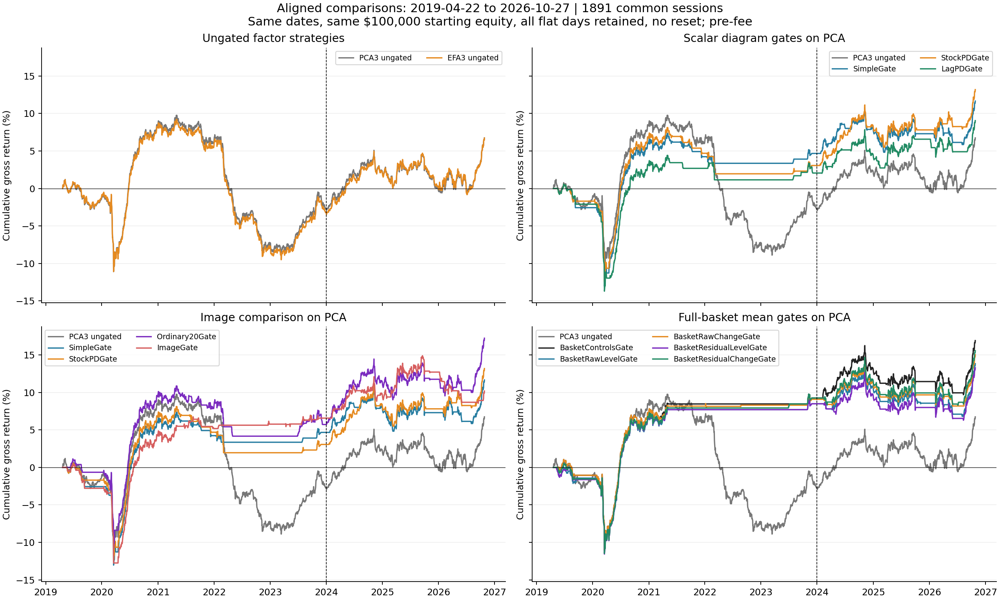
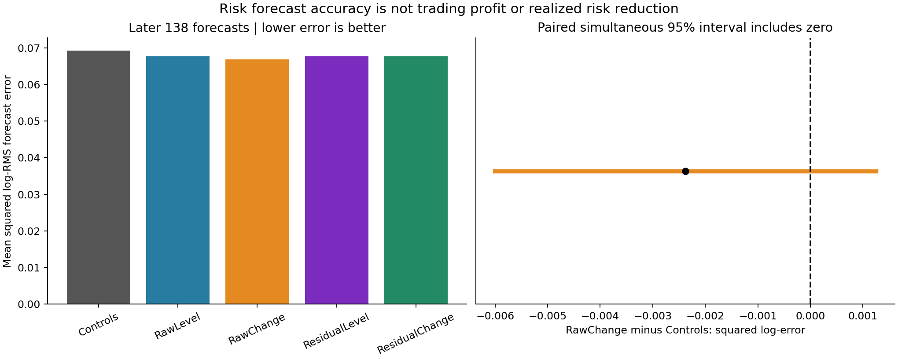

# Equity results: validated definitions and comparison ledger

Validated October 29, 2026. **Use this page for current performance/risk numbers.** The [research log](EQUITY_RESEARCH_LOG.md) preserves the sequence of experiments; this page reconciles their different scopes. No strategy was retuned and no return ledger was changed.

## The direct answer about TDA and risk

There are two separate favorable later point observations:

1. **Realized portfolio volatility:** the stock-loading-diagram mean gate has 3.21% annualized volatility versus 3.80% for always running PCA. Its point CAGR is 3.39% versus 3.37%, and Sharpe 1.06 versus 0.89. It trades only 69.4% of calendar days. The ordinary SimpleGate has 3.18% volatility while active 67.2% of days. Lower exposure through flat days can reduce measured volatility without establishing a uniquely useful topological signal.
2. **Accuracy of a risk forecast:** full-basket RawChange lowers later squared log-RMS forecast error by **3.44%** relative to its 33-control model. That forecast was **not used to size, hedge, or switch off the portfolio**. This is neither a 3.44% return nor a demonstrated reduction in realized portfolio risk.

Both point observations are valid. The declared paired uncertainty intervals include zero; a reliable incremental TDA benefit over matched conventional controls remains unestablished. Saying simply “TDA improves risk” omits these essential distinctions.

## 1. Same later period: January 2, 2024–October 27, 2026

Every row below uses **the same 708 trading sessions**. All returns are gross/pre-fee, with no cash-interest return, 1× gross exposure on active days, and flat days included as zero. CAGR means annualized compounded return, not total profit.

| Strategy | Start | Days | Gross CAGR | Realized annualized volatility | Sharpe vs zero | Active days |
|---|---|---:|---:|---:|---:|---:|
| PCA3 ungated | 2024-01-02 | 708 | 3.37% | 3.80% | 0.89 | 100.0% |
| EFA3 ungated | 2024-01-02 | 708 | 3.54% | 3.81% | 0.93 | 100.0% |
| SimpleGate | 2024-01-02 | 708 | 2.33% | 3.18% | 0.74 | 67.2% |
| StockPDGate | 2024-01-02 | 708 | 3.39% | 3.21% | 1.06 | 69.4% |
| ImageGate | 2024-01-02 | 708 | 1.19% | 2.83% | 0.43 | 55.9% |
| BasketControlsGate | 2024-01-02 | 708 | 2.44% | 3.12% | 0.79 | 67.9% |
| BasketRawChangeGate | 2024-01-02 | 708 | 1.90% | 3.06% | 0.63 | 63.7% |

PCA120 and EFA120 are **ungated and use no persistence features**. Every gate shown acts on the fixed PCA120 underlying strategy, not EFA. StockPDGate uses the three stock-loading diagram summaries; ImageGate uses the H0 bins and H1 image; BasketRawChangeGate uses full-basket day-diagram changes. SimpleGate and BasketControlsGate are different ordinary-control feature sets. The basket control includes conventional MST/H0-equivalent summaries. Compare additions to their own control, not unrelated rows as though one feature alone changed.

The stock-PD gate's paired later mean increment over SimpleGate remains +0.411 bps/day, simultaneous interval [−0.213,+1.035]. The basket RawChange mean gate instead trails its own control in point returns. The risk predictor and the mean-return gate are fitted to different targets.

## 2. What “overall” means

Full native baseline history, **February 3, 2017–October 27, 2026**:

| Strategy | Start | Days | Gross CAGR | Realized annualized volatility | Sharpe vs zero | Active days |
|---|---|---:|---:|---:|---:|---:|
| PCA3 ungated | 2017-02-03 | 2446 | 0.68% | 3.92% | 0.19 | 100.0% |
| EFA3 ungated | 2017-02-03 | 2446 | 0.66% | 3.92% | 0.19 | 100.0% |

The 3.54% EFA CAGR applies only to the later subperiod. Its full native-history CAGR is 0.66%, with 17.14% maximum drawdown; $100,000 becomes approximately $106,550. This does not contradict a 3.54% recent-period CAGR.

The gates need completed training labels and first trade on **April 22, 2019**. Their native “full” period therefore starts later. They have no generated decisions before that date. We do not fabricate early gate returns or prepend zeros and call that an equivalent strategy.

For comparison, every row below is restarted at the same capital on **April 22, 2019**, then compounded continuously through October 27, 2026: **1,891 common sessions**, with no reset at 2024.

| Strategy | Start | Days | Gross CAGR | Realized annualized volatility | Sharpe vs zero | Active days |
|---|---|---:|---:|---:|---:|---:|
| PCA3 ungated | 2019-04-22 | 1891 | 0.87% | 4.15% | 0.23 | 100.0% |
| EFA3 ungated | 2019-04-22 | 1891 | 0.87% | 4.15% | 0.23 | 100.0% |
| SimpleGate | 2019-04-22 | 1891 | 1.48% | 3.23% | 0.47 | 50.6% |
| StockPDGate | 2019-04-22 | 1891 | 1.66% | 3.25% | 0.52 | 51.1% |
| ImageGate | 2019-04-22 | 1891 | 1.30% | 3.00% | 0.45 | 45.3% |
| BasketControlsGate | 2019-04-22 | 1891 | 2.10% | 3.20% | 0.67 | 45.8% |
| BasketRawChangeGate | 2019-04-22 | 1891 | 1.88% | 3.19% | 0.60 | 44.5% |

Those common-period gate point returns can exceed the ungated point return. That is a descriptive result, not established TDA-specific alpha: ordinary gates also change performance, and all originally declared paired TDA-versus-control intervals remain unresolved. The common-calendar table is a reporting alignment, not a newly selected test or a fresh holdout.

## 3. The exact risk-forecast result

**Underlying target strategy:** ungated PCA120. **Forecast target:** log of the next twenty daily gross strategy returns' RMS, measured in bps. RMS is the square root of average squared returns; both large gains and large losses raise it. It is different from expected return, downside-only risk, and portfolio volatility after applying a policy.

On the later **138 completed, non-boundary forecast targets**:

| Risk predictor | Squared log-RMS forecast error | Meaning |
|---|---:|---|
| Ordinary 33 controls | 0.06924038 | Baseline prediction error |
| Same controls + RawChange | 0.06686171 | 3.435% lower point prediction error |

The percentage is `(0.06924038 − 0.06686171) / 0.06924038 × 100`. The paired loss difference is **−0.00237868**, approximate simultaneous 95% interval **[−0.00600227,+0.00124491]**, including zero. Earlier point reduction is only 0.43%. All four declared additions' primary simultaneous intervals span zero in both periods.

As a secondary metric, RMS absolute forecast error is 4.844 versus 4.792 bps. Different loss functions give different percentage changes; these are not interchangeable definitions of “risk improvement.” No allocation rule based on these risk predictions was evaluated.

## 4. Why earlier numbers or plots differ

| Difference | What must be held fixed before comparing |
|---|---|
| 0.66% versus 3.54% EFA CAGR | Full 2017-onward history versus the 2024-onward subperiod |
| Ungated versus TDA-gated profit | Different trading policies; the latest EFA curve has no TDA gate |
| 2017 baseline versus 2019 gate start | Admission/history warmup differs from completed-label forecasting warmup |
| Original thirty versus expanded two hundred stocks | Different universes; the original negative result remains valid for its basket |
| 120 versus 252 factor-fit sessions | Separate fixed lookbacks; no winning setting has been validated |
| Daily 708 later executions versus 689 event formations | The 1/5/20-session event study uses common complete20 dates and omits nineteen tail dates |
| Raw daily P&L versus adjusted event returns | Different saved price conventions; both are pre-fee |
| A curve beginning at zero in each panel versus a continuous curve | The former resets capital for each displayed subperiod; the latter does not |
| Dollar profit versus percentage total return versus CAGR | Different units; $100k capital and the 252-session annualization must be stated |
| Active-day mean versus calendar mean | Our gate performance includes all inactive zero-return days |
| Different confidence endpoints on identical point returns | Earlier HAC5 intervals versus block-bootstrap intervals, and different seeds/comparison families; no underlying return change is implied |
| Ordinary pointwise versus simultaneous intervals | Several isolated secondary pointwise results exclude zero but do not survive their declared comparison family |

Dollar neutrality also does not mean zero gross stock exposure. A $100,000 account at 1× gross initially has roughly $50,000 long and $50,000 short. Estimated SPY beta and three factor exposures balance at formation, but other risks and later exposure changes remain.

## 5. What was revalidated

- **Eight audit reruns passed:** full expanded data pagination/returns/coverage, expanded PCA and its price ledger, scalar diagram forecasts/gates, images, full-basket states and both targets, EFA/PCA, expanded peer structure, and the earlier direct response study. They ran in isolated report directories. At audit completion, all 476 snapshotted original files were unchanged.
- **Additional independent legacy reconstruction passed:** all 2,598 original thirty-stock daily portfolios, all five PC-sensitivity return series, every H0 peer-pilot return, selected daily peer labels, all thirty cuts at all 127 original hierarchy anchors, original descriptive PCA, and gross performance/HAC intervals.
- The same underlying PCA return series matches every gate's AlwaysOn ledger. Scalar and image studies' shared Simple/StockPD gates match exactly. All native-period CAGR, volatility, Sharpe and drawdown figures reproduce to numerical tolerance.
- All **11 existing notebooks** have executed code and no saved execution errors. All **50 embedded figures** match current saved project PNGs byte for byte. This rules out stale embedded versus sidecar image mismatches; it does not make their differently scoped graphs comparable automatically.
- Forecast risk losses were recalculated directly from saved predictions and actual target labels. The underlying daily returns were separately reconciled against prices and holdings by the audit chain.

**No numerical discrepancy was found in these audited returns, losses or metrics. The reporting problem was switching among valid but differently scoped quantities without keeping the distinctions prominent.** This page and its machine-readable ledger now make those scopes explicit. Historical source tables/graphs are preserved; documentation was clarified rather than changing strategy outcomes.

This validates implementation and internal consistency, not an economic edge. It does not independently certify every vendor price/corporate-action adjustment, realistic fills, point-in-time universe membership, or future generalization. Current-survivor selection, examined evaluation dates, short time history, overlapping labels, conditional bootstrap inference and multiple historical experiments remain limitations. No trading costs were introduced in this review.

## Evidence and reproduction

- [All return metrics with strategy, universe, lookback, scope, dates and counts](experiments/equity_validation_review_2026_10_29/canonical_return_metrics.csv)
- [Separate risk-forecast metrics](experiments/equity_validation_review_2026_10_29/canonical_risk_forecast_metrics.csv)
- [Common-calendar daily returns and equity](experiments/equity_validation_review_2026_10_29/common_calendar_returns_and_equity.csv)
- [Audit rerun results/log paths](experiments/equity_validation_review_2026_10_29/audit_reruns.json), [legacy checks](experiments/equity_validation_review_2026_10_29/legacy_checks.json), [ledger checks](experiments/equity_validation_review_2026_10_29/ledger_validation.json), [notebook/image inventory](experiments/equity_validation_review_2026_10_29/notebook_output_inventory.csv)
- [Audit runner](experiments/revalidate_equity_research.py), [legacy reconstruction](experiments/equity_validation_review_2026_10_29/check_legacy_results.py), [ledger/report generator](experiments/equity_validation_review_2026_10_29/build_comparison_ledger.py)

No new TDA/EFA combination, risk-sizing policy, strategy tuning or external data collection was run. This is a validation and reporting reconciliation of existing equity work.
