# Equity results, November 17, 2026

Nineteen studies on 200 large US stocks, January 2016 – November 9, 2026. Settings were chosen on dates before 2024; "2024 on" is the check period. Returns are before trading costs except in study 12, which charges measured costs. Read the [caveats](#caveats-that-apply-to-everything) before quoting any number.

Words used below:

- **H0 / groups**: raise a distance threshold from zero and link any two stocks closer than it. H0 tracks the separate groups and the distance at which each one merges into another.
- **H1 / rings**: a ring is a chain of stocks, each linked to the next, with no links across the middle. Its lifetime is how long it lasts as the threshold rises.
- **Peer correlation**: correlation between a stock's move and the average move of its peers over the next 20 days, with SPY's move removed. Higher means better peers.
- **Sharpe**: yearly return divided by yearly volatility.
- **Basis point (bp)**: 0.01%.
- **Cash neutral**: dollars held long equal dollars held short, so the book needs no net investment.
- **Gross**: dollars long plus dollars short. Every book here is scaled to a gross of 1.

## Main finding: the late-day reversal, hedged with TDA peer groups

**The effect.** At 3:40 pm, compare each stock's price with its average traded price since the open. A stock that has run up late in the day, relative to its TDA peers, tends to give some of it back by the next morning; one that has fallen late tends to recover.

**The book.** Bet against that move. Cash neutral and SPY-beta neutral inside every TDA peer group, half long and half short. It trades a median of 133 of the 200 stocks a day (66%; the rest have no close peer or too little history) in about 43 peer groups; the largest position is typically 3.8% of the capital and the 10 largest hold 25%. Over the hours it is held its measured beta to SPY is 0.003 (correlation 0.025). Enter near the close, sell everything at the next open.

| Version (2017–2026) | Before costs: Sharpe (95% interval) | After measured spreads and fees |
|---|---:|---:|
| Signal at 3:40, ordinary order at 3:50, exit in the opening auction | 2.21 (1.55 to 3.00), 1.4 bps a day | −0.71: the spread (1.6 bps per trade) costs more than the trade earns |
| Signal at 3:50, closing-auction order in, opening-auction order out | 1.44, 0.84 bps a day | **0.97 (0.30 to 1.63)**, 1.4% a year per dollar of gross |
| Signal at 3:40, auctions both ways | 1.01, 0.62 bps a day | 0.56 (−0.09 to 1.26) |

**Why TDA matters here.** The same signal hedged within sectors has a Sharpe of 1.43, and against the market only 0.88. The TDA peer hedge adds +0.77 over sectors (0.21 to 1.46) and +1.33 over the market (0.73 to 2.02). It ties a plain fine clustering (+0.07, −0.59 to 0.70), so what matters is the idea of small, tight peer groups. Shuffling members at random (study 19) shows the gain is mostly *who* is grouped together: random small groups within each sector reach 1.63 at the median and 1.96 at best out of 300, never 2.21. Rebuilding the groups more often helps, but almost all of the gain is already there at 5 days; a shorter correlation window does not help.

**How sure.** Before costs: the same in both periods (2.21 and 2.20), positive in all 10 years and in every sector, and 2.42 with the 2020 crash removed. On the 1,961 days outside the 5-minute sample (study 15) it is 2.14 before costs, and the auction version 0.92 after costs. The settings were never tuned, and study 16 finds that tuning would not help: out of 576 versions the current one ranks 18th, and choosing versions without seeing the years they are scored on does no better. The intraday data and the trade timing were checked (study 10).

**Possible improvements (study 18).** A fast system that reads the signal at 3:50 and trades immediately, both at the quote midpoint, earns 1.95 bps a day against 1.49 for the 3:40 signal on the same 496 days (+0.46, 0.23 to 0.70; Sharpe 3.12 against 2.42). This is not bid-ask bounce: the last trade sits only 0.6 bps from the midpoint. Blending several versions instead of choosing one adds a little and is steadier. The truly uncorrelated 5-day reversal from study 4 adds a little more.

**Is it viable?** Not yet as a stand-alone strategy:

- **Execution.** Only trading in the auctions survives costs, and the net edge is small: 0.57 bps a day.
- **Leverage.** It needs leverage to matter. At 10% volatility (about 6.8 times gross) it would earn about 10% a year before financing costs. My understanding is that ordinary margin accounts allow about 2 times overnight, which gives about 3% a year.
- **Capacity.** At $100 million gross a typical position is about 1% of the stock's trading in the last 10 minutes.
- **The decisive test** is a forward test with real auction orders.

## The thirteen findings

1. **Groups are real; ring totals are mostly noise.** With a 252-day window, 94% of the links between groups are closer than 99% of the links in scrambled data. Total ring lifetime is the opposite: real data has *less* of it than noise (4.2 versus 16.9), and it mostly just mirrors the average correlation between stocks (correlation −0.79). This is why the old ring-based features added nothing.
2. **Reading the H0 tree by its long-lived branches fixes the "one giant group" problem.** It gives about 45 tight groups (MA/V, the refiners, the defence contractors, the insurance brokers) and leaves about 30% of stocks ungrouped. These peers track a stock at 0.62, against 0.41 for its sector peers. A plain method cut equally finely does just as well.
3. **A reversal bet against tight peers has half the risk for the same return.** Gross Sharpe 0.81 over 2017–2026 against 0.30 for the market-neutral version, and it made money in 9 of 10 years. But the edge is about 1 bp a day, which is too small to survive trading costs, and finding 7 shows where most of it comes from.
4. **Nothing we tested makes the bounce bigger.** Not peer tightness, not VIX, not the size of the move.
5. **Shape does not improve risk estimates.** Tree-based covariance estimates lose to standard shrinkage, and shape measures make a dispersion forecast slightly worse.
6. **The barcode of a stock's own price path adds nothing to a forecast.** Its main summary is exactly a plain quantity (distance travelled minus range), and learners score the same with or without it.
7. **Machine learning doubled the gross Sharpe of the peer-hedged book, and all of the gain is one effect: the late part of the day's move reverses overnight.** A one-line rule on that effect matches the learners (Sharpe 2.0 before costs, 2019 onward, breaking even at 1.7 bps). It uses the closing price as both the signal and the trade price, so study 10 tests it with intraday data.
8. **The late-day reversal is real and visible before the close.** A signal known 20 minutes before the close, traded 10 minutes before it and sold at the next open, has a Sharpe of 2.2 before costs (95% interval 1.6 to 3.0), 2.2 in both periods, and is positive in all 10 years. It earns 1.4 bps a day and trades twice its size daily, so it breaks even at 0.70 bps per dollar traded.
9. **The TDA peer hedge is worth about 0.8 Sharpe over sectors and 1.3 over the market** for this signal, and tuning the settings on early years picks a worse version than the default.
10. **After measured costs, only auction-to-auction trading survives.** Measured spreads at 3:50 pm average 3.2 bps, so an ordinary order loses money. Entering in the closing auction and leaving in the opening auction pays fees only: net Sharpe 0.97 (0.30 to 1.63).
11. **The paper's 1D-sweep barcode does not help, even inside the day where the effect lives,** and neither does learning the curve it is taken of (Remark 3.2 of the paper). Total bar length is exactly distance travelled minus range, the other summaries are 72–74% explained by plain path measures, and no learner, with or without the barcode, beats the one-line rule.
12. **The strategy's settings cannot be usefully tuned.** Of 576 versions over 2017–2026, the current settings rank 18th (Sharpe 2.20; middle version 1.41). The versions that beat it by about 0.1 do so in only 5 of 10 years, and tuning that never sees the years it is scored on does not beat the current settings.
13. **It is the choice of members that matters, not just small groups.** With the same stocks and group sizes but members shuffled within sectors, 300 random versions reach a median Sharpe of 1.63 and never 2.21. Rebuilding the groups more often helps a little, with most of the gain reached by every 5 days; a shorter window does not help (study 19).

Short version: TDA pointed at the right structure (small tight groups, and stocks with no peers), and that structure is useful. In every head-to-head test a plain method that uses the same idea matched it. The largest effect found is not a shape: it is what happens to a stock in the last part of the trading day. TDA's contribution to it is the peer groups the bet is hedged against.

---

## 1. Noise floor (`s01_noise_floor`)

**Question.** How much of the shape is real? Each window was compared with scrambled copies: one where every stock keeps only its link to SPY (noise), and one where it also keeps its link to its sector.

| Window | H0 links beating noise | Ring lifetime: real / noise / market + sectors | Real rings above noise ceiling, per date | …above market + sectors ceiling |
|---|---:|---:|---:|---:|
| 120 days | 80% | 6.5 / 21.7 / 10.5 | 6.8 | 2.0 |
| 252 days | 94% | 4.2 / 16.9 / 6.4 | 4.3 | 2.7 |
| 504 days | 98% | 2.9 / 12.8 / 3.8 | 12.5 | 4.6 |

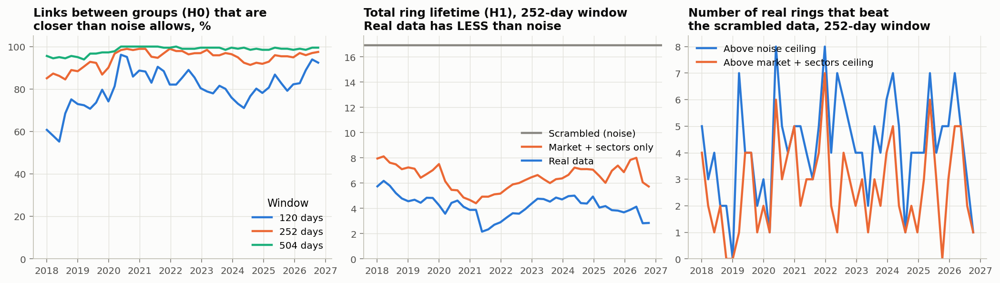

**What it means.** Use 252 days or more; at 120 days a fifth of the H0 links cannot be told from noise. Structure makes rings disappear, so a total over all rings measures how *unstructured* the market is. A few individual rings (2 to 5 per date) do beat a market-plus-sectors world, and those are the only ring features worth a further look.

**Could the test have missed a real ring?** A planted ring of 30 stocks explaining 30% of their non-market variance is found in 100% of trials at 252 days, and 52% of the time at 20%. The longest real ring is about the size a 30% planted ring produces.

## 2. Peer groups (`s02_peer_groups`)

**Question.** The old approach cut the H0 tree at one height and got one giant group. Does keeping the long-lived branches instead (HDBSCAN) give good peers?

| Peers, scored on the same stocks | Before 2024 | 2024 on |
|---|---:|---:|
| H0 tree cut into 11 groups (old approach, all stocks) | 0.11 | 0.20 |
| Sectors | 0.42 | 0.41 |
| Average linkage, 11 groups | 0.43 | 0.45 |
| Nearest 3 stocks | 0.58 | 0.60 |
| Average linkage, 80 groups | 0.59 | 0.60 |
| **Long-lived H0 branches (HDBSCAN)** | **0.60** | **0.62** |
| Average linkage, 100 groups | 0.62 | 0.64 |

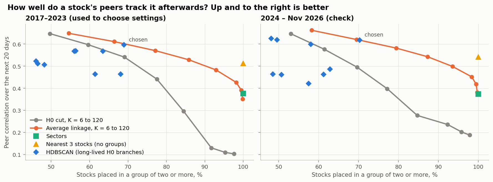

**What it means.** The gain over sectors is large and certain (+0.17 before 2024, +0.21 after; both intervals far from zero). The gain comes from using small tight groups and refusing to group stocks that have no close peer. Average linkage cut into 80–100 groups lands on the same line. What HDBSCAN adds is that it picks the number of groups itself and names the stocks with no peer. Sector peers explain those stocks poorly (0.28, against 0.41 for grouped stocks), so the "no peer" flag is meaningful. The latest groups are in [latest_groups.txt](results/s02_peer_groups/latest_groups.txt); the no-peer list includes AAPL, MSFT, NVDA, TSLA and META.

## 3. Is there a bounce? (`s03_signal_search`)

**Question.** Ten forms of the reversal signal, three ways of measuring what comes next.

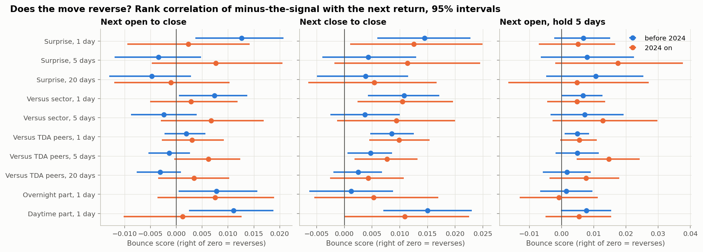

**What it means.** Every bounce is small: no rank correlation is above 0.02. Followed to the next close, two forms are positive in all 10 years:

- the 1-day move **relative to TDA peers** (0.0085 before 2024, 0.0099 after, both intervals above zero);
- the **daytime part** of today's move, open to close (0.0150 and 0.0109).

The raw 1-day surprise scores higher than the peer version (0.0145 and 0.0125) but with an interval twice as wide: comparing with peers removes noise, it does not add edge. The overnight part of today's move does not reverse (0.0012 and 0.0053, both intervals include zero), and moves over 20 days do not reverse. That the daytime part carries the bounce is the first sign of what study 9 finds.

## 4. The reversal book (`s04_peer_reversal_book`)

**Question.** Does that turn into a strategy? Each book bets against today's move and differs only in what it is hedged against. Total long plus short is 1.

| Book, traded close to close, 2017–2026 | Return per year | Volatility | Sharpe (95% interval) | Worst drawdown |
|---|---:|---:|---:|---:|
| Market only | 1.7% | 6.2% | 0.30 (−0.32 to 1.06) | −17.7% |
| Sectors | 1.6% | 5.0% | 0.34 (−0.33 to 1.05) | −13.9% |
| Plain fine groups | 2.4% | 3.4% | 0.70 (0.01 to 1.45) | −7.6% |
| **TDA peer groups** | **2.8%** | **3.5%** | **0.81 (0.25 to 1.35)** | **−5.3%** |

**What it means.**

- Hedging each stock against its tight peers halves the volatility and keeps the return. The TDA book was positive in 9 of 10 years, and its Sharpe is 0.89 without 2020, so it does not depend on the 2020 spike. By period: 0.77 before 2024, 0.91 after.
- TDA groups and plain fine groups are not distinguishable (Sharpe difference +0.16 before 2024, −0.02 after, both intervals wide).
- **It is not profitable after costs.** The book earns 1.1 bps a day and trades 1.45 times its size daily, so it breaks even at 0.8 bps of cost per dollar traded. Real costs for these stocks are around 1 bp or more.
- It needs a trade at the same close the signal is measured on. Waiting for the next open cuts the Sharpe to 0.36.
- Study 9 splits today's move into the part up to the day's average traded price and the part from there to the close. Over 2019–2026 this book earns Sharpe 0.91; betting against the early part alone earns 0.45, and against the late part alone 2.00. Most of this book's edge is the late part.
- The 5-day version trades a fifth as much and breaks even at 1.7 bps (Sharpe 0.66; 0.49 before 2024, 1.14 after). That is the closest thing here to a tradable strategy, and it is still marginal.

## 5. When is the bounce stronger? (`s05_when_is_the_bounce`)

No split gives the same answer in both periods: not tightness (measured by H0 join distance or by plain correlation), not yesterday's VIX, not the size of today's move. For example the high-VIX third earns 2.7 bps a day before 2024 and 12.2 after, but the later figure rests on 121 days. Nothing here is usable as a filter.

## 6. Risk estimates (`s06_risk_estimates`)

**Question.** Build the lowest-risk portfolio from each covariance estimate (252-day window) and measure its real volatility over the next 20 days.

| Estimate | Before 2024 | 2024 on |
|---|---:|---:|
| Raw | 24.0% | 20.3% |
| H0 tree | 18.8% | 19.5% |
| Market + sectors | 16.2% | 13.0% |
| Average-linkage tree | 15.7% | 12.6% |
| Market + TDA peer groups | 15.6% | 12.7% |
| Shrunk (Ledoit-Wolf) | 15.2% | 10.9% |
| 10 PCA factors | 14.6% | 11.0% |

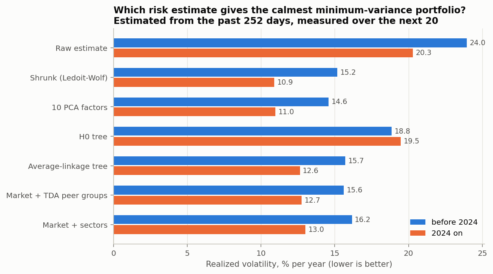

**What it means.** Every structured estimate beats the raw one. None beats ordinary shrinkage or a PCA factor model, and the H0 tree estimate is clearly the worst of them (24% to 79% more volatility than shrinkage). TDA peer groups are slightly better than sectors.

For a long-only portfolio, hierarchical risk parity cuts volatility by 9–11% against inverse-volatility weights. Running the same method with stocks in **random** order still gives 6–9%, so the tree contributes only the last 2–3 points, and the H0 tree and average-linkage tree give identical results.

## 7. Market shape through time (`s07_market_shape`)

| Shape measure | Share already explained by plain measures |
|---|---:|
| Typical distance to nearest group (H0) | 85% |
| Total ring lifetime (H1) | 80% |
| Change in ring diagram over 5 days | 26% |
| Share of stocks with no close peer | 25% |
| Number of TDA peer groups | 15% |

**What it means.** The two classic summaries carry little that average correlation does not. The group counts are new information, but adding all five shape measures to a forecast of next week's dispersion (built on recent dispersion and VIX) raises the error: +13% before 2024, +3% after, with both intervals including zero.

One thing worth watching: on November 9, 2026 the average correlation between stocks after removing SPY is 0.20, higher than on 96% of days since 2017 and the highest since May 2021. Stocks are moving together in ways the market index does not explain.

## 8. The shape of one stock's own path (`s08_path_shape`)

**Question.** "Topological Attention for Time Series Forecasting" (Zeng et al., 2021) uses a different kind of TDA: the barcode of a single series. It lists every dip that was later recovered and every bump that was later given back. Does that help forecast a stock's next move? This tests the feature without the paper's neural network.

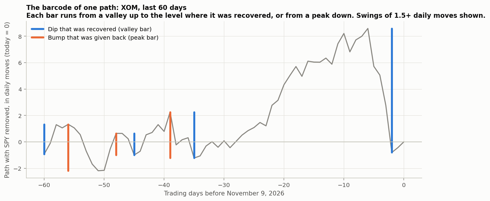

| Barcode summary, 60-day path | Share already explained by range, net move, distance travelled and position in range |
|---|---:|
| Total swing length | 100% |
| Longest recovered swing | 67% |
| Number of swings of 1+ daily moves | 52% |

The first row is an exact identity, checked in the library tests: **total swing length = distance travelled − range**.

A learner was trained on all earlier years and scored on the next (2019 onward, 459,275 stock-days), with 15 plain features and then with 42 barcode features added.

| Rank correlation of forecast with next day's move | 2019–2023 | 2024 on |
|---|---:|---:|
| Bet against move versus peers, nothing fitted (stocks with peers only) | 0.0083 | 0.0099 |
| Ridge, plain features | 0.0088 | 0.0088 |
| Ridge, plain + barcode | 0.0100 | 0.0103 |
| **Gain from the barcode, ridge** | **+0.0011 (−0.0035 to 0.0058)** | **+0.0015 (−0.0036 to 0.0063)** |
| Gain from the barcode, boosted trees | −0.0017 (−0.0068 to 0.0035) | −0.0006 (−0.0086 to 0.0074) |

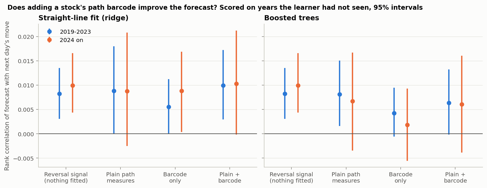

**What it means.** The barcode adds nothing we can measure, with a straight-line learner or a non-linear one. Fitted learners also do not beat the one-line reversal rule. Splitting stocks by how choppy their path has been gives no stable pattern in the bounce either. The paper's neural network was not run (PyTorch is not installed); these results say its input carries no detectable extra information here, so a larger model has nothing more to find.

## 9. Machine learning without topology (`s09_ml_forecast`)

**Question.** Can a learner combine plain signals into a better forecast than a one-line rule? Each stock gets 39 features a day (recent moves, trend, risk, volume, what its peers did, where it sits in its recent range). Three learners with settings fixed in advance: ridge (a straight-line fit), boosted trees, and a small neural network. Each is trained on all earlier years and scored on the next, 2019 onward, and its forecast is placed in the same peer-hedged book as study 4.

Today's move is also split in two: the **early part** runs from yesterday's close to today's average traded price, the **late part** from that average price to the close.

| What decides the trades (peer-hedged book, 2019–2026, before costs) | Traded at the close, held 1 day: Sharpe (95% interval) | Break-even cost | In at the next open, out at the close: Sharpe |
|---|---:|---:|---:|
| Rule: bet against the whole move (study 4) | 0.91 (0.41 to 1.56) | 0.9 bps | 0.39 |
| Rule: bet against the early part | 0.45 (−0.14 to 1.19) | 0.5 bps | 0.32 |
| **Rule: bet against the late part** | **2.00 (1.20 to 2.77)** | **1.7 bps** | 0.52 |
| Ridge, all 39 features | 1.91 (1.16 to 2.67) | 1.8 bps | 0.61 |
| Boosted trees, all 39 features | 2.08 (1.20 to 2.84) | 1.7 bps | 0.58 |
| Neural network, all 39 features | 1.06 (0.31 to 1.74) | 0.8 bps | 0.46 |
| Ridge, today's close not used (27 features) | 0.80 (0.12 to 1.65) | 0.7 bps | 0.05 |
| Boosted trees, today's close not used | 0.48 (−0.21 to 1.32) | 0.4 bps | −0.14 |
| Neural network, today's close not used | 0.26 (−0.29 to 0.84) | 0.2 bps | 0.22 |

**What it means.**

- **ML helped on paper.** Ridge and boosted trees double the gross Sharpe of the peer-hedged book (difference from the rule +1.00, interval 0.12 to 1.73, and +1.17, interval 0.14 to 2.01).
- **A one-line rule does the same.** Betting against the late part of today's move reaches 2.00 with nothing fitted. When every feature is rebuilt so that today's move ends at the day's average price instead of the close, the learners fall to the simple rule's level or below. The learners found one effect, and it is this one.
- **The gain sits entirely between the close and the next open.** Entered at the next open, every book is back at 0.6 or below.
- **It may not be tradable.** The closing price is both the signal and the trade price. Either prices are pushed late in the day and drift back overnight, or the closing print itself is noisy; daily data cannot tell these apart. In both cases you cannot see the close and then trade at it. A tradable version has to take the signal a few minutes before the close, which needs minute bars.
- **Size.** The late-part rule earns 2.4 bps a day, trades 1.44 times its size daily, and has a Sharpe of 0.82 after a cost of 1 bp per dollar traded. By period: 1.84 for 2019–2023, 2.35 for 2024 on.
- **The neural network is the worst learner in every setting**, which is what to expect when the signal is this small.

**A trap this study exposed.** The 200 stocks are the largest as of 2026, so a stock that was small in 2018 is on the list only because it grew. Used alone, dollar volume has a rank correlation of −0.016 (−0.028 to −0.005) with the next 5 days' move: smaller stocks did better, by construction. Removing the 8 features that say what kind of stock it is (size, beta, volatility, peer tightness, long-run trend) leaves the 1-day book unchanged (1.92 and 2.01), so the result above does not come from this. It does cut the 5-day books (boosted trees 1.03 to 0.53, neural network 1.20 to 0.08, against 0.73 for the rule), so the 5-day gains with all features should not be trusted.

## 10. Is the late-day reversal tradable? (`s10_late_day_tradable`)

**Data.** Intraday bars for all 2,477 trading days, January 2017 – November 9, 2026; 2,455 of them have a full year of history and are traded.

**Data checks.** Every file was compared with the daily bars:

- No duplicate or out-of-order bars, and every bar falls inside its window. Half days (20) are handled.
- 99.8% of stock-days have every bar. The rest are missing, mostly on six days when the provider's feed has holes in the last half hour (for example April 19, 2021: 30% of stocks complete). The first version of the loader filled those from the 3:30 pm price, which made a stale price look like a late move. It now leaves them missing; this moved the bold row from 2.28 to 2.21.
- Opening prices match the daily file (median gap 0), and the last regular trade sits a median 1.4 bps from the official close.
- The largest gaps between the last trade and the official close are in March 2020 (for example Hilton on March 18: last trade 57.01, official close 48.22, next open 55.00). These are either real auction dislocations from that week or bad closing prints; the check without the crash is below.
- The daily file's bar for January 24, 2022 has the right open and close but a wrong high, low and volume (far too narrow for that day). Studies 1–8 use only opens and closes. Study 9 uses that day's high, low, volume and average price for one day out of about 2,450.

**Question.** Study 9's rule used the closing price as both signal and trade price. With intraday bars the late move can be cut into three pieces, by when each is visible:

| Piece of the late move | Typical size |
|---|---:|
| Day's average price so far, up to 10 minutes before the close | 34 bps |
| The last 10 minutes of trading | 14 bps |
| The closing auction (last regular trade to official close) | 1.4 bps |

| Signal (peer-hedged book, before costs) | Traded | Sharpe, 2017–2026 (95% interval) | Before 2024 | 2024 on | Return per day | Break-even cost |
|---|---|---:|---:|---:|---:|---:|
| As in study 9 (not tradable) | at the close, to the next open | 2.34 (1.72 to 3.12) | 2.54 | 1.79 | 1.8 bps | 0.91 bps |
| Known 10 minutes before the close | at the close, to the next open | 1.44 (0.78 to 2.12) | 1.57 | 1.17 | 0.8 bps | 0.42 bps |
| Known 10 minutes before the close | 10 minutes before the close, to the next open | 3.09 (2.41 to 3.81) | 3.33 | 2.59 | 1.9 bps | 0.95 bps |
| **Known 20 minutes before the close** | **10 minutes before the close, to the next open** | **2.21 (1.55 to 3.00)** | **2.21** | **2.20** | **1.4 bps** | **0.70 bps** |
| Known 30 minutes before the close | 10 minutes before the close, to the next open | 1.97 (1.26 to 2.84) | 1.89 | 2.18 | 1.2 bps | 0.62 bps |
| Last 10 minutes of trading only | at the close, to the next open | 2.57 (1.63 to 3.78) | 2.63 | 2.41 | 1.8 bps | 0.91 bps |
| Closing auction only | at the close, to the next open | 1.53 (0.98 to 2.12) | 1.93 | 0.50 | 1.6 bps | 0.80 bps |

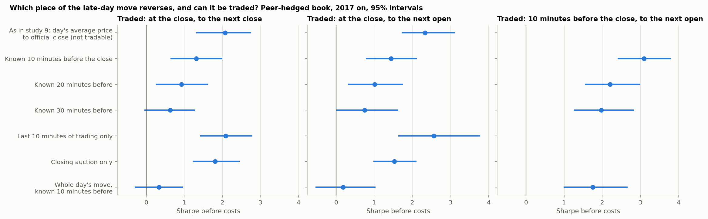

**What it means.**

- **It is not an artifact of the closing price.** The auction moves the price 1.4 bps against a 34 bps signal. The bold row shares no price between signal and trade, holds in both periods (2.21 and 2.20), and is positive in all 10 years.
- **The reversal starts before the close.** For the same signal, trading 10 minutes before the close earns about twice what waiting for the auction earns. (The 3.09 row uses one price as both signal and entry, so it is slightly flattered; the 20-minute row is the clean one.)
- **Every piece reverses**, including the last 10 minutes and the auction itself.
- **It does not depend on the 2020 crash.** Without February 24 – April 30, 2020 the bold row's Sharpe is 2.42 (1.71 to 3.04), and the crash supplies 5% of its profit. The closing-auction-only row depends on it most (28% of its profit) and still has 1.48 without it.
- **Costs decide it.** These books go in and out once a day, so they trade twice their size daily. The bold row breaks even at 0.70 bps per dollar traded and has a Sharpe of −0.93 after a 1 bp cost. I have no bid-ask data for these stocks here; my estimate is that paying the spread on large US stocks costs about that much. The edge is therefore about the size of the cost of trading with ordinary market orders. It would be profitable only with cheaper execution, for example passive limit orders.

## 11. Characterizing the late-day reversal (`s11_late_day_characterize`)

**Question.** For study 10's main version (signal at 3:40, entered at 3:50, sold at the next open): does the TDA hedge matter, can it be tuned honestly, where does the money come from, and how big could it be?

**The hedge.** Same signal, same trades, only the groups the book is neutral inside change.

| Hedge | Sharpe, 2017–2026 (95% interval) | Before 2024 | 2024 on | Worst drawdown |
|---|---:|---:|---:|---:|
| **TDA peer groups** | **2.21 (1.55 to 3.00)** | **2.21** | **2.20** | **−2.0%** |
| Plain fine groups (average linkage, 100 groups) | 2.14 (1.49 to 2.85) | 2.54 | 1.18 | −1.8% |
| Sectors | 1.43 (0.88 to 2.03) | 1.39 | 1.54 | −2.9% |
| Market only | 0.88 (0.38 to 1.45) | 0.86 | 0.93 | −3.7% |
| Market only, same stocks as TDA | 0.79 (0.33 to 1.32) | 0.92 | 0.47 | −5.5% |

TDA minus sectors: +0.77 (0.21 to 1.46). TDA minus market: +1.33 (0.73 to 2.02). TDA minus plain fine groups: +0.07 (−0.59 to 0.70).

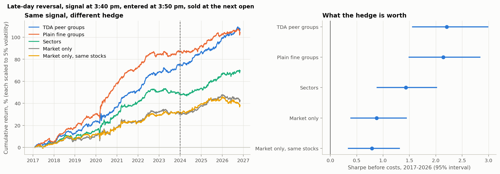

**Tuning.** I tried 25 versions (3 signal times × 5 hedges × 2 ways of trading, leaving out the one that uses a single price for signal and trade), chose the best on dates before 2024, and scored it once on 2024 on. The best early choice was plain fine groups (2.54 before 2024), which fell to 1.18 after. The default TDA version held at 2.21 and 2.20. Across all 25, early and late Sharpes have a rank correlation of 0.68: which hedge is better persists, but the single top pick does not. So the settings stay as they were, without further tuning.

**Where the money comes from** (profit per dollar held per day, before costs):

| Split | Result |
|---|---|
| Sector | Positive in all 11; strongest in Communication (3.8 bps), weakest in Materials (0.5 bps) |
| Stock size | Smaller third 1.7 bps, larger thirds 1.3 bps |
| Yesterday's VIX | High third 2.4 bps, low and middle 1.0 bps; high-VIX days give 47% of the profit |
| Signal size | Small signals 2.1, middle 1.0, large 1.2 bps per dollar held: no clean pattern |
| Year | Positive in all 10, from 0.6 bps (2017) to 2.2 bps (2022) |
| Weekday | Positive every weekday; Tuesday highest (2.5 bps); probably noise with 5 buckets |

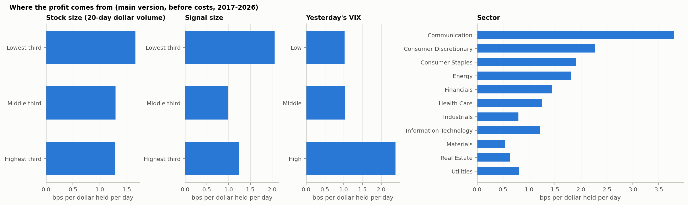

**Profit over the years, and the November 2026 sell-off.** Every year is profitable before costs, from +1.4% (2017) to +5.5% (2022), at a gross of 1. The data covers the sell-off from October 6 to November 5, 2026 (SPY −5.9%, including −4.4% on November 5). The trade placed on November 5 made +22 bps.

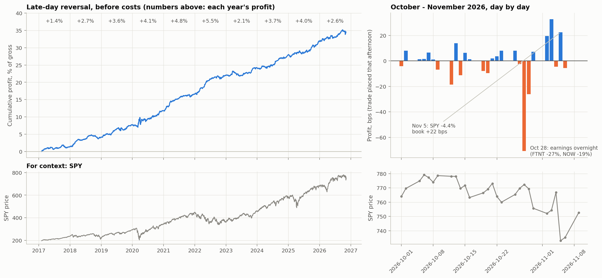

**The main risk is earnings.** The book holds positions from 3:50 pm to the next open, which is exactly when companies report earnings. The trade placed on October 28, 2026 lost 71 bps, the second-worst day in 10 years (the worst is April 2, 2020, −171 bps). Almost all of it came from three stocks the book was long: FTNT fell 27% overnight, NOW 19% and GOOGL 12%. Of the eight worst days, two fall in the middle of earnings season (October 28, 2026 and August 6, 2025); three are in March–June 2020. Skipping stocks that report that evening would probably remove most of these losses, but it needs an earnings calendar, which this project does not have.

**Capacity.** Each position as a share of the stock's dollars traded in the last 10 minutes:

| Gross book size | Median position | 95th percentile |
|---|---:|---:|
| $10 million | 0.12% | 0.75% |
| $100 million | 1.2% | 7.5% |
| $1 billion | 12% | 75% |

Up to a few tens of millions the book is small next to the closing trade. At $1 billion it would move the prices it trades at.

## 12. After measured trading costs (`s12_late_day_costs`)

**Data.** Real bid and ask quotes in the 5 seconds before 3:50 pm, on every 5th trading day (496 days), for all 200 stocks (`market_data/download_equity_quotes.py`). Each stock's median spread in each calendar quarter is applied to every day of that quarter.

| Median full bid-ask spread at 3:50 pm | 2017 | 2019 | 2021 | 2023 | 2025 | 2026 |
|---|---:|---:|---:|---:|---:|---:|
| bps of the price | 1.6 | 1.8 | 2.5 | 2.4 | 3.3 | 3.7 |

Weighted by the book's positions, the spread averages 3.2 bps, wider than the 1–2 bps I had guessed.

**Costs charged.** Half the spread when trading against the market (an auction order pays none, since everyone gets one price); a regulatory fee of 0.278 bps on every dollar sold (the 2025 rate, assumed for every year); no commission; short borrowing ignored (under 0.01 bps a day for these stocks).

| Way of trading | Before costs (bps a day) | Costs | After costs | Net Sharpe (95% interval) | Before 2024 / 2024 on |
|---|---:|---:|---:|---:|---:|
| A: signal at 3:40, ordinary order at 3:50, exit in the opening auction | 1.41 | 1.86 | −0.45 | −0.71 (−1.31 to −0.16) | −0.42 / −1.38 |
| **B: signal at 3:50, closing auction in, opening auction out** | **0.84** | **0.28** | **+0.57** | **0.97 (0.30 to 1.63)** | **1.08 / 0.73** |
| B40: as B, signal at 3:40 | 0.62 | 0.28 | +0.34 | 0.56 (−0.09 to 1.26) | 0.53 / 0.63 |
| C: as A, also half the spread at the open (assumed twice the 3:50 spread) | 1.41 | 5.02 | −3.61 | −5.62 | — |

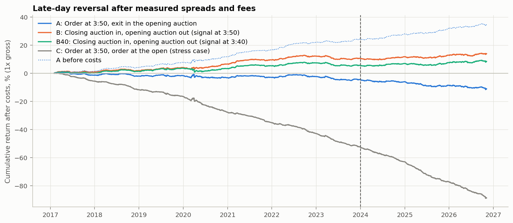

**What it means.**

- **An ordinary order loses money.** Half the spread (1.6 bps) is more than the 1.4 bps the trade earns, and spreads have widened over the decade.
- **Auction orders make it profitable but small.** On NYSE the deadline for a closing-auction order is 3:50 pm, so version B needs the signal computed and the orders sent at 3:50 exactly. B40 leaves ten minutes and keeps a little over half the net edge.
- **Size.** Version B earns 1.4% a year with 1.5% volatility per dollar of gross. Scaled to 10% volatility (6.8 times gross) that is about 10% a year before financing; at the 2 times overnight leverage I understand ordinary margin accounts allow, about 3%.
- **Not included:** the cost of borrowing to lever, price impact (see capacity), and whether my "next open" price is exactly the opening auction price.

## 13. The 1D-sweep barcode inside the day (`s13_intraday_barcode`)

**Data.** 5-minute bars on every 5th trading day, 487 days (63,176 stock-days with a peer group).

**Question.** Study 8 tested the barcode of each stock's path over 20–60 days. The late-day effect lives inside one day, so this applies the same 1D sweep to each stock's 5-minute path from the open to 3:40 pm: valley bars sweeping up, peak bars sweeping down. Target: the move from 3:50 pm to the next open, against peers.

**Is it new information?** Mostly not. Total valley length plus total peak length equals distance travelled minus range exactly (largest difference 7 × 10⁻¹⁵; the library tests also check it on random paths). The longest bars and the bar counts are 72–74% explained by plain path measures (range, distance travelled, position in the range, straightness).

**Does it say which late moves reverse?** Reversal (lowest fifth minus highest fifth of the signal, against peers) in each third of each measure, within the day, 486 days:

| Split by | Lowest third | Middle | Highest third |
|---|---:|---:|---:|
| Barcode: longest recovered swing | 7.1 bps | 5.4 | 5.7 |
| Barcode: number of swings | 7.1 | 5.5 | 2.9 |
| Plain: choppiness (1 − net move ÷ distance travelled) | 9.9 (4.9 to 15.0) | 5.5 | 4.5 (0.0 to 9.4) |

No split separates stocks that reverse from stocks that don't. The plain one looked strong when this study first ran on 98 days (straightest minus choppiest third: 16.1 bps, 3.3 to 27.3). On the 388 days that were not part of that first run it is 2.7 bps (−3.9 to 9.5), and study 15 finds the same on 1,961 other days. It was chance.

**Does a learner do better with it?** Each learner was trained on earlier years and scored on the next, 2019 onward (392 days):

| Forecast | Rank correlation (95% interval) |
|---|---:|
| Rule: bet against the signal versus peers | 0.041 (0.027 to 0.054) |
| Ridge, plain path measures | 0.037 (0.025 to 0.049) |
| Ridge, plain + barcode | 0.034 (0.023 to 0.045) |
| Ridge, barcode only | 0.020 (0.012 to 0.028) |
| Boosted trees, plain + barcode | 0.022 (0.011 to 0.033) |
| Gain from adding the barcode: ridge | −0.003 (−0.009 to 0.002) |
| Gain from adding the barcode: boosted trees | −0.001 (−0.009 to 0.008) |

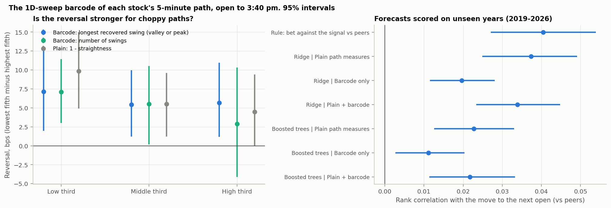

Put into the peer-hedged book, no forecast beats the rule; the closest, ridge on plain + barcode, differs by +0.17 Sharpe (−0.71 to 1.11). The barcode on its own carries a little signal (0.020), but only the part it shares with plain path measures.

## 14. Learning the curve the barcode is taken of (`s14_learned_filter`)

**Question.** Remark 3.2 of Zeng et al. (2021) suggests learning the function that is swept, instead of sweeping the raw series. A small network reads each stock's day (5-minute price path and volume, open to 3:40 pm) and outputs one curve, starting as the price path itself. The barcode of that curve feeds the forecast. Each bar's length is a difference of two points on the curve, so the network can be trained through it (`topology.path_pairs`; checked to start exactly equal to the plain barcode). Two controls get the same inputs and training: the same learned curve summarized by plain numbers, and plain features only. Trained on earlier years, scored on 2021–2026 (291 days), two random starts averaged.

| Model | Rank correlation (95% interval) | Book Sharpe before costs |
|---|---:|---:|
| Learned curve + barcode | 0.028 (0.015 to 0.041) | 3.58 |
| Learned curve, no barcode | 0.030 (0.018 to 0.043) | 3.57 |
| Plain features only | 0.027 (0.014 to 0.040) | 3.76 |
| Rule: bet against the signal versus peers | 0.045 (0.031 to 0.059) | 4.17 |

Learned barcode minus the same curve without it: Sharpe 0.00 (−1.44 to 1.57). Minus plain features: −0.18 (−1.73 to 1.60). Minus the rule: −0.59 (−1.97 to 0.75).

**What it means.** The learned barcode is no better than its controls, and all three fitted models score below the one-line rule. (These Sharpes come from every 5th day, 2021–2026 only, which is why they are higher than elsewhere; compare them with each other, not with other sections.) With this data the barcode, learned or not, carries nothing a plain summary of the same path does not.

## 15. Checking a pattern found by accident (`s15_straight_runs`)

**Question.** Study 13 noticed, when it first ran on about 100 days, that straight runs into 3:40 pm reverse much more than choppy ones (17 against 1 bps). It was not planned. Here straightness (move since the open ÷ distance travelled) is measured from the 30-minute path, which exists for every day, and the test uses only the 1,961 days outside the 5-minute sample, none of which study 13 saw.

| Reversal by the next open (against peers) | Choppiest third | Middle | Straightest third |
|---|---:|---:|---:|
| Held-out days (1,961) | 4.4 bps (2.3 to 6.6) | 2.8 | 6.0 (3.7 to 8.3) |
| 5-minute sample days, same 30-minute measure (490) | 5.4 | 4.1 | 9.1 |

Straightest minus choppiest on held-out days: +1.5 bps (−1.5 to 4.5).

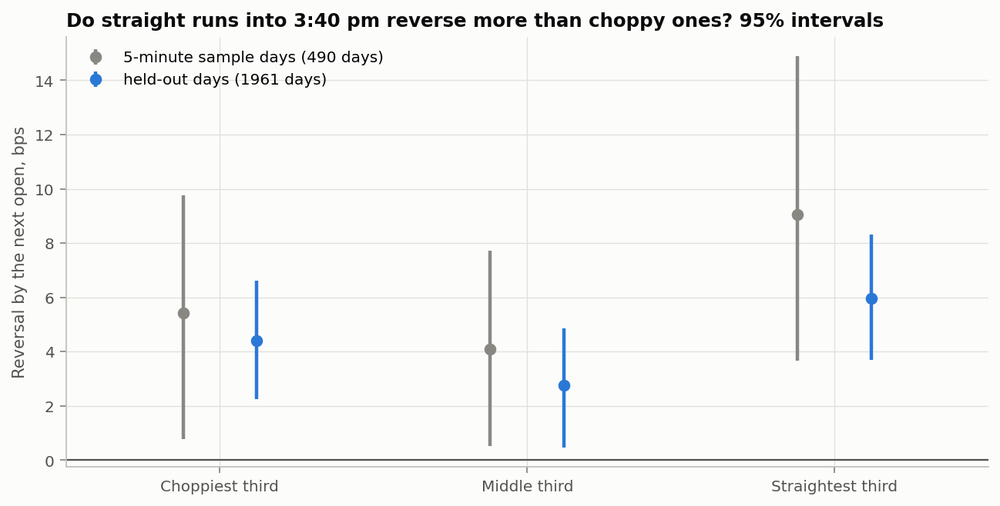

**What it means.** Not confirmed. Every third reverses, and the gap is within noise. Trading only the straighter half of the stocks lowers the Sharpe (before costs 1.39 against 2.14 for all stocks on the same days), because half the stocks gives less diversification. The pattern in study 13 was most likely chance.

Two side results on the held-out days: the main book before costs has a Sharpe of 2.14 (1.52 to 2.94), and the auction-to-auction version after costs 0.92 (0.20 to 1.60). Both match studies 11 and 12, on days those studies' design never depended on.

## 16. Tuning the settings (`s16_tuning`)

**Question.** The strategy's settings were chosen once, without tuning. Would small changes make it better? Tested on version A (signal at 3:40, bought or sold at 3:50, sold at the next open, before costs), and repeated on the auction version after fees.

**The grid**, fixed before looking at results: the average price the signal compares against (since the open / last 4 hours / 2 hours / 1 hour); the signal's form (raw move / divided by the stock's volatility / rank within the day / extremes clipped at 3 standard deviations); position weights (1 ÷ variance / 1 ÷ volatility / equal); peer groups (252 or 126 days of history; smallest group 2, 3 or 5 stocks); and stocks with no peer (left out / traded, hedged within their sector). That makes 576 versions, each run over all of 2017–2026.

**Why not just take the best one?** With 576 tries some win by luck, so the best 10-year Sharpe overstates what that version would earn in future. The 10 years were therefore used three ways:

1. **Sensitivity.** All 576 versions over the full 10 years. Is the current setting on a broad plateau, or is it in a dip that a nearby setting clearly fixes?
2. **Walk-forward.** For each year from 2019, pick the version that was best on all earlier years and trade it that year. The joined record is what tuning would really have earned.
3. **Interleaved years.** Pick on odd years and score on even years, then the reverse, so all 10 years are scored by a choice that never saw them.

**Sensitivity (version A, before costs).**

| | Sharpe, 2017–2026 |
|---|---:|
| Current setting | 2.20 (rank 18 of 576) |
| Middle of the 576 versions | 1.41 |
| 90th percentile | 1.81 |
| Best in hindsight (optimistic) | 2.45 |

| Change one setting from the current one | Sharpe | Change (95% interval) |
|---|---:|---:|
| Average over the last 4 hours instead of since the open | 1.47 | −0.73 (−1.14 to −0.32) |
| Average over the last hour | 1.11 | −1.09 (−1.97 to −0.19) |
| Signal clipped at 3 standard deviations | 2.30 | +0.11 (0.00 to 0.25) |
| Signal as a rank within the day | 2.30 | +0.11 (−0.20 to 0.46) |
| Weights 1 ÷ volatility | 2.23 | +0.03 (−0.18 to 0.21) |
| Smallest peer group 5 stocks | 1.71 | −0.48 (−1.14 to 0.04) |
| 126 days of peer history | 2.14 | −0.06 (−0.65 to 0.42) |
| Stocks with no peer traded, hedged in their sector | 1.59 | −0.61 (−1.29 to −0.02) |

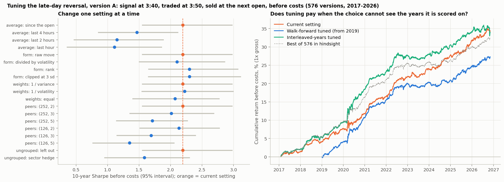

**Honest tuning.**

| | Sharpe | Against the current setting (95% interval) |
|---|---:|---:|
| Current setting, 2019–2026 | 2.26 | |
| Walk-forward tuned, 2019–2026 | 2.32 | +0.06 (−0.85 to 0.78) |
| Current setting, 2017–2026 | 2.20 | |
| Interleaved-years tuned, 2017–2026 | 1.79 | −0.41 (−1.07 to 0.16) |

**What it means.**

- **Three current choices are clearly right.** These are comparing against the average since the open, keeping groups as small as 2 stocks, and leaving out stocks with no close peer. The last two are the TDA choices from study 2.
- **The only changes that look better are tiny and inconsistent.** Clipping or ranking the signal adds about 0.1 Sharpe over 10 years but is better in only 5 of 10 years each.
- **Differences between versions are partly real but mostly luck.** A version's Sharpe on odd years and on even years have a rank correlation of only 0.36. The version walk-forward kept choosing (ranked signal, 126-day peer history) won every year from 2017 to 2021 and then lost badly from 2022 to 2024.
- **Tuning would not have helped.** Walk-forward ties the current setting and interleaved years loses to it.
- **The current settings stay as they are.**

**The best version in hindsight** (for curiosity, not to trade): average since the open, the signal as a rank within the day, weights 1 ÷ variance, peer groups from 126 days of history with a smallest group of 2, stocks with no peer left out. Over 2017–2026 it has a Sharpe of 2.45 (1.73 to 3.12), 3.4% a year with 1.4% volatility, and a worst drawdown of −1.25%. But its daily returns correlate only 0.57 with the current version, its edge over it is +0.25 (−0.52 to 0.88), and it fell from 2.78 before 2024 to 1.66 after (it made only +0.3% and +0.6% in 2023 and 2024). The current version is 2.19 and 2.20 in the two periods.

**The auction version after fees** (study 12's version B) gives the same answer:

- the current setting ranks 74th of 576 (net Sharpe 0.95; middle version 0.73);
- odd and even years barely agree (rank correlation 0.18);
- walk-forward tuning earns 0.43 against 0.98 for the current setting, and interleaved years 0.78 against 0.95.

Its results are in `results/s16_tuning/B_auction_after_fees/`.

## 17. When to sell the next morning (`s17_exit_timing`)

**Question.** The book sells at the next official open (9:30 am). The first minutes of trading are the noisiest of the day. Would selling a little later, or holding longer, do better? Same positions in every row, only the exit time changes; before costs.

| Sell at | Profit per day | Daily volatility | Sharpe (95% interval) |
|---|---:|---:|---:|
| **9:30, the official open (current)** | **1.41 bps** | **10.1 bps** | **2.21 (1.55 to 3.00)** |
| 10:00 | 1.03 | 13.6 | 1.20 (0.48 to 1.94) |
| 10:30 | 1.15 | 14.8 | 1.23 |
| 11:00 | 1.32 | 15.1 | 1.38 |
| 12:00 | 1.46 | 15.9 | 1.47 |
| The next close, 4:00 pm | 1.77 | 17.1 | 1.64 (0.96 to 2.31) |

On the 491 days with 5-minute bars, every exit from 9:35 to 10:00 is worse than the open. The book gives back about 0.8 bps in the first 5 minutes, and selling at 9:35 instead of 9:30 costs 1.18 Sharpe (0.37 to 1.94).

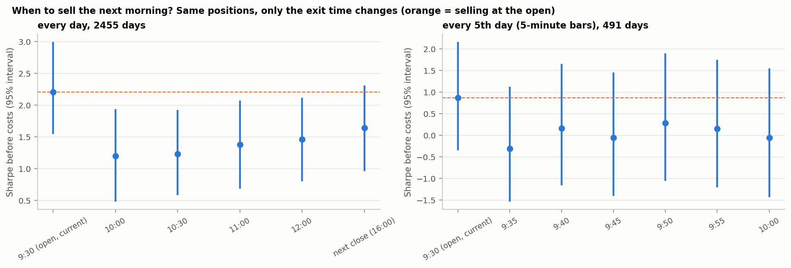

**What it means.**

- **Selling at the open is clearly best.** The official opening price carries part of the reversal that the first minutes of trading then undo, so it has to be an opening-auction order: an ordinary order a few minutes later loses that part.
- **Holding to the next close earns more in total** (1.77 against 1.41 bps), because the drift continues during the day. But it adds much more risk than return.

## 18. Two kinds of improvement: combining versions, and trading faster (`s18_combining_and_speed`)

**Combining versions.** Versions of the same strategy are not the same book: across the 576 versions of study 16, daily returns have a median pairwise correlation of only 0.44. Holding several at once lets their construction noise partly cancel. Choosing which ones to hold, though, has the same luck problem as choosing one.

| Before costs | Sharpe (95% interval) | Before 2024 / 2024 on |
|---|---:|---:|
| Current version | 2.20 (1.55 to 2.99) | 2.19 / 2.20 |
| Best of 576 in hindsight | 2.45 (1.73 to 3.12) | 2.78 / 1.66 |
| Current + best, half each (best chosen with hindsight: optimistic) | 2.61 (1.96 to 3.30) | 2.78 / 2.21 |
| Average of all 576 (nothing chosen, includes clearly bad versions) | 2.02 (1.39 to 2.63) | 2.19 / 1.61 |
| Each year, average of the 10 versions best on earlier years (2019 on) | 2.29 (1.64 to 3.02); current 2.26 on the same days | |
| Each year, average of the 50 best on earlier years (2019 on) | 2.34 (1.74 to 3.12); current 2.26 on the same days | |

Blending chosen fairly (the last two rows) does slightly better than both the current version and the single walk-forward pick of study 16 (2.32). The gain is small, but blending is the safer way to use the grid.

**A different strategy.** Study 4's books against TDA peers, combined with the late-day book (best fixed mix of the two, weights chosen with hindsight):

| Other strategy | Its Sharpe | Correlation with the late-day book | Best mix |
|---|---:|---:|---:|
| 1-day reversal, close to close | 0.81 | 0.31 | 2.19 (late-day alone 2.18) |
| 5-day reversal | 0.66 | 0.01 | 2.27 |

The 1-day reversal adds nothing: its profit is mostly the same late-day effect (study 10). The 5-day reversal is genuinely uncorrelated but weak, so it adds about 0.1.

**Trading faster.** Study 10's best-looking row reads the signal at 3:50 from the last trade and trades at that same price (Sharpe 3.09). I suspected this was flattered by bid-ask bounce: a trade prints at either the bid or the ask, so a stock whose last print was at the bid looks like it fell, and the backtest buys at that low price. The quotes at 3:50 (study 12, every 5th day) test it, using the midpoint instead:

| On the 496 days with quotes, before costs | Profit per day | Sharpe | Against the current version |
|---|---:|---:|---:|
| Current: signal at 3:40, trade at the 3:50 last trade | 1.49 bps | 2.42 | |
| Current signal, trade at the 3:50 midpoint | 1.44 | 2.34 | −0.05 bps |
| Signal at 3:50 from the last trade, trade at that price | 1.99 | 3.17 | +0.49 (0.26 to 0.73) |
| **Signal at 3:50 from the midpoint, trade at the midpoint** | **1.95** | **3.12** | **+0.46 (0.23 to 0.70)** |

The midpoint version keeps almost all of the gain, and the last trade sits a median 0.6 bps from the midpoint. So the gain is not bounce: it is real information in the last 10 minutes before 3:50, which a system that reads and trades within moments could capture. That still means trading in the open market at 3:50 rather than in the closing auction, so in practice it pays the spread that this before-costs comparison ignores.

## 19. Random groups, and the two grouping settings never varied (`s19_grouping_checks`)

**Question.** Does it matter *which* stocks TDA puts together, or would any small groups do? And do the correlation window (252 days) and how often the groups are rebuilt (every 5 days) matter? Same strategy as study 11 (signal 3:40, trade 3:50, sell at the next open, before costs); only the groups change. SPY beta, weights and signal are the current version's.

**Random groups.** On every rebuild date, keep TDA's grouped stocks and its group sizes and shuffle the members, 300 times each:

| Hedge, 2017–2026 | Sharpe |
|---|---:|
| Market only, same stocks | 0.79 |
| Random groups, shuffled anywhere: median (5th to 95th percentile) | 0.74 (0.58 to 0.92) |
| Sectors | 1.43 |
| Random groups, shuffled only within sector: median (5th to 95th percentile) | 1.63 (1.44 to 1.86); best of 300: 1.96 |
| **TDA peer groups** | **2.21** |

No shuffle of either kind reached 2.21. Before 2024 and from 2024 on the picture is the same (within-sector shuffles 1.78 and 1.33 at the median; TDA 2.21 and 2.20).

**What it means.** The +0.78 that TDA groups add over sectors splits in two. About +0.2 comes from cutting sectors into small groups at all (sectors 1.43 → random small groups within sector 1.63). About +0.6 comes from choosing the right members: the specific stocks that actually move together. Groups that ignore sector are no hedge at all (0.74, the same as market only). This is a property of correlation-based grouping, not of TDA specifically: the plain fine clustering of study 11 ties it.

**Settings.** Sharpe before costs, 2017–2026:

| Correlation window | Rebuilt every day | every 5 (current) | every 21 | every 63 |
|---|---:|---:|---:|---:|
| 252 days (current) | 2.27 | **2.21** | 2.18 | 1.93 |
| 189 days | 1.93 | 2.01 | 1.76 | 1.87 |
| 126 days | 2.32 | 2.11 | 1.84 | 1.42 |
| 63 days | 1.93 | 2.00 | 1.65 | 1.29 |

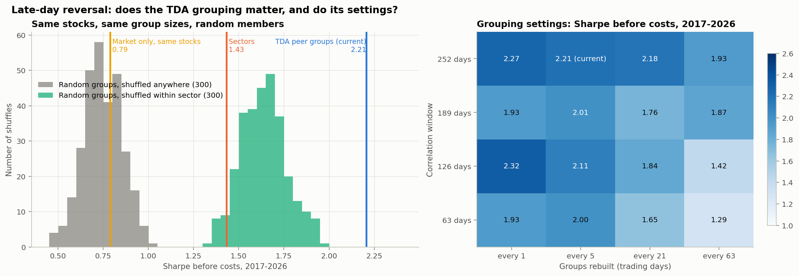

- **Rebuilding more often helps, with shrinking gains.** Averaged over the four windows, the Sharpe is 1.63 rebuilt every 63 days, 1.86 every 21, 2.08 every 5 and 2.12 every day, in the same order before and after 2024. Stale groups hedge worse. From every 5 days to every day the gain is small: +0.04 on average, +0.07 (−0.14 to 0.24) at 252 days, and daily wins in only 4 of the 8 window-and-period cells. Only 7% of grouped pairs split between consecutive 5-day rebuilds, so the groups barely change in a week.
- **Rebuilding rarely hurts most with short windows:** every 63 days costs −0.28 (−0.65 to 0.14) at 252 days and −0.92 (−1.47 to −0.26) at 63 days, where 56% of pairs have split by the next rebuild.
- **Shorter windows give noisier groups.** Their books correlate only 0.56–0.66 with the current one, so they are partly different bets, and none beats it with an interval that excludes zero.
- **Slightly better settings exist, but the current one is where to leave it.** Several versions beat it on paper: here 252 days rebuilt daily (2.27) and 126 days rebuilt daily (2.32); in study 16, clipping or ranking the signal (+0.11 each) and the hindsight best of 576 (2.45). Each gain is small, its interval includes zero, and which setting wins does not carry over between periods: across these 16 settings the before-2024 and 2024-on Sharpes have a rank correlation of −0.13, and the best before 2024 (126 days, rebuilt daily: 2.57) fell to 1.77 after. The current setting is 2.21 and 2.20 in the two periods. Daily rebuilding is the one change with a reason besides its score (it uses the newest data and does not add trading, since the book goes fully in and out every day), so it is a reasonable choice for a live version. It was not switched here because every earlier study uses every 5 days.
- A window longer than 252 days was not possible without changing the rule that a stock needs 272 days of history to be traded.

## How this relates to published work

- **The effect is known.** Baltussen, Da and Soebhag, ["End-of-Day Reversal"](https://www3.nd.edu/~zda/EOD.pdf) (working paper, 2024–25), find that stocks' moves in the last 30 minutes reverse the next day across US stocks, which they attribute to price pressure at the close. Bogousslavsky and Muravyev, "Who trades at the close? Implications for price discovery and liquidity" (Journal of Financial Markets, vol. 66, 2023), find closing-auction price deviations reverse fully overnight. Study 10's finding that every piece of the late move reverses, auction included, agrees with both.
- **Reversal against peers is known.** Da, Liu and Schaumburg, ["A Closer Look at the Short-Term Return Reversal"](https://www.newyorkfed.org/research/staff_reports/sr513.html) (Management Science, 2014), show that reversal is stronger within industries, once industry moves are removed. Avellaneda and Lee, ["Statistical arbitrage in the US equities market"](https://www.math.nyu.edu/faculty/avellane/AvellanedaLeeStatArb20090616.pdf) (Quantitative Finance, 2010), trade residuals against sector funds or principal components.
- **Return-based peers beating industry codes is known.** Several recent papers find peer groups built from return correlations co-move more than standard industry codes (examples in this [2025 comparison](https://arxiv.org/html/2509.01590v1)), and an Oxford thesis trades mean reversion inside correlation clusters ([link](https://ora.ox.ac.uk/objects/uuid:173a88b2-f00c-4346-8868-aabbd97ec8d7/files/dt722h970m)).
- **What I did not find:** a published test that uses TDA (persistent-homology or HDBSCAN) peer groups as the hedge for an end-of-day or overnight reversal. The nearest are TDA pairs trading on Indian high-frequency data ([2023](https://ideas.repec.org/a/wsi/ijtafx/v26y2023i08ns021902492450002x.html)) and practitioner write-ups of clustering for pairs trading. So the combination here seems new, but the pieces are not, and study 11 shows a plain correlation clustering does as well.

---

## Caveats that apply to everything

- **The stock list was chosen with hindsight.** It is the 200 largest US stocks as of 2026, and sector labels are a 2026 snapshot. Anything that holds one kind of stock for a long time is flattered by this (measured in study 9). Short-term reversal signals are much less affected.
- **Returns are before costs except in study 12**, with trades assumed to fill at the official open or close (or, from study 10 on, at the last trade price 10 minutes before the close). The "next open" is the daily open in the data; I have not confirmed it is always the opening auction price.
- **Close-to-close results use the close as both signal and trade price.** That includes the headline numbers of studies 3, 4 and 9.
- **No date before November 10, 2026 is unseen.** The old experiments looked at 2024 onward, and studies 8 and 9 scored several learners on 2019 onward. Only new data is a clean test.

## Errors found and fixed in this pass

- Study 8: the 5-day move feature was blank because of how missing early data was handled. Fixed and re-run; the gain from the barcode moved from +0.0005 / +0.0012 to +0.0011 / +0.0015, and the conclusion is unchanged. The library function now refuses tables with missing values so this cannot recur silently.
- Finding 1 said real links are closer than scrambled data "ever" produces. The test compares against the closest 1% of scrambled links, and the wording now says so.
- Section 3 said only one signal was positive in all 10 years. The daytime part of the move is too; it is now listed.
- Intraday loader (study 10): the first version filled missing late-day bars with the 3:30 pm price, which made a stale price look like a late move; such stock-days are now missing (0.2%). The second version decided which stocks to trade using whether they traded after 3:50 pm, which is not known at 3:50; it now checks only data up to 3:50. Together these moved study 10's main Sharpe from 2.28 to 2.21.
- Intraday downloader: one dropped connection stopped the download, and a stale manifest from a test run made the folder look complete. Both fixed; the download is complete and checked.
- Studies 1–7 were re-read line by line for use of future data and for arithmetic errors; none was found. Every number in sections 1–7 was re-checked against the saved tables, and studies 3 and 4 were re-run and reproduce their saved output exactly.

## Where this leaves the strategy goal

| | Before costs | After measured costs | Status |
|---|---:|---:|---|
| Bet against the whole move, hedged by TDA peers (study 4) | Sharpe 0.8–0.9 | Negative (break-even 0.8 bps) | Not profitable |
| Bet against the late move, ordinary orders near the close (studies 10–12) | 2.2 | −0.7 | Not profitable: the spread is too wide |
| Bet against the late move, closing auction in and opening auction out (study 12, version B) | 1.4 | 1.0 (0.3 to 1.6) | Profitable on paper, small; needs leverage |

Next steps, in the order I would do them:

1. **Forward test version B.** Freeze it as it is and score it on trading days after November 9, 2026, with real auction prices. It is the only clean test left, and paper orders in the auctions would also answer the last open question about fill prices.
2. **A stock list without hindsight,** widened to mid-size stocks, where reversal is usually stronger. Spreads are wider there too, so only the auction version is worth testing.
3. **Stop adding model complexity.** Three learners and a topological feature set all lost to, or tied with, a one-line rule. The limit is the data, not the model.

On the TDA side, the peer groups are the part worth keeping: they are what makes both books above low-risk. Still open from the original plan: naming the stocks in the few rings that beat the market-plus-sectors noise level, a Mapper picture of the universe, and a separate tight-branch spread study (the peer-group book in section 4 already trades those branches against each other).
