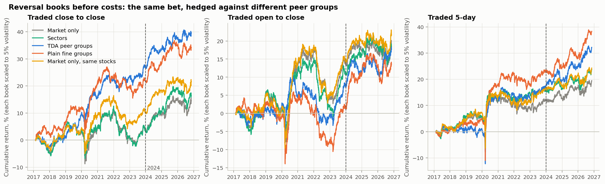
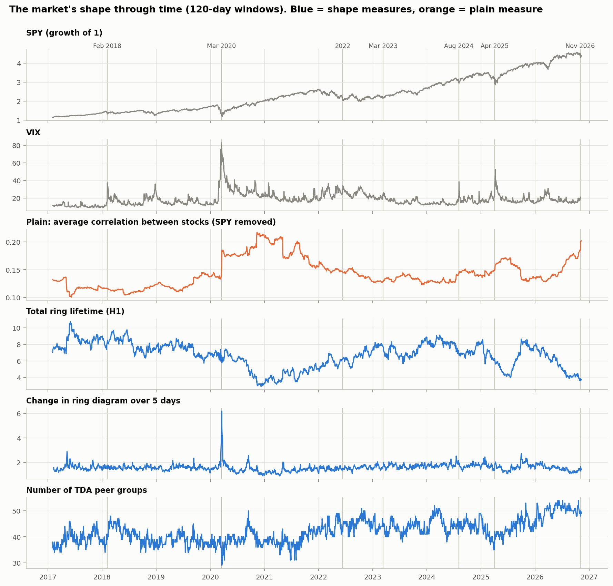
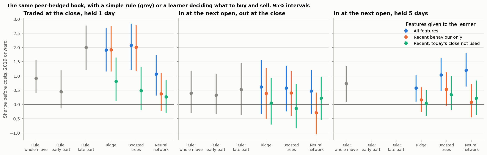

# Equity results, November 16, 2026

Ten studies on 200 large US stocks, January 2016 – November 9, 2026. Settings were chosen on dates before 2024; "2024 on" is the check period. All returns are before trading costs. Read the [caveats](#caveats-that-apply-to-everything) before quoting any number.

Words used below:

- **H0 / groups**: raise a distance threshold from zero and link any two stocks closer than it. H0 tracks the separate groups and the distance at which each one merges into another.
- **H1 / rings**: a ring is a chain of stocks, each linked to the next, with no links across the middle. Its lifetime is how long it lasts as the threshold rises.
- **Peer correlation**: correlation between a stock's move and the average move of its peers over the next 20 days, with SPY's move removed. Higher means better peers.
- **Sharpe**: yearly return divided by yearly volatility.
- **Basis point (bp)**: 0.01%.

## The eight findings

1. **Groups are real; ring totals are mostly noise.** With a 252-day window, 94% of the links between groups are closer than 99% of the links in scrambled data. Total ring lifetime is the opposite: real data has *less* of it than noise (4.2 versus 16.9), and it mostly just mirrors the average correlation between stocks (correlation −0.79). This is why the old ring-based features added nothing.
2. **Reading the H0 tree by its long-lived branches fixes the "one giant group" problem.** It gives about 45 tight groups (MA/V, the refiners, the defence contractors, the insurance brokers) and leaves about 30% of stocks ungrouped. These peers track a stock at 0.62, against 0.41 for its sector peers. A plain method cut equally finely does just as well.
3. **A reversal bet against tight peers has half the risk for the same return.** Gross Sharpe 0.81 over 2017–2026 against 0.30 for the market-neutral version, and it made money in 9 of 10 years. But the edge is about 1 bp a day, which is too small to survive trading costs, and finding 7 shows where most of it comes from.
4. **Nothing we tested makes the bounce bigger.** Not peer tightness, not VIX, not the size of the move.
5. **Shape does not improve risk estimates.** Tree-based covariance estimates lose to standard shrinkage, and shape measures make a dispersion forecast slightly worse.
6. **The barcode of a stock's own price path adds nothing to a forecast.** Its main summary is exactly a plain quantity (distance travelled minus range), and learners score the same with or without it.
7. **Machine learning doubled the gross Sharpe of the peer-hedged book, and all of the gain is one effect: the late part of the day's move reverses overnight.** A one-line rule on that effect matches the learners (Sharpe 2.0 before costs, 2019 onward, breaking even at 1.7 bps). It uses the closing price as both the signal and the trade price, so study 10 tests it with intraday data.
8. **The late-day reversal is real and visible before the close.** A signal known 20 minutes before the close, traded 10 minutes before it and sold at the next open, has a Sharpe of 2.2 before costs (95% interval 1.6 to 3.0), 2.2 in both periods, and is positive in all 10 years. It earns 1.4 bps a day and trades twice its size daily, so it breaks even at 0.70 bps per dollar traded: about the size of real trading costs. This is the strongest lead in the project.

Short version: TDA pointed at the right structure (small tight groups, and stocks with no peers), and that structure is useful. In every head-to-head test a plain method that uses the same idea matched it. The largest effect found has nothing to do with shape: it is what happens to a stock in the last part of the trading day.

---

## 1. Noise floor (`s01_noise_floor`)

**Question.** How much of the shape is real? Each window was compared with scrambled copies: one where every stock keeps only its link to SPY (noise), and one where it also keeps its link to its sector.

| Window | H0 links beating noise | Ring lifetime: real / noise / market + sectors | Real rings above noise ceiling, per date | …above market + sectors ceiling |
|---|---:|---:|---:|---:|
| 120 days | 80% | 6.5 / 21.7 / 10.5 | 6.8 | 2.0 |
| 252 days | 94% | 4.2 / 16.9 / 6.4 | 4.3 | 2.7 |
| 504 days | 98% | 2.9 / 12.8 / 3.8 | 12.5 | 4.6 |

**What it means.** Use 252 days or more; at 120 days a fifth of the H0 links cannot be told from noise. Structure makes rings disappear, so a total over all rings measures how *unstructured* the market is. A few individual rings (2 to 5 per date) do beat a market-plus-sectors world, and those are the only ring features worth a further look.

**Could the test have missed a real ring?** A planted ring of 30 stocks explaining 30% of their non-market variance is found in 100% of trials at 252 days, and 52% of the time at 20%. The longest real ring is about the size a 30% planted ring produces.

## 2. Peer groups (`s02_peer_groups`)

**Question.** The old approach cut the H0 tree at one height and got one giant group. Does keeping the long-lived branches instead (HDBSCAN) give good peers?

| Peers, scored on the same stocks | Before 2024 | 2024 on |
|---|---:|---:|
| H0 tree cut into 11 groups (old approach, all stocks) | 0.11 | 0.20 |
| Sectors | 0.42 | 0.41 |
| Average linkage, 11 groups | 0.43 | 0.45 |
| Nearest 3 stocks | 0.58 | 0.60 |
| Average linkage, 80 groups | 0.59 | 0.60 |
| **Long-lived H0 branches (HDBSCAN)** | **0.60** | **0.62** |
| Average linkage, 100 groups | 0.62 | 0.64 |

**What it means.** The gain over sectors is large and certain (+0.17 before 2024, +0.21 after; both intervals far from zero). The gain comes from using small tight groups and refusing to group stocks that have no close peer. Average linkage cut into 80–100 groups lands on the same line. What HDBSCAN adds is that it picks the number of groups itself and names the stocks with no peer. Sector peers explain those stocks poorly (0.28, against 0.41 for grouped stocks), so the "no peer" flag is meaningful. The latest groups are in [latest_groups.txt](results/s02_peer_groups/latest_groups.txt); the no-peer list includes AAPL, MSFT, NVDA, TSLA and META.

## 3. Is there a bounce? (`s03_signal_search`)

**Question.** Ten forms of the reversal signal, three ways of measuring what comes next.

**What it means.** Every bounce is small: no rank correlation is above 0.02. Followed to the next close, two forms are positive in all 10 years:

- the 1-day move **relative to TDA peers** (0.0085 before 2024, 0.0099 after, both intervals above zero);
- the **daytime part** of today's move, open to close (0.0150 and 0.0109).

The raw 1-day surprise scores higher than the peer version (0.0145 and 0.0125) but with an interval twice as wide: comparing with peers removes noise, it does not add edge. The overnight part of today's move does not reverse (0.0012 and 0.0053, both intervals include zero), and moves over 20 days do not reverse. That the daytime part carries the bounce is the first sign of what study 9 finds.

## 4. The reversal book (`s04_peer_reversal_book`)

**Question.** Does that turn into a strategy? Each book bets against today's move and differs only in what it is hedged against. Total long plus short is 1.

| Book, traded close to close, 2017–2026 | Return per year | Volatility | Sharpe (95% interval) | Worst drawdown |
|---|---:|---:|---:|---:|
| Market only | 1.7% | 6.2% | 0.30 (−0.32 to 1.06) | −17.7% |
| Sectors | 1.6% | 5.0% | 0.34 (−0.33 to 1.05) | −13.9% |
| Plain fine groups | 2.4% | 3.4% | 0.70 (0.01 to 1.45) | −7.6% |
| **TDA peer groups** | **2.8%** | **3.5%** | **0.81 (0.25 to 1.35)** | **−5.3%** |

**What it means.**

- Hedging each stock against its tight peers halves the volatility and keeps the return. The TDA book was positive in 9 of 10 years, and its Sharpe is 0.89 without 2020, so it does not depend on the 2020 spike. By period: 0.77 before 2024, 0.91 after.
- TDA groups and plain fine groups are not distinguishable (Sharpe difference +0.16 before 2024, −0.02 after, both intervals wide).
- **It is not profitable after costs.** The book earns 1.1 bps a day and trades 1.45 times its size daily, so it breaks even at 0.8 bps of cost per dollar traded. Real costs for these stocks are around 1 bp or more.
- It needs a trade at the same close the signal is measured on. Waiting for the next open cuts the Sharpe to 0.36.
- Study 9 splits today's move into the part up to the day's average traded price and the part from there to the close. Over 2019–2026 this book earns Sharpe 0.91; betting against the early part alone earns 0.45, and against the late part alone 2.00. Most of this book's edge is the late part.
- The 5-day version trades a fifth as much and breaks even at 1.7 bps (Sharpe 0.66; 0.49 before 2024, 1.14 after). That is the closest thing here to a tradable strategy, and it is still marginal.

## 5. When is the bounce stronger? (`s05_when_is_the_bounce`)

No split gives the same answer in both periods: not tightness (measured by H0 join distance or by plain correlation), not yesterday's VIX, not the size of today's move. For example the high-VIX third earns 2.7 bps a day before 2024 and 12.2 after, but the later figure rests on 121 days. Nothing here is usable as a filter.

## 6. Risk estimates (`s06_risk_estimates`)

**Question.** Build the lowest-risk portfolio from each covariance estimate (252-day window) and measure its real volatility over the next 20 days.

| Estimate | Before 2024 | 2024 on |
|---|---:|---:|
| Raw | 24.0% | 20.3% |
| H0 tree | 18.8% | 19.5% |
| Market + sectors | 16.2% | 13.0% |
| Average-linkage tree | 15.7% | 12.6% |
| Market + TDA peer groups | 15.6% | 12.7% |
| Shrunk (Ledoit-Wolf) | 15.2% | 10.9% |
| 10 PCA factors | 14.6% | 11.0% |

**What it means.** Every structured estimate beats the raw one. None beats ordinary shrinkage or a PCA factor model, and the H0 tree estimate is clearly the worst of them (24% to 79% more volatility than shrinkage). TDA peer groups are slightly better than sectors.

For a long-only portfolio, hierarchical risk parity cuts volatility by 9–11% against inverse-volatility weights. Running the same method with stocks in **random** order still gives 6–9%, so the tree contributes only the last 2–3 points, and the H0 tree and average-linkage tree give identical results.

## 7. Market shape through time (`s07_market_shape`)

| Shape measure | Share already explained by plain measures |
|---|---:|
| Typical distance to nearest group (H0) | 85% |
| Total ring lifetime (H1) | 80% |
| Change in ring diagram over 5 days | 26% |
| Share of stocks with no close peer | 25% |
| Number of TDA peer groups | 15% |

**What it means.** The two classic summaries carry little that average correlation does not. The group counts are new information, but adding all five shape measures to a forecast of next week's dispersion (built on recent dispersion and VIX) raises the error: +13% before 2024, +3% after, with both intervals including zero.

One thing worth watching: on November 9, 2026 the average correlation between stocks after removing SPY is 0.20, higher than on 96% of days since 2017 and the highest since May 2021. Stocks are moving together in ways the market index does not explain.

## 8. The shape of one stock's own path (`s08_path_shape`)

**Question.** "Topological Attention for Time Series Forecasting" (Zeng et al., 2021) uses a different kind of TDA: the barcode of a single series. It lists every dip that was later recovered and every bump that was later given back. Does that help forecast a stock's next move? This tests the feature without the paper's neural network.

| Barcode summary, 60-day path | Share already explained by range, net move, distance travelled and position in range |
|---|---:|
| Total swing length | 100% |
| Longest recovered swing | 67% |
| Number of swings of 1+ daily moves | 52% |

The first row is an exact identity, checked in the library tests: **total swing length = distance travelled − range**.

A learner was trained on all earlier years and scored on the next (2019 onward, 459,275 stock-days), with 15 plain features and then with 42 barcode features added.

| Rank correlation of forecast with next day's move | 2019–2023 | 2024 on |
|---|---:|---:|
| Bet against move versus peers, nothing fitted (stocks with peers only) | 0.0083 | 0.0099 |
| Ridge, plain features | 0.0088 | 0.0088 |
| Ridge, plain + barcode | 0.0100 | 0.0103 |
| **Gain from the barcode, ridge** | **+0.0011 (−0.0035 to 0.0058)** | **+0.0015 (−0.0036 to 0.0063)** |
| Gain from the barcode, boosted trees | −0.0017 (−0.0068 to 0.0035) | −0.0006 (−0.0086 to 0.0074) |

**What it means.** The barcode adds nothing we can measure, with a straight-line learner or a non-linear one. Fitted learners also do not beat the one-line reversal rule. Splitting stocks by how choppy their path has been gives no stable pattern in the bounce either. The paper's neural network was not run (PyTorch is not installed); these results say its input carries no detectable extra information here, so a larger model has nothing more to find.

## 9. Machine learning without topology (`s09_ml_forecast`)

**Question.** Can a learner combine plain signals into a better forecast than a one-line rule? Each stock gets 39 features a day (recent moves, trend, risk, volume, what its peers did, where it sits in its recent range). Three learners with settings fixed in advance: ridge (a straight-line fit), boosted trees, and a small neural network. Each is trained on all earlier years and scored on the next, 2019 onward, and its forecast is placed in the same peer-hedged book as study 4.

Today's move is also split in two: the **early part** runs from yesterday's close to today's average traded price, the **late part** from that average price to the close.

| What decides the trades (peer-hedged book, 2019–2026, before costs) | Traded at the close, held 1 day: Sharpe (95% interval) | Break-even cost | In at the next open, out at the close: Sharpe |
|---|---:|---:|---:|
| Rule: bet against the whole move (study 4) | 0.91 (0.41 to 1.56) | 0.9 bps | 0.39 |
| Rule: bet against the early part | 0.45 (−0.14 to 1.19) | 0.5 bps | 0.32 |
| **Rule: bet against the late part** | **2.00 (1.20 to 2.77)** | **1.7 bps** | 0.52 |
| Ridge, all 39 features | 1.91 (1.16 to 2.67) | 1.8 bps | 0.61 |
| Boosted trees, all 39 features | 2.08 (1.20 to 2.84) | 1.7 bps | 0.58 |
| Neural network, all 39 features | 1.06 (0.31 to 1.74) | 0.8 bps | 0.46 |
| Ridge, today's close not used (27 features) | 0.80 (0.12 to 1.65) | 0.7 bps | 0.05 |
| Boosted trees, today's close not used | 0.48 (−0.21 to 1.32) | 0.4 bps | −0.14 |
| Neural network, today's close not used | 0.26 (−0.29 to 0.84) | 0.2 bps | 0.22 |

**What it means.**

- **ML helped on paper.** Ridge and boosted trees double the gross Sharpe of the peer-hedged book (difference from the rule +1.00, interval 0.12 to 1.73, and +1.17, interval 0.14 to 2.01).
- **A one-line rule does the same.** Betting against the late part of today's move reaches 2.00 with nothing fitted. When every feature is rebuilt so that today's move ends at the day's average price instead of the close, the learners fall to the simple rule's level or below. The learners found one effect, and it is this one.
- **The gain sits entirely between the close and the next open.** Entered at the next open, every book is back at 0.6 or below.
- **It may not be tradable.** The closing price is both the signal and the trade price. Either prices are pushed late in the day and drift back overnight, or the closing print itself is noisy; daily data cannot tell these apart. In both cases you cannot see the close and then trade at it. A tradable version has to take the signal a few minutes before the close, which needs minute bars.
- **Size.** The late-part rule earns 2.4 bps a day, trades 1.44 times its size daily, and has a Sharpe of 0.82 after a cost of 1 bp per dollar traded. By period: 1.84 for 2019–2023, 2.35 for 2024 on.
- **The neural network is the worst learner in every setting**, which is what to expect when the signal is this small.

**A trap this study exposed.** The 200 stocks are the largest as of 2026, so a stock that was small in 2018 is on the list only because it grew. Used alone, dollar volume has a rank correlation of −0.016 (−0.028 to −0.005) with the next 5 days' move: smaller stocks did better, by construction. Removing the 8 features that say what kind of stock it is (size, beta, volatility, peer tightness, long-run trend) leaves the 1-day book unchanged (1.92 and 2.01), so the result above does not come from this. It does cut the 5-day books (boosted trees 1.03 to 0.53, neural network 1.20 to 0.08, against 0.73 for the rule), so the 5-day gains with all features should not be trusted.

## 10. Is the late-day reversal tradable? (`s10_late_day_tradable`)

**Data.** Intraday bars for all 2,477 trading days, January 2017 – November 9, 2026; 2,455 of them have a full year of history and are traded.

**Data checks.** Every file was compared with the daily bars:

- No duplicate or out-of-order bars, and every bar falls inside its window. Half days (20) are handled.
- 99.8% of stock-days have every bar. The rest are missing, mostly on six days when the provider's feed has holes in the last half hour (for example April 19, 2021: 30% of stocks complete). The first version of the loader filled those from the 3:30 pm price, which made a stale price look like a late move. It now leaves them missing; this moved the bold row from 2.28 to 2.21.
- Opening prices match the daily file (median gap 0), and the last regular trade sits a median 1.4 bps from the official close.
- The largest gaps between the last trade and the official close are in March 2020 (for example Hilton on March 18: last trade 57.01, official close 48.22, next open 55.00). These are either real auction dislocations from that week or bad closing prints; the check without the crash is below.
- The daily file's bar for January 24, 2022 has the right open and close but a wrong high, low and volume (far too narrow for that day). Studies 1–8 use only opens and closes. Study 9 uses that day's high, low, volume and average price for one day out of about 2,450.

**Question.** Study 9's rule used the closing price as both signal and trade price. With intraday bars the late move can be cut into three pieces, by when each is visible:

| Piece of the late move | Typical size |
|---|---:|
| Day's average price so far, up to 10 minutes before the close | 34 bps |
| The last 10 minutes of trading | 14 bps |
| The closing auction (last regular trade to official close) | 1.4 bps |

| Signal (peer-hedged book, before costs) | Traded | Sharpe, 2017–2026 (95% interval) | Before 2024 | 2024 on | Return per day | Break-even cost |
|---|---|---:|---:|---:|---:|---:|
| As in study 9 (not tradable) | at the close, to the next open | 2.34 (1.72 to 3.12) | 2.54 | 1.79 | 1.8 bps | 0.91 bps |
| Known 10 minutes before the close | at the close, to the next open | 1.44 (0.78 to 2.12) | 1.57 | 1.17 | 0.8 bps | 0.42 bps |
| Known 10 minutes before the close | 10 minutes before the close, to the next open | 3.09 (2.41 to 3.81) | 3.33 | 2.59 | 1.9 bps | 0.95 bps |
| **Known 20 minutes before the close** | **10 minutes before the close, to the next open** | **2.21 (1.55 to 3.00)** | **2.21** | **2.20** | **1.4 bps** | **0.70 bps** |
| Known 30 minutes before the close | 10 minutes before the close, to the next open | 1.97 (1.26 to 2.84) | 1.89 | 2.18 | 1.2 bps | 0.62 bps |
| Last 10 minutes of trading only | at the close, to the next open | 2.57 (1.63 to 3.78) | 2.63 | 2.41 | 1.8 bps | 0.91 bps |
| Closing auction only | at the close, to the next open | 1.53 (0.98 to 2.12) | 1.93 | 0.50 | 1.6 bps | 0.80 bps |

**What it means.**

- **It is not an artifact of the closing price.** The auction moves the price 1.4 bps against a 34 bps signal. The bold row shares no price between signal and trade, holds in both periods (2.21 and 2.20), and is positive in all 10 years.
- **The reversal starts before the close.** For the same signal, trading 10 minutes before the close earns about twice what waiting for the auction earns. (The 3.09 row uses one price as both signal and entry, so it is slightly flattered; the 20-minute row is the clean one.)
- **Every piece reverses**, including the last 10 minutes and the auction itself.
- **It does not depend on the 2020 crash.** Without February 24 – April 30, 2020 the bold row's Sharpe is 2.42 (1.71 to 3.04), and the crash supplies 5% of its profit. The closing-auction-only row depends on it most (28% of its profit) and still has 1.48 without it.
- **Costs decide it.** These books go in and out once a day, so they trade twice their size daily. The bold row breaks even at 0.70 bps per dollar traded and has a Sharpe of −0.93 after a 1 bp cost. I have no bid-ask data for these stocks here; my estimate is that paying the spread on large US stocks costs about that much. The edge is therefore about the size of the cost of trading with ordinary market orders. It would be profitable only with cheaper execution, for example passive limit orders.

---

## Caveats that apply to everything

- **The stock list was chosen with hindsight.** It is the 200 largest US stocks as of 2026, and sector labels are a 2026 snapshot. Anything that holds one kind of stock for a long time is flattered by this (measured in study 9). Short-term reversal signals are much less affected.
- **All returns are before costs**, with trades assumed to fill at the official open or close.
- **Close-to-close results use the close as both signal and trade price.** That includes the headline numbers of studies 3, 4 and 9.
- **No date before November 10, 2026 is unseen.** The old experiments looked at 2024 onward, and studies 8 and 9 scored several learners on 2019 onward. Only new data is a clean test.

## Errors found and fixed in this pass

- Study 8: the 5-day move feature was blank because of how missing early data was handled. Fixed and re-run; the gain from the barcode moved from +0.0005 / +0.0012 to +0.0011 / +0.0015, and the conclusion is unchanged. The library function now refuses tables with missing values so this cannot recur silently.
- Finding 1 said real links are closer than scrambled data "ever" produces. The test compares against the closest 1% of scrambled links, and the wording now says so.
- Section 3 said only one signal was positive in all 10 years. The daytime part of the move is too; it is now listed.
- Studies 1–7 were re-read line by line for use of future data and for arithmetic errors; none was found. Every number in sections 1–7 was re-checked against the saved tables, and studies 3 and 4 were re-run and reproduce their saved output exactly.

## Where this leaves the strategy goal

| | Sharpe before costs | Break-even cost | Status |
|---|---:|---:|---|
| Bet against the whole move, hedged by TDA peers (study 4) | 0.8–0.9 | 0.8–0.9 bps | Too small to cover costs |
| Bet against the late move, seen 20 minutes before the close, traded 10 minutes before it, sold at the next open (study 10) | 2.2 | 0.70 bps | Real and tradable in principle; profit is about the size of trading costs |

Next steps, in the order I would do them:

1. **Measure the real cost.** Historical bid and ask quotes at 3:50 pm for these 200 stocks would replace my estimate of the spread with a number. That is the last unknown between this effect and a strategy.
2. **Forward test.** Freeze the bold rule of study 10 and score it on data after November 9, 2026. It is the only clean test left.
3. **A stock list without hindsight,** widened to mid-size stocks, where reversal is usually stronger and spreads are wider.
4. **Stop adding model complexity.** Three learners and a topological feature set all lost to, or tied with, a one-line rule. The limit is the data, not the model.

On the TDA side, the peer groups are the part worth keeping: they are what makes both books above low-risk. Still open from the original plan: naming the stocks in the few rings that beat the market-plus-sectors noise level, a Mapper picture of the universe, and a separate tight-branch spread study (the peer-group book in section 4 already trades those branches against each other).
