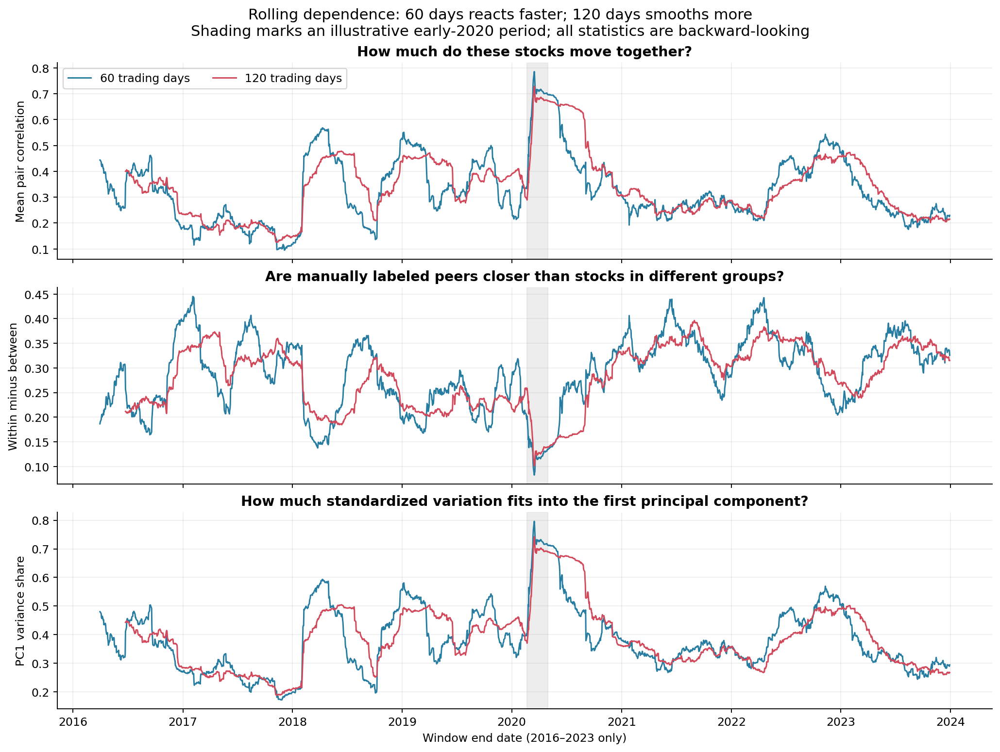
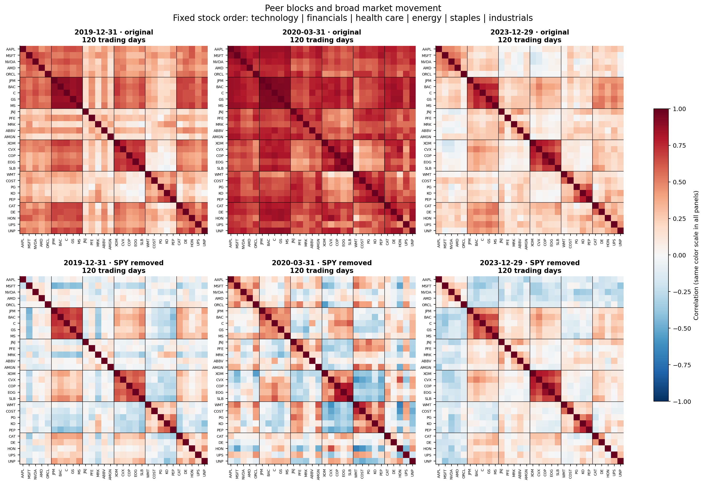
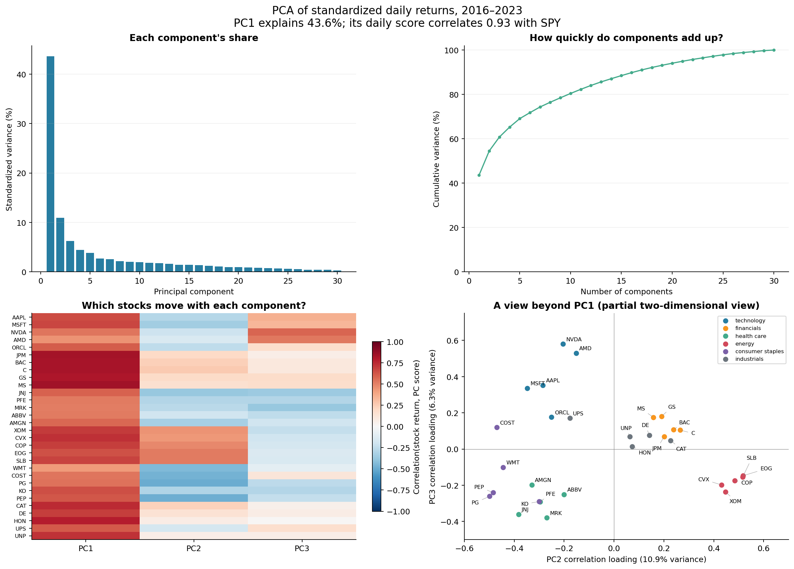
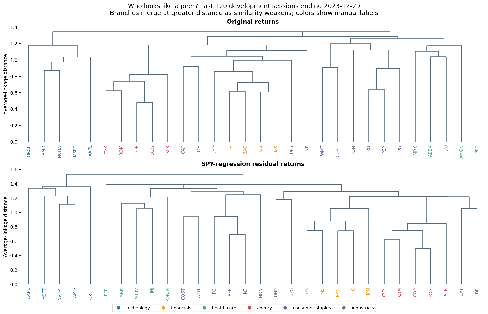

# Equity correlation and PCA: first descriptive pass

Created October 28, 2026. Start with the executed [notebook](../../equity_correlation_pca.ipynb), using the **TDA (conda)** kernel. It includes explanations, four saved figures, and numerical tables. The [source script](../equity_correlation_pca.py) reproduces the calculations without network access or credentials.

For an intuitive explanation of every figure, component, and inference limit, read [What we learned](../../EQUITY_INTUITION.md).

**Later October 28 update:** a separate [frozen daily reversal backtest](../equity_residual_backtest/README.md) has now evaluated 2024 onward. Both models had negative average gross evaluation returns under its specified timing. The descriptive results here remain restricted to 2016–2023; later data is no longer untouched holdout data for subsequent research.

## What the data shows

The analysis uses 2,011 daily log returns per stock from January 5, 2016 through December 29, 2023. Thirty stocks enter the correlation matrices and PCA; SPY is a separate diagnostic benchmark. **2024 onward is excluded from all fits and reported statistics.**

- Reference PC1 explains **43.6%** of standardized return variance; PC2 explains **10.9%**, PC3 **6.3%**.
- PC1's daily score has **0.928** sample correlation with SPY. This supports a broad market interpretation, without making PC1 identical to SPY.
- Two components cover at least 50% of variance; ten cover at least 80%. Variation is concentrated in fewer linear combinations, but all 30 sample eigenvalues are positive. This does not identify the number of economic drivers or establish independence of the components.
- The final development window has much closer relationships within our manual groups than between groups. After fitting out SPY, this contrast remains.

| 120-session window ending | Mean pair correlation | PC1 variance share | Within-group SPY-residual correlation | Between-group SPY-residual correlation |
|---|---:|---:|---:|---:|
| 2019-12-31 | 0.389 | 44.3% | 0.327 | -0.013 |
| 2020-03-31 | 0.678 | 69.5% | 0.379 | 0.014 |
| 2023-12-29 | 0.215 | 26.7% | 0.359 | 0.001 |

The early-2020 snapshot shows much stronger common movement. The end-2023 picture has more differentiated group behavior. These are selected calendar examples for interpretation, not independent crisis-prediction or reversal tests.

## Figures









## Definitions and reproducibility

PCA centers and scales each stock within the fitted window, using sample standard deviations. This is PCA of a sample **correlation** matrix. Component signs are deterministic plotting conventions; component identities may change across rolling windows. The full 2016–2023 reference fit is retrospective and must not supply exposures to earlier signal dates in a backtest.

The stock-map axes use correlations of stock returns with PC2 and PC3 scores. Proximity in this partial view does not establish proximity in all dimensions. PC1 is omitted from that panel. The separate loading CSV uses stock-component correlations, not raw eigenvector coefficients or portfolio weights.

Each rolling observation uses the last 60 or 120 trading returns through its endpoint. Overlapping windows are dependent. The peer gap subtracts the mean correlation of different-group pairs from that of same-group pairs (excluding the diagonal). Effective dimension is the participation ratio `(sum(eigenvalues))**2 / sum(eigenvalues**2)`; it ranges from one to thirty and is not a fitted factor count.

SPY removal fits an intercept and each stock's time-series SPY coefficient over the same window, then correlates residuals. It removes one fitted linear exposure, not all common economic drivers. These fits are diagnostic, not out-of-sample forecasts.

Trees use average linkage on `sqrt(2 * (1 - correlation))`. They are conventional baselines; correlation-derived H0 instead corresponds to **single linkage**. No persistent homology has been computed in this pass.

The intended cross-sectional contrarian strategy is recorded separately in the [151 strategy reference](../../literature/residual_mean_reversion_151_2026-10-28.md). Diagnostic SPY residuals and retrospective PCA scores do not implement it.

To reproduce from `TDA_Research`:

```sh
conda activate tda
python experiments/equity_correlation_pca.py
```

Outputs include `rolling_metrics.csv`, six snapshot correlation matrices, PCA variance/shares, the first five development-period PC scores and stock-component correlations, nearest peers, and `summary.json`. The summary records the input return file's SHA-256 hash. The executed notebook embeds all four figures and tables, so it can be read without rerunning code.

Checks passed for input completeness, holdout exclusion, unit correlation diagonals, nonnegative correlation eigenvalues within numerical tolerance, PCA trace/reconstruction, and OLS residual orthogonality. Figures were visually inspected. Original downloaded dataset hashes remain unchanged.

## Interpretation and next step

This shows peer organization beyond broad SPY exposure, and sensitivity to window and market period. It does **not** establish mean reversion or a TDA advantage. The fixed basket was selected in 2026 and has survivorship/selection bias; excluding later return rows does not repair that universe-selection bias. Vendor adjustments and daily-bar definitions retain the limitations in the [dataset guide](../../../market_data/datasets/equity_daily_30_2016_2026-10-27/README.md).

Next, freeze a peer construction and cross-sectional strategy specification on development data. Compare manual groups, average linkage, single linkage, and a trailing PCA exposure basis with identical weights, signal interval, entry/exit, and cost assumptions. Test future relative-return behavior separately. Keep 2024 onward out of tuning.
