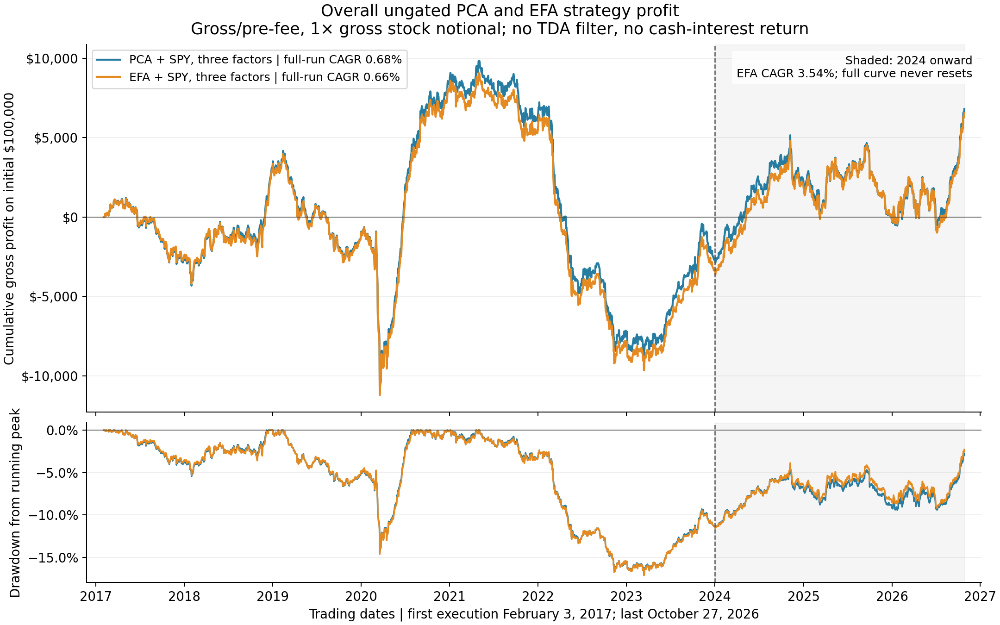

# Overall continuous PCA/EFA profit

October 29, 2026. A reporting view of the existing ungated [matched EFA/PCA experiment](../equity_efa_vs_pca/README.md), not another strategy test. The chart uses the full 2,446-execution ledger without resetting equity at 2024. Trading begins February 3, 2017 after the initial history/admission warmup and ends October 27, 2026.

| Period | EFA gross annualized compounded return | PCA gross annualized compounded return |
|---|---:|---:|
| Full trading run, February 2017–October 2026 | 0.66% | 0.68% |
| February 2017–December 2023 | −0.49% | −0.39% |
| January 2024–October 2026 | 3.54% | 3.37% |

On an initial $100,000 with daily reinvestment, the full EFA curve ends at **$106,549.67** and PCA at **$106,801.29**. EFA's full-run maximum drawdown is **17.14%**, annualized volatility **3.92%**, and Sharpe versus zero **0.19**. Period annualization uses 252 sessions, matching the original study. Reporting subperiod returns separately does not reset the continuous chart.

The frequently quoted **3.54% belongs only to the later subperiod**. It should not be presented as the full-history return. EFA/PCA remain ungated here: no persistence features or TDA timing rule enter these returns. All figures are gross/pre-fee, and no cash-interest return is included.

Dollar neutrality means equal initial long and short dollars, not zero gross exposure. With $100,000 equity and 1× gross stock exposure, formation positions are approximately $50,000 long and $50,000 short. Estimated SPY beta and the chosen three factor exposures also balance at formation. These are selected linear constraints, not the absence of idiosyncratic risk, future exposure drift, or loss. The large observed drawdown makes that distinction concrete.

The later EFA paired-return estimate and its uncertainty remain as reported in the original experiment; this plot does not turn it into a validated edge. The survivor universe and examined dates remain limitations.

[SVG for a report](overall_profit_and_drawdown.svg) · [full-precision period metrics](performance_by_period.csv) · [continuous curves](continuous_equity_curves.csv) · [source/provenance](provenance.json) · [plot reproduction script](../plot_equity_efa_overall_profit.py).
