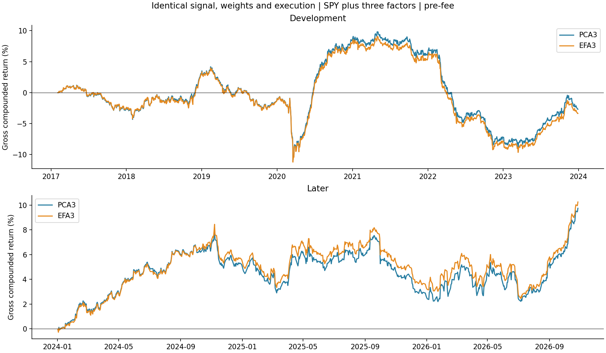
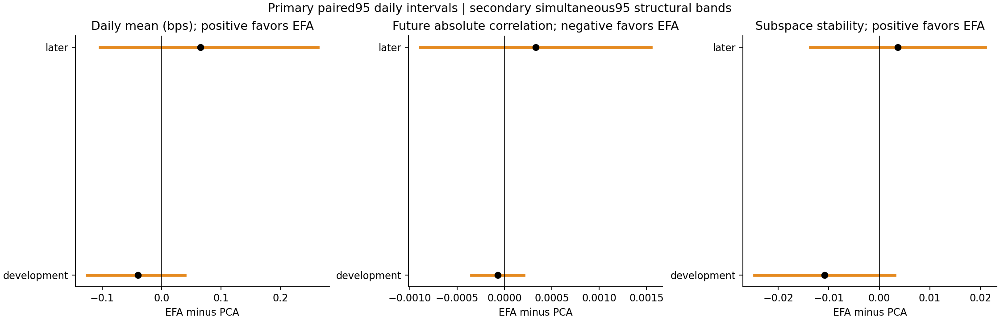
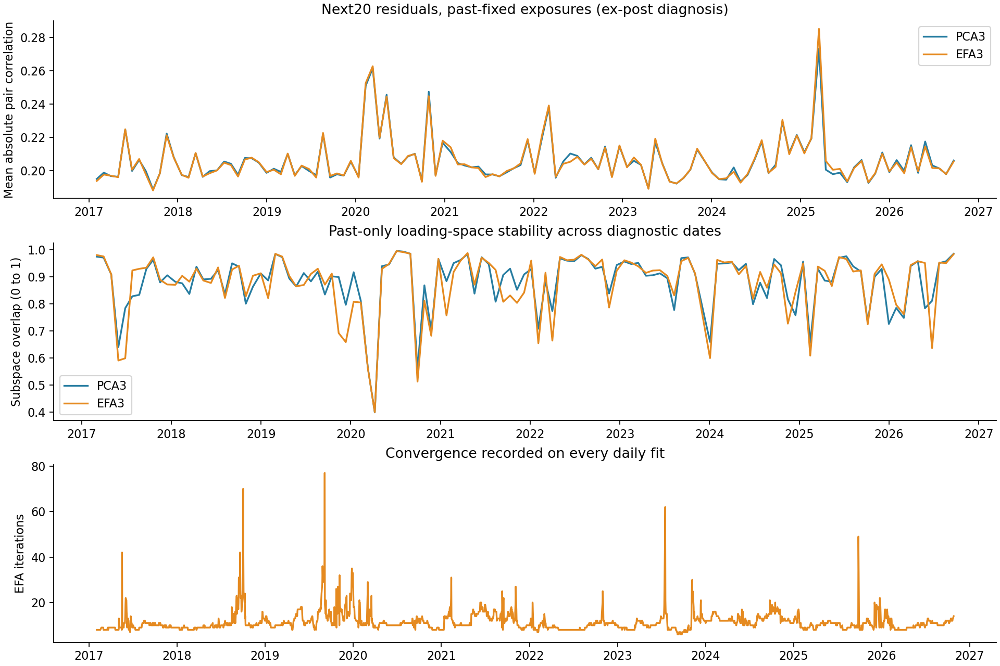
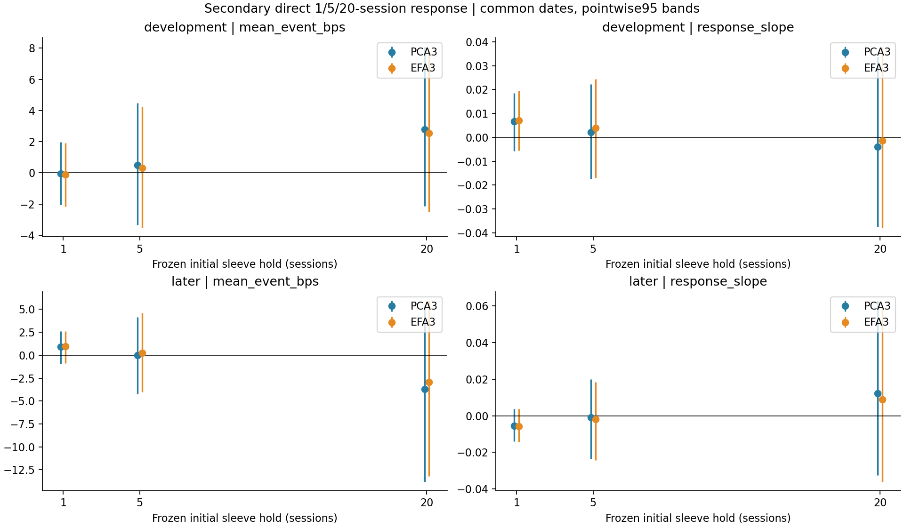

# EFA versus PCA: matched three-factor residual reversal

Executed October 29, 2026. **EFA does not materially change the current finding.** It gives a small favorable later gross point estimate, without establishing improved returns, future residual correlations, or factor stability. Reliable short-term residual reversal remains unconfirmed for these constructions.

[Executed notebook](../../equity_efa_vs_pca.ipynb) · [fixed specification](specification.json) · [source](../equity_efa_vs_pca.py) · [independent audit](independent_audit.json) · [audit source](../audit_equity_efa_vs_pca.py) · [original matched PCA study](../equity_expanded_pca_reversal/README.md).

## What changes, and why test it?

PCA summarizes directions explaining observed variance. Classical exploratory factor analysis models observations as common factors plus stock-specific noise, allowing a different noise variance for each stock. That additional flexibility might estimate common movement differently; it does not supply a temporal reversal relation. See the primary [PCA](https://scikit-learn.org/stable/modules/generated/sklearn.decomposition.PCA.html) and [factor-analysis](https://scikit-learn.org/stable/modules/generated/sklearn.decomposition.FactorAnalysis.html) documentation. The local implementation is scikit-learn 1.8.0; the inspected local source determines the exact behavior used here.

For standardized SPY-residual returns, EFA models covariance as `B B' + diag(psi)`, with three latent unit-covariance factors. B contains stock exposures; psi contains separate unique variances. This is a covariance model, not identification of economic causes or proof that the leftover movement is temporary. Classical diagonal unique covariance may itself be an approximation for equities.

This is one fixed EFA/PCA comparison, with **three additional factors and a 120-session fit**. There is no factor-count search, rotated-label search, longer-window sensitivity, regime gate, persistence construction, or tuning by profit.

## The matched implementation

Both strategies use the same 200-stock candidate universe, with 182–200 names admitted as their history becomes available. Admission requires 272 complete contiguous prior returns ending t−1; no future completeness filter or filled prices. The 272-day admission rule is retained to match the old experiment, while factor estimation uses 120 days.

At each daily formation:

1. Fit each stock's prior returns on an intercept and SPY. Keep those SPY beta estimates and the residual histories.
2. Demean/standardize residual histories using their sample standard deviations, floored at 0.0001.
3. Fit either top-three PCA directions or three-factor EFA. EFA uses deterministic LAPACK SVD, all-ones unique-variance initialization, no rotation/warm start, likelihood stopping tolerance 0.001 and at most 1,000 iterations.
4. Convert standardized factor columns to raw-return exposures by multiplying each stock's loading row by its residual standard deviation. Add dollar and SPY-beta columns. Both exposure matrices have rank five.
5. Regress the current day's adjusted close-to-close log-return signal across stocks using the **same inverse prior total-return variance weights**. Holdings are proportional to **minus W times that regression residual**, normalized to unit gross.
6. Enter at the next vendor raw daily-bar open, exit at that day's raw close, and remain flat overnight.

EFA's uniqueness estimates do **not** replace portfolio W. We do not substitute its posterior factor scores for the cross-sectional signal construction. Doing so would change both the factor model and the portfolio weighting/scoring rule. Here initial holdings are dollar neutral, estimated-SPY neutral, and neutral to the chosen three-factor exposure span. Rotation or rescaling of a fixed basis does not change those span constraints.

Every performance result is **gross/pre-fee**. No assumed commissions, spread, impact, borrow, financing, or generic cost deductions are applied. Execution timing is unchanged; excluding fees does not grant a fill at an already-observed close.

## Primary trading result

There are 2,446 daily formations: 1,738 development executions and 708 later executions. Later means January 2024–October 27, 2026; it has already been examined in earlier research.

| Period | Model | Mean gross bps/day | Approximate 95% mean interval | Annualized compounded return | Sharpe versus zero |
|---|---|---:|---:|---:|---:|
| Development | PCA3 | −0.125 | [−2.051,+1.961] | −0.39% | −0.080 |
| Development | EFA3 | −0.165 | [−2.089,+1.908] | −0.49% | −0.105 |
| Later | PCA3 | +1.343 | [−0.764,+3.335] | 3.37% | 0.890 |
| Later | EFA3 | +1.408 | [−0.703,+3.382] | 3.54% | 0.930 |

Primary paired EFA-minus-PCA daily gross mean:

| Period | Difference, bps/day | Approximate paired 95% interval |
|---|---:|---:|
| Development | −0.0401 | [−0.1258,+0.0387] |
| Later | +0.0652 | [−0.1039,+0.2630] |

The later CAGR improvement is about **0.17 percentage point per year**, not a validated new edge. Both standalone means and paired differences have intervals including zero. The new bootstrap seed changes interval endpoints relative to earlier reports; matched PCA point returns and every saved PCA position reproduce the old study.



The primary inference uses 1,000 paired circular block resamples of sixty formation dates, separately by period. There is one primary EFA-versus-PCA comparison per period. It is an approximate conditional historical interval, not a correction for every past project experiment or an untouched-test claim.

## Do the common-factor estimates differ substantially?

At each date, compare the raw three-dimensional loading spaces using `||Qpca' Qefa||F²/3`, where Q has orthonormal columns. One means the same subspace, regardless of signs or rotations. The median is **0.979 earlier and 0.970 later**. Individual dates can differ more; later minimum is about 0.664. The models usually estimate closely aligned spans. This is an observed similarity, not evidence that either span contains true economic factors.

All **2,446 EFA fits converged**: 6–77 iterations, median 10.5. Unique variances remain positive, with global minimum about 0.048 in standardized units, well above the numerical boundary. A converged likelihood fit does not prove model correctness or a global optimum.

## Secondary structural diagnosis

Every twenty formation dates, freeze that date's exposures and weights and decompose the next twenty close-to-close log returns using the same cross-sectional WLS. Measure mean absolute pair correlation of what remains. This is an **ex-post diagnostic**: future daily common-return coefficients are used only to measure future unexplained co-movement, never to form a trade or fit past exposures. The residuals are our matched WLS residuals, not directly EFA's posterior unique errors.

For stability, compare each model's current raw loading span with its previous diagnostic block on their common admitted stocks. This is invariant to factor signs/rotations and avoids mistaking renamed directions for instability. It is not a count of economically stable drivers. The previous diagnostic block can be farther than twenty sessions when a split-crossing target is omitted.

| Period | Model | Future mean absolute residual correlation | Average loading-space stability |
|---|---|---:|---:|
| Development | PCA3 | 0.205886 | 0.886365 |
| Development | EFA3 | 0.205800 | 0.875518 |
| Later | PCA3 | 0.206137 | 0.876527 |
| Later | EFA3 | 0.206464 | 0.880203 |

There are 86 earlier and 35 later future blocks; stability has 85 earlier comparisons because its first observation lacks a predecessor. The simultaneous paired two-metric comparison uses common dates: 85/35 blocks. Later EFA-minus-PCA absolute-correlation difference is **+0.000328**, simultaneous interval **[−0.000893,+0.001548]**; stability difference is **+0.003675**, **[−0.013684,+0.021035]**. Neither establishes improvement. Individual correlations are estimated from only twenty future returns and are noisy; even a correct common-factor approximation need not make estimated WLS residual correlations exactly zero.





Structural bands resample three consecutive diagnostic blocks and account simultaneously for the two reported metrics within each period. This does not make the 35 later blocks independent: rolling estimation histories overlap.

## Secondary direct reversal check

Use the same common complete twenty-session formation dates for 1-, 5-, and 20-session frozen initial holdings. These are event responses, not a funded overlapping multi-day portfolio. Entry is the next adjusted open and exit the corresponding adjusted close. The slope is `sum(e'W future_return) / sum(e'W e)`; a negative slope is the direction expected under reversal.

There are 1,719 earlier and 689 later events per horizon/model. Their sample and adjusted price convention differ from the daily raw open-close ledger; the one-session event mean therefore need not equal the 708-day daily mean. In particular, the common event sample omits nineteen later tail dates to support the full twenty-session target.

| Later horizon | PCA mean event bps | EFA mean event bps | PCA response slope | EFA response slope |
|---|---:|---:|---:|---:|
| 1 session | +0.903 | +0.968 | −0.00552 | −0.00587 |
| 5 sessions | −0.028 | +0.236 | −0.00076 | −0.00193 |
| 20 sessions | −3.685 | −2.946 | +0.01229 | +0.00881 |

Every standalone event mean and slope interval includes zero in both periods. EFA's twenty-session paired mean improvement has a pointwise interval above zero, and its paired slope change has a pointwise interval below zero; **neither survives the declared three-horizon simultaneous bands**. EFA's own twenty-session point mean remains negative. Those isolated differences do not establish a short-term reversal process.



The event comparisons use the same 1,000 sixty-date paired resamples, with simultaneous three-horizon families separately for mean and slope. They are secondary and do not correct across every diagnostic or project experiment.

## Checks, limitations, and decision

All original PCA positions, daily returns, and horizon events reconcile. The audit separately reconstructs every WLS holding and every EFA Gaussian training likelihood, refits thirteen EFA windows, and checks an independent EM update increases likelihood. It reconciles raw and adjusted price ledgers, future residual correlations, loading-space stability, metrics and all bootstrap intervals. Maximum holding difference is about 2×10⁻¹⁵. Data, frozen scripts, and prior results are unchanged.

The comparison is restricted to three factors and a 120-session fit, about two hundred current-survivor securities, one daily residual-return signal, and the existing execution convention. There are fewer time observations per fit than stock coordinates; this is a structured low-rank-plus-diagonal approximation, with no claim that the fitted latent causes are identifiable. Neither mathematical convergence nor a high loading-space overlap proves temporal predictability. Generic EFA superiority, economic interpretation, and other temporal mean-reversion mechanisms remain untested.

**Decision:** retain PCA as the existing benchmark and EFA as a completed matched alternative. EFA modestly changes the later point return, but does not establish better factor removal or a reversal edge. Do not start a new TDA gate or factor-count/rotation search merely because its point CAGR is slightly higher. The practical conclusion remains that short-term residual reversal is unconfirmed for these tested signals, rather than proven absent from all equity markets.

## Reproduce

Use the local TDA conda Python with one BLAS/OMP thread and writable Matplotlib/IPython caches. From the TDA project root:

```sh
python equity/experiments/equity_efa_vs_pca.py
python equity/experiments/audit_equity_efa_vs_pca.py
python equity/experiments/build_equity_efa_vs_pca_notebook.py
```

The run downloads nothing, reads no credentials and submits no orders. Changed settings require a separate experiment. Full-precision evidence: [daily returns](daily_gross_returns.csv), [performance](gross_performance.csv), [positions/loadings/unique variances](positions_and_loadings.npz), [daily fit diagnostics](fit_diagnostics.csv), [structural blocks](structural_blocks.csv), [structural means](structural_summary.csv), [event ledger](horizon_events.csv), [horizon summary](horizon_summary.csv), [paired comparisons](paired_comparisons.csv), and [configuration, checks and hashes](summary.json).
