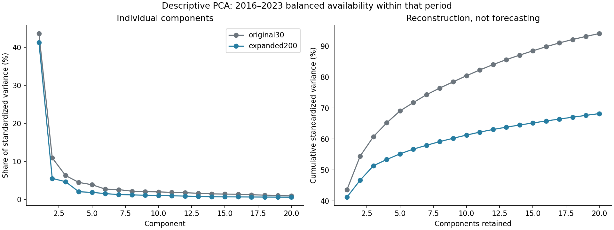
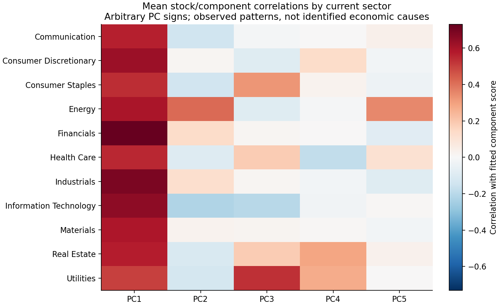
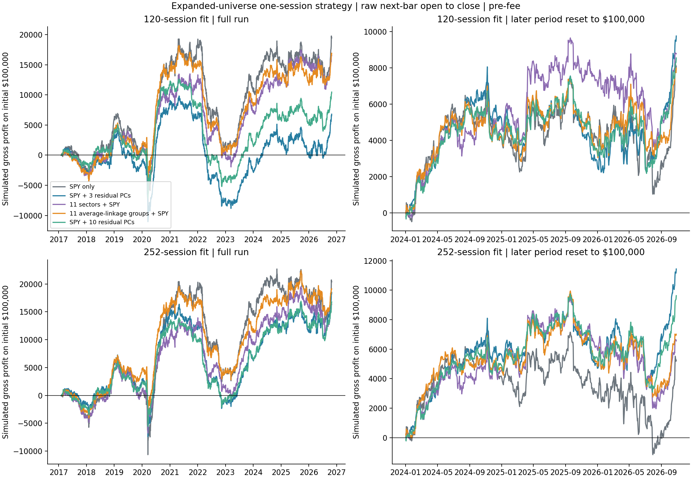
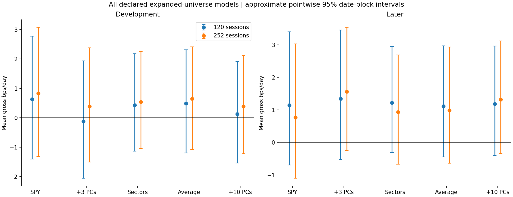
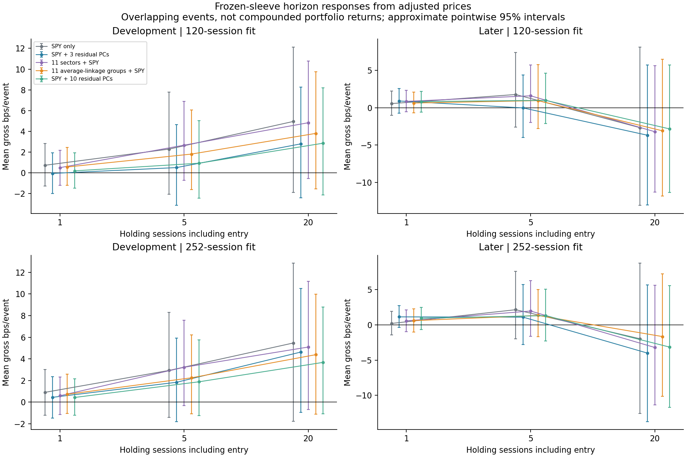
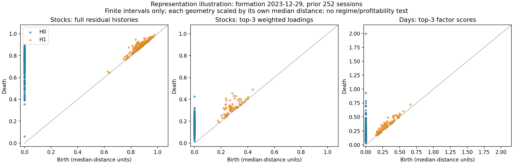

# PCA and residual reversal on the expanded 200-stock panel

Run October 29, 2026. The user accepted the existing **200 stocks**, correcting the initial reference to 300. No additional history was downloaded. [Executed notebook](../../equity_expanded_pca_reversal.ipynb), [source](../equity_expanded_pca_reversal.py), [fixed specification](specification.json), [independent audit](independent_audit.json).

**Result: the broader-universe daily strategy has positive later-period gross point estimates, unlike the original 30-stock result. Every model's approximate mean interval still includes zero.** This changes the descriptive return result without establishing a reliable edge, a winning factor count, or a profitable regime filter.

## 1. PCA still finds a broad common movement, with more remaining variation



The descriptive reference fit uses **2016–2023 only**. The original thirty names all have complete observations. In the larger panel, **182 stocks** have complete histories within this fit period and enter this descriptive balanced matrix. The other eighteen are explicitly listed as omitted short histories. This descriptive choice does not determine daily trading membership.

| Reference fit | Stocks | PC1 variance | First 3 variance | First 10 variance | PC1/SPY score correlation |
|---|---:|---:|---:|---:|---:|
| Original basket | 30 | 43.59% | 60.78% | 80.43% | 0.92755 |
| Expanded basket, complete reference histories | 182 | 41.23% | 51.39% | 61.27% | 0.97381 |

**Intuition:** one broad common direction remains prominent, and its score closely tracks SPY. The same ten-component budget reconstructs a smaller fraction of the larger basket's standardized variation. The percentages are not forecast accuracy and do not identify how many true economic drivers exist.



The heatmap averages stock/component score correlations within each current sector. It describes observed contrasts. PC signs are arbitrary, and no interest-rate, growth, commodity-price, or other causal interpretation is inferred from the colors. Full per-stock loadings and score series are saved separately.

## 2. Daily gross results are more favorable in the broader basket



These curves compound **one-session strategy returns**, raw next vendor-bar open to same-day close, at unit gross and before fees. The right panels reset starting equity to $100,000 at the beginning of the later period. They are separate illustrations of the full run and the later period, not actual account P&L.

The primary rerun preserves the original SPY-only and SPY-plus-three-residual-PC constructions and **120-session** fit. A declared **252-session** sensitivity and three additional comparisons are all reported: eleven snapshot sectors plus SPY, eleven average-linkage groups plus SPY, and ten residual PCs plus dollars/SPY. The last three have twelve independent exposure columns. The original models have two and five columns, respectively; they are not exposure-count-matched to the peer comparisons.

Later period, **708 execution dates**, January 2, 2024–October 27, 2026:

| Universe | Prior fit | Model | Mean gross bps/day | Approximate pointwise 95% interval | Gross annualized Sharpe |
|---|---:|---|---:|---:|---:|
| Original 30 | 120 | SPY only | -1.291 | [-4.300, +1.802] | -0.486 |
| Expanded | 120 | SPY only | +1.143 | [-0.692, +3.395] | +0.609 |
| Original 30 | 120 | SPY + 3 PCs | -0.646 | [-3.016, +2.017] | -0.307 |
| Expanded | 120 | SPY + 3 PCs | +1.343 | [-0.530, +3.452] | +0.890 |
| Expanded | 252 | SPY + 3 PCs | +1.560 | [-0.244, +3.535] | +1.006 |

All five broader-universe models have positive later daily means under both fit lengths; **all their mean intervals include zero**. The full [performance table](gross_performance.csv) includes development and later results, all settings, volatility, gross CAGR, drawdown, and concentration. Sharpe is the conventional annualized mean/standard-deviation ratio, not a significance statistic or a volatility-independent forecast claim.



**Broader versus original control:** the original thirty-stock strategies are rerun on the identical calendar and fit lengths. With 120 observations, the later broad-minus-original mean difference is **+2.434 bps/day** for SPY-only, interval **[+0.378,+4.618]**; for three PCs it is **+1.989**, interval **[-0.134,+4.288]**. These are paired, pointwise exploratory intervals, not multiple-comparison-adjusted confirmations. Better measured performance than a weak baseline also does not prove positive standalone expected return.

The 120-session three-PC broader strategy's mean effective gross breadth is about **90** names later, versus **16** for the original basket. The returns and concentration both changed with the selected universe. We have not isolated a general causal effect of adding arbitrary stocks, and current-size survivor selection remains a material qualification.

Structural coherence and profitability remain different outcomes. Average linkage's previous coherence advantage does not establish a return advantage over PCA here; these trading mean intervals overlap broadly and no model is selected as a validated winner.

## 3. Longer frozen holds do not establish a reversal edge



These are **separate cumulative returns of the initial sleeves**, using all-adjusted next-open-to-exit-close prices at 1/5/20 sessions. They are not the daily strategy's compounded next-month performance and are not annualized or compounded across overlapping events.

Later 120-session three-PC responses:

| Initial-sleeve holding | Mean gross bps/event | Approximate pointwise 95% interval |
|---|---:|---:|
| 1 session | +0.903 | [-0.737, +2.555] |
| 5 sessions | -0.028 | [-3.967, +4.390] |
| 20 sessions | -3.685 | [-13.032, +5.716] |

Every expanded-universe event mean and overall reversal-response slope interval includes zero in both periods across all declared models/lookbacks. This does not prove an effect is absent, but it does not establish a preferred hold or a simple long-run catch-up story.

### Why does the one-session event mean differ from the daily table?

The daily table has all **708** later sessions. The event comparison uses **689 common dates** with complete twenty-session outcomes; nineteen tail dates are omitted. It also uses adjusted rather than raw same-day prices.

For later 120-session three-PC positions:

- Full 708-date raw one-session mean: **+1.34269 bps/day**.
- The 689 common dates, raw one-session mean: **+0.90473**.
- Those same common dates, adjusted one-session mean: **+0.90294**.
- The nineteen omitted dates, raw one-session mean: **+17.22456**.

Thus sample composition explains almost all this particular difference; vendor adjustment precision explains very little. The recent tail is favorable and contributes materially to the full-period mean. It is neither silently excluded from the primary result nor selected as a future regime. [Convention/sample bridge](one_session_convention_bridge.csv).

## 4. Factor coefficients as coordinates: a measured representation illustration



At formation December 29, 2023, using the prior 252 observations, the illustration compares:

1. 198 stock points in standardized SPY-residual history coordinates.
2. The same 198 stocks in three eigenvalue-weighted loading coordinates.
3. 252 day points in three residual-factor score coordinates.

The complete loading-coordinate representation is verified to preserve the stock correlation distances before truncation. Keeping only three components changes the geometry; changing the points to days changes the object being studied. Each geometry's distances are divided by its own median pair distance for this picture; raw scales and the full diagrams are saved.

This is **not a test of profitable regimes**. A more persistent H1 interval after projection is not automatically a meaningful economic cycle, a statistical discovery, or a better signal. The different point counts and rescalings also prevent a naive ranking of total bar counts. No labels or forecasts of future profit have been fitted to these diagrams.

Read [persistence and regime ideas](../../PERSISTENCE_REGIME_IDEAS.md) for the stock-exposure versus market-state distinction, weighting identities, temporal-order limitations, and a concrete proposed evaluation.

## Construction and comparability

- **2,446 formation/execution dates:** 1,738 development and 708 later. The first formation requires 272 prior observations so the same admission rule supports both fit lengths. Development therefore starts later than the original frozen experiment. The later dates are identical to its 708-date sample.
- Admit stocks only with **272 complete contiguous prior returns ending t-1**. Both lookbacks and all broader models use the same admitted basket at each date, growing from 182 to 200. Current signal returns and active future prices must exist; missing targets raise an error rather than silently remove a member. No history is filled.
- Exposure fits end before signal day t. Observe t's adjusted log return, construct **minus W times the cross-sectional WLS residual**, scale to unit gross, then enter the next raw daily-bar open. No caps, threshold search, or current-signal close fill is introduced. Dollar and chosen estimated-factor exposure constraints hold initially.
- Residual PCA is fitted after the prior SPY regression, on standardized residual histories. The raw exposure columns are `residual_sigma * eigenvector`; SVD estimates the same subspace as the earlier covariance eigendecomposition. This differs from the eigenvalue-weighted coordinates used to define a clustering distance.
- Original30 control rows are calculated with the same timing and two primary models, not eleven-sector constraints. Their 120-session raw returns reproduce **all 4,892 overlapping saved model/date rows** of the frozen original source to numerical precision. No original result is overwritten.
- The multi-session event sample requires all twenty future sessions and excludes targets crossing the 2024 boundary. Initial sleeves are not rebalanced over these holds and estimated neutrality can drift. Their pooled slope uses the frozen formation-exposure residual attribution identity; negative means an opposite relative response.
- Mean and slope intervals use **1,000 circular sixty-date block resamples** separately by period, with all stocks together and pooled ratios recomputed. The same resamples produce paired universe differences. Intervals are approximate and pointwise; overlapping events, persistent fits, and the many examined settings constrain inference.
- A current-survivor/size-selected universe, current sector labels, vendor daily aggregation, adjusted-price precision, and ideal target-dollar execution remain limitations. This is not a reconstructed point-in-time investable universe or a verified corporate-action/auction ledger. Already examined 2024 onward does not become an untouched holdout.
- **No fees are deducted.** No generic commission, spread, slippage, impact, borrow, or financing assumption enters these results. No regime filter, new paid data, live trading, or order submission is involved.

## Decision

Keep the broadened SPY/PCA strategy as a **more favorable but unconfirmed gross baseline**, alongside the sector and average-linkage comparisons. Do not carry forward the impression that the original negative thirty-stock mean must describe the two-hundred-stock strategy. Equally, positive estimates and Sharpe near one do not override the wide mean intervals or universe-selection limitations.

The user's regime hypothesis is a useful next question if it targets future performance of a **fixed** strategy and compares diagram features with simple state summaries. A separate, chronologically trained experiment is needed. No profitable diagram-conditioned regime is established here.

## Reproduce and files

From `TDA_Research/equity` in the TDA environment:

```sh
OPENBLAS_NUM_THREADS=1 OMP_NUM_THREADS=1 python experiments/equity_expanded_pca_reversal.py
OPENBLAS_NUM_THREADS=1 OMP_NUM_THREADS=1 python experiments/audit_equity_expanded_pca_reversal.py
```

The notebook loads saved outputs, embeds the six figures, and deterministically writes the one-session sample/price bridge and annual gross table. Core outputs include descriptive scores/loadings/variance, daily gross returns, horizon events, performance/intervals, paired universe differences, formation dates/memberships, compressed full position arrays, timestamped past-fit state features, and snapshot distances/diagrams.

The independent audit checks every daily/event P&L sum, past-only admission, thirteen complete formation reconstructions using covariance eigenvectors and normal-equation WLS, exact historical controls, all reported intervals, descriptive PCA, and protected input/source/result hashes.
