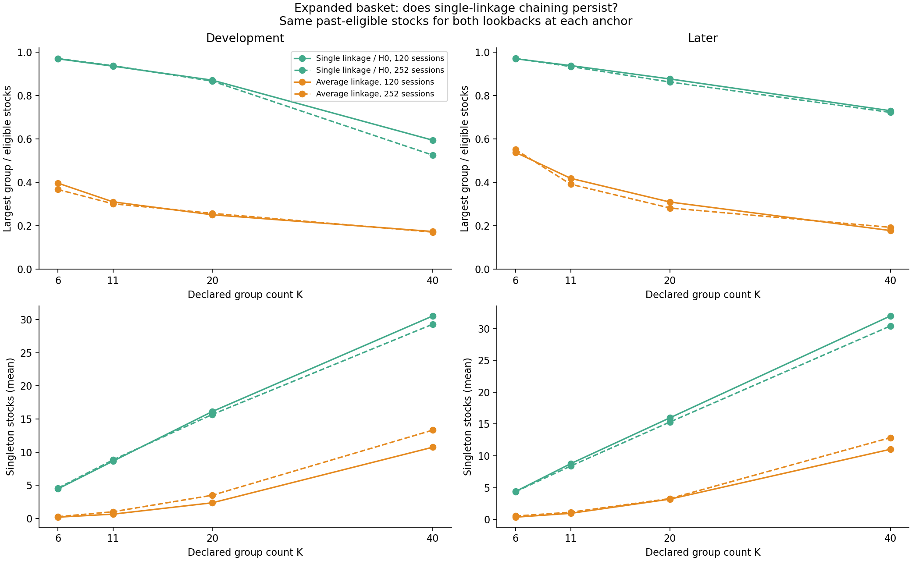
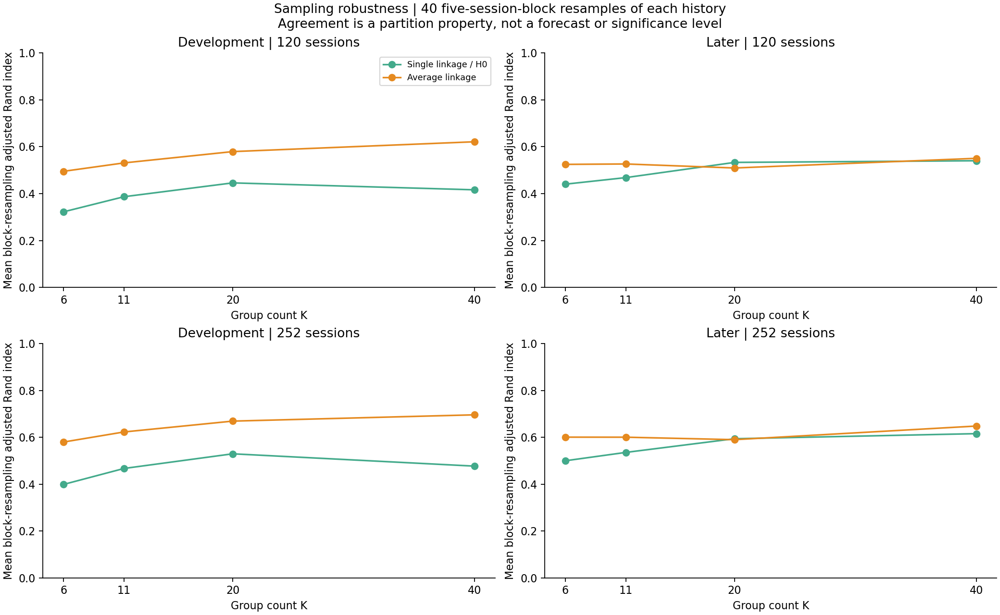
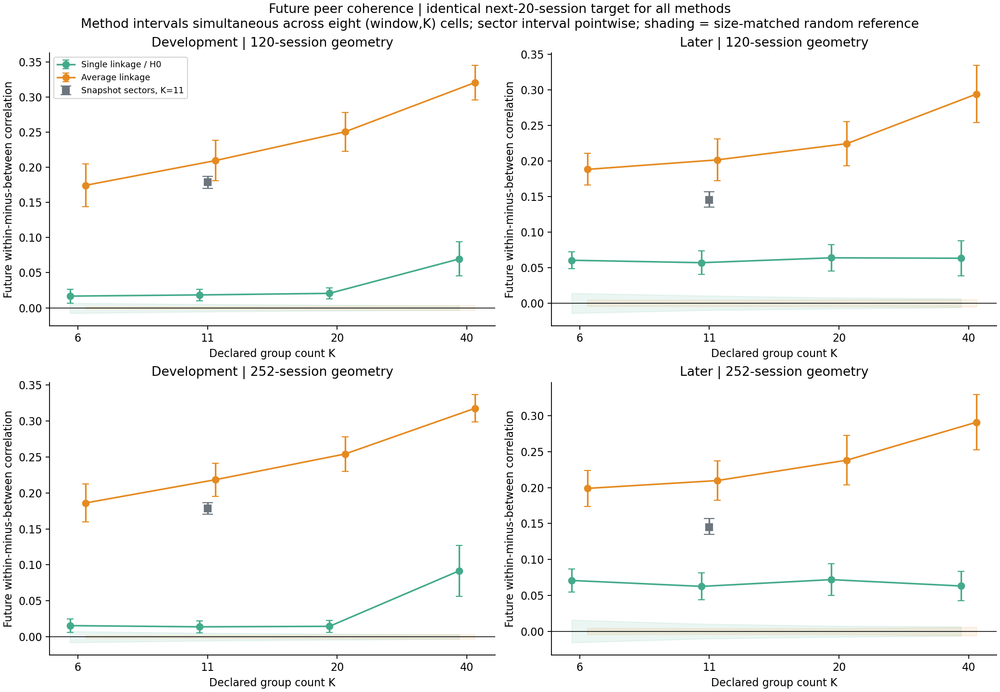
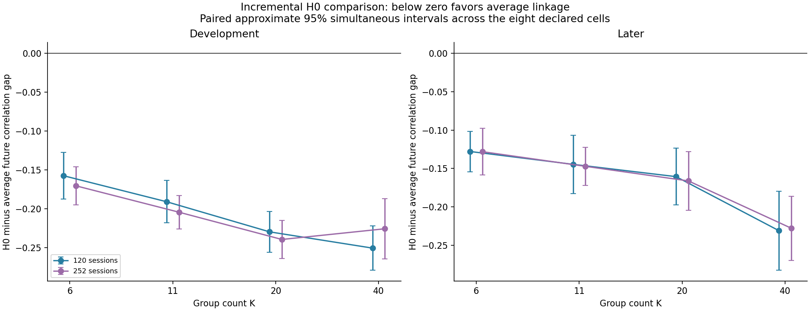
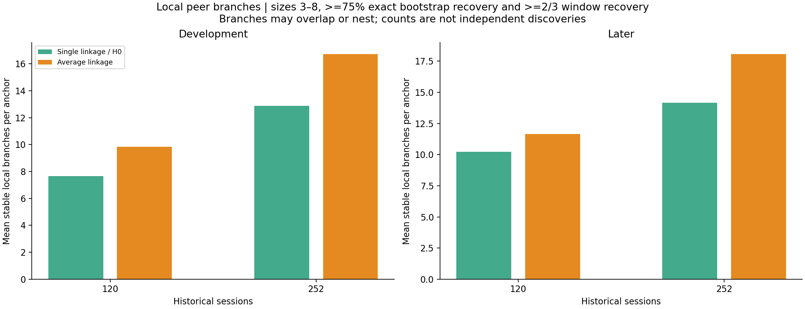

# Does peer structure generalize to the 200-stock basket?

October 28, 2026. [Executed notebook](../../equity_expanded_structure.ipynb), [fixed specification](specification.json), [source](../equity_expanded_structure.py), [independent audit](independent_audit.json).

**Decision: repeatable peer structure generalizes, but H0/single linkage remains a poor global partition in this basket. Average linkage has stronger future correlation separation at every declared group count and both lookbacks in both periods.** Many small H0 branches are robust and interpretable as named stock sets; nearly all of those stable occurrences also appear in average linkage. This is a structural result, not evidence of reversal profits or a general rejection of TDA.

No positions, P&L, return-reversal strategy, or fee calculation was added. The earlier trading results remain unchanged. All analysis is exploratory on a current-survivor basket and already examined dates.

## 1. The global H0 partition is still dominated by one component



Later-period means, with about **198.7 eligible stocks per anchor**:

| Fit history | Method | Groups K | Largest group | Singleton stocks |
|---|---|---:|---:|---:|
| 120 sessions | H0 / single | 11 | 186.5 | 8.8 |
| 120 sessions | Average | 11 | 83.2 | 1.0 |
| 252 sessions | H0 / single | 11 | 185.6 | 8.4 |
| 252 sessions | Average | 11 | 77.9 | 1.1 |
| 252 sessions | H0 / single | 40 | 143.6 | 30.4 |
| 252 sessions | Average | 40 | 38.3 | 12.9 |

At K=11, H0 puts roughly **93%** of the basket in one component. Even K=40 leaves about **72%** together while isolating many other names. This is the chaining property: a sequence of locally close connections can merge stocks whose complete group is not mutually close. More names did not make this tested partition balanced. This is not a controlled causal estimate of what increasing universe size alone does, because this run also changes dates, eligibility, and comparison design.

Average linkage is less imbalanced but does not deliver equal-sized groups either. Balance is a construction diagnostic, not a profitability metric. All K=1..N balance measurements are saved in [all_cut_balance.csv](all_cut_balance.csv); outcome comparisons are restricted to the four declared K values, **6, 11, 20, 40**.

## 2. More historical observations improve measured sampling agreement, without fixing chaining



At K=11 later, mean five-session-block resampling ARI is:

| Method | 120-session fit | 252-session fit |
|---|---:|---:|
| H0 / single | 0.468 | 0.536 |
| Average linkage | 0.527 | 0.601 |

ARI asks how much the group assignments agree after changing the sampled history, independent of arbitrary group labels. These are sensitivity averages, not significance levels. The longer histories have higher mean bootstrap ARI at every declared cut for both methods and periods. Average linkage is not universally more stable: H0 has slightly higher later K=20 bootstrap ARI under both histories. The positive conclusion for average linkage below concerns future coherence, not dominance on every diagnostic.

This does not establish 252 as an optimal forecast window. Longer windows use more observations but average relationships over more time. The shorter/longer window perturbations are also different relative changes: +/-20 sessions is a larger percentage of 120 than of 252. [Scored measurements](scored_cut_measurements.csv) retain shorter, longer, and five-session-older window agreement separately.

The 120-session SPY-residual histories have rank **118**, while the 252-session histories have full cross-sectional rank **182–200** at the observed anchors. Distance geometry requires no inverse covariance, so the short-history singularity does not invalidate the distances. It does limit independent directions and motivates sensitivity analysis. No shrinkage parameter was fitted or chosen from outcomes.

## 3. Average linkage preserves stronger future within-group relationships



For each grouping made from past data, measure the subsequent twenty-session average **within-group residual correlation minus between-group residual correlation**. A larger positive gap means the assigned peers remain more alike than stocks assigned to different groups. It does not mean their relative prices return to an equilibrium.

The future return target is the same for the 120- and 252-session constructions: fit SPY coefficients on the prior 252 observations, freeze them, and residualize the twenty future daily returns. Thus changing the geometry window does not also change the measured future benchmark.

At **K=11** in the later period:

| Group construction | Future correlation gap | Approximate 95% interval |
|---|---:|---:|
| H0, 120-session geometry | 0.0569 | [0.0403, 0.0734] |
| Average, 120-session geometry | 0.2016 | [0.1721, 0.2310] |
| H0, 252-session geometry | 0.0625 | [0.0438, 0.0813] |
| Average, 252-session geometry | 0.2098 | [0.1822, 0.2374] |
| Eleven provider snapshot sectors | 0.1452 | [0.1348, 0.1570] |

Method intervals are simultaneous across the eight declared (lookback,K) cells within a method/period; the single sector interval is pointwise. The paired tests below, not overlap of these intervals, support method differences.

At the matched eleven-group count, average linkage exceeds the sector gap. For example, later 252-session average-minus-sector is **+0.0646**, approximate simultaneous interval **[+0.0381,+0.0912]**. Development K=11 also favors average linkage for both windows. This is evidence about this particular coherence metric. The group sizes, pairs assigned within groups, and snapshot nature of sector labels still differ. It is not proof of better economic classifications, risk hedges, or profitable trades. Sector contrasts at K=6/20/40 are saved for completeness but do not match the sector group count and should not be ranked as equivalent partition tasks.

All **32** method/window/K/period mean gaps exceed their simultaneous size-matched random-label upper reference in this run. In **31 of 32** cells the method's simultaneous lower uncertainty bound also exceeds that upper reference; the exception is development H0, 252 sessions, K=6. The random reference permutes stock labels while preserving each partition's complete group-size pattern. It is a conditional structural reference, not an executable-strategy significance test. Different K values cover different numbers and types of within-group pairs, so the rise of average-linkage coherence at fine cuts is not proof that K=40 is the best setting.

## 4. The incremental H0 comparison is negative on the declared cells



Every H0-minus-average future-gap difference is negative, and its approximate simultaneous 95% interval lies below zero: **all eight cells in development and all eight later**. The later 252-session K=11 difference is **-0.1473**, interval **[-0.1720,-0.1225]**. This is a clearer incremental-method result than the original 30-stock pilot, under the present design.

The simultaneous family covers eight fixed lookback/group-count comparisons within each period, not every representation or research choice. The original narrow K=27 result from the 30-stock study is neither rerun nor generalized here. We did not search all 200 possible cuts for a favorable future result.

## 5. Good local branches exist inside the poor global partition



A local branch is an exact set of **3–8 stocks**, found anywhere in the hierarchy. The past-only diagnostic requires it to recur in at least **30 of 40** history resamples and at least **two of three** window perturbations. Parent and child sets can both qualify; counts are nested/repeated occurrences, not independent discoveries or ready-made nonoverlapping portfolios.

Examples under the later **252-session H0** construction, ordered by past stability counts:

| Named set | Anchors present | Anchors meeting the stability rule |
|---|---:|---:|
| AEP, DUK, SO | 35 | 35 |
| AMAT, KLAC, LRCX | 35 | 35 |
| COP, CVX, EOG, XOM | 35 | 35 |
| MPC, PSX, VLO | 35 | 35 |
| ADI, NXPI, TXN | 35 | 33 |
| CSX, NSC, UNP | 35 | 31 |

These are measured co-movement sets, not identified economic causes. The broader universe permits more detailed named relationships than the original six groups of five. The [full named catalogue](named_local_branch_catalogue.csv) retains all local sets, their historical recovery, and descriptive future local gaps. A local gap compares within-branch correlations with member-to-outside correlations; it is not the whole partition's within-minus-between score and is not a reversal measurement.

However, the robust local sets are mostly shared with conventional clustering:

| Later fit | Stable H0 occurrences | Also present in average tree | Also stable under average |
|---|---:|---:|---:|
| 120 sessions | 358 | 354 | 327 |
| 252 sessions | 496 | 486 | 436 |

There are a few H0-only stable occurrences, so the correct conclusion is **near-complete overlap**, not exact equivalence of the two hierarchies. Unique membership alone does not establish additional utility.

At 252 sessions later, average linkage has **18.09** stable local branches per anchor versus H0's **14.17**. Their union covers an average **52.8 versus 40.5 stocks**, respectively. These coverage numbers apply only to the diagnostic's 3–8-stock branches; excluded pairs or larger groups may also have meaningful relationships.

## Design, eligibility, and limitations

- **121 nonoverlapping future blocks:** 86 development and 35 later. Development targets run February 3, 2017–December 4, 2023; later targets run January 4, 2024–October 19, 2026. Calendar-end tails and the block crossing 2024 are excluded. This is a distinct sample from earlier experiments.
- At each anchor t, admit only stocks with **272 contiguous finite prior returns ending t-1**. The same **182–200** names enter both geometry windows, all cuts, and the sector reference. All original 30 names qualify at every anchor. No stock is admitted or removed based on future returns or target availability. All targets happen to be complete; unexpected missing targets would raise an error, not silently change membership.
- Fit SPY residual geometry on 120 or 252 prior observations. Window checks use **100/140 or 232/272** observations and the same-length history shifted five sessions earlier. Forty circular block resamples of each history use five-session blocks, sampling stock and SPY rows together and refitting SPY.
- The latest price dataset and classification snapshot were selected in 2026. These past-data admission rules prevent history filling and future availability filtering, but **do not repair original survivor/size selection or current classification look-ahead**. Multiple share classes are separate securities, not independent companies.
- Random controls use **250 common stock relabelings per anchor**, preserving every cut's group sizes. Uncertainty uses **1,000 circular resamples of six consecutive anchors**, roughly 120 trading sessions, with the same resamples for paired comparisons. Long training histories overlap and only 35 later blocks exist; intervals depend on approximate block-bootstrap assumptions and do not capture every form of dependence or research selection.
- Both linkage methods use the same linear correlation information. H0 is single-linkage merging under this filtration. No H1 or new source of higher-order return dependence was measured.
- No fees, gross returns, position changes, or mean-reversion tests enter this structural experiment. Existing pre-fee research results remain the only trading evidence.

## Research implication

The larger basket supports **past-formed groups retaining future co-movement**, and shows a useful average-linkage distinction beyond coarse sector labels on the stated metric. It also strengthens the case against using a fixed-K H0 cut as the default broad peer partition. Robust small H0 branches remain useful for interpretation, but conventional clustering recovers almost all of them.

Retain average linkage as the stronger tested structural baseline, along with sectors and the labeled hierarchy. Do not infer a return-reversal edge, an optimal 252-session fit or K=40 cut, or a need to add H1 to rescue trading P&L. A new trading rule or another TDA mini-study would be a separately specified next task.

## Files and reproduction

From `TDA_Research/equity`, using the TDA environment:

```sh
OPENBLAS_NUM_THREADS=1 OMP_NUM_THREADS=1 python experiments/equity_expanded_structure.py
OPENBLAS_NUM_THREADS=1 OMP_NUM_THREADS=1 python experiments/audit_equity_expanded_structure.py
```

Outputs include [anchor dates and memberships](anchors.csv), [all scored measurements](scored_cut_measurements.csv), [summaries](cut_summary.csv), [paired differences](paired_method_differences.csv), [sector reference](sector_summary.csv), [branch counts](stable_branch_counts.csv), [branch overlap](branch_overlap.csv), the complete compressed internal-branch ledger, all-cut balance, random-reference arrays, and five figures.

The independent audit verifies every anchor's admission and chronology, all-cut balances and branches, branch flags/overlap/counts, eleven independently reconstructed anchors, first-anchor random scores and actual history/window perturbations, and all pointwise/simultaneous method and sector-difference intervals. Input datasets, prior scripts, and frozen experiment summaries are hash-checked for preservation. No network request or order submission is involved.
