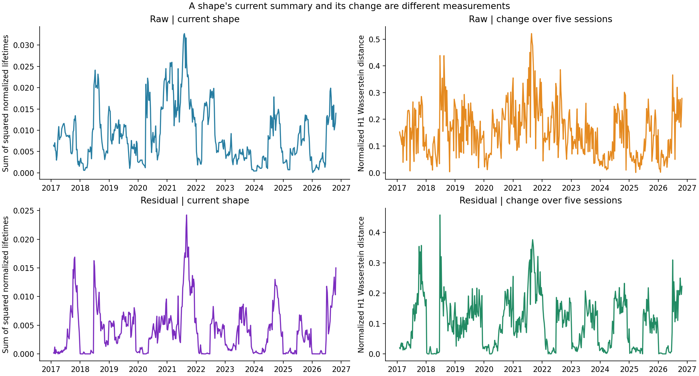
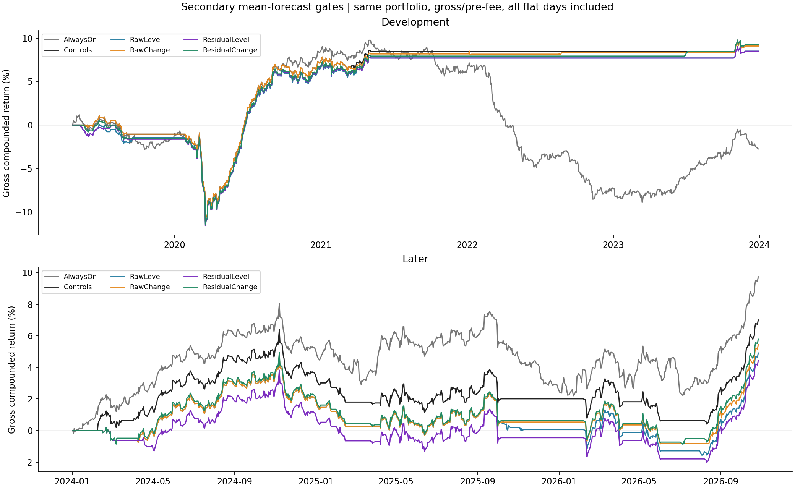
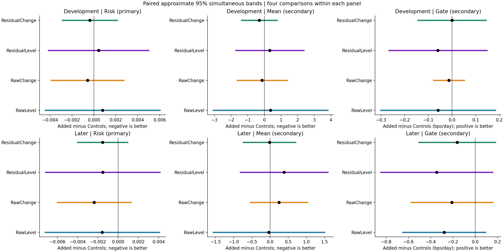
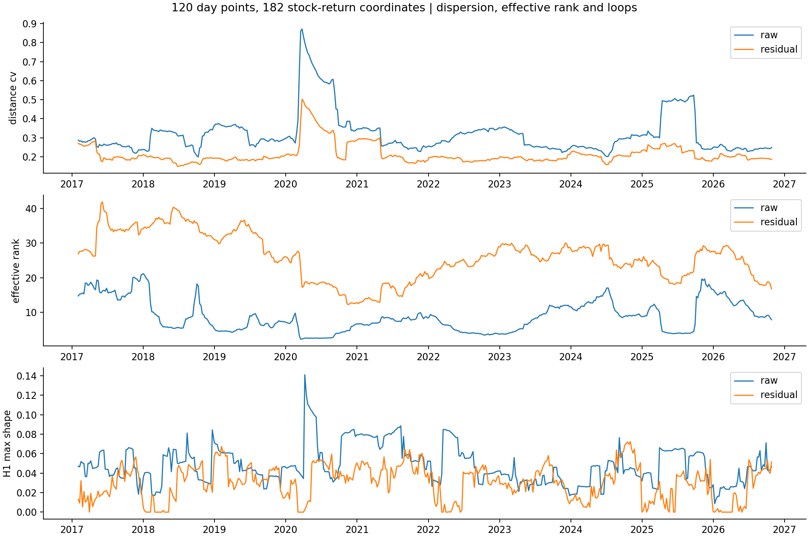

# Full-basket day clouds: 120 days × 182 stock-return coordinates

Executed October 29, 2026. **The user's proposed change of point object is now tested.** Each point is one historical day's vector of all 182 fixed reference-stock returns. No PCA truncation is used in the cloud. We tested four declared additions: raw/residual geometry, each represented by its current H1 features or changes over five sessions.

**Result:** later risk-forecast point errors improve modestly, by 2.2–3.4%, but none establishes an incremental benefit. Mean-return forecasts barely improve, and all four secondary mean-forecast gates have lower later point profit than their matched control. Every declared simultaneous incremental interval spans zero in both periods. This is not an identified profitable regime or proof that all TDA state constructions fail.

[Executed notebook](../../equity_full_basket_states.ipynb) · [fixed specification](specification.json) · [source](../equity_full_basket_states.py) · [independent audit](independent_audit.json) · [audit source](../audit_equity_full_basket_states.py) · [coordinate/literature review](../../literature/tda_regimes_and_coordinate_design_2026-10-29.md).

## The object: a row is a day, a column is a stock

At each decision date, collect the previous 120 days ending at t−1. The matrix has **120 rows and 182 columns**:

`day s = (return of stock1 on s, ..., return of stock182 on s)`.

Each row is one point in 182-dimensional space. Two days are close if the basket's combinations of stock returns were similar. This changes the question from “which stocks move similarly?” to “what kinds of joint basket moves occurred recently?” The same current-survivor candidate universe remains, so this is a new representation of existing observations, not new independent market history.

The 182 names reuse the prior experiment's reference cohort: complete prior returns at the first formation, not a filter requiring future completeness. The traded strategy can still admit the other eighteen candidate names as their histories arrive. Fixing the reference dimensions avoids mistaking coordinate-count changes for market changes. No missing prices are filled and no additional data is downloaded.

We keep the previous 120-session length to isolate this change from a window search. It is a fixed starting choice, not a demonstrated optimum. There is no lag appended to each day vector. The day order inside any one cloud is ignored; the sequence of rolling diagrams is still dated.

## Two versions of the same basket

| Object | Coordinates | What it preserves/removes |
|---|---|---|
| Raw day returns | All stock daily log returns, divided by `sqrt(182)` | Broad market movement and relative return amplitudes remain. Distances become RMS stock-return differences. |
| Residual day returns | Fit each stock on intercept and SPY over that window, divide residuals by their sample standard deviations, then by `sqrt(182)` | Removes the fitted market component and individual historical residual scales; keeps the full residual coordinate set. |

The common division by sqrt(182) changes only the distance unit. For numerical consistency, Rips H0/H1 is computed after dividing distances by their median. Raw scale is restored for amplitude features. Normalized features describe shape. No component selection or whitening of factor scores is used in these point clouds. Ordinary controls still include the earlier PCA concentration measurements.

“Raw” here means **unresidualized adjusted-close log returns**, from the existing saved return panel. It does not mean unadjusted daily bars. Trading P&L still uses the original vendor raw open/close convention.

## What the four additions measure

Every addition goes on top of the **same 33-control forecast**. The controls contain the previous ten ordinary predictors; trailing strategy RMS; stock-volatility level/dispersion; and each cloud's scale, distance spread/quantiles, H0/MST summaries, effective covariance rank, mean stock correlation, covariance change, and scale change. H0 merge distances equal minimum-spanning-tree edges, so those are cheap ordinary connectivity controls rather than a claim of unique H0 information.

| Model | Added inputs |
|---|---|
| RawLevel | H1 count, longest lifetime in raw-return bps, sum of squared raw lifetimes |
| RawChange | Raw-unit H1 Wasserstein distance, normalized H1 Wasserstein distance, signed change in normalized squared-lifetime sum |
| ResidualLevel | H1 count, longest normalized lifetime, sum of squared normalized lifetimes |
| ResidualChange | Normalized H1 Wasserstein distance and signed change in normalized squared-lifetime sum |

**Wasserstein distance** here is the minimum total cost of matching one diagram's loop events to the other's, allowing loops to appear/disappear by matching to the diagonal. We use order one, Euclidean birth/death cost, and lifetime/sqrt(2) cost to the diagonal. An empty diagram is handled explicitly. It compares geometric events, not stock identities or an economic mechanism.

The comparison is against the window five sessions earlier, matching the forecast update interval. Those two 120-day windows share **115 days**. A large change can reflect entering/leaving observations or a shift in scale; it is not automatically an abrupt economic regime transition. Ordinary covariance and scale changes are included in the baseline for that reason. The residual transformation is estimated separately on each window's own past observations.



## Risk first; mean and trading separately

The primary target is the log of the **next twenty daily strategy returns' RMS**, measured in bps. RMS means square root of the average squared return. Large positive and negative returns both raise it. It measures return amplitude, not expected profit, downside-only risk, or a discrete regime label. Squared log forecast error is the primary loss. Exponentiating a forecast gives a positive RMS estimate; it is not claimed to be an unbiased arithmetic conditional mean.

The secondary target remains average gross return of the next twenty actual daily strategy trades. A secondary mean forecast above zero activates the existing daily strategy for the next five sessions; otherwise it stays flat. There is **no risk-based trading gate** in this experiment. We do not assume that turbulence means reversal will lose money.

The underlying strategy remains the existing 200-candidate, 120-session SPY-plus-three-PC daily residual reversal portfolio, with next daily-bar open entry and same-day close exit. Unit gross, daily refresh, flat nightly. No portfolio returns are recomputed. All days, including flat zero-return days, enter gate performance. Every result is **gross/pre-fee**, with no generic cost deduction.

Both targets use the exact previous **379 forecast dates and completed training memberships**, at least 104 completed labels. Feature scaling is trained only on that expanding history. Ridge regression keeps the previous fixed lambda=1; no threshold, component count, cloud window, diagram lag, or image grid is selected by outcomes.

## Results

The experiment computes 490 feature anchors, plus the prior diagram needed for the first five-session change. Forecasts start April 18, 2019. Scores use 233 earlier and 138 later complete twenty-session outcomes; four boundary targets and four latest incomplete targets are not assigned to either period's forecast score. All available daily gate executions remain: 1,183 earlier and 708 later sessions.

Later means January 2024–October 27, 2026. The following are **forecast errors, not returns**:

| Model | Earlier squared log-RMS error | Later squared log-RMS error | Later reduction versus Controls |
|---|---:|---:|---:|
| Completed historical mean | 0.17153 | 0.08412 | −21.5% |
| Controls | 0.13534 | 0.06924 | — |
| RawLevel | 0.13612 | 0.06766 | 2.3% |
| RawChange | 0.13475 | 0.06686 | 3.4% |
| ResidualLevel | 0.13577 | 0.06772 | 2.2% |
| ResidualChange | 0.13496 | 0.06770 | 2.2% |

RawChange has the largest later point reduction among the four declared variants; this does not make it a validated selection. Its paired loss difference is **−0.00238**, approximate simultaneous 95% interval **[−0.00600,+0.00124]**. In RMS-bps absolute-error units, Controls gives 4.844 and RawChange 4.792; those are different losses and should not be confused with a 3.4% reduction in realized portfolio risk. Every incremental primary interval includes zero in both periods. Earlier improvements are much smaller and not uniform across variants.

| Model | Later mean-return forecast MSE, bps² | Later gate gross CAGR | Later gate Sharpe versus zero |
|---|---:|---:|---:|
| Controls | 35.132 | 2.44% | 0.79 |
| RawLevel | 35.097 | 1.72% | 0.57 |
| RawChange | 35.376 | 1.90% | 0.63 |
| ResidualLevel | 35.517 | 1.55% | 0.52 |
| ResidualChange | 35.114 | 2.02% | 0.66 |

The always-on portfolio remains **3.37% CAGR and 0.89 Sharpe**. The older three-summary gate remains a separate saved experiment; its feature set differs from this richer matched baseline, so a cross-experiment rank is not a clean single-feature comparison. Every daily mean interval here includes zero. Lower return-forecast MSE need not improve a zero-threshold gate: small forecast movements around zero change which complete five-day blocks are traded.

All four new gates have unfavorable later point increments relative to Controls: **−0.279, −0.209, −0.347, and −0.162 bps/calendar day**, respectively. All simultaneous intervals span zero. One unadjusted pointwise gate comparison excludes zero; it is not the declared simultaneous result.





Uncertainty uses 1,000 circular block resamples, twelve forecast anchors for losses and sixty daily trades for gate returns. The four augmentation-minus-Controls bands are simultaneous within each period/metric. Risk is primary; mean and trading are secondary. These intervals condition on saved forecasts rather than refitting models, and do not correct for every experiment in the project. Examined history and overlapping windows continue to limit conclusions.

## Did 182 dimensions make every day look the same?

Not literally. Across later feature anchors:

| Diagnostic, median | Raw | Residual |
|---|---:|---:|
| Pair-distance standard deviation / mean | 0.254 | 0.207 |
| Effective covariance rank | 11.0 | 25.0 |
| Number of H1 intervals | 11 | 7 |
| Longest H1 lifetime / median pair distance | 0.0429 | 0.0248 |

Effective rank here is `(trace covariance)^2 / sum(covariance²)`: a measure of how spread out the covariance eigenvalues are, not a discovered latent dimension or a count of true factors. A centered cloud of 120 points has rank at most 119 regardless of its 182 coordinate columns. Nevertheless, all coordinates entered the distances; no PCA projection discarded variation.

Pair distances vary, and H1 loops occur, but those observations do not establish significant or profitable topology. The intervals are short relative to median pair distances. We have not validated them against a matched stochastic null or identified their economic causes. Removing SPY changes the geometry by construction; a descriptive difference is not an incremental forecast result.



## Verification and decision

The independent audit reconstructs all 491 state windows' distances and conventional controls using a separate regression formula and Gram-matrix distances; checks all H0 intervals against MST edges; recomputes selected H1 diagrams; and verifies every diagram-change distance with an independent match/delete/insert linear program. This avoids reliance on one assignment implementation or numerically unstable near-identical pairwise-distance formulas.

All **4,548 target/model/date fits** are reproduced with scikit-learn. Every label, completed training membership, gate allocation, metric, and pointwise/simultaneous interval is reconciled. Maximum forecast difference is about 2×10⁻¹³; transport disagreement is about 1×10⁻¹⁰. Original prices, strategies, notebooks, and prior experiment inputs remain unchanged.

Controls establish day-order and stock-order invariance; uniform raw return scaling changes raw distance scale but leaves normalized shape unchanged; standardized residual geometry is invariant to that scaling; and a full nonzero-component PCA rotation preserves all distances. These are representation properties, not forecasting evidence. An unordered day cloud cannot alone detect the direction of time.

**Decision:** this is a distinct, completed test of the user's full-basket idea, not a repetition of a four-index crash chart. It supplies weak favorable later risk estimates but no established incremental improvement or profitable gate. Keep the full-basket representation as a research benchmark and the return strategy fixed. Do not select RawChange or enlarge a parameter search from this point ranking. A further study should justify whether it seeks risk detection, mean prediction, or a temporal distinction this construction loses; another learner/window on the same dates is still exploratory.

## Reproduce and inspect

Use the local TDA conda Python with one BLAS/OMP thread and writable Matplotlib/IPython caches. From the TDA project root:

```sh
python equity/experiments/equity_full_basket_states.py
python equity/experiments/audit_equity_full_basket_states.py
python equity/experiments/build_equity_full_basket_states_notebook.py
```

No network, credentials, orders, or new data are needed. Changing a frozen specification requires a new experiment. Exact artifacts: [features and labels](state_features_and_targets.csv), [normalized diagram intervals](day_cloud_intervals.csv.gz), [geometry diagnostics](geometry_diagnostics.csv), [representation controls](representation_controls.csv), [forecasts](walk_forward_predictions.csv), [memberships](training_membership.csv.gz), [coefficients](coefficient_history.csv), [forecast metrics](forecast_metrics.csv), [paired comparisons](paired_incremental_comparisons.csv), [calendar P&L](daily_gate_returns.csv), [performance](gate_performance.csv), and [summary with protected hashes](summary.json).
