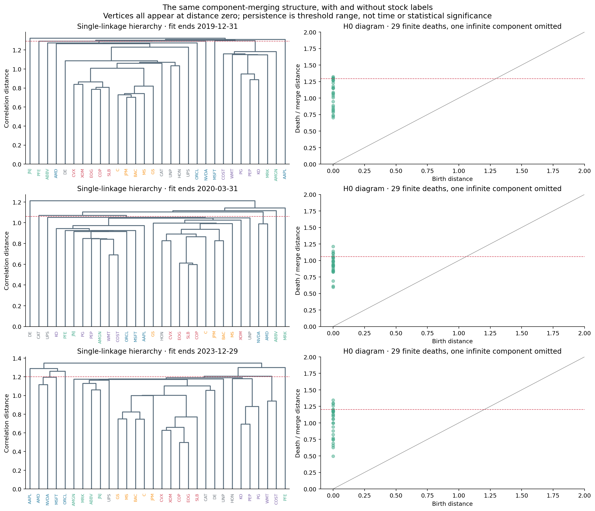
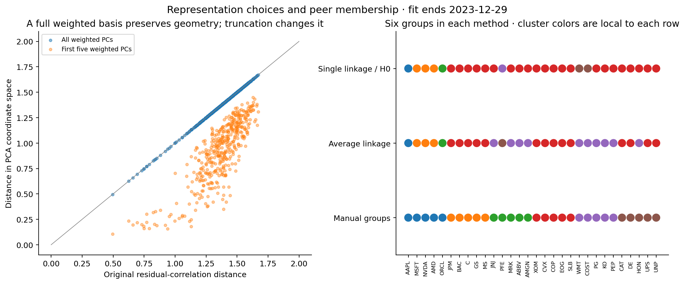
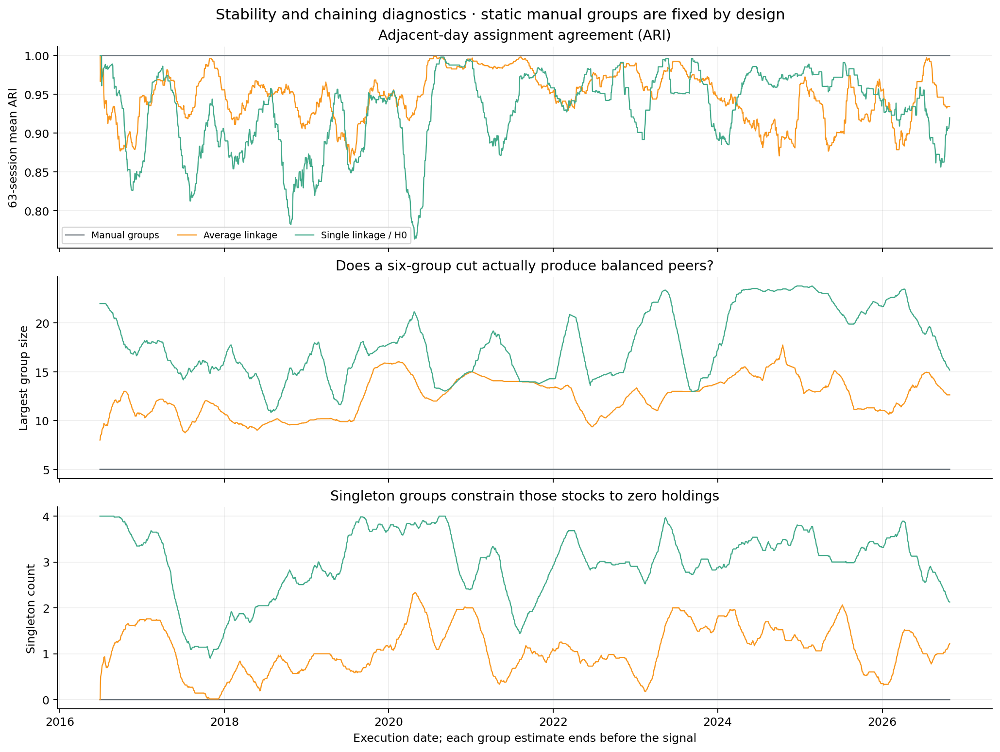
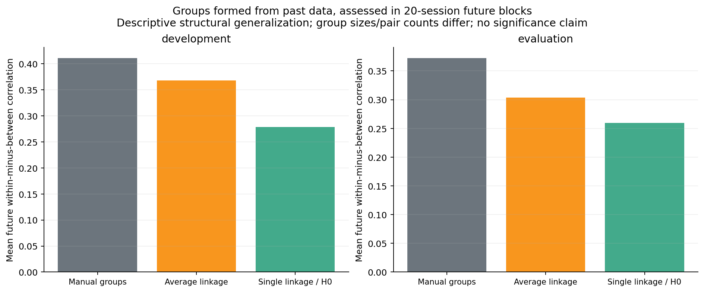
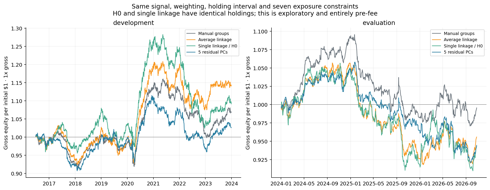

# H0 peer pilot: what is a point, and does the hierarchy give useful peers?

Run October 28, 2026. [Executed notebook](../../equity_h0_peers.ipynb), [source](../equity_h0_peers.py), [specification](specification.json), and [numerical summary](summary.json). This is follow-up exploration on already examined data. All performance is **gross/pre-fee**. No new untouched temporal holdout, profitable TDA strategy, or novel clustering method is claimed.

**Subsequent structural experiment:** the [whole-hierarchy study](../equity_h0_scale_robustness/README.md) now inspects every cut and measures exact branch recovery under historical perturbations. It finds stable local peers, largely shared with average linkage, rather than an incremental H0 advantage. The fixed-cut results below are preserved.

## Coordinates: returns first, PCA as a controlled alternative

The object is **30 stock points**, not one point per date. Each stock is represented by its aligned 120-session history after fitting out its linear SPY exposure. Center and divide each stock's residual history by its own sample residual volatility, then divide the coordinate vector by `sqrt(119)`. Each point therefore has unit Euclidean norm.

For these points u_i:

```text
dot(u_i, u_j) = residual_return_correlation(i, j)
distance(i,j)^2 = 2 * (1 - correlation(i,j))
```

This makes the intended similarity explicit: stocks are close when their residual returns moved together over those dates. It discards differences in residual volatility and average return. Dates must align; permuting the same dates for every stock leaves these distances unchanged, so this representation is about comovement rather than temporal ordering.

### Can PCA coefficients be the dimensions instead?

Yes, if we define what coefficients and what metric. For correlation matrix `C = V @ diag(lambda) @ V.T`, use stock coordinates:

```text
L_ik = V_ik * sqrt(lambda_k)
```

L contains correlations with normalized component scores. With all components, `L @ L.T = C`, so Euclidean distances between its rows exactly reproduce correlation distances. It is another coordinate system for the same geometry, not new information. With five components, the distances use only the retained shared patterns and omit the rest; whether this helps is a separate hypothesis.

**Do not use all plain eigenvector coefficients as coordinates without eigenvalue weights.** A complete orthogonal N-by-N V has orthonormal rows: every distinct pair is distance `sqrt(2)`. Their apparent nearest neighbors are numerical tie-breaking, not meaningful peers. The saved plain-eigenvector neighbor statistics illustrate this degenerate construction and are not an alternative model to interpret.

The dimensionless clustering coordinates L are also different from the raw-return exposure basis used for dollar-neutral trading. There we use `diag(training_residual_sigma) @ V_k` (equivalently a per-column rescaling of it), so the portfolio constraint is in raw-return units. A per-column rescaling preserves a constraint span, but it generally changes Euclidean clustering distances; geometry and exposure neutrality are different uses of coefficients.

### Should we append past returns or other features?

The trailing returns already generated L. Concatenating the full L block with its original normalized return vectors duplicates the same distances and simply multiplies them by `sqrt(2)`. Concatenating a truncated L block instead double-weights the retained directions relative to the omitted directions. Neither operation adds a new data source.

Appending only the most recent return would deliberately make today's shock affect peer identity more strongly. That answers a different question from estimating slower structural peers. It also changes the current comparison, where exposures end before the signal interval. Size, liquidity, or other features might support a future definition of peers, but each needs a stated reason, compatible units/scaling, and an independent comparison. No such extra block was added here.

## What was compared

- Manual6: the existing six manual groups plus a SPY-beta constraint.
- Average6: six average-linkage groups from the residual distances, plus SPY beta.
- Single6: six single-linkage groups, plus SPY beta.
- H0_6: connected components of the distance-threshold graph at the corresponding six-component cut, plus SPY beta.
- PCA5: five residual-PC exposure columns plus SPY beta and a dollar constraint.

Every model had **seven independent exposure columns on every date**. Six complete group indicators already span the intercept; no redundant intercept was added. Holding the nominal group count fixed does not make group sizes or portfolio breadth equal. Those are reported explicitly.

All fits use 120 observations ending before the signal day. The one-day close-to-close signal, inverse total-variance weighting, unit gross target, and next vendor-bar raw open-to-close holding are unchanged. Dates used as coordinates are historical only. No fee adjustment, ranking, clipping, or parameter selection was used.

## H0 controls passed

H0 threshold-graph partitions matched single linkage, and their portfolios were **exactly identical** in this run. MST edge weights matched single-linkage merge heights. Ripser's three snapshot H0 diagrams had 29 finite deaths and one infinite component, matching those merge heights within floating-point tolerance.

Synthetic controls recovered three strongly separated constructed groups and demonstrated chaining: a sequence of short links joins endpoints that are far apart. The point-coordinate/correlation identity and full weighted-PCA distance identity also passed numerically.



Every stock vertex is present at threshold zero, so every H0 birth is zero. A vertical column of diagram points is expected here, not a plot failure. The single infinite component is omitted from the figure. The diagram retains merge distances but not the complete labeled membership structure shown on the left. A long-lived H0 component can be an isolated stock; it does not automatically signify a cohesive peer group, long time duration, significance, or an arbitrage opportunity. Component-survivor labels can depend on tie conventions.

## What the representations changed

At the fit ending **2023-12-29**, all weighted PCs preserved pair distances to numerical precision. Keeping five weighted PCs preserved about **70% of each stock's three nearest neighbors on average** and changed the six-group single-linkage partition (ARI about 0.565). These are one-snapshot observations, not evidence that truncation improves peers or trading. Original returns with SPY retained also yielded a different geometry; it was a prespecified snapshot check, not a second strategy selected by profit.



Group colors are local identifiers within each row, not matched meanings across methods. [Representation measurements](representation_checks.csv) and [named cluster memberships](snapshot_cluster_members.csv) are saved.

## Main limitation observed: chaining and singleton constraints

In the later 2024–October 2026 portion, the largest single-linkage/H0 group averaged **21.6 stocks**, with **3.21 singleton groups** on average. Average linkage's largest group averaged 13.6 stocks, with 1.22 singletons. Manual groups have five stocks each by construction.

At the 2023-12-29 snapshot, single linkage grouped 22 stocks into one component and left AAPL, ORCL, and PFE as singletons, alongside a three-stock group and a two-stock group. Thus “six groups” did not mean six similarly local peer baskets.

Exact neutrality to a singleton group forces its stock's position to zero. This was checked numerically. The H0 portfolio averaged 26.8 active stocks in the later portion, versus 30 for manual groups/PCA. This is a consequence of the chosen group constraint, not a borrow or fee assumption.



ARI measures partition agreement independent of arbitrary group labels: one is identical partitions; zero is chance-adjusted agreement. Adjacent 120-day windows share 119 observations, so high day-to-day agreement is partly expected. Manual-group agreement is one because those labels were deliberately fixed. A stable large component is not necessarily an informative local peer group.

## Later structural coherence

Past-formed groups were assessed in **20-session non-overlapping future blocks**, using the prior fitted SPY betas to form future residual returns. Blocks crossing the original development/evaluation boundary were excluded. There were 94 development blocks and 34 later blocks. Training windows still overlap, so this is not an independence guarantee.

| Representation | Later future within-minus-between correlation | Mean within-group pair count |
|---|---:|---:|
| Manual groups | 0.373 | 60.0 |
| Average linkage | 0.304 | 121.6 |
| Single linkage / H0 | 0.260 | 229.6 |



The manual groups show the largest gap under this metric. This does not prove a statistically significant ranking or economic ground truth. Group sizes and pair counts differ materially; broad components include more heterogeneous pairs. The metric is a descriptive assessment of later dependence, not a forecast of the next return or a causal explanation.

## Gross return comparison

| Representation | Development mean gross bps/day | Later mean gross bps/day | Later gross Sharpe vs zero |
|---|---:|---:|---:|
| Manual groups + SPY | +0.393 | -0.010 | -0.005 |
| Average linkage + SPY | +0.752 | -0.576 | -0.259 |
| Single linkage / H0 + SPY | +0.536 | -0.755 | -0.306 |
| Five residual PCs + SPY | +0.178 | -0.761 | -0.397 |



The manual model is approximately flat before fees in the later portion; the alternatives have negative point estimates. These estimates do not establish a positive expected return or reliable superiority of one model. See the saved HAC mean intervals in [gross_performance_and_structure.csv](gross_performance_and_structure.csv). The five-PC daily returns were independently reconciled to the previous component-count sensitivity run. H0 is plotted once with single linkage because the portfolios are identical.

## What we learned and what remains open

We now have actual persistence diagrams tied to named stock relationships, and a measured equivalence between the proposed return-history and full weighted-PCA geometries. The simplest six-component H0 cut is not a demonstrated improvement: it chains many names into a broad group and adds singleton constraints. This is an identified limitation of this construction, not a failure of every topological method.

This pilot uses one cut of the hierarchy. It does not test an incremental cross-scale feature, temporal persistence method, H1, extra fundamentals, a larger universe, or a new signal horizon. Any next such step needs an explicit distinction to measure and a simpler comparator. The existing 30-stock basket and historical classifications retain selection bias; the later period has already been examined. No economic cause or novel financial alpha is established.

## Reproduce

From `TDA_Research/equity`, using the TDA environment:

```sh
python experiments/equity_h0_peers.py
```

Only local files are read. The original backtest source and data snapshot were preserved during folder reorganization. `specification.json` records the pilot settings before results are computed, and `independent_audit.json` records additional accounting, identity, path, and hash checks.

References: [Ripser API](https://ripser.scikit-tda.org/en/latest/reference/stubs/ripser.ripser.html), [Carlsson–Mémoli hierarchical clustering](https://www.jmlr.org/papers/v11/carlsson10a.html). Mathematical coordinate identities above are derived directly from the stated Gram matrix and checked in code.
