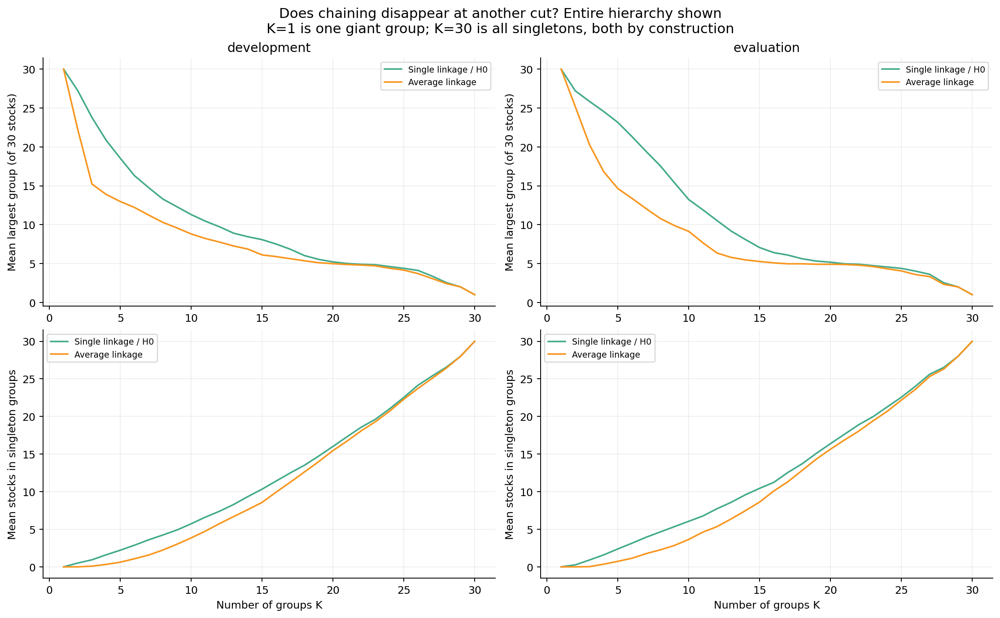
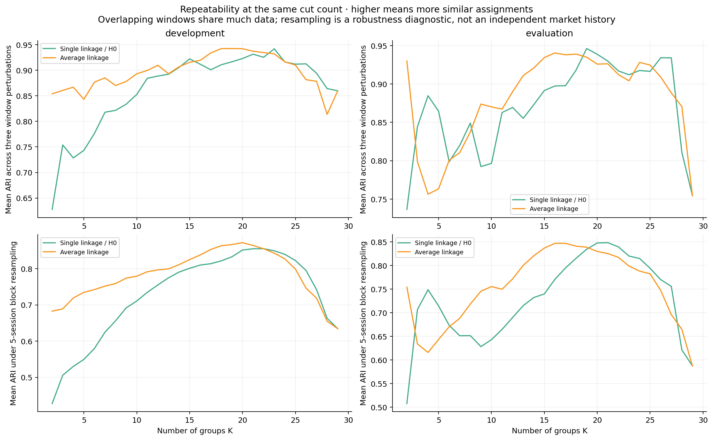
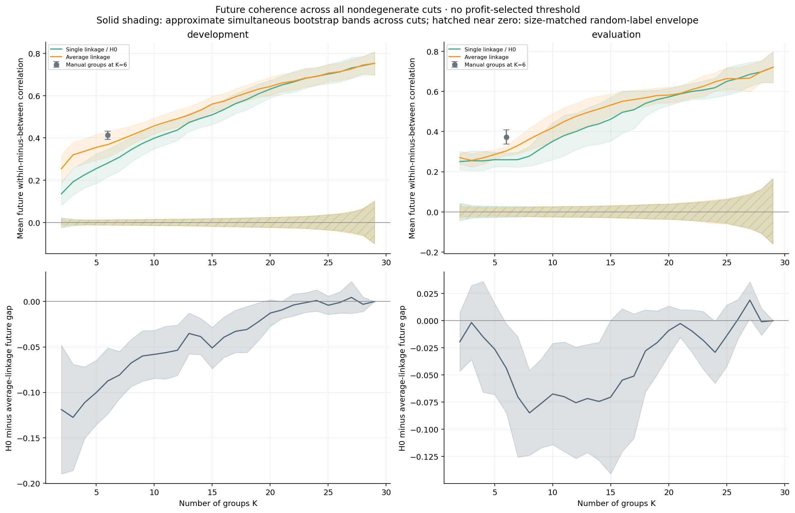
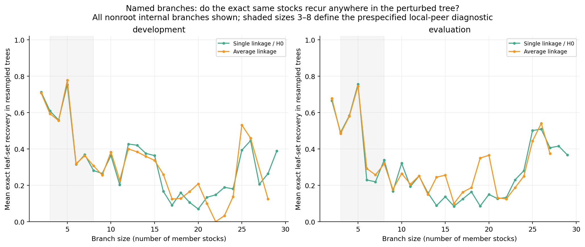

# Whole-hierarchy robustness: are useful peers hidden beyond the six-group cut?

Run October 28, 2026. [Executed notebook](../../equity_h0_scale_robustness.ipynb), [source](../equity_h0_scale_robustness.py), [fixed specification](specification.json), and [summary](summary.json). This is exploratory structural analysis on already examined data. **No trading rule, position, holding period, or fee assumption was changed. No new P&L backtest was run.**

**Subsequent experiment completed:** the [direct reversal-response diagnostic](../equity_reversal_response/README.md) tests the missing link from persistent peers to subsequent catch-up at 1/5/20 sessions. Overall slope and gross-event-return intervals all include zero; stable peer assignments did not establish stronger reversal. That separate experiment leaves this structural study and its original outputs unchanged.

## Decision from this experiment

**There are repeatable local peers inside the hierarchy, but no compelling incremental H0 advantage over ordinary average linkage was established.** The six-group cut hid useful smaller branches. However, discovering those branches is not unique to H0, and moving to a finer global cut trades the giant component for many singleton stocks.

The local-branch observation is a useful positive descriptive result. It is not evidence that those groups' relative returns reverse, that a branch-selection portfolio will work, or that an economic cause has been identified.

## What was fixed before this run

- Stock geometry: 120 prior SPY-residual daily returns, standardized per stock; correlation distance.
- Both single linkage/H0 and average linkage, at **every group count K=1 through 30**.
- Historical-window perturbations: 100 sessions, 140 sessions, and a 120-session window shifted five sessions earlier.
- Sampling perturbations: **40 circular block resamples**, five consecutive trading sessions per block. Stock and SPY rows are sampled together, and the SPY fit is re-estimated.
- Future target: the next **20 daily-return observations** after the signal date, with residuals calculated using the frozen prior SPY coefficients. Target blocks do not overlap; blocks crossing January 2024 are omitted.
- Size-matched references: **250 random stock relabelings per anchor**, preserving every cut's exact cluster sizes. The same relabeling is used across cuts to preserve the hierarchy's nested structure.
- Uncertainty: **1,000 circular moving-block resamples of the anchor sequence**, six anchors per block (roughly 120 sessions). Pointwise intervals and approximate simultaneous bands across the 28 nondegenerate cuts are both saved. Paired method differences use the same resampled anchors.
- Named local branches: all nonroot internal branches are retained. A past-only diagnostic flags branches of **3–8 stocks**, recovered exactly in at least **75% of history resamples** and at least **two of three window perturbations**. These thresholds define a diagnostic, not an optimized trading rule.

There are **93 development anchors** and **34 later anchors**. The first anchor requires 140 prior observations so all window perturbations are available. The terminology development/evaluation identifies the original split; it does not restore untouched data for this follow-up.

## 1. The problem was not confined to K=6



In the later period:

| Groups K | H0 largest group, mean | H0 singleton stocks, mean | Average-linkage largest group, mean | Average-linkage singleton stocks, mean |
|---|---:|---:|---:|---:|
| 6 | 21.3 | 3.1 | 13.4 | 1.1 |
| 10 | 13.2 | 6.1 | 9.1 | 3.6 |
| 15 | 7.1 | 10.4 | 5.3 | 8.6 |
| 20 | 5.2 | 16.4 | 4.9 | 15.6 |
| 25 | 4.4 | 22.6 | 4.1 | 22.2 |

A finer cut can expose small peers, but it does not produce a balanced peer partition for all 30 stocks. At many cuts, average linkage is less imbalanced. At K=1 everything is one group; at K=30 every stock is isolated. Those endpoints are reported for balance but have undefined within-minus-between coherence and are excluded from quality comparisons. Fixed-merge-count cuts use the library's tie convention if heights tie; the independent audit checks real base-tree threshold consistency.

## 2. Adjacent-day stability was an optimistic view of sampling robustness



The earlier daily estimates shared 119 of 120 observations, so high agreement was partly expected. Replacing blocks of observations gives a stronger perturbation. At K=6, mean block-resampling ARI was **0.580 versus 0.742** for H0 versus average linkage in development, and **0.673 versus 0.670** later. Thus average linkage is not universally more stable, and stability depends on scale and period.

ARI compares partition assignments independent of arbitrary label numbers. The exact same stock set can also recur at a different cut; that separate branch-level property is measured below. Resampled histories are sensitivity checks, not additional independent market histories. The five-session resampling block and all branch thresholds are choices, not estimated optimal constants.

## 3. Both hierarchies contain future-coherent structure beyond random groups



At every nondegenerate cut in both periods, the mean future coherence of both methods exceeds the simultaneous size-matched random reference envelope in this run. This shows persistent association in the chosen stock basket beyond arbitrary labels. It does not distinguish H0 from ordinary clustering or demonstrate return predictability.

The top panels compare **future within-group minus between-group correlations**. Solid shading gives approximate simultaneous bootstrap uncertainty across cuts. Hatched near-zero shading is the simultaneous random-label reference envelope. The manual six-group reference is plotted only at K=6, where it is a comparable group count; its interval is pointwise.

The bottom panels show paired H0-minus-average differences. Development differences favor average linkage at K=2–19 under the approximate simultaneous bands. In the later period, those bands favor average linkage at **K=6–14 and K=24**. Most other differences are unresolved.

There is one later-period H0-favorable exception at **K=27**: mean gap difference about **+0.0189**, with approximate simultaneous interval **[+0.0021, +0.0356]**. This cut leaves an average **25.6 singleton stocks**. It concerns a few closely related names and does not establish a broadly useful peer partition or a profitable trading rule. It was not selected as a new setting. At K=29 both methods select the closest pair and agree.

The rise in absolute coherence at fine cuts should not be read as “more groups is better.” There are progressively fewer within-group pairs, increasingly concentrated in the strongest relationships. Matched random sizes control an arbitrary-group reference; they do not make every scale cover the same stocks or answer the same portfolio question.

The simultaneous bands cover the cut curve within the stated method/period comparison, **not** every possible dataset, representation, perturbation, or research decision. Block bootstrap assumptions are approximate, and only 34 later target blocks are available. The random-label envelope is a structural reference, not a test of an executable strategy or an economic mechanism.

## 4. Named branches: there are useful local groups



A branch is the exact set of stocks below an internal tree node. We check whether the same set appears **anywhere** in a perturbed tree, rather than requiring it to occur at the same K. Parent and child branches can both qualify; these are overlapping/nested sets, not a ready-made nonoverlapping portfolio partition.

In the later period, H0 had an average **3.71** past-selected stable local branch occurrences per anchor; average linkage had **4.03**. Across 34 anchors, the H0 counts include:

| Named branch | Anchors where it appears | Anchors meeting past-only stability thresholds | Mean resampling recovery when present |
|---|---:|---:|---:|
| XOM, CVX, COP, EOG, SLB | 34 | 33 | 96.0% |
| JPM, BAC, C, GS, MS | 34 | 31 | 93.5% |
| XOM, CVX, COP, EOG | 33 | 25 | 84.3% |
| PG, KO, PEP | 28 | 16 | 76.0% |

These sets are familiar manual peer groups or subsets. That supports interpretability, without establishing why the stocks co-moved. Mean future local gaps for the full energy and bank branches were positive (about 0.648 and 0.558), but these are conditional descriptive measurements, not a forecast of reversal.

**All 126 later-period stable H0 branch occurrences also appeared in the average-linkage trees; 119 met the stability thresholds there too.** In development the corresponding counts were 391 H0 occurrences, 388 also present under average linkage, and 352 stable under both. Occurrences repeat named groups across anchors and include nested branches; they are not 126 distinct or independent discoveries.

The full [named catalogue](named_branch_catalogue.csv) reports every observed set, not only these examples. [Branch overlap](branch_overlap_summary.csv) is a deterministic membership comparison computed in the notebook from saved branches. Examples above are ordered by past-only stable-occurrence counts, not by profit or future coherence.

## Interpretation and next decision

The hierarchy does contain local peer structure. The earlier six-cut finding should therefore be described as **a poor global partition**, not “no useful branches anywhere.” But ordinary average linkage recovers essentially the same robust local sets and generally has stronger future coherence across the practically broader cuts. This experiment does not justify further H0-based trading variations on this basket as a distinct alpha direction.

Keep the labeled hierarchy and exact-recovery measurements as useful research diagnostics. If equity work continues, preserve average linkage and manual groups as strong baselines and freeze any branch-to-exposure rule before evaluating it. A larger universe could test generalization, but these results do not promise a TDA advantage there. H1, nonlinear dependence, economic factors, a different holding interval, and other mini-studies remain separate hypotheses.

No fee deductions or P&L selection entered this experiment. The original trading results are unchanged. Past coefficients and branch stability use only historical inputs; future returns are used only to assess the resulting structure. The fixed selected universe, already examined periods, and limited target-block count constrain conclusions.

## Files and reproduction

From `TDA_Research/equity` in the TDA environment:

```sh
python experiments/equity_h0_scale_robustness.py
```

Outputs include anchor dates, every cut's size/stability/coherence measurements, all internal branches, a named catalogue, random reference curves, pointwise and simultaneous uncertainty summaries, paired differences, and the four figures. Run the notebook to reproduce the branch-overlap summary from those outputs. `independent_audit.json` records timing, numerical, reference-size, and source/data-integrity checks. Synthetic checks caught and corrected this installed SciPy version's all-cuts K=N endpoint behavior before real-data computation.
