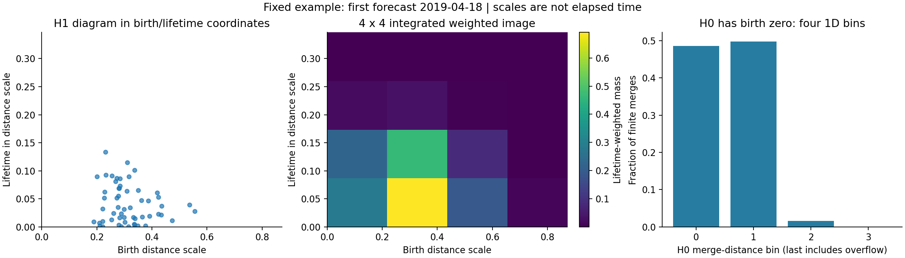
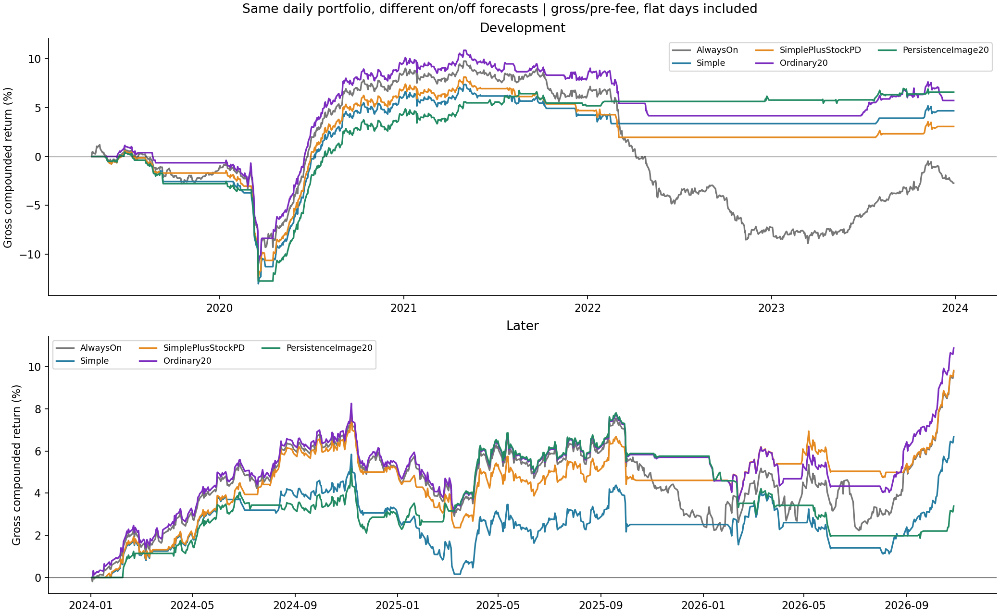
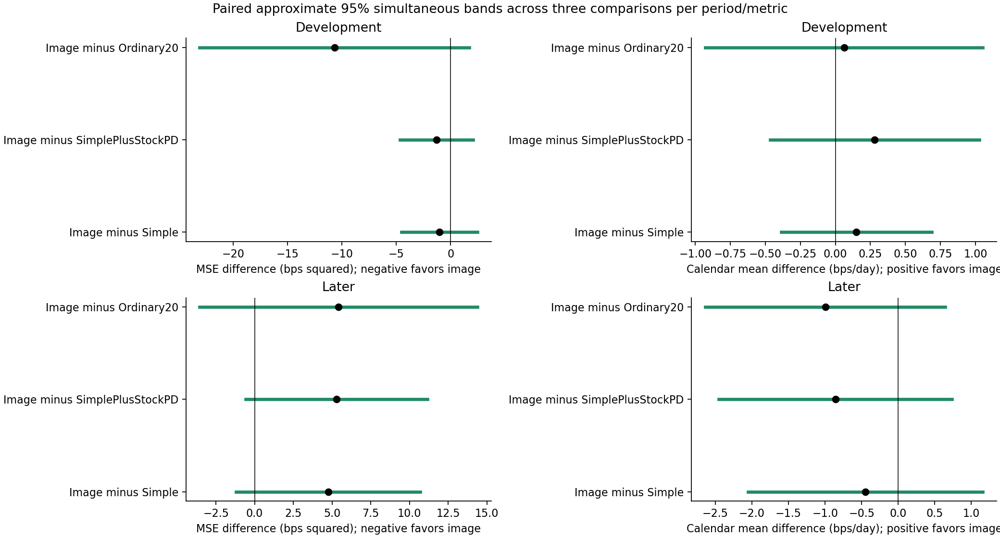
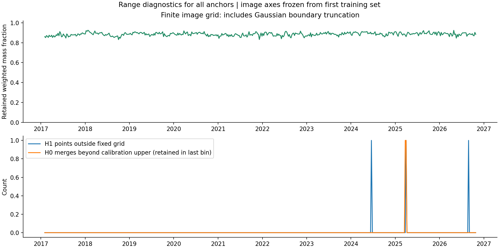

# Persistence images for the fixed equity timing gate

Executed October 29, 2026. **The image representation did not improve the gate.** It modestly improved the earlier-period point forecast error, but later forecast error increased and gross trading performance fell. All declared simultaneous incremental intervals include zero, so this is an unfavorable point result, not proof that images are universally worse.

[Executed notebook](../../equity_persistence_images.ipynb) · [fixed specification](specification.json) · [frozen grid](frozen_grid.json) · [source](../equity_persistence_images.py) · [independent audit](independent_audit.json) · [audit source](../audit_equity_persistence_images.py) · [previous scalar-summary experiment](../equity_persistence_regimes/README.md).

## The question

The previous model reduced each stock diagram to three numbers: a high H0 merge-distance quantile, longest H1 lifetime, and sum of squared H1 lifetimes. These discard where H1 features first appear and much of the distribution. Two diagrams can share those summaries but have different birth scales.

The bounded hypothesis was: **does retaining more of the diagram's distribution improve forecasts of this particular daily strategy's returns?** We tested one fixed representation and learner, without changing the portfolio, execution prices, signal, forecast target, update frequency, or zero forecast threshold.

## What an image means here

Each stock is a point with three coordinates describing its common residual-return exposures. The reference set is the same 182 stocks as the previous experiment, fixed from the initial formation's prior observations. Coordinates come from 120 prior sessions of SPY-residual returns, standardized stock by stock, and the top three eigenvalue-weighted PCA loading directions. Pair distances are divided by their median.

As connection distance increases, components merge (H0), and loops can appear and disappear (H1). In a birth/lifetime diagram, a point's horizontal coordinate is the distance scale where a loop appears; its vertical coordinate is death minus birth. **Neither coordinate measures calendar time, and a loop is not an arbitrage opportunity.**

For H1 we place a Gaussian bump at each birth/lifetime point, weight it by its lifetime, and integrate the bumps into a **4×4 grid**. That gives sixteen numbers. Smooth bumps make a small point movement change pixel values gradually. The weighting emphasizes longer-lived features without asserting they are economically useful or that short features are all noise. This follows the construction in [Adams et al. (2017), *Persistence Images*](https://www.jmlr.org/papers/volume18/16-337/16-337.pdf).

H0 components all start at zero in this filtration, so we use **four one-dimensional merge-distance frequency bins**, excluding the one infinite interval. A two-dimensional H0 image would allocate a dimension to a constant birth value. The combined representation therefore adds twenty inputs, not twenty separate trading signals.



The first forecast's diagram is the fixed illustration above, not a date chosen for favorable performance. The original diagram remains more detailed than its image; vectorization cannot create information absent from the diagram.

## Frozen design and ordinary comparison

The exact numerical settings are saved in the specification and grid files. Grid axes use only the first forecast's **104 completed valid training anchors**. The upper birth/lifetime bounds are 1.25 times their respective calibration maxima; Gaussian standard deviations are half a pixel width. These choices are frozen before new forecasts and are never selected against return outcomes. No other resolution or bandwidth was tried.

H1 uses a finite nonnegative rectangle and keeps its integrated weighted mass without renormalization. Gaussian tails outside it are omitted and diagnosed. H0's final bin includes values above its calibration upper bound, so those merges are retained. After that initial unsupervised grid calibration, each forecast standardizes its inputs using only its own expanding completed training set.

Every augmented model includes the previous ten simple predictors. In addition to the historical-mean and simple baselines, we compare:

| Model | Added inputs |
|---|---|
| Three diagram summaries (`SimplePlusStockPD`) | The original three scalar stock-diagram summaries |
| Ordinary20 | Ten quantiles of normalized loading-cloud pair distances and ten of full residual stock correlations, from the same prior window |
| PersistenceImage20 | Four H0 frequencies and sixteen H1 image pixels |

The ordinary control adds the same number of coordinates as the image. Equal feature count does not guarantee identical effective model complexity, but it checks whether extra conventional geometric detail is already competitive.

All models use the same fixed ridge penalty: minimize mean squared forecast error plus the squared standardized coefficients, with an unpenalized intercept. Training expands only over prior anchors whose entire twenty-session target is complete. At least 104 labels are required. The grid is calibrated once; scalers and regression coefficients update causally thereafter.

The target is the **mean return of the next twenty actual daily strategy trades**, not twenty-day holdings of today's stocks. Every five sessions, a positive forecast switches the original strategy on for the next five sessions; otherwise it remains flat. Stocks and weights still refresh daily and positions close each night. All zero-return flat days remain in reported calendar returns.

## Results

There are **490 feature anchors and 379 forecasts**, April 18, 2019–October 26, 2026. Forecast scoring uses 233 development and 138 later complete targets. Four targets cross the period boundary and four latest targets are incomplete; they are not assigned to either period's forecast score. Gates retain their available daily executions. Daily performance covers 1,183 earlier and 708 later sessions.

Later means January 2024–October 27, 2026. Every return is **gross/pre-fee**, including no spread, impact, borrow, financing, or generic cost subtraction.

| Rule | Later mean bps/calendar day | Gross annualized return (CAGR) | Sharpe versus zero | Active days |
|---|---:|---:|---:|---:|
| Always trade | 1.343 | 3.37% | 0.89 | 100.0% |
| Simple gate | 0.933 | 2.33% | 0.74 | 67.2% |
| Three diagram summaries | 1.344 | 3.39% | 1.06 | 69.4% |
| Ordinary20 | 1.483 | 3.75% | 1.10 | 82.1% |
| PersistenceImage20 | 0.487 | 1.19% | 0.43 | 55.9% |

These are point estimates; **every daily mean's pointwise interval includes zero**. The ordinary control's higher point Sharpe is not a validated model selection result.



| Model | Earlier forecast MSE | Later forecast MSE |
|---|---:|---:|
| Historical mean | 79.278 | 32.277 |
| Simple | 71.153 | 33.347 |
| Three diagram summaries | 71.423 | 32.812 |
| Ordinary20 | 80.800 | 32.680 |
| PersistenceImage20 | 70.128 | 38.103 |

MSE is mean squared difference between a forecast and the subsequent twenty-session mean, measured in bps squared. Lower is better. The image's earlier advantage did not carry into the later period. The historical mean remains the lowest later point MSE among these models.

Primary paired later comparisons, image minus comparator:

| Comparator | Forecast MSE difference, approximate simultaneous 95% interval | Calendar mean difference in bps/day, approximate simultaneous 95% interval |
|---|---:|---:|
| Simple | +4.756 [-1.196,+10.708] | −0.446 [−2.051,+1.159] |
| Three summaries | +5.292 [−0.578,+11.162] | −0.857 [−2.451,+0.737] |
| Ordinary20 | +5.423 [−3.544,+14.390] | −0.996 [−2.638,+0.646] |

Positive forecast-error differences and negative trading-mean differences favor the comparator. All primary simultaneous intervals span zero in both periods. One later forecast comparison has a pointwise interval excluding zero; it does not survive the declared simultaneous comparison. Do not substitute that isolated interval for the primary result.



Intervals use 1,000 circular block resamples, sixty daily observations for gate returns and twelve five-session anchors for forecast errors. Three simultaneous comparisons are made within each period and metric. They condition on saved causal forecasts, not a full model-refit bootstrap. They do not correct for every historical experiment in this project.

## Checks and interpretation

The later image gate allowed 55.9% of days. On those days the underlying portfolio averaged **0.870 bps/day**; on the days it skipped, that same underlying portfolio averaged **1.942 bps/day**. This is the wrong descriptive ordering for a useful on/off rule and explains how the gate left positive returns out of its calendar series. These are realized subgroup means, not information available in advance or a statistically established reversal of the forecast relationship. The corresponding earlier means were +1.433 on active days and −1.235 on skipped days. See the notebook's [selection decomposition](gate_selection_diagnostics.csv); it adds no new fitted rule.

Only **3 of 30,270 H1 points** across all 490 anchors lie outside the fixed image rectangle. The median retained lifetime-weighted Gaussian mass is **88.6%**, minimum **83.1%**. Even points inside a finite rectangle have Gaussian tails outside its boundaries. Two H0 merges exceed their calibration upper bound but remain in the final bin. This does not suggest a widespread out-of-range failure; it does not prove the coarse grid or smoothing was optimal.



The independent audit reconstructs all 490 image vectors, verifies Gaussian integrals with numerical quadrature, checks ordinary coordinates through covariance eigenvectors, and reproduces all 379 fits with scikit-learn. It also checks exact completed-label memberships, future-label exclusion, every daily gate return, all metrics, every reported uncertainty band, and protected input hashes. Original baseline forecasts and gate returns match the previous experiment. The old strategy, diagrams, sources, notebook, and price files are unchanged.

Representation controls confirm permutation invariance and zero image contribution from empty or zero-lifetime H1. A labeled hypothetical pair of diagrams with equal lifetimes but shifted births produces different images. Thus the vectorization can preserve a distinction the original scalar summaries omit. **That representational distinction did not deliver demonstrated return-prediction value here.**

Possible explanations include additional estimation noise, weak relationship between these shapes and reversal returns, or a representation that misses the relevant distinction. This experiment does not identify which explanation is correct. We did not fit a CNN, tune image resolution, search for profitable pixels, or select a threshold after looking at returns.

**Decision:** retain the image experiment as a negative incremental result. Keep the existing fixed daily strategy as the benchmark and the gates as unconfirmed research variants. Do not promote Ordinary20 or the three-summary model based on this table's point rankings, and do not increase resolution solely to repair the curve.

Limits include the current-survivor universe, already examined later dates, fixed reference cohort, overlapping history and label windows, one image specification, fixed learner, and approximate conditional uncertainty. More pixels cannot supply new independent market history. Confirmation would require a distinct justified hypothesis or new observations, not relabeling this historical period as untouched.

## Reproduce and inspect

Use the local TDA conda Python with `OPENBLAS_NUM_THREADS=1`, `OMP_NUM_THREADS=1`, and writable Matplotlib/IPython caches. From the project root:

```sh
python equity/experiments/equity_persistence_images.py
python equity/experiments/audit_equity_persistence_images.py
python equity/experiments/build_equity_persistence_images_notebook.py
```

The run downloads nothing and reads no credentials. Existing specifications reject changed settings. Reproduction uses the frozen prior experiment and local returns; it does not overwrite earlier results.

Full precision is in [forecast metrics](forecast_metrics.csv), [gate performance](gate_performance.csv), [paired comparisons](paired_incremental_comparisons.csv), [predictions](walk_forward_predictions.csv), [daily calendar returns](daily_gate_returns.csv), [features](state_features_and_targets.csv), [coefficients](coefficient_history.csv), [training membership](training_membership.csv.gz), and [range diagnostics](image_range_diagnostics.csv). [Summary](summary.json) records configuration, checks, grid values, and protected hashes. The notebook also computes descriptive returns of the underlying strategy on active versus skipped days; these are explanations of the observed gate outcome, not new decision rules.
