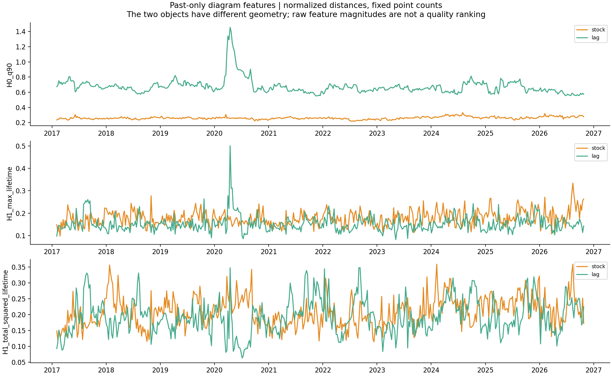
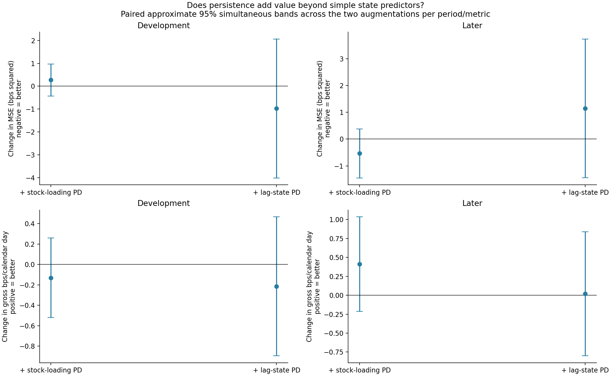
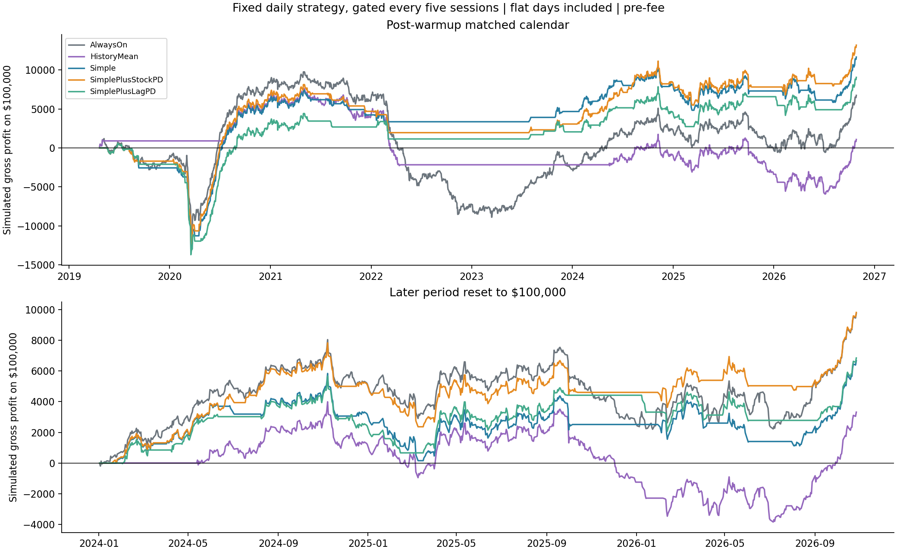
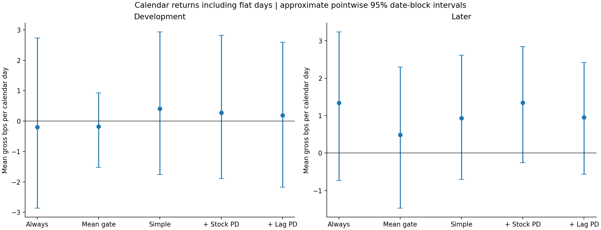
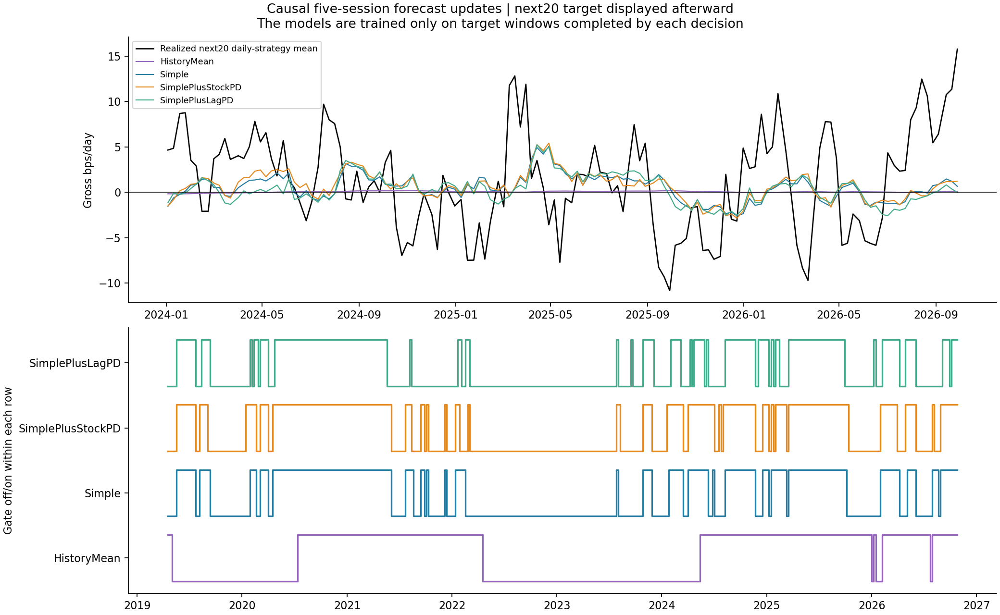

# Can persistence features identify favorable residual-reversal regimes?

October 29, 2026. [Executed notebook](../../equity_persistence_regimes.ipynb), [source](../equity_persistence_regimes.py), [fixed specification](specification.json), [independent audit](independent_audit.json).

**Result: no reliable incremental forecasting or trading benefit from the tested persistence features was established.** The stock-loading version has a modest favorable later point estimate versus the simple model; its paired uncertainty interval includes zero. The lagged-state version has essentially no later trading improvement and worse mean forecast error. All primary incremental intervals include zero in both periods. No winning state, threshold, or alternate hyperparameter was selected afterward.

The useful positive result is that the two representations respond to different controlled changes. That distinction did not translate into a demonstrated profitability filter in this experiment. This is exploratory on already examined dates and a current-survivor universe, not a rejection of every TDA representation.

## 1. What did we try to predict?

Keep the **200-stock, 120-session SPY-plus-three-residual-PC daily reversal strategy fixed**. Its positions are computed from the closing return signal and traded from the next raw vendor-bar open to close. We reuse its saved gross returns without changing factor counts, weights, signal timing, position caps, or execution assumptions.

Every five trading sessions, predict the **average gross daily return of its next twenty daily trades**. The strategy refits and trades daily during those twenty sessions. This is not the separate test that holds today's stock positions for twenty days.

At the end of formation day t, feature histories stop at t-1. The trailing strategy-return input and completed training labels can include a trade ending at t's close, which is observed before the next entry. Only earlier anchors whose full target windows have finished can enter model training.

There are **490 feature anchors**, **379 forecasts** after warmup, and **1,891 matched calendar executions** from the first actionable forecast onward. The first forecast is April 18, 2019. Forecast evaluation includes 233 development and 138 later complete target windows; four boundary-crossing windows are excluded from period forecast scores, and four latest incomplete targets are not scored. Their available daily trading returns remain in the calendar comparison.

## 2. The comparisons in plain language

| Name in files | Meaning |
|---|---|
| `AlwaysOn` | Trade the original daily strategy every session. |
| `HistoryMean` | Forecast the average of previously completed twenty-session targets; trade only if that forecast is positive. |
| `Simple` | Forecast using ordinary historical state summaries; trade only if positive. |
| `SimplePlusStockPD` | The identical simple model, adding three persistence features from stock factor-loading points. |
| `SimplePlusLagPD` | The identical simple model, adding three persistence features from lagged factor-state points. |

The fitted forecasters use **ridge regression**: a linear forecast with a fixed penalty shrinking coefficients toward zero. This limits how strongly a small, correlated set of inputs can fit historical noise. We fixed the penalty in advance, used training-only means/standard deviations, and did not search penalties or trade thresholds for profit.

The simple inputs are prior SPY volatility, average residual correlation, first-PC and first-three-PC variance shares, average lag-one factor autocorrelation, average dominant Fourier power share, trailing twenty-session strategy mean, current strategy stock count, and the two clouds' unnormalized median distances. The latter inputs give every model access to the basic scale of both geometric objects, rather than reserving it for the TDA model.

The gate is fixed: **forecast > 0 means trade the unchanged daily strategy for the next five sessions; otherwise remain flat**. It is revisited at the next forecast. This uses a twenty-session state forecast for a five-session allocation decision, an explicit choice rather than a claim that the two horizons must rank models identically. Flat days count as zero return on the full calendar, not as observations we can drop.

## 3. How the persistence inputs were built

Freeze a reference list at the first formation using only stocks with 272 complete prior returns: **182 names**. This prevents changes in point count from mechanically moving the diagram features as newer stocks enter the broader trading universe. The strategy itself retains its dynamic 182–200-stock admission rule, and its stock count is included as a simple predictor. The reference list is still drawn from the current-size-selected survivor dataset; this does not make it historically point-in-time investable.

On each anchor's prior 120 sessions, regress the reference stock returns on SPY, standardize the residual histories, and extract the first three residual PCs.

- **Stock-loading cloud:** 182 stock points, each with three eigenvalue-weighted loading coordinates. It describes the arrangement of common-return sensitivities retained by those three PCs.
- **Lagged-state cloud:** whiten the three daily factor scores to unit sample variance, then pair each day with its predecessor. This gives **119 points in six coordinates**, each representing one adjacent-state transition. Divide concatenated vectors by sqrt(2), then normalize the geometry as below.

Each object's distances are divided by its own median pair distance. Each contributes exactly three finite-diagram summaries: the 90th percentile H0 death, the longest H1 lifetime, and the sum of squared H1 lifetimes. Infinite H0 intervals are saved separately in the interval ledger and excluded from finite summaries. Every cloud has one essential H0 interval. The diagram features have fixed point counts within each object, but their raw numerical magnitudes are not a ranking of the two different constructions.

H0 describes connectivity scales. H1 describes loops in the particular point-cloud geometry. Neither is automatically a profitable regime, an economic cycle, or evidence of a causal market mechanism.

## 4. Controlled changes show what the representations preserve

The controls use the **first past-data window**, independently of future profit:

| Change to the stock/SPY history | Stock-loading diagrams | Lagged-state diagrams |
|---|---|---|
| Shuffle the days together across all series | Unchanged: the stock correlation matrix is unchanged. | Change: consecutive transitions have changed. |
| Multiply all returns by three | Unchanged after stock standardization and geometric normalization. | Unchanged after whitening and normalization. |
| Reverse time | Unchanged. | Unchanged: swapping the two lag blocks and reordering points is an isometry. |

The last row is an important limitation: lagged clouds can respond to **which transitions occurred** without preserving the arrow of time. They do not independently tell us which direction a stock will move. The forecast needs a learned relationship with subsequent strategy performance.

[Control values](representation_controls.csv), [past-only feature table](state_features_and_targets.csv), [complete diagram intervals](persistence_intervals.csv.gz).



## 5. Did persistence improve forecasts?

Mean squared error (MSE) is the average squared gap between the predicted and realized next-twenty-session mean return. Its units here are **bps squared**; lower is better. It is a forecast metric, not a trading return.

Later-period complete targets:

| Forecast | MSE | Skill relative to historical-mean forecast |
|---|---:|---:|
| Historical mean | 32.277 | 0.00% |
| Simple state model | 33.347 | -3.31% |
| Simple + stock-loading PD | 32.812 | -1.66% |
| Simple + lagged-state PD | 34.493 | -6.86% |

The simple model and both augmented models have worse later point MSE than the historical-mean forecast. That does not demonstrate statistically reliable inferiority. More importantly for the TDA question, the paired augmentation-minus-simple MSE differences are:

- Stock-loading PD: **-0.535 bps²**, approximate simultaneous interval **[-1.452,+0.381]**.
- Lagged-state PD: **+1.145 bps²**, interval **[-1.446,+3.737]**.

Negative means improved forecast accuracy. Neither interval excludes zero. The development counterparts also include zero. [All forecast metrics](forecast_metrics.csv), [paired comparisons](paired_incremental_comparisons.csv).



## 6. Did the trading gate help?

Later period, **the same 708 daily execution dates** for every rule:

| Rule | Days active | Gross mean bps/calendar day | Approximate pointwise 95% interval | Annualized gross Sharpe |
|---|---:|---:|---:|---:|
| Always on | 100.0% | 1.343 | [-0.730,+3.235] | 0.890 |
| Historical-mean gate | 83.5% | 0.486 | [-1.472,+2.302] | 0.348 |
| Simple state gate | 67.2% | 0.933 | [-0.699,+2.613] | 0.739 |
| Simple + stock-loading PD | 69.4% | 1.344 | [-0.259,+2.841] | 1.056 |
| Simple + lagged-state PD | 58.1% | 0.953 | [-0.567,+2.419] | 0.832 |

Stock-loading PD earns almost exactly the always-on point mean with less time invested and lower observed volatility. Its higher point Sharpe is worth recording, not a validated superiority claim. Every calendar-mean interval includes zero. Reducing active days also changes risk exposure; it is not additional per-trade alpha by definition.

The primary **incremental** paired comparisons, against the same simple model:

- Stock-loading PD: **+0.411 bps/calendar day**, approximate simultaneous interval **[-0.213,+1.035]**.
- Lagged-state PD: **+0.020**, interval **[-0.799,+0.839]**.

Both intervals include zero, as do their development counterparts. We did not promote the largest point Sharpe, invert a failed gate, or try alternate thresholds afterward. [Full gate table](gate_performance.csv).



The upper panel starts with the common post-warmup calendar. The lower panel restarts each rule at $100,000 at the later-period boundary. These compound daily calendar returns including flat zero days. They are simulated gross P&L under the underlying ideal vendor-bar execution assumptions, not actual account performance.



### Were predicted “bad” states actually bad?

The [sign-calibration table](sign_calibration.csv) groups forecasts by their declared positive/nonpositive sign. Later, the simple model's positive predictions had mean realized next20 return **1.156 bps/day**, versus **1.113** for its nonpositive predictions. That is almost no separation. Stock-PD values were **1.241 versus 0.923**; lag-PD values were **0.583 versus 1.890**, opposite the desired ordering. These are descriptive, overlapping target groups with wide uncertainty, not independent regime discoveries.

Even the historical-mean forecast's 23 later nonpositive predictions corresponded to favorable realized targets. This is a retrospective failure diagnostic for that rule, not authorization to invert its sign after seeing the results. Positive future average performance in a group labeled unfavorable is precisely the kind of miss a timing model needs to overcome.



## Chronology, inference, and qualifications

- Forecasts update every **five trading sessions**, not necessarily the same weekday. The target covers twenty future daily trades, so neighboring labels overlap. The trading allocations themselves are disjoint five-session blocks; capital is not allocated at unit gross to multiple overlapping cohorts.
- Training expands using only prior anchors with targets completed by the current close. It starts after **104 completed labels** with valid predictors. Those are overlapping five-session anchors, not 104 independent months. Input means/scales and all ridge coefficients are fitted only on the eligible training set.
- The ridge objective is average squared bps error plus `sum(beta²)`, with a free intercept; lambda is fixed at one. There is no profit-based search over this coefficient, training start, cloud lag, PCs, feature list, or gate threshold.
- Models continue learning from completed 2024+ labels as time passes. “Later” identifies the calendar segment, not a model frozen at 2023 or a new untouched holdout.
- Forecast-score intervals use **1,000 circular resamples of twelve consecutive forecast anchors**, roughly sixty sessions. Daily-return intervals use sixty-session blocks. Primary paired intervals are simultaneous across the **two PD augmentations within each period and metric**. They do not cover every historical research choice or representation possibility.
- The bootstrap resamples saved causal forecast errors and return differences. It does **not refit the forecasting pipeline** in each resample or establish that sixty-session blocks capture all dependence. Long feature windows, overlapping targets, expanding fits, and limited later history constrain inference.
- Incomplete latest targets are never used for training or forecast scores, but predictions and all available resulting daily returns are retained. Boundary-crossing twenty-session targets are omitted from the separate period forecast metrics, not erased from the live chronological learning sequence once completed or from the daily trading calendar.
- Always-on later returns match the previous broader strategy exactly. Different bootstrap seeds/groupings mean interval endpoints need not equal the earlier standalone report, even though the underlying returns are identical. We did not choose a favorable resampling seed.
- Current-survivor selection remains; sector labels are not inputs to this particular regime model or its fixed PCA strategy. No fee deductions, new data downloads, changes to stock positions on active days, or order submissions occur. All current performance is **pre-fee**.

## Decision

**Do not promote either persistence-conditioned gate as an established improvement.** Stock-loading geometry has a favorable later point estimate versus the simple gate, but no reliable incremental effect or improved forecast skill over the historical-mean baseline. The lagged-state construction supplies a meaningful controlled distinction, without a demonstrated return-prediction benefit here.

Keep this as the first bounded regime benchmark. Another TDA experiment should identify a specific distinction missed by the present controls—rather than search more lags, penalties, diagram summaries, and thresholds on the same profit history. The measured failure is conditional on this object, frequency, target, feature set, and learner; it does not show that every persistence representation or regime hypothesis fails.

## Reproduction and artifacts

From `TDA_Research/equity` in the TDA environment:

```sh
OPENBLAS_NUM_THREADS=1 OMP_NUM_THREADS=1 python experiments/equity_persistence_regimes.py
OPENBLAS_NUM_THREADS=1 OMP_NUM_THREADS=1 python experiments/audit_equity_persistence_regimes.py
```

Artifacts retain the fixed reference list, every feature/target timestamp, full finite/essential diagram intervals, every causal forecast, compressed exact training memberships, scaler/coefficient history, every daily active/flat return, calibration, forecast metrics, paired comparisons, five figures, and protected source/data hashes. The notebook displays these outputs and writes a deterministic interval-count summary.

The independent audit reconstructs nine feature windows using covariance eigenvectors, matches H0 with MST edges, reconciles the entire interval ledger, independently fits **all 379 forecasts** with scikit-learn ridge, verifies every training membership and daily gate, perturbs uncompleted labels, reproduces all reported uncertainty comparisons, and verifies prior artifacts unchanged.
