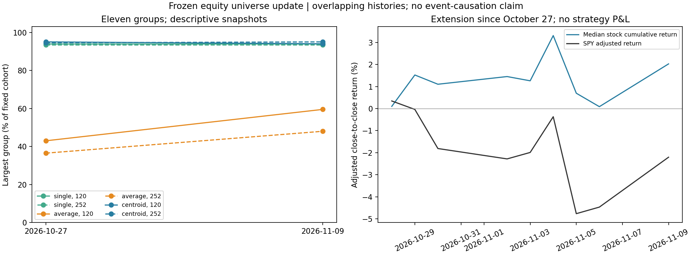

# Recent equity update and centroid-linkage comparison

Executed November 10, 2026. **Data now extends through November 9.** The
original 200 equities plus SPY are unchanged. Nine added sessions are too short
to establish a new regime, forecast benefit or causal explanation of an unwind.

## Data and design

The [new complete data vintage](../../../market_data/datasets/equity_daily_expanded_2016_2026-11-09/README.md)
contains 2,729 sessions and 528,637 bars per raw/adjusted mode. Independent
pagination, prices, returns and coverage checks passed. All source-vintage files
remain unchanged. Adjusted OHLC changed on 55,674 overlap bars; raw OHLC did not.

The [specification](specification.json) was saved before computing these results.
Freeze membership using 272 complete daily log returns through October 27:
all 200 stocks qualify. Compare after-close snapshots on October 27 and November
9 with 120/252 observed returns, including each snapshot close. Fit each stock
on intercept and SPY; standardize residual columns. Each stock is a vector of
those standardized residuals divided by `sqrt(L-1)`, giving Euclidean distances
`sqrt(2*(1-rho))`. Use the same vectors for single, average and centroid linkage.

Stop after `N-11` actual merges for eleven groups. Centroid heights can decrease,
so its result is a merge-count partition, not a horizontal filtration cut.
Every centroid height reconstructs from size-weighted original-point means.
Single-linkage cuts independently match threshold-graph connected components.
The two snapshots use the same refreshed price vintage; they are not exact
reproductions of the older study's t−1 formation convention.

## Measured results

| Quantity | October 27 | November 9 |
|---|---:|---:|
| Mean raw pair correlation, 120 sessions | 0.0660 | 0.0940 |
| Mean SPY-residual pair correlation, 120 sessions | 0.0453 | 0.0513 |
| Raw PC1 variance share, 120 sessions | 20.55% | 21.08% |
| Residual top-three PC variance share, 120 sessions | 32.85% | 35.59% |
| Mean raw pair correlation, 252 sessions | 0.0924 | 0.1050 |
| Mean SPY-residual pair correlation, 252 sessions | 0.0438 | 0.0451 |

Raw and residual correlations both rise in these rolling snapshots. Most
observations overlap, and nine observations enter as nine old observations
leave; this does not identify a structural break or a cause.

| History | Method | Largest group, Oct 27 → Nov 9 | Singletons, Nov 9 | Old/new partition ARI |
|---|---|---:|---:|---:|
| 120 | Single / Rips H0 | 188 → 188 | 8 | 0.728 |
| 120 | Average | 86 → 119 | 1 | 0.635 |
| 120 | Centroid | 190 → 188 | 9 | 0.706 |
| 252 | Single / Rips H0 | 187 → 187 | 8 | 0.747 |
| 252 | Average | 73 → 96 | 1 | 0.643 |
| 252 | Centroid | 189 → 190 | 10 | 0.642 |

Centroids do not repair the giant-group problem in these snapshots. Their trees
have 39–46 decreasing-height steps across the four fits. This is an observed
property of the centroid criterion, not an error to remove by relabeling heights.
ARI measures assignment agreement, not correctness; a nearly all-in-one partition
can have substantial agreement while providing little peer resolution.

Over October 28–November 9, SPY's adjusted cumulative return is **−2.20%**, while
the median cumulative stock return is **+2.02%**. The median curve is a changing
cross-sectional median, not a self-financing equal-weight portfolio. These
close-to-close returns are separate from our old next-open-to-close strategies.
Within that interval, SPY falls **4.41% on November 5** and rises **2.37% on
November 9**. The cumulative extension return therefore does not describe the
size of the individual selloff day.

For a bounded forward descriptive check, freeze October 27 group labels and
252-session SPY coefficients. Measure within-minus-between residual correlations
over the nine new sessions:

| Formation history | Single | Average | Centroid |
|---|---:|---:|---:|
| 120 sessions | 0.0996 | 0.5369 | 0.1926 |
| 252 sessions | 0.1267 | 0.4509 | 0.2545 |

Average has the higher point gap here too, but these are **one short block**,
not the old twenty-session target or an independent confirmation. With only nine
returns per stock, individual correlations are noisy and rank-limited. We report
no significance interval and select no method/lookback from these ranks. Group
sizes and the pairs counted within groups differ. In-sample gaps in the CSV
are formation diagnostics, not forecast results.

## The user's hedge-fund unwind hypothesis

The user identifies a recent reduction of long/short factor-neutral positions
as the suspected mechanism. Keep three levels of evidence separate:

1. **Observed in our panel:** the index drawdown, cross-sectional differences,
   correlations, and changed group assignments above.
2. **Reported externally:** a November 6 Reuters report describes leverage
   reductions at multi-manager funds, Walleye reducing its internal equity
   long/short business, and concern about overlapping positions. It reports
   substantial losses in tech-focused long/short books. This is contemporaneous
   reporting, not a downloaded fund-position ledger. [Reuters, syndicated copy](https://d2233.cms.socastsrm.com/2026/11/06/tech-selloff-wipes-out-hedge-fund-gains-prompting-risk-cuts-and-layoffs/).
3. **Not established:** that these specific books were neutral to the same
   factors as our strategy, that most long/short funds downsized, or that their
   trading caused the broad-market decline. The panel has no fund holdings,
   trade signs, gross-exposure changes, financing shocks or intraday sequencing.

**Why factor neutrality does not rule out unwind losses.** If a portfolio `h`
has fitted factor exposures `B' h = 0`, scaling it to `a h`, `0 < a < 1`, keeps
`B' (a h) = 0`. But the unwind sells existing longs and buys back existing
shorts. Shared crowded books can therefore have falling long names and rising
short names, adverse execution pressure and correlated residual losses while
remaining approximately neutral to the fitted factors. This is a mechanism,
not a measured finding about the funds in this episode. Long/short alone also
does not imply dollar, beta, sector or style neutrality.

A neutral unwind need not push every stock down: short covering creates buy
pressure. Its broad index effect depends on names, weights, liquidity and
responses by other investors. Nor must it raise all pairwise correlations:
same-side holdings can move together while opposite-side holdings separate.
That motivates **signed holdings and labeled relationships**, the distinction
already studied in research-log entry 22. A global H0/H1 scalar alone loses
who was long and who was short.

The [IMF's October 6 analysis](https://www.imf.org/en/blogs/articles/2026/10/06/hedge-funds-improve-market-functioning-but-can-also-amplify-stress)
provides general evidence of amplification through leverage, crowding and
synchronized unwinds; it does not attribute the November episode. A future
causal study needs independently dated position/flow evidence. A return-only
study could instead test whether frozen labeled relationships describe the
episode differently from ordinary correlations/covariance, explicitly without
calling the patterns evidence of particular funds' actions.

## Files and reproduction

- [Source](../equity_recent_refresh.py), [specification](specification.json), [summary](summary.json), [independent output checks](independent_audit.json).
- [Correlation/PCA snapshots](correlation_snapshots.csv), [group balance](group_balance.csv), [assignments](stock_groups.csv), [partition changes](partition_changes.csv).
- [Nine-session correlation check](short_extension_coherence.csv), [stock returns](extension_stock_returns.csv).

Run `python equity/experiments/equity_recent_refresh.py` in `tda` from the
project root. Old trading and prediction ledgers remain dated through October
27; no strategy, gate, sizing rule or fee assumption changed.
