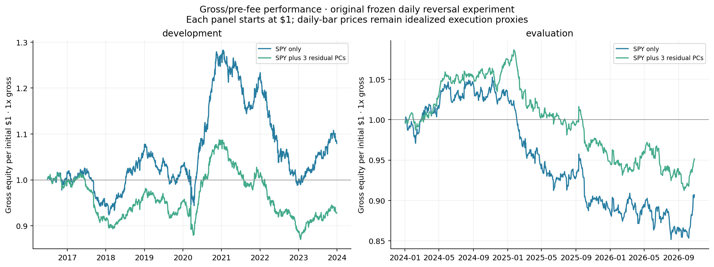
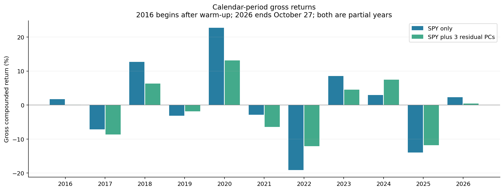

# First daily residual-reversal backtest

Run October 28, 2026. Read the [executed notebook](../../equity_residual_backtest.ipynb). [Source](../equity_residual_backtest.py), [frozen settings](frozen_specification.json), and [evaluated results](evaluated/summary.json) are saved locally. This is an experiment using daily-bar execution proxies, not submitted orders or an independently validated executable strategy.

**Current project convention:** report **gross/pre-fee results only**. Old cost-scenario fields remain in the frozen artifacts for provenance; they are not the default analysis and do not determine the conclusions here. The current [gross-only reporting script](../equity_gross_report.py) and `gross_report/` tables/plots reproduce this presentation without applying cost deductions.

## Result

**This specification did not establish a positive gross reversal edge.** The market-only strategy was weak in development, and both strategies had negative average gross returns in evaluation. No parameter search was performed and settings were unchanged between development and evaluation.

| Period | Model | Mean gross daily return (bps) | Gross Sharpe vs zero | Gross CAGR |
|---|---|---:|---:|---:|
| 2016-06-28–2023-12-29 | Dollar + SPY neutral | +0.50 | +0.18 | +1.0% |
| 2016-06-28–2023-12-29 | Dollar + SPY + 3 residual PCs | -0.35 | -0.17 | -1.0% |
| 2024-01-02–2026-10-27 | Dollar + SPY neutral | -1.29 | -0.49 | -3.4% |
| 2024-01-02–2026-10-27 | Dollar + SPY + 3 residual PCs | -0.65 | -0.31 | -1.8% |

Development has 1,890 trade sessions; evaluation has 708. CAGR compounds daily returns at a 252-session annualization. At **1x gross**, the target is approximately 50% of starting equity long and 50% short, with positions liquidated every trade day. These are simulated stock P&L returns relative to starting equity, with no cash interest or financing benefit included.

Approximate Newey–West 95% intervals (five lags) for evaluation gross mean daily return are **[-4.51, +1.93] bps** for SPY-only and **[-3.23, +1.94] bps** for PCA. The paired PCA-minus-SPY difference is +0.64 bps/day, with interval **[-1.41, +2.70]**. These intervals do not establish a positive mean for either model or a reliable improvement from PCA; they are conditional on this experiment, not corrections for every possible research choice.

Observed evaluation annualized gross volatility fell from **6.7% to 5.3%** with the additional constraints. That is a historical risk-description result, not a new source of expected return. Negative gross estimates do not establish that the opposite signal would be profitable.

## What was fixed before evaluation

1. Estimate each stock's SPY beta and total return volatility from **120 sessions ending t-1**.
2. For the PCA model, regress each stock's history on an intercept and SPY, standardize those historical residuals, and retain the first **three residual PCs**. Convert the basis to raw-return exposure units with residual training volatilities.
3. Observe **one-day adjusted close-to-close log returns at t**. Regress that cross-section on the applicable exposure matrix using inverse trailing total variances, with a daily-volatility floor of 0.0001.
4. Set target signed dollar positions proportional to **minus W times the residual**, normalized to 1x gross. Include the dollar and SPY-beta constraints in both models. No ranking, clipping, position caps, or economic signal threshold was added.
5. Use the **next session's raw daily-bar open as the entry proxy**, and that session's raw daily-bar close as the exit proxy. No overnight positions are carried. All shares are hypothetically fractional; filling the exact dollar targets at the entry price is idealized.

The estimation window, observed-return signal interval, and future holding interval are different. This specifically tests reversal remaining after entry at the following bar's open. Any reversal between signal close and entry is missed. It is not the overnight-signal intraday illustration in the source paper, nor a cointegrated-spread/OU strategy.

## Portfolio accounting

Every day opens and liquidates approximately one full gross portfolio. Average traded notional is **2.0002 times starting equity per day**. This is retained as a descriptive property; no assumed fee, slippage, impact, borrow, or financing deduction is applied in the current gross-only report.

## Checks, execution limits, and concentration

Checks passed for weighted factor/dollar neutrality, zero trades on pure-factor synthetic signals, invariance to exposure-basis transformations, the sign of an exact hypothetical residual reversal, and entry/exit notional accounting. Every exposure fit ends before its signal date and every execution date follows its signal date. Adding the later data reproduced all development daily returns and checked diagnostics within numerical tolerance.

Maximum constraint error after column scaling was **3.2e-14**, with maximum absolute estimated SPY exposure **7.6e-15**. These concern the fitted exposure model at target construction, not unknown future betas. No constraints were silently imposed using future returns.

No position caps were included, and the largest single-stock target was **46.2% of gross**. This concentration is a material limitation of the uncapped baseline. Implementing caps requires constrained portfolio construction; independently clipping these holdings would generally break neutrality. A fixed basket of 30 surviving stocks is also far smaller than an institutional stat-arb universe and retains selection/survivorship bias.

The vendor daily-bar open/close has not been independently verified as regular-session auction prices. There is no quote-based fill model, spread/impact calibration, auction eligibility model, borrow-availability test, or capacity estimate. Entry prices determine hypothetical share conversion only; the signal and target dollars were formed earlier. Exact fractional-dollar fills at those prices are still an execution assumption. This limits tradability claims even if gross results had been strong.

All input data uses the already downloaded snapshot. Adjusted closes carry vendor corporate-action and precision limitations. Raw open/close prices are used for intraday trading P&L. The stock universe was selected in 2026; the later period was held out from the initial plots and settings, but not from that universe selection.

## Files and reproduction

- `frozen_specification.json`: settings written before the first performance run; subsequent runs refuse changed settings.
- `development_only/`: initial development results.
- `evaluated/`: unchanged specification evaluated across both periods.
- Original result folders retain the historical frozen output, including superseded cost scenarios, source/input hashes, and checks. Do not silently rewrite those records.
- `gross_report/`: current gross-only performance, annual returns, daily diagnostics, regime/component tables, and gross plots.
- `evaluated/independent_audit.json`: additional ledger, calendar timing, cost, and input-integrity checks.

For the current gross presentation, from `TDA_Research` using the TDA environment:

```sh
python experiments/equity_gross_report.py
```

The original frozen backtest source reproduces the historical experiment and requires matching source/settings before evaluation. It is retained for provenance, not as an instruction to reintroduce its fee assumptions in future studies. Rolling fits use newly available prior observations; no parameters were selected from evaluation performance.





## Interpretation for the research project

Neutralization worked algebraically; it did not create a predictive edge. Three additional PCA constraints reduced observed volatility but did not deliver positive gross evaluation returns. This specific timing/weighting/universe therefore supplies a negative baseline, not evidence that all residual mean reversion fails or that MFT stat arb generally is disappearing. No TDA method was evaluated.

**2024 onward has now been evaluated.** It must not continue to be described as untouched holdout data. Further hypotheses should be labeled follow-up exploration; tuning on these results cannot retain the original evaluation's status. A subsequent confirmatory test needs genuinely unexamined data or a separately justified validation design.
