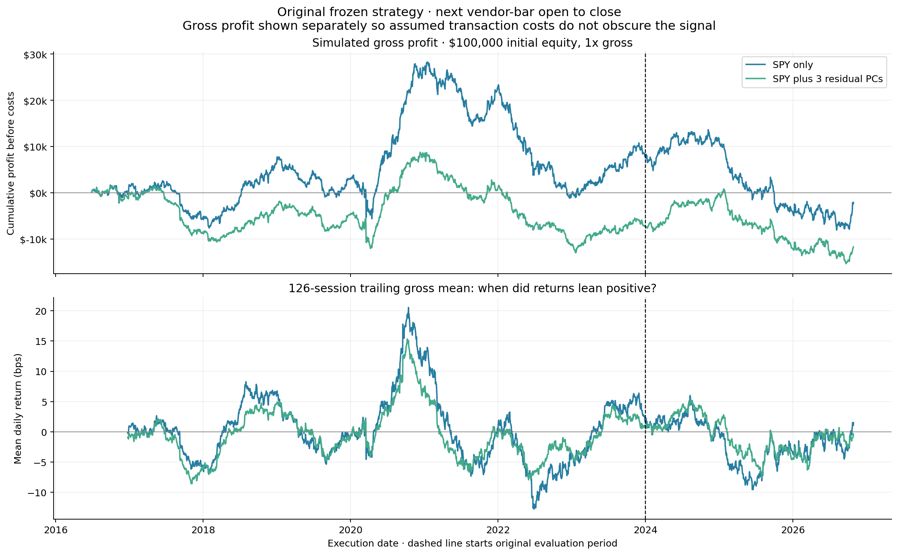
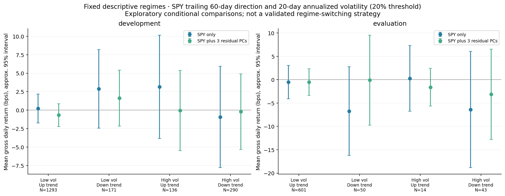
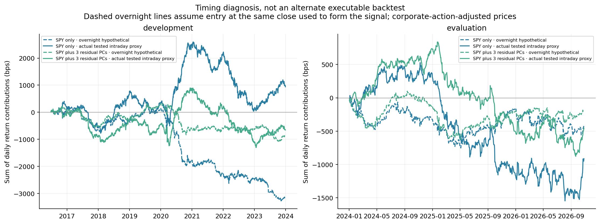
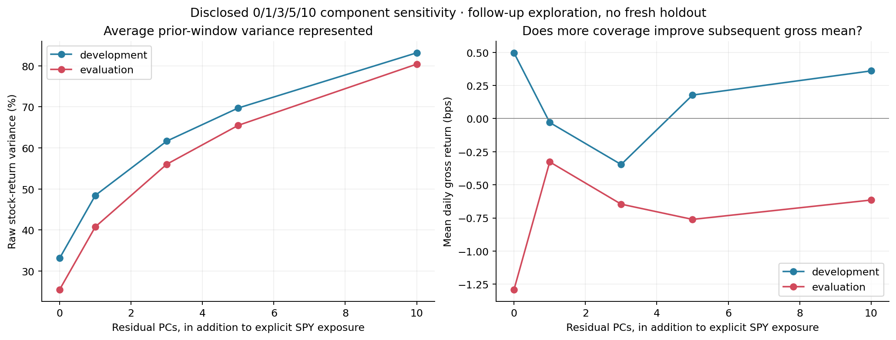

# Why did the first reversal experiment struggle?

Exploratory diagnostics, October 28, 2026, after the original evaluation had already been examined. Original strategy settings and results are preserved. These are follow-up analyses, not a new untouched holdout or a validated regime-switching rule. [Source](../equity_residual_diagnostics.py), [diagnostic settings](diagnostic_specification.json), and [numerical summary](summary.json) are local.

**Current reporting convention:** gross/pre-fee performance only. The original output files retain historical cost-scenario columns for provenance; default tables, notebook displays, and interpretations use gross results. Fee-free [regime and component tables](../equity_residual_backtest/gross_report/) are saved with the current gross report.

## The profit graph: yes, there were profitable stretches



Top panel compounds the **original** daily gross strategy returns from $100,000 starting equity at 1x gross. It is simulated profit before costs, not actual account P&L. The dashed line marks the beginning of the original later-period evaluation. Bottom panel shows the trailing 126-session average gross daily return, not a trading filter or a forecast.

Across the whole period, final gross profit was approximately **-$2,107 for SPY-only** and **-$11,726 for SPY + 3 residual PCs** on that starting equity. The paths include substantial profitable stretches and subsequent losses. A flat or negative endpoint does not mean every interval lost money.

Selected calendar-period returns make the variation clear:

| Year | SPY-only gross | SPY + 3 PCs gross |
|---|---:|---:|
| 2018 | +12.7% | +6.3% |
| 2020 | +22.7% | +13.1% |
| 2022 | -19.1% | -12.1% |
| 2024 | +3.0% | +7.5% |
| 2025 | -13.9% | -11.8% |

All gross calendar-period returns, including partial 2016 and 2026, are retained in the [current gross annual table](../equity_residual_backtest/gross_report/annual_returns.csv); the selected rows above illustrate variation rather than define a rule. No fee deduction is used here.

## Did it work in identifiable regimes?

We specified four simple descriptive states before computing their conditional strategy returns: SPY's trailing **60-session** log return positive/nonnegative versus negative, crossed with trailing **20-session** annualized volatility above/equal to **20%** versus below. The thresholds were not selected by maximizing profits. Inputs end on the signal day and are available before the next-bar entry. This is still post-evaluation exploration, and these particular state definitions are not privileged economic truths.



Development SPY-only mean returns were +0.22 bps/day in low-vol/up-trend, +2.88 in low-vol/down-trend, +3.15 in high-vol/up-trend, and -0.93 in high-vol/down-trend. None of their approximate 95% intervals excludes zero. The PCA model also has no reliably positive state under this diagnostic.

In evaluation, the four SPY-only means were -0.51, -6.72, +0.28, and -6.39 bps/day respectively. The one positive point estimate has only **14 sessions** and a wide interval. All four PCA means were negative. Every interval includes zero. The mostly negative state means do not establish reliably negative conditional expectations either.

There is therefore historical variation, but no robust regime filter has been identified here. Even the same broad label contains different dates, stocks' events, and relationships. A profitable 2020 does not by itself establish a general crisis or high-volatility advantage. Using winning years as a future switch would use hindsight.

Intervals use a five-lag Newey–West conditional-mean influence series on the full period's trading calendar, with zero influence outside the selected state. We do not pretend separated state dates are adjacent observations. They are approximate, unadjusted for multiple exploratory comparisons, and particularly uncertain in small groups. [Full regime table](conditional_regimes.csv).

## Did entry after the opening gap miss the reversal?

We measured the return from the signal close to the next vendor-bar open using corporate-action-adjusted prices and the **same target directions**. This is a hypothetical attribution interval: a signal that uses the closing price cannot assume execution at that exact already-observed close.

| Original evaluation model | Hypothetical overnight mean | Original tested open-to-close mean |
|---|---:|---:|
| SPY-only | -0.62 bps/day | -1.29 bps/day |
| SPY + 3 residual PCs | -0.27 bps/day | -0.65 bps/day |

Development overnight means were also negative (-1.66 and -0.46 bps/day). Thus the aggregate measurements do **not** support the explanation that a positive reversal return systematically happened overnight and was gone by our entry. This does not rule out some days or other signal timings; it answers the question for these weights and intervals. Overnight evaluation mean intervals include zero.

The hypothetical close-to-close means were also negative in evaluation: -1.91 and -0.91 bps/day. These numbers are not an executable earlier-entry backtest. Adjusted daily open/close definitions have the same source limitations as the original experiment.



Dashed lines sum hypothetical overnight return contributions; solid lines sum original tested intraday proxy returns. They are arithmetic contribution sums, **not compounded dollar profit**, and should not be added directly: overnight holdings cause a change in the subsequent intraday notional. The exact identity is checked separately on adjusted prices:

```text
O/C_previous - 1 = gap
C_next/O - 1 = day
C_next/C_previous - 1 = gap + (1 + gap) * day
```

We retain both exact adjusted-price attribution and original raw-price intraday P&L in [timing_daily.csv](timing_daily.csv). Differences also reflect vendor adjusted-price rounding.

For the same weights, the evaluation weighted-log-return variance decomposition places about **32%** of close-to-close variance in the overnight term and **68–72%** in the intraday term, with a covariance contribution of about -0.5% to -4.3%. These contributions need not sum to 100% without covariance. This is portfolio-weighted log-return variation, not a statement about every stock or the whole market. More importantly, **variance is movement, not predictable profit**. Most variation remaining after the open would not itself imply exploitable reversal.

## Did we remove too little common variation?

The first three **residual PCs** covered roughly 44.5% of standardized SPY-residual training variance in evaluation windows. Combined SPY and three-PC reconstruction represented about **56.0% of pooled raw training stock-return variance**. Those denominators differ from the full-period original-return PCA's percentages. None is a share of future returns predicted.

We disclosed a fixed sensitivity grid of **0, 1, 3, 5, and 10 residual PCs**, always retaining the separate dollar and SPY-beta constraints. Everything else—the signal, 120-day prior fits, weights, entry/exit, and costs—was unchanged. The 0/3-PC daily returns reproduce the original frozen models to numerical precision. We report the entire grid and do not select a winner as a validated model.

| Residual PCs | Mean combined raw training variance represented, evaluation | Evaluation mean gross return |
|---|---:|---:|
| 0 | 25.5% | -1.29 bps/day |
| 1 | 40.8% | -0.33 bps/day |
| 3 | 56.0% | -0.65 bps/day |
| 5 | 65.5% | -0.76 bps/day |
| 10 | 80.4% | -0.61 bps/day |

Increasing coverage did not turn evaluation gross mean positive or yield a monotonic improvement. All approximate gross mean intervals include zero. This does not prove every factor construction fails, but it gives no support to a simple “three was too few; cover 80% and the problem goes away” explanation.



Higher variance coverage makes a better in-sample reconstruction under its metric. That is a different objective from finding deviations that subsequently reverse. Removing more factors can remove risk, noise, useful signal, or a mixture. We have not identified which economic mechanism produced the residual returns. [Coverage and performance table](component_sensitivity_summary.csv).

## What explanation is actually supported?

The strongest direct diagnosis is **weak and unstable gross return predictability for this particular prior-day signal and delayed holding interval**. The targets satisfy the selected exposures, but algebraic neutralization does not imply that residual returns are temporary errors. This conclusion is based on pre-fee results.

Possible explanations that remain hypotheses include persistent company-specific information, an inappropriate signal/holding horizon, noisy or changing exposures, daily-bar measurement effects, and concentration in a small selected basket. We have not isolated their contributions. In particular, we have not measured crowding, competition, or a market-wide disappearance of stat-arb alpha. The diagnostics above weaken two specific proposed explanations—missing positive overnight reversal and simply retaining too few PCs—without establishing one universal cause.

## Reproduce and audit

From `TDA_Research`, in the TDA environment:

```sh
python experiments/equity_residual_diagnostics.py
```

The script reads local files only. It preserves original frozen strategy results and saves follow-up data separately. Identity checks cover adjusted price attribution, weighted log-return variance decomposition, and reproduction of original 0/3-PC daily returns. Figures were visually inspected. Source hashes and ledger checks are recorded in `independent_audit.json`.
