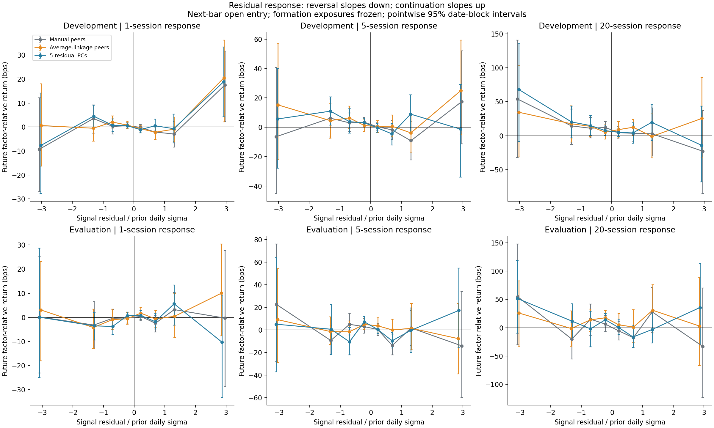
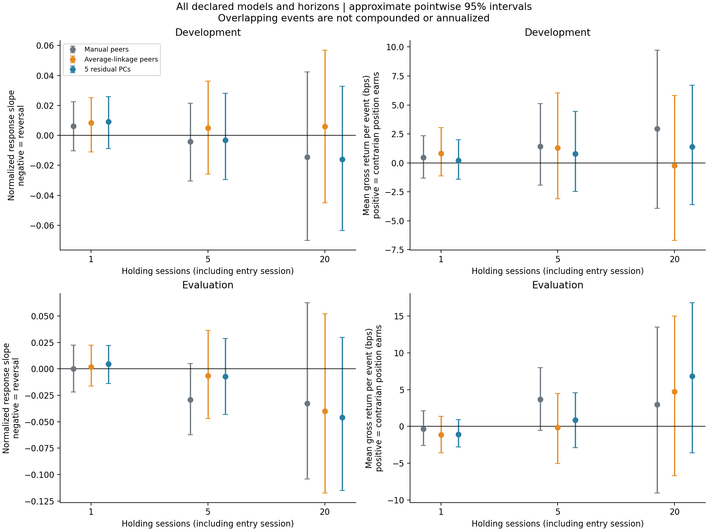
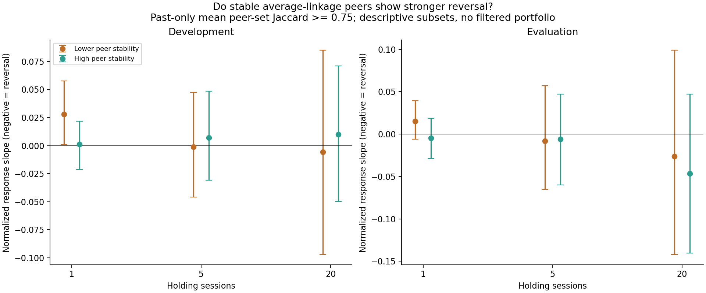

# Do peer-relative moves subsequently reverse?

October 28, 2026. [Executed notebook](../../equity_reversal_response.ipynb), [source](../equity_reversal_response.py), [fixed specification](specification.json), [summary](response_summary.csv), [independent audit](independent_audit.json).

**Decision: neither a reliable reversal response nor a gross trading edge was established at 1, 5, or 20 sessions. More stable peer assignments did not establish stronger reversal either.** Some longer-horizon point estimates favor reversal, but uncertainty remains substantial. This is a bounded follow-up on already examined history, not a fresh holdout or evidence that all mean-reversion strategies fail.

The prior hierarchy experiment found persistent peers. This experiment asks a different question: after a stock moves unusually relative to those peers, does its subsequent relative return tend to go the other way?

## 1. Read the response plots as a catch-up test



- Horizontal axis: today's factor-relative return divided by that stock's prior total daily volatility. A value of -1 is underperformance equal to one prior daily sigma; it is not necessarily -1% and is not a price-spread z-score.
- Vertical axis: subsequent cumulative return relative to the **same formation-date exposures**, in basis points, starting at the next vendor-bar open.
- Reversal would slope downward: prior losers on the left subsequently outperform, while prior winners on the right underperform. An upward slope means continuation.
- Each point pools stock events in a declared signal-size bin. Error bars resample blocks of dates with every stock kept together. A point is not an independent stock experiment.

The curves do not show a clean, repeatable downward relationship across models, horizons, and periods. Individual bins sometimes have intervals excluding zero; the many bin comparisons are exploratory and not multiplicity-adjusted. There is no basis here for selecting a profitable extreme-move threshold.

## 2. Overall response and gross event returns



For 2024–October 2026, using the **689 common formation dates** with complete outcomes:

| Formation model | 1-session gross bps/event | 5-session gross bps/event | 20-session gross bps/event |
|---|---:|---:|---:|
| Manual peers | -0.35 [-2.57, +2.11] | +3.66 [-0.56, +7.97] | +2.98 [-9.06, +13.47] |
| Average-linkage peers | -1.12 [-3.60, +1.36] | -0.13 [-5.07, +4.48] | +4.72 [-6.71, +15.00] |
| Five residual PCs | -1.10 [-2.78, +0.90] | +0.86 [-2.87, +4.59] | +6.84 [-3.60, +16.78] |

Brackets are approximate **pointwise 95% date-block bootstrap intervals**. Every model/horizon gross interval includes zero in both periods. Every overall response-slope interval also includes zero. The full [summary](response_summary.csv) includes all 18 model/period/horizon combinations, including 1,851 development formation dates.

Manual peers at five sessions and PCA at twenty sessions are positive point estimates worth recording, not validated winners. The later five-session manual slope is -0.029, with interval [-0.062, +0.005]; the later twenty-session PCA slope is -0.046, with interval [-0.115, +0.030]. Negative slopes are consistent with partial reversal, but these intervals also allow zero or continuation.

These are cumulative returns **per initial unit-gross event**, not daily returns, annualized returns, or the profit curve of a strategy opening overlapping positions every day. The 20-session number cannot be compared with a one-session number as if both consume the same capital for the same time. A multi-cohort portfolio and its capital allocation have not been specified or simulated.

The slope and mean gross return use different aggregation weights. The pooled slope gives more weight to dates with larger normalized signal energy; the gross calculation first normalizes each date's holdings to unit gross and then averages dates equally. Their aggregate signs therefore need not be opposites, even though the exact per-date algebra is checked.

## 3. Stable peers did not establish a better reversal response



For each stock in the average-linkage model, compare its assigned peers with assignments from 100-session, 140-session, and five-session-older 120-session histories. Jaccard overlap means the number of peers shared by two assignments divided by the number present in either assignment. Average those three past-only overlaps. A score at least 0.75 defines the declared high-stability group; the remainder defines the lower group.

In the later period, 13,883 active stock events are high stability and 5,945 are lower stability per horizon. The high-minus-lower slope differences are:

| Horizon | High-minus-lower response slope | Approximate pointwise 95% interval |
|---|---:|---:|
| 1 session | -0.020 | [-0.048, +0.005] |
| 5 sessions | +0.002 | [-0.081, +0.084] |
| 20 sessions | -0.020 | [-0.137, +0.096] |

A negative difference would mean stronger reversal among high-stability events. Every difference interval includes zero in both periods. The one-session development lower-stability group has a slightly positive continuation slope with an unadjusted interval above zero, but its difference from the high group is unresolved. That is not a validated filter.

This is a descriptive subset comparison, **not a filtered portfolio**: keeping selected stocks from a neutral portfolio can break its exposure constraints. Manual membership is fixed by construction, so it supplies no meaningful empirical stability split. PCA has no discrete peer membership. This check tests window sensitivity, not every possible stability concept or the exact-branch bootstrap diagnostic used in the preceding hierarchy study.

## Construction and timing

All models have seven independent exposure columns: six complete group indicators plus fitted SPY betas, or dollar exposure, SPY betas, and five raw-return-scaled residual PCs. The PCA model and group construction match the prior peer pilot.

For each signal date t:

1. Fit exposures and inverse total-variance weights W on 120 return observations ending t-1. Estimate altered-window peer sets using only earlier observations too.
2. Observe the adjusted close-to-close log return vector r at t. Compute the WLS residual e using the fixed exposure matrix X. Set initial dollar positions D = -W e / sum(abs(W e)); X' D = 0.
3. Enter at the next vendor daily-bar open. Hold the initial sleeves through the close of session 1, 5, or 20, including the entry session. Do not rebalance or update the exposure model during the event. Estimated neutrality is an initial constraint; dollar weights and exposures can drift during the holding period.
4. Compute cumulative simple stock returns R from all-adjusted prices. For relative-return attribution, apply the formation-date WLS residual projection to R, giving E. This projection uses future returns only as an **outcome calculation**, never to construct the initial positions. D' R = D' E is verified.

Write sigma for prior total daily volatility, z = e/sigma, and y = E/sigma. The pooled response slope is sum(z*y)/sum(z*z) over stock/date events, with zero intercept. Negative means reversal, positive continuation; it is an association, not a causal estimate. The response plot's vertical units are unnormalized E in basis points. A -0.03 slope describes a small average normalized opposite response, not a 3% investment return or proof of stationary relative prices.

Signals with abs(z) <= 1e-10 are excluded from response bins and stability subsets. This includes average-linkage singleton stocks forced to zero by their own group constraint. They remain in the universe and exposure system. The all-stock slope and portfolio calculations retain the full vectors; numerical-zero terms make no material contribution.

## Sample, price conventions, and uncertainty

- **2,540 formation dates**, 1,851 development and 689 later, and 685,800 stock/model/horizon records. A 140-observation initial requirement permits the longest stability window. All models/horizons use the same dates; incomplete twenty-session tails and targets crossing January 2024 are excluded. Shorter horizons therefore omit some otherwise available dates.
- All horizons use the same **all-adjusted open/close return proxy** to handle cross-date splits/dividends consistently. This is a vendor-adjusted total-return approximation, not an audited corporate-action cash ledger. Vendor daily opens/closes are not independently verified regular-session auctions.
- The prior pilot used **raw same-day** open/close prices. Its one-session targets and raw-bar returns reproduce to about 1e-16 on overlapping dates. Adjusted versus raw event P&L differs by at most **1.08 bps** on any one event here, consistent with vendor precision/convention differences. This experiment does not silently overwrite the prior raw-price result. Its common-date sample also differs.
- Uncertainty uses **1,000 circular moving-block resamples of 60 formation dates**, separately by period. All stocks and outcomes on a sampled date travel together, and pooled numerator/denominator ratios are recomputed. This accommodates overlapping 5/20-session events and some temporal dependence under an approximate block-bootstrap model. It is not proof that all dependence is captured; only 689 later dates are available.
- Intervals are pointwise, not simultaneous across models, horizons, bins, or research choices. More observations from overlapping horizons are not independent evidence. The already examined time period, fixed 2026-survivor basket, and single vendor restrict generalization.
- Results are **gross/pre-fee only**. No commission, spread, slippage, impact, borrow, financing, or hypothetical generic fee schedule is deducted.

## Research implication

The supported picture is **persistent peer structure with unestablished reversal predictability**. Extending the holding horizon has not demonstrated that the initial failure was simply a one-day timing problem. The estimates are too uncertain to prove that a modest effect is absent, and they do not identify an economic cause or the general state of statistical arbitrage.

Archive this as the bounded daily-reversal baseline. There is no measured reason to select one of these horizons, add a stability trading filter, or add H1 in an attempt to rescue its return curve. A broader universe remains a distinct structural-generalization experiment; it can be worthwhile without a profitable baseline, but should have a fixed selection/estimation design. For further TDA learning, a controlled delay-embedding study would exercise a different construction rather than relabeling clustering.

## Reproduce

From `TDA_Research/equity` in the TDA environment:

```sh
python experiments/equity_reversal_response.py
python experiments/audit_equity_reversal_response.py
```

The notebook loads saved outputs and embeds the three figures. Source scripts, data, and the frozen original backtest summary are hash-checked for preservation. The independent audit reconstructs thirteen sampled formations using separate projection/distance calculations, checks every saved bin and summary, and reconciles all event contributions. No data download or order submission occurs.
