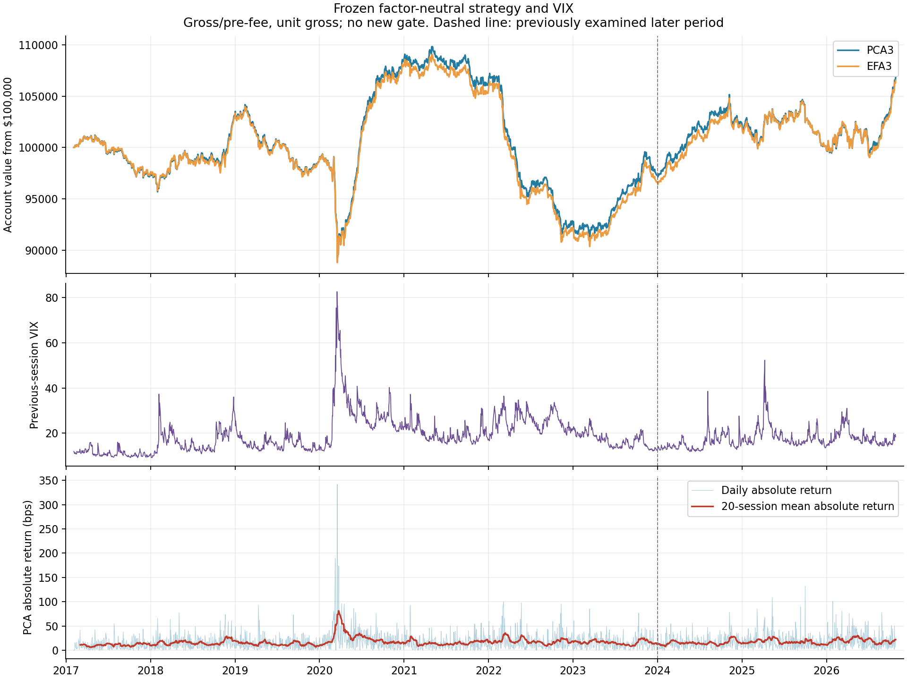
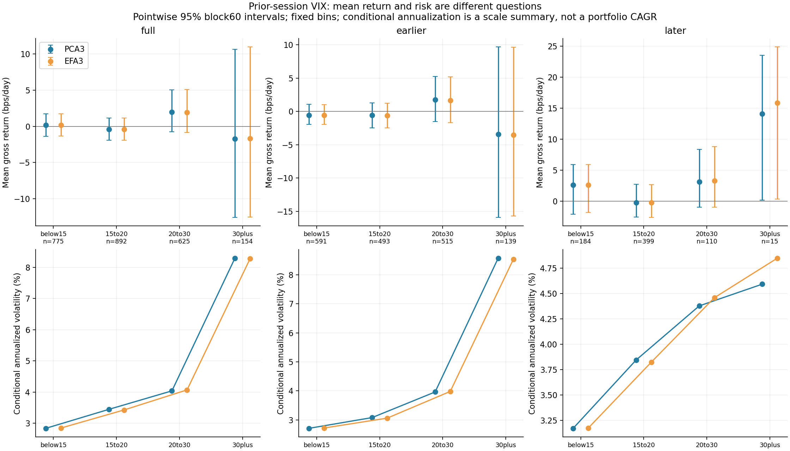
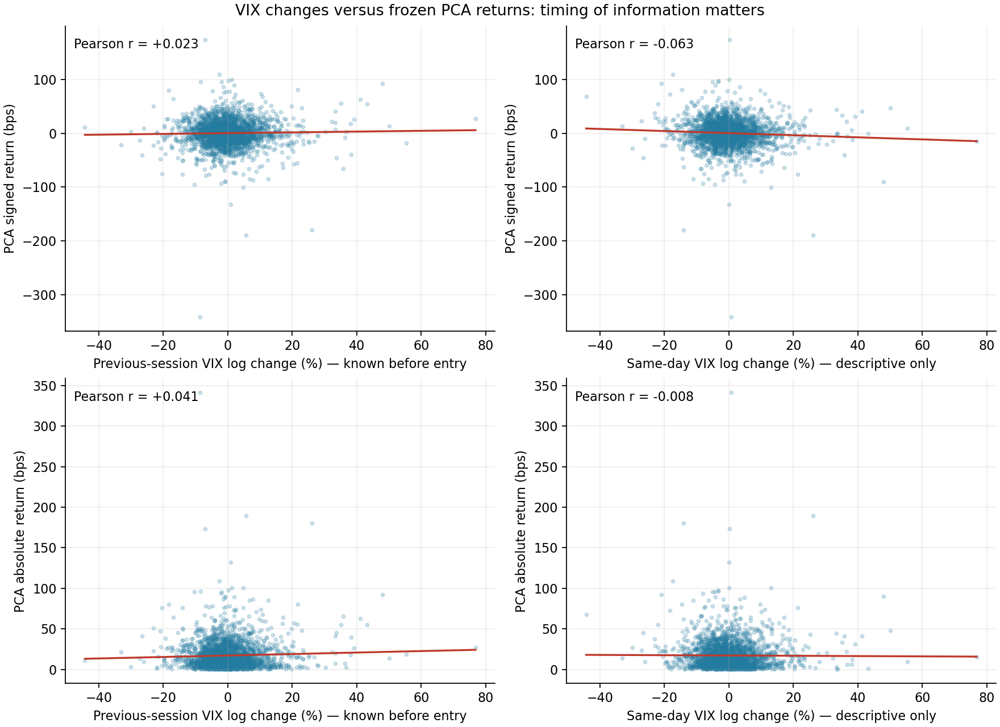
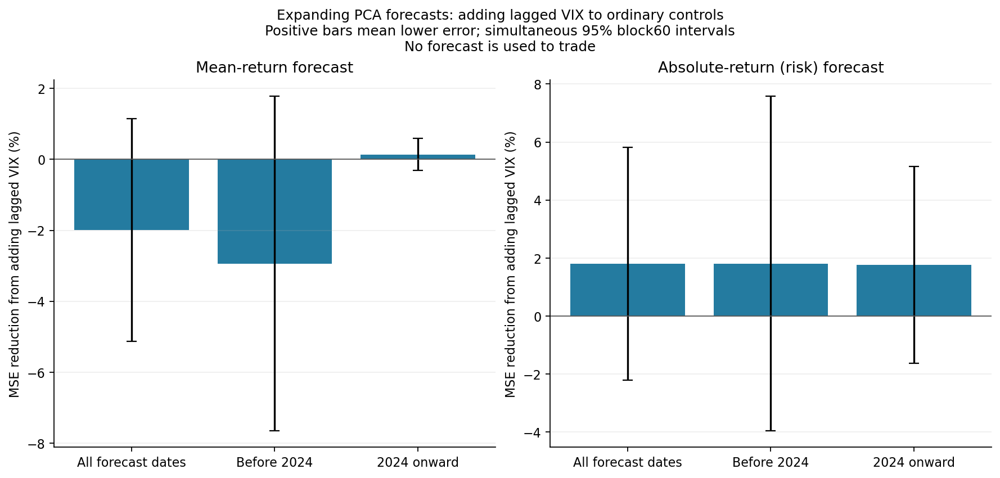

# Factor-neutral short-term reversal versus VIX

**November 4, 2026. Prior-session VIX has a clear descriptive relationship with the magnitude of strategy returns, but no stable relationship with their sign. Adding it to ordinary controls does not establish better return forecasts or a profitable trading gate.** The matched PCA and EFA versions give almost the same answer.

**Subsequent user-requested follow-up:** [fixed20–30 policy and nonlinear band analysis](../factor_vix_20_30/README.md) tests the specific middle-band pattern highlighted after this comparison. It improves full-sample point return/risk, underperforms later in CAGR/Sharpe, and remains uncertain. The new binary-band forecast also fails to establish incremental prediction. Original results on this page remain unchanged.

This returns to the original stock-residual strategy. It does not study the separate LinkedIn index-rebound strategy, change stock holdings, or select a VIX threshold for trading.

## Strategy, data and information timing

The frozen strategy buys stocks whose preceding return is unusually low relative to fitted common factors and shorts relative winners. At each formation it balances initial long/short dollars, fitted SPY exposure, and the chosen three-factor exposure span. It uses the existing 120-session PCA fit as the primary case and the matched three-factor EFA fit as a check. Portfolios enter at the next vendor raw daily-bar open, exit that day's raw close, and remain flat overnight. Gross stock notional is one times current account equity, approximately half long and half short. Vendor prices remain fill proxies.

We use the **existing, unchanged 2,446 daily returns**, February 3, 2017–October 27, 2026. Full-history PCA CAGR is 0.68%, EFA 0.66%; this comparison does not change those returns. January 2024 onward contains 708 executions and is already examined history, not a new untouched holdout. The earlier period has 1,738 executions. Universe survivorship/selection and all existing strategy limitations remain. All performance is **gross/pre-fee**.

VIX is the saved [Cboe daily history](../../../market_data/datasets/mean_reversion_context_2026-11-04/README.md). For execution on day t:

- **Predictor candidates:** VIX at the previous equity-session close and its completed previous-session log change. Both are known before entry. Align on the full SPY calendar first, then lag; no filling or silent deletion of missing dates.
- **Ordinary controls:** S&P daily return from the previous session and realized S&P volatility over twenty sessions ending the previous session.
- **Descriptive only:** the change in VIX between the previous close and execution-day close. That closing value is unavailable at that morning's entry, and its interval includes the preceding night while strategy P&L is intraday.

[The specification](specification.json) fixes the bins, models, periods and uncertainty calculation before this new comparison. The price/strategy histories were already examined, so this is exploratory despite fixing this particular analysis in advance. VIX levels, VIX changes, returns and cumulative account values are distinct objects. We do not correlate cumulative profit with VIX and interpret the result as an entry forecast.

## The strongest distinction: risk versus mean return

For the primary PCA strategy over the full history:

| Previous-session VIX | Execution days | Mean gross return | Approx. 95% mean interval | Daily return standard deviation |
|---|---:|---:|---:|---:|
| Below 15 | 775 | +0.17 bps | [−1.39, +1.74] bps | 17.85 bps |
| 15 to below 20 | 892 | −0.41 bps | [−1.91, +1.14] bps | 21.68 bps |
| 20 to below 30 | 625 | +1.97 bps | [−0.74, +5.04] bps | 25.43 bps |
| At least 30 | 154 | −1.75 bps | [−12.55, +10.63] bps | 52.29 bps |

**One basis point is 0.01%.** These are daily whole-account returns at unit gross, not annual returns or returns on only the long leg. Conditional standard deviation describes the distribution of daily outcomes in a bin, not the CAGR of a portfolio that trades only in that bin. Its annualized scale is 2.83%, 3.44%, 4.04%, and 8.30%, respectively; daily variability is nearly three times greater in the highest than the lowest VIX bin. The table's mean intervals all include zero.

Prior-session VIX has Pearson correlation **−0.020 with signed PCA return**, versus **+0.322 with absolute return**. Corresponding rank correlations are +0.032 and +0.200. The absolute-return Pearson relationship is +0.367 before 2024 and +0.153 later, so the strength varies by era. EFA's matching correlations and conditional tables are saved in the result files.

The fixed **VIX at least 20 minus below 20** difference is +1.38 bps/day over the full PCA sample, approximate interval **[−2.62, +6.05]**. Later it is +3.76, interval **[−1.72, +9.03]**. EFA gives +1.38 and +4.12, with both intervals spanning zero. This contrast does not establish a reliable profitable regime. It was specified as a diagnostic, never applied to trading.

**Interpretation:** neutralizing selected fitted return exposures does not fix the portfolio's conditional variance. Linear formation constraints do not guarantee constant residual risk, independence from volatility states, or protection from stress losses. VIX helps identify environments in which this fixed-gross strategy has larger gains and losses. These measurements do not identify the economic cause of those changes.



## High VIX does not have a stable profit sign

The at-least-30 bin changes materially across periods:

| PCA period | Days | Mean gross return | Daily return standard deviation |
|---|---:|---:|---:|
| Before 2024 | 139 | −3.46 bps | 54.01 bps |
| 2024 onward | 15 | +14.09 bps | 28.94 bps |

The later point estimate is favorable, and its pointwise block60 interval is **[+0.14, +23.56] bps**. However, **12 of those 15 days are in April 2025**. They are not fifteen independent stress episodes. Forty-six of the 2,000 block resamples contain no later at-least-30 observation; their conditional bin mean is undefined and omitted, leaving 1,954 valid draws. This small, clustered bin is a substantial limit on that interval's interpretation. It is not a simultaneous correction for the other bins or the project's past experiments. The high-VIX date ledger is preserved in [high_vix_days.csv](high_vix_days.csv).

Annual context also resists a simple high-VIX profit story: in 2020 PCA earned **+9.80%** with average prior VIX 29.22; in 2022 it lost **12.68%** with average prior VIX 25.61. These are measured calendar summaries, not controlled comparisons or causal explanations. No macroeconomic mechanism is inferred from those two years.



## VIX changes and ordinary controls

Full-sample PCA correlations with signed return are **+0.023** for the previous-session VIX log change and **−0.063** for the execution-day VIX log change. The same-day relationship is weak and unavailable for choosing the morning's trade. Its correlation with absolute return is −0.008; it is the **level** of prior VIX that has the clearer association with return magnitude here.

In full-sample descriptive regressions, controlling for lagged S&P return and log realized volatility:

- The coefficient of log prior VIX in the **signed-return** regression is +2.72 bps per log unit, HAC20 interval [−6.87, +12.31]. A relative 10% higher VIX corresponds to a fitted +0.26 bps, interval [−0.65, +1.17], holding the other regressors fixed. This does not establish a mean-return effect.
- The coefficient in the **absolute-return** regression is +14.95 bps per log unit, HAC20 interval [+6.33, +23.58]. A relative 10% higher VIX corresponds to a fitted +1.43 bps of absolute return, interval [+0.60, +2.25]. The positive association remains after these particular controls in sample; that is not proof of forecast improvement or causal influence.
- Adding same-day VIX change gives a small negative signed-return coefficient, but the entire same-day diagnostic regression explains only about **0.51%** of daily return variation. The same-day variable is never fed into the forecast check.

The relative-10% illustration means, for example, VIX 20 versus 22, not a ten-index-point increase. The regressions are linear in log VIX, not a search over thresholds. HAC intervals are approximate pointwise descriptive intervals, without correction across all these regressions or prior research.



## Does VIX help forecast the next strategy return?

We ran one fixed, chronological check to avoid treating an in-sample association as forecast evidence. For each strategy, fit expanding OLS separately for **signed daily return** and **absolute daily return**. The latter is a risk-magnitude target, not a variance forecast. Use 504 completed observations initially, refit every 21 sessions, and compare:

1. Past-only average target, with no features.
2. Lagged S&P return and log twenty-session realized S&P volatility.
3. Those controls plus log prior VIX and prior-session VIX log change.

Predictor standardization uses training observations only. Training always ends before execution; negative absolute-return predictions are clipped to zero. Forecasts begin **February 6, 2019**, giving 1,942 forecast dates: 1,234 earlier and 708 later. Thus the forecast table's full period is shorter than the descriptive table's full period. No forecast is used to gate or size a trade.

For PCA, percentage reduction in squared forecast error **from adding VIX to controls**:

| Forecast dates | Signed-return target | Absolute-return target |
|---|---:|---:|
| All 1,942 dates | **−2.00%**: error increases | **+1.80%**: error decreases |
| Before 2024 | −2.93% | +1.81% |
| 2024 onward | +0.14% | +1.76% |

EFA is almost the same: full signed-return error increases 1.97%, absolute-return error decreases 1.75%; later reductions are 0.19% and 1.81%.

**Every declared simultaneous interval for incremental VIX forecast improvement includes zero.** The primary paired loss is MSE(Controls+VIX) minus MSE(Controls), so a negative difference is better. For PCA over all forecast dates it is +13.68 bps² for signed returns, simultaneous interval [−7.84, +35.20], and −6.20 bps² for absolute returns, interval [−20.02, +7.63]. Later these are −0.78 [−3.38, +1.82] and −4.62 [−13.52, +4.28]. The block20 sensitivity reaches the same zero-spanning conclusion for the simultaneous forecast comparisons.

The constant-only benchmark is retained too. Over all forecast dates, mean-return MSE is 679.21 bps² for constant-only, 685.50 for controls, and 699.18 for controls+VIX. This particular expanding linear forecast fails to demonstrate a useful mean forecast even before adding VIX. Absolute-return MSE is 359.76, 344.34, and 338.14, respectively; VIX's extra point gain beyond controls remains uncertain.



## What this settles

The user's intuition points to a real distinction: **the same factor-neutral construction has different observed risk across VIX environments**. Prior VIX belongs among ordinary state controls when assessing a future TDA risk feature, rather than being omitted from its comparison. That is a research-baseline decision, not evidence to increase leverage, avoid all high-VIX days, or adopt a new profitability gate.

The comparison does not establish “mean reversion works when VIX is high,” “VIX spikes predict profits,” or incremental forecast value beyond past realized volatility. The current result is a clear descriptive risk association, weak/inconsistent mean associations, and no demonstrated incremental forecasting gain from this fixed model. Other nonlinear constructions or time horizons remain untested; this is not a reason to select a threshold from these same historical returns.

## Uncertainty, verification and reproduction

Conditional means and the fixed high/low contrast use 2,000 circular moving-block resamples of the calendar, with primary block60 and sensitivity block20. Mean estimates are ratios of return sums to selected-day counts, preserving zero-contribution days during resampling. The forecast analysis resamples paired daily loss differences and forms simultaneous intervals across the four PCA/EFA-by-signed/absolute combinations within each period using the maximum standardized bootstrap deviation. Periods and prior project experiments are not jointly corrected. These are approximate historical intervals; few stress episodes remain a limit even with long blocks.

No new data or original strategy rerun is required:

```sh
conda run --no-capture-output -n tda python equity/experiments/factor_reversal_vix.py
conda run --no-capture-output -n tda python equity/experiments/audit_factor_reversal_vix.py
```

[The audit](audit.json) independently reconstructs source-based lagged features on every date, verifies frozen strategy provenance, reconstructs conditional statistics, checks all 48 HAC regressions against statsmodels, and independently refits every expanding forecast with unscaled raw-feature statsmodels OLS. It verifies all **23,304 forecast rows**, chronological training boundaries, paired loss differences, and input/output hashes. Source strategy files remain unchanged. [Run manifest](run_manifest.json) pins inputs, code and outputs; [specification](specification.json) records the fixed design.

Tables: [aligned daily panel](aligned_daily_panel.csv), [conditional returns](conditional_returns.csv), [fixed high/low contrast](high_low_contrast.csv), [correlations](correlations.csv), [descriptive HAC regressions](regressions_hac.csv), [annual context](annual_context.csv), [forecast metrics](forecast_metrics.csv), [paired forecast comparisons](forecast_comparisons.csv), [individual forecasts](forecast_predictions.csv).
