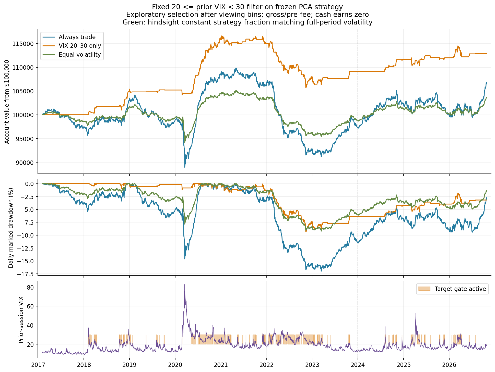
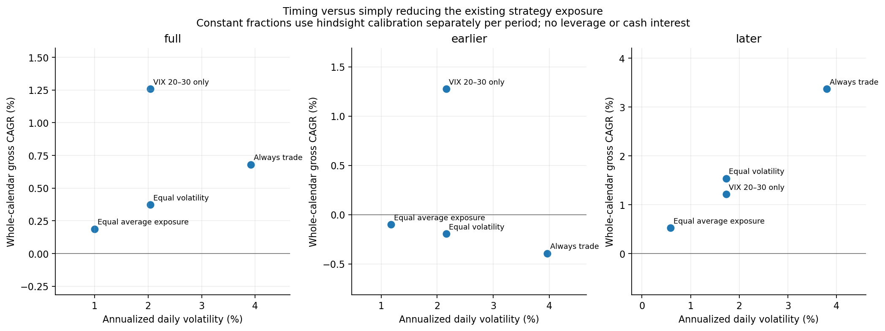
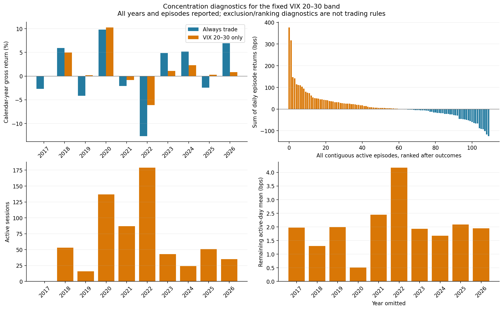

# Does trading only with prior VIX between 20 and 30 help?

**November 4, 2026. The fixed band improves the full-history point estimates and reduces risk, but does not establish a dependable advantage. Its profit is concentrated in 2020, its relative advantage depends substantially on reducing 2022 losses, and it underperforms always trading in 2024 onward.** An explicit nonlinear band feature also fails to demonstrate better chronological mean forecasts.

This is the user-requested follow-up to the [factor-neutral strategy/VIX comparison](../factor_reversal_vix/README.md). The band was selected after seeing that comparison's four groups, so this is **exploratory selection on examined history**, not a preregistered discovery or new holdout. We fix the existing boundaries and report checks rather than searching for improved boundaries.

## The precise rule and capital commitment

For each day's frozen factor-neutral stock portfolio:

> Trade its unchanged next-open-to-close holdings if the **previous equity session's VIX close is at least 20 and below 30**; otherwise stay in zero-yield cash.

The primary strategy remains SPY plus three PCA factors fitted on 120 past sessions; the matched EFA version is a robustness check. Portfolios are initially dollar neutral, fitted-SPY neutral and neutral to their chosen factor span, at **one times account equity in gross stock exposure**. No original holdings, estimation, stock admission, or prices are changed. Daily bar opens/closes remain execution proxies. Positions are closed every day; nothing is held overnight.

With a $100,000 account, an active day deploys approximately **$50,000 long and $50,000 short**. Inactive days hold cash. Trading on 25.6% of days does not mean only $25,600 of starting capital is needed to reproduce this account. The whole-account returns below include cash days, use daily reinvestment, and are **gross/pre-fee**, with no interest on idle cash. No leverage or volatility sizing is added.

## Full and subperiod results

| PCA period and policy | Active days / available days | Gross CAGR | Annualized volatility | Sharpe versus zero | Maximum daily marked drawdown |
|---|---:|---:|---:|---:|---:|
| Full: always trade | 2,446 / 2,446 | 0.68% | 3.92% | 0.19 | 16.99% |
| Full: VIX 20–30 only | 625 / 2,446 | **1.26%** | **2.04%** | **0.62** | **9.33%** |
| Before 2024: always trade | 1,738 / 1,738 | −0.39% | 3.96% | −0.08 | 16.99% |
| Before 2024: VIX 20–30 only | 515 / 1,738 | **1.27%** | **2.16%** | **0.60** | **9.33%** |
| 2024 onward: always trade | 708 / 708 | **3.37%** | 3.80% | **0.89** | 5.41% |
| 2024 onward: VIX 20–30 only | 110 / 708 | 1.21% | **1.73%** | 0.71 | **2.01%** |

The full calendar is **February 3, 2017–October 27, 2026**. Full-history $100,000 becomes **$112,894 with the band versus $106,801 always trading**. Full equity is continuous; subperiod metrics separately start at one for comparison. The later dates were already examined and are not an untouched test. The gate is active on 25.55% of the full calendar and only 15.54% of the later calendar.

The matched EFA strategy gives nearly identical conclusions: full CAGR **1.23% gated versus 0.66% always**, with 9.84% versus 17.14% drawdown; later CAGR **1.28% gated versus 3.54% always**. Agreement between these closely related fitted factor spans is a robustness check, not independent market evidence.

The original **+1.97 bps selected-day mean** is real as an observed sample average. Multiplying by its 25.55% activity gives **+0.504 bps per calendar day**, explaining why this produces about 1.26% annual compounded return rather than about 5%. One basis point is 0.01%. A favorable conditional mean and a useful whole-account policy are related but distinct measurements.



## Does this outperform merely reducing exposure?

Two constant reductions of the always-trading strategy help distinguish timing from simply carrying less risk. These are **hindsight diagnostic weights**, calibrated separately within each reported period; they are not forecasts or deployable fixed weights selected in advance. All cash still earns zero.

| Full PCA comparison | Gross exposure | Gross CAGR | Annualized volatility | Maximum drawdown |
|---|---:|---:|---:|---:|
| Always trade | 100% each day | 0.68% | 3.92% | 16.99% |
| VIX 20–30 only | 100% on 25.55% of days | **1.26%** | 2.04% | 9.33% |
| Equal average exposure | 25.55% every day | 0.19% | 1.00% | 4.62% |
| Equal realized volatility | 52.15% every day | 0.37% | 2.04% | 9.22% |

The full-history point return improvement remains after matching volatility. The gate's drawdown is almost the same as the matched-volatility control, rather than materially smaller. Equal **average exposure** is not equal risk: the band concentrates its exposure in more volatile environments.

The later comparison changes: a constant **45.47%** allocation to the original strategy has the same realized volatility as the later gate and earns **1.54%**, versus the gate's **1.21%**. Its drawdown is 2.48% versus the gate's 2.01%. Later gate Sharpe is below always trading because constant scaling leaves the zero-cash Sharpe unchanged. No policy dominates every measured dimension or era.

These are comparisons within the same factor-neutral strategy. They do not establish superiority to holding the S&P 500, and they do not license dividing CAGR by activity or leveraging the gated strategy to reproduce always-on exposure.



## Concentration: the main qualification

Calendar-year PCA gross returns:

| Year | Always trade | VIX 20–30 only | Active days |
|---|---:|---:|---:|
| 2017, from February | −2.68% | 0.00% | 0 |
| 2018 | +5.95% | +5.00% | 53 |
| 2019 | −4.16% | +0.20% | 16 |
| 2020 | +9.80% | **+10.27%** | 137 |
| 2021 | −2.08% | −0.84% | 87 |
| 2022 | −12.68% | **−6.14%** | 179 |
| 2023 | +4.88% | +1.09% | 43 |
| 2024 | +5.16% | +2.30% | 24 |
| 2025 | −2.43% | +0.30% | 51 |
| 2026, through October 27 | +6.96% | +0.81% | 35 |

**2020 provides 79.6% of the net sum of gated daily simple returns.** This is an arithmetic contribution, not an additive attribution of compounded terminal dollars. Deleting 2020 drops the gate's remaining-calendar CAGR from **1.26% to 0.27%**, and its selected-day mean from **1.97 to 0.51 bps**. The mean remains positive, so the sign is not entirely explained by that year, but its economic magnitude is much smaller.

The full gate's active-day mean remains positive after omitting **any one year**, ranging from 0.51 to 4.17 bps. That is a favorable robustness observation. Nevertheless, **deleting 2022 reverses the gated-versus-always CAGR ranking**: 2.14% gated versus 2.34% always. Thus much of the relative benefit comes from reducing that year's losses rather than a uniformly stronger return process. Year deletion uses frozen holdings and omits the corresponding return dates; it does not refit all subsequent factor models as though the year never existed.

The 625 active sessions form **110 contiguous episodes**, median two sessions, maximum 56. “Episode” means consecutive days on which separate intraday portfolios are permitted, not a position held overnight. The two largest arithmetic-gain episodes both occur in 2020 and together supply **56.2% of the net arithmetic total**. Their dates and every other episode are preserved in [episodes.csv](episodes.csv).

Removing the **five best** active days, while leaving their dates as zero-return days, reduces full gate CAGR to **0.79%** and active mean to **1.26 bps**. Removing the five worst instead raises CAGR to 1.71%. For the **later** sample, removing its five best days leaves only **0.05% CAGR and 0.15 bps per remaining active day**; removing five worst yields 2.30% CAGR. These are symmetric ex-post sensitivity diagnostics, not tradable exclusion rules or evidence that a strategy must earn evenly across days.



## Does it matter how VIX reaches the band?

We fixed this distinction before the follow-up: classify each contiguous active episode using the preceding VIX observation. The episode origin and the current age are known by entry, but no new gate is built from these results.

| PCA full-history episode origin | Active days | Episodes | Mean daily return |
|---|---:|---:|---:|
| VIX entered from below 20 | 319 | 82 | +1.91 bps |
| VIX entered from at least 30 | 306 | 28 | +2.04 bps |

There is little full-history point difference. Earlier means are +0.89 and +2.43 bps, whereas later they are **+4.74 and −2.37 bps**, respectively. The later from-above group contains only 25 days from four episodes. A story that cooling VIX consistently drives the profits is not established.

Known episode-age groups have full means +1.54 bps on the first day, +3.44 on days 2–5, +0.47 on days 6–20, and +2.96 after day 20. The latter group comprises only seven episodes, all before 2024. These are descriptive subgroup estimates, not reliable new thresholds or a basis to choose a waiting-period rule. [All episode states and counts](episode_states.csv).

## Uncertainty and selection

The point estimates are favorable over the full sample, but the uncertainty remains substantial. Primary PCA block60, 2,000 paired calendar resamples:

| Statistic | Observed estimate | Approx. pointwise 95% interval |
|---|---:|---:|
| Mean on active band days | +1.973 bps | [−0.743, +4.944] |
| Whole-calendar gated mean | +0.504 bps/day | [−0.202, +1.239] |
| Gated minus always-trading mean | +0.205 bps/day | [−0.925, +1.305] |
| Gated minus equal-average-exposure mean | +0.428 bps/day | [−0.062, +0.914] |
| Gated minus equal-volatility mean | +0.348 bps/day | [−0.215, +0.870] |
| Conditional band mean minus outside-band mean | +2.248 bps | [−0.347, +4.914] |

**No full-history advantage in this table is established by its interval.** Primary means and gate-versus-always comparisons also span zero earlier and later. A favorable earlier pointwise comparison against the volatility-matched control barely clears zero with block60 but includes zero with block20; it is not robust evidence of a validated benefit. Constant-control bootstrap comparisons condition on the estimated full-period calibration weight rather than re-estimating that weight in every draw.

Because the band was selected after viewing four bins, we also report every original bin's policy and simultaneous intervals across the **four bins and two factor models**, separately for conditional means, whole-calendar means and paired gate-minus-always means within each period. The full target-band conditional interval widens to **[−1.77, +5.72] bps**, and paired gate-minus-always to **[−1.13, +1.54] bps/day**. The same core conclusions hold with twenty-session blocks. These families do not correct across periods, the entire project's earlier trials, arbitrary untried boundaries, or the original universe selection.

Simultaneous conditional-mean families omit bootstrap draws in which any original bin has no observations; the later block60 family has 1,949 valid draws. The target20–30 bin itself is present in every draw. All eight calendar-mean/increment series remain defined even if a rare bin has no active dates. Approximate resampling uncertainty cannot manufacture more independent historical stress episodes.

## Does an explicit nonlinear band feature forecast returns?

The prior analysis used smooth log VIX and change features, so it did not directly test a middle-band pattern. We now explicitly add **one binary indicator for 20–30** to the same expanding linear forecast's prior-VIX, prior-VIX-change, realized-volatility and market-return inputs. The indicator is nonlinear in VIX, while its coefficient is estimated linearly. It is included from the first training window; its later statistical evaluation is still exploratory because the band was selected from this same examined history.

Use the same 504 completed observations initially and 21-session refits, with no tuning or trading based on predictions. Across 1,942 forecast dates from February 6, 2019:

- PCA mean-return MSE improves **0.13% overall**, 0.29% earlier, and **worsens 0.25% later**.
- EFA gives +0.13%, +0.30%, and −0.27%, respectively.
- Every pointwise and PCA/EFA simultaneous paired-loss interval spans zero for both block lengths. The full PCA incremental loss is −0.90 bps², simultaneous interval [−8.48,+6.69]; later it is +1.42, [−3.42,+6.27].

Descriptive regressions tell a similar story. The full PCA band coefficient is +2.99 bps controlling for past S&P return/realized volatility, interval [−0.46,+6.44]. After adding smooth VIX level/change it is +2.84, [−2.13,+7.81]. Later the latter coefficient is only +0.19, [−7.42,+7.80]. These models have low explanatory power and do not establish an independent mean-return relationship. Nor does this one fixed model disprove all possible nonlinear effects.

## Assessment

The user identified a useful descriptive lead: the fixed band has positive selected-day means in both earlier and later periods, improves full-sample CAGR and Sharpe, survives single-year deletions in sign, and gives similar results under EFA. The gain is not solely a mechanical consequence of less exposure, as the full-period volatility-matched comparison shows.

The limits are equally concrete: modest whole-calendar return, concentrated profits, a reversal of relative ranking later, uncertain incremental means, and no demonstrated nonlinear forecast benefit. **Retain 20–30 as an exploratory benchmark, rather than promote it as a validated gate or refine its boundaries to improve the same historical curve.** No new TDA feature, sizing model, or causal market mechanism is inferred. Confirmation would require keeping the rule fixed on genuinely new observations or independent suitable data with the same executable timing.

## Reproduction and audit

From the project root in the existing `tda` environment:

```sh
conda run --no-capture-output -n tda python equity/experiments/factor_vix_20_30.py
conda run --no-capture-output -n tda python equity/experiments/audit_factor_vix_20_30.py
```

[Specification](specification.json), [source](../factor_vix_20_30.py), [run manifest and hashes](run_manifest.json), [audit](audit.json), [audit source](../audit_factor_vix_20_30.py). The independent audit verifies boundary inclusion, source provenance, all 48 policy/period metrics and 39,136 curve rows, annual decomposition, 110 episode structures for both models, 625 active-date ages/origins, year deletions, all twelve HAC regressions against statsmodels, and all 7,768 nonlinear forecast rows with independent statsmodels refits. No original strategy source or results are changed.

Tables: [performance](performance.csv), [annual returns](annual_returns.csv), [daily curves](daily_curves.csv), [pointwise inference](inference.csv), [original-bin simultaneous comparisons](original_band_simultaneous.csv), [episodes](episodes.csv), [daily episode state](episode_daily.csv), [subgroup summaries](episode_states.csv), [year omissions](leave_year_out.csv), [tail sensitivity](tail_sensitivity.csv), [band regressions](band_regressions.csv), [forecast comparison](forecast_comparison.csv), [forecast predictions](forecast_predictions.csv).
