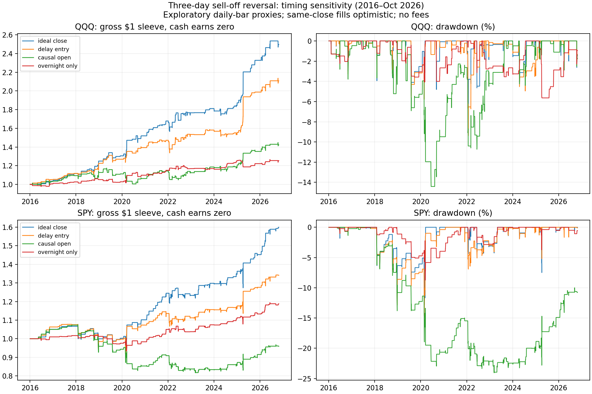

# Does the LinkedIn three-day sell-off rule survive our data?

**November 4, 2026. The broad rebound pattern is supported by an exploratory approximation; the exact strategy and its live feasibility are not independently validated.** QQQ's optimistic close-to-close version resembles the post's high win rate and short holding period. Delaying both decisions to observable next-session prices substantially weakens the evidence. This is market-direction reversal, a different hypothesis from our peer/factor-residual reversal work.

**Capital and benchmark follow-up:** [same-$100,000 buy-and-hold and passive risk comparisons](CAPITAL_COMPARISON.md) show that SPY buy-and-hold earns 14.97% annualized over the full period, versus 4.45% for ideal-close SPY reversal and −0.38% for causal-open SPY reversal. The strategy commits the entire account on active trades despite being invested infrequently. The favorable ideal-close QQQ risk comparison weakens under causal execution.

## What was specified and measured

The user supplied [this LinkedIn post](https://www.linkedin.com/feed/update/urn:li:activity:7523503251665723394/) and its text. The browser could not retrieve a full article/specification. The decline threshold, volatility definition/lookback, exact up-day definition, overlap rules, instrument, position sizing, stop rules and execution assumptions remain unknown. We cannot verify the original 332 trades, 1995 training history, six preregistered criteria, net costs, t=4.1, independent implementation, or pre-1995 failure.

We wrote [the specification](specification.json) before running this new test. It fixes a transparent approximation rather than selecting parameters to match the post:

1. Compute the last three sessions' adjusted close return, `C[t]/C[t-3] - 1`.
2. Divide by `sqrt(3)` times the sample standard deviation of **20 daily returns ending t−1**. This scales daily volatility to three sessions; it is not a normal-distribution significance test.
3. Enter when this ratio is at most **−1.5**. Three individually negative days are not required in the primary version; that interpretation is included in the declared sensitivity grid.
4. Hold one fully invested, unlevered ETF sleeve until the first later session with `C[u] > C[u-1]`. No maximum hold, stop, pyramiding or same-exit-session reentry. Signals while holding are ignored. Cash earns zero.

Use existing SPY bars plus a separate QQQ download, January 4, 2016–October 27, 2026, with 2,720 matching sessions. QQQ and SPY are ETFs, not index levels, and have correlated exposures. All-adjusted prices are vendor return proxies. Alpaca [documents](https://docs.alpaca.markets/us/docs/market-data-faq) trade-condition-based daily bar construction; the bar open/close is not an independently verified auction fill. Its daily-price update rules exclude extended-hours trade conditions from daily OHLC. These data do not establish execution capacity or a pre-close signal.

All returns below are **gross/pre-fee**, following the existing project instruction. There is no claim to reproduce the post's net-of-costs figures. The 2020 split is descriptive and matches the post's era; it is not a fresh holdout or an exercise in training on 1995–2020. We never had the earlier history here, and these calendar years were already examined in prior research.

## Main result: 2020 through October 27, 2026

| ETF / timing | Completed trades | Winners | Mean return/trade | Approx. 95% interval | Gross CAGR |
|---|---:|---:|---:|---:|---:|
| QQQ: signal close → first-up close | 71 | 83.1% | +0.942% | [+0.445%, +1.492%] | 10.01% |
| QQQ: next open → first-up close | 71 | 63.4% | +0.738% | — | 7.74% |
| QQQ: next open → open after first-up close | 64 | 62.5% | +0.404% | [−0.119%, +0.912%] | 3.68% |
| SPY: signal close → first-up close | 73 | 80.8% | +0.652% | [+0.355%, +0.946%] | 7.11% |
| SPY: next open → first-up close | 73 | 71.2% | +0.416% | — | 4.45% |
| SPY: next open → open after first-up close | 63 | 65.1% | +0.037% | [−0.397%, +0.406%] | 0.25% |

The intervals use a ratio bootstrap of completed-trade returns attached to their entry-session calendar: circular moving blocks of 20 sessions and 2,000 draws. They are pointwise and exploratory, without correction for trying multiple variants. The 60-session block sensitivity leads to the same zero/nonzero assessment here. Neither bootstrap controls unknown selection by the post's author or makes our historical sample untouched. The descriptive trade t statistics for ideal-close QQQ/SPY are 3.54/3.99; these are not verification of the author's significance calculation.

The ideal-close average hold is **1.62 sessions QQQ and 1.67 SPY**. QQQ's ideal-close sleeve has no negative calendar year in 2020–2026 YTD, resembling that part of the post. SPY loses 0.94% in 2022. The causal-open QQQ sleeve loses 4.44% in 2020 and 1.61% in 2022; SPY loses 9.55%, 7.91% and 0.40% in 2020, 2022 and 2023. See [calendar-year returns](annual_returns.csv). “No losing year” is not invariant to timing.

The ideal sleeve is exposed on about 6.7% of later QQQ sessions and 7.1% of later SPY sessions. CAGR uses the whole calendar including flat days. Buy-and-hold adjusted-proxy CAGR is 20.13% QQQ and 15.12% SPY over this subperiod, with much greater exposure; the sell-off rule does not dominate buy-and-hold simply because its win rate is high.

## What changes when information must be observable

**Same-close entry and exit are optimistic on daily data.** The final close determines the sell-off signal and whether the exit day is positive. Filling after learning that close at exactly that price is not established. A strategy may use a pre-close indication and closing orders, but that requires a cutoff, intraday observations and auction/fill validation. We do not infer the author's code has look-ahead; their execution specification is unavailable.

The entry-only delay retains about **78% of QQQ's mean trade return and 64% of SPY's** on the same 71/73 completed signal cohorts. This does **not** support “most of it is gone by the next open” for our approximation. There is a positive overnight component, but it is not the whole measured effect. Within the ideal completed trades, overnight/intraday mean log-return contributions are 36.58/54.80 basis points QQQ and 35.95/28.06 SPY. These add exactly in logs, not simple percentages. Intraday attribution includes the first-up day selected by the exit rule and therefore is not proof of an independently predictable intraday edge.

When **both** decisions wait for the next open, intervals include zero, annual losses appear, and full-history drawdowns increase. This daily-bar version is causal in information order; actual open fills and vendor adjustments still remain proxies. It also holds across an extra exit-night gap, can miss later signals while occupied, and consequently has different trade counts. The overnight-only variant in [summary](summary.csv) is a separate strategy, with different eligible trades, not a matched subtraction.

## Controls, earlier period and sensitivity

- **High win rate partly follows from the exit rule.** Entering whenever flat, without any sell-off threshold, and using the same ideal first-up exit already produces **73.8% QQQ and 73.1% SPY winners in 2020 onward**. High winners alone do not establish an entry edge. A small positive day can also follow several larger losses and leave the trade underwater.
- **There is evidence beyond the win rate.** Following every eligible sell-off signal, including those that would occur while a sleeve is already held, the fixed next-session mean close return is **49.4 bps QQQ versus 8.5 bps on all eligible days**, and **22.5 versus 6.4 bps SPY** in 2020 onward. This event study avoids a first-up exit but has clustered/overlapping signals; these are descriptive means, not independent-event t tests.
- **Alignment control:** shifting the signal sequence through each period, while keeping its clustering and reapplying the exit/occupancy rule, produces weaker ideal-close daily means. In 2020 onward, observed/shift-median daily means are 3.93/1.09 bps QQQ and 2.86/0.94 SPY. None of 1,673 shifts matches QQQ and 0.24% match/exceed SPY. These are descriptive alignment fractions, **not calibrated p values**: shifting crisis signals changes the volatility regime and exposure opportunities. The broad pattern warrants attention without certifying a live strategy.
- **Earlier data are less uniform.** In 2016–2019, ideal-close mean return is +0.733% QQQ but only +0.021% SPY; SPY's interval includes zero. This is evidence against assuming every index/era behaves identically.
- **Full 2016–October 2026:** ideal-close QQQ has 108 trades, 83.3% winners, +0.870% mean, 8.85% CAGR and 6.72% maximum drawdown. SPY has 102 trades, 79.4% winners, +0.472% mean, 4.45% CAGR and 12.80% drawdown. Causal-open full-history CAGR is 3.32% QQQ and −0.38% SPY; maximum drawdowns are 14.41%/24.05%. Both causal-open full-history mean intervals include zero.
- **All 18 declared adjusted-price combinations** of volatility windows 10/20/60, thresholds 1/1.5/2 and with/without three individually down days have positive 2020-onward ideal-close mean returns for both ETFs. This supports the broad pattern rather than a single selected optimum, but the timing limitation applies to the entire grid. These variants are correlated and not 18 independent replications. Raw-price primary results are similar: +0.950% QQQ and +0.659% SPY per trade. The full grid is saved in [sensitivity](sensitivity.csv); no winner was selected.

First-up exits are searched strictly after the entry-signal session. Trades without an observed eligible exit are flagged incomplete, excluded from completed-trade means/wins, and marked to the final close in equity/drawdown. Periods reset flat for their separate diagnostics; the full curve never resets at 2020. No missing prices are filled.

## VIX coverage and usefulness here

**Alpaca does not currently supply VIX index values through its documented Market Data offering.** Its September 2, 2026 [index-options announcement](https://alpaca.markets/blog/alpaca-launches-index-options-via-trading-api/) explicitly distinguishes index-option support from unavailable index data. VIX options and VIX-futures products are not spot VIX history.

We downloaded free [Cboe VIX daily history](https://www.cboe.com/tradable_products/vix/vix_historical_data), preserved the source and checksums in [the separate dataset](../../../market_data/datasets/mean_reversion_context_2026-11-04/README.md), and saved conservatively **one-equity-session-lagged VIX** alongside each ETF's signal and past-only realized volatility. No missing VIX observations are filled; the study never consumes observations after October 27 even though the source extends through November 3.

Fixed prior-VIX bins show larger unscaled ideal-close returns after higher-VIX sell-offs. For QQQ in 2020 onward: below 20, **35 trades averaging 0.412%**; 20–30, **25 at 0.779%**; at least 30, **11 at 2.997%**. SPY has 36/27/10 trades, with means 0.400%/0.656%/1.549%. The last bins contain few trades, and higher volatility mechanically allows larger returns and losses. These tables establish neither independent predictive information beyond realized volatility nor a profitable VIX gate. We did not optimize a VIX threshold, normalize away that confound, or modify frozen factor/TDA strategies.

A sensible role for VIX in a subsequent explicitly specified factor experiment is an ordinary market-state/risk control compared against realized volatility. Whether it forecasts the **mean of residual-sleeve returns**, rather than their risk, must be tested separately. The rebound result itself does not identify forced fund selling or margin calls: we have no fund-flow or liquidation evidence in these daily bars.

## Reproduction and verification

From the project root, using the existing `tda` environment:

```sh
conda run --no-capture-output -n tda python market_data/download_mean_reversion_context.py
conda run --no-capture-output -n tda python equity/experiments/index_selloff_reversal.py
conda run --no-capture-output -n tda python equity/experiments/audit_index_selloff_reversal.py
```

The download is only needed to recreate the separately saved inputs; it fetches the then-current vendor snapshot. [Run manifest](run_manifest.json) pins source/input/output hashes. [Audit](audit.json) independently reconstructs all **1,716 primary ledger rows** across symbols, periods and timing modes; checks scalar volatility/signals, future-price perturbation, hand-computed timing cases, censored trades, daily/trade wealth reconciliation and lagged VIX alignment. This catches implementation errors within our specification; it is not an independent reproduction of the author's unavailable specification.

Artifacts: [summary](summary.csv), [trades](trades.csv), [daily curves](daily_curves.csv), [annual returns](annual_returns.csv), [controls](controls.csv), [timing attribution](timing_attribution.csv), [sensitivity](sensitivity.csv), [VIX bins](vix_context.csv), [QQQ features](qqq_features.csv), [SPY features](spy_features.csv).


