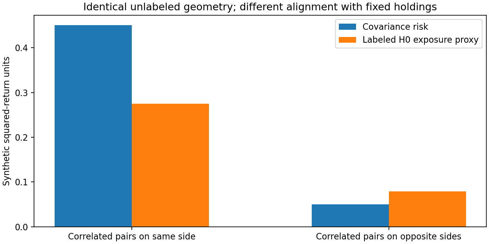
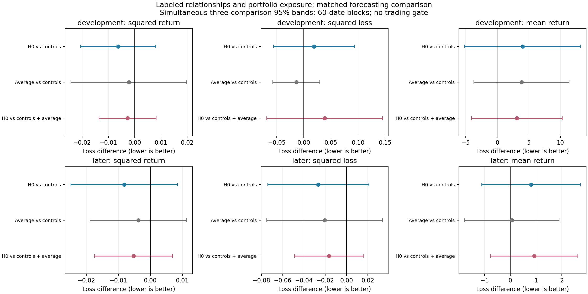
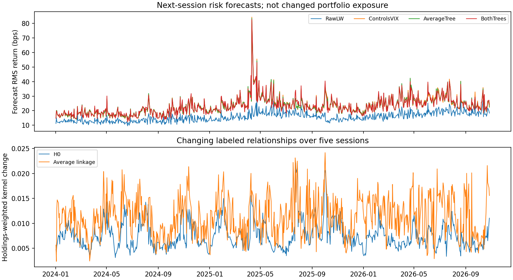
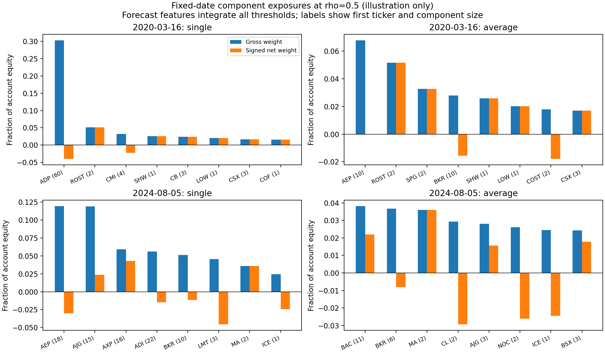

# Labeled relationship changes and portfolio exposure

Executed November 5, 2026, following the user's request to continue beyond the local residual-shock experiment. This tests the second [alternative TDA role](../../literature/tda_alternative_uses_2026-11-05.md): retain stock identities, attach current holdings to persistent groups, and measure changes in the relationships to which the portfolio is exposed.

**There is a modest favorable squared-return forecast estimate in both periods, including beyond average-linkage controls, but no reliable incremental benefit is established.** Later downside-risk forecasts also improve in point estimates; earlier downside results are unfavorable. Mean-return forecasts get slightly worse. Every declared paired 95% interval includes zero.

This is a new forecast comparison on the **unchanged portfolio**. It is not a risk-reduction policy, a profitable-regime rule, or a new trading backtest. All outcomes are gross/pre-fee; no exposure, gate or strategy return was changed.

## What information this construction retains

An unlabeled persistence diagram can describe similar global geometry while losing which stocks are connected and whether they sit on the long or short side. We instead retain the complete labeled H0 component hierarchy from single linkage on past stock-correlation distances.

For each signal date, use the original admitted stocks and 120 preceding sessions of standardized SPY-residual returns, ending at `t-1`. Repeat for a window ending at `t-6`, using the same currently admitted stocks. Distance is `sqrt(2(1-rho))`, ranging from zero to two. Current outcomes do not construct either relationship estimate.

For stocks i and j, let `c_ij` be the distance where their components first join. Define:

```text
K_ij = 1 - c_ij / 2        K_ii = 1
v_i  = current dollar weight_i × prior intraday sigma_i in bps
tree exposure proxy = v' K v
```

`K` equals the average component co-membership matrix integrated across every distance threshold from zero to two. It is positive semidefinite. At each threshold, `v' K_threshold v` is the sum of squared net sigma-weighted exposures of the components. Thus the integrated proxy retains how positions offset **inside** groups, rather than merely counting groups or bars.

Intraday sigma uses 120 preceding raw open-to-close returns, with a one-bp floor. The same current `v` is attached to both current and older hierarchies, so a change feature measures relationships changing while holding positions/scales fixed. Three inputs describe each hierarchy:

1. Log integrated exposure proxy.
2. Signed change in that proxy over five sessions, divided by diagonal portfolio risk.
3. Absolute pairwise kernel change, weighted by `abs(v_i v_j)` and normalized by `sum(abs(v))²`.

We construct the same three inputs from **average linkage**, which merges groups according to the average distance across their members. That ordinary hierarchy is a matched comparator. H0/single linkage uses the closest connecting path and can chain larger groups together. This experiment does not claim that H0 is distinct from single linkage, introduce new observations beyond correlations, or use H1/zigzag persistence.

The four-stock synthetic check holds unlabeled geometry fixed but moves the correlated pairs between the same and opposite portfolio sides. Both covariance and labeled-tree exposure distinguish those cases; a bare unlabeled diagram cannot. This verifies the intended distinction, not TDA superiority. Exact threshold integration, direct tree-merge integration, joint relabeling of stocks/holdings and global sign reversal agree.



## Forecast comparison

Source dates and portfolio weights are the frozen expanded-stock SPY + three-PC strategy, with the original 272-return admission rule. The 2,446 signal dates run February 2, 2017–October 26, 2026. First use 504 completed outcomes for training, then predict **1,942 executions**, February 6, 2019–October 27, 2026: **1,234 development and 708 later dates**.

| Model | Inputs |
|---|---:|
| Controls + VIX | 20 ordinary controls |
| Average tree | Same 20 + three average-linkage exposure/change features |
| H0 tree | Same 20 + three H0 exposure/change features |
| Both trees | Same 20 + both three-feature sets |

Ordinary controls include current-holdings Ledoit–Wolf covariance risk from past intraday and close-to-close returns, diagonal risk, covariance changes, sector exposure, position concentration, residual correlation/PC share, historical hypothetical-current-sleeve downside/mean/kurtosis, trailing actual strategy outcomes, S&P volatility and entry-available VIX log level/change plus the fixed 20–30 indicator. Historical sleeve returns apply today's known holdings to already observed returns; they are risk inputs, not a funded strategy return series. Snapshot sectors retain the existing historical-selection limitation.

The targets are evaluated independently:

- **Primary risk:** next-session squared gross portfolio return in bps², a raw second moment including both gains and losses.
- **Secondary downside risk:** `max(-gross_bps, 0)²`, a downside second moment. It is zero on positive-return days.
- **Mean:** next-session signed gross return in bps.

These are actual frozen portfolio outcomes, unlike the prior experiment's individual relative-stock targets. At unit total gross notional, returns are also account-equity returns; they are not long-book returns.

Risk models forecast a positive conditional moment using log intraday covariance risk as an offset, training-standardized features and a fixed quadratic coefficient penalty. The convex training objective is average `log(m) + outcome/m` plus `0.5 × sum(beta²)`, with an unpenalized intercept. Mean models use the original ridge objective, average squared error plus `sum(beta²)`. Fits expand and update every 20 forecast dates, with current features refreshed daily. Only outcomes completed by the refit signal close enter training. Numerical Newton polishing ensures the same convex objective reaches gradient convergence; it does not change the model or penalty.

Raw covariance and expanding scalar-calibrated covariance are additional risk benchmarks. Zero and expanding historical mean are additional signed-return benchmarks. All models share dates. See the [pre-run specification](specification.json) and saved [fit diagnostics](fit_diagnostics.csv).

## Risk results

Risk uses **QLIKE**, the average of `log(forecast moment) + realized square / forecast moment`. Lower is better. It penalizes underforecasting large moves and also penalizes excessive forecasts. Paired differences compare forecasts on identical days. Absolute QLIKE depends on return units, so a percentage change in its level is not reported as a percentage risk reduction.

| Model | Development squared-return QLIKE | Later squared-return QLIKE | Development downside QLIKE | Later downside QLIKE |
|---|---:|---:|---:|---:|
| Raw intraday covariance | 8.36285 | 7.65582 | 7.23422 | 6.44834 |
| Scalar-calibrated covariance | 7.54376 | 7.26982 | 7.12793 | 6.53100 |
| Controls + VIX | 7.31594 | 7.26063 | 6.93629 | 6.46653 |
| Average tree | 7.31372 | 7.25689 | **6.92237** | 6.44598 |
| H0 tree | **7.30964** | 7.25246 | 6.95497 | 6.44002 |
| Both trees | 7.31102 | **7.25165** | 6.96070 | **6.42953** |

The primary comparison adds H0 after ordinary controls **and** the average tree. Negative differences below favor H0:

| Target | Period | Both trees minus average tree | Simultaneous 95% interval |
|---|---|---:|---:|
| Squared return | Development | −0.002698 | [−0.013610, +0.008213] |
| Squared return | Later | −0.005234 | [−0.017417, +0.006949] |
| Squared loss | Development | +0.038328 | [−0.068597, +0.145253] |
| Squared loss | Later | −0.016446 | [−0.048757, +0.015865] |

H0 without average-linkage inputs also lowers squared-return QLIKE versus ordinary controls in both periods: −0.006308 earlier and −0.008174 later. Their simultaneous intervals include zero. Average linkage itself gives favorable squared-return point increments, also uncertain. No model is selected as a validated winner.

As a descriptive calibration check, later realized RMS return is **23.971 bps**. Square root of average forecast moment is **15.990 bps** for raw covariance, **23.840 bps** for ordinary controls and **23.750 bps** for both trees. The corresponding average realized-square/forecast ratios are 2.189, 1.040 and 1.036. The learned models correct much of the raw covariance underforecast; these aggregate checks alone do not establish conditional calibration or the significance of the H0 increment.

## Separate mean-return results

| Model | Development mean MSE (bps²) | Later mean MSE (bps²) |
|---|---:|---:|
| Zero | **737.5234** | 574.6021 |
| Historical mean | 739.1097 | **574.5981** |
| Controls + VIX | 755.2320 | 575.4247 |
| Average tree | 759.0741 | 575.4852 |
| H0 tree | 759.2406 | 576.2324 |
| Both trees | 762.1865 | 576.4124 |

Adding H0 beyond the average tree worsens mean MSE by **0.410% earlier** and **0.161% later**. Paired intervals include zero. Both simple benchmarks have lower point errors than the feature models. Thus the favorable risk estimates do not become a finding about profitable trading regimes.



## What changes and exposures look like

The next plot shows forecasts and labeled kernel changes separately. Forecasting a higher squared return does not change the portfolio. The kernel-change series is continuous relationship turnover, not a binary crisis label or a calibrated change-point alarm.



The two dates below were fixed before evaluating this run. For illustration only, cut each hierarchy at distance one—the underlying pairwise distance scale corresponding to correlation 0.5. This does not require all pairs within a component to have that correlation; average-linkage cuts have a different grouping rule. **Forecasts integrate every threshold**, rather than using this illustrative cut. The CSV retains full named membership, net dollars, gross dollars and net sigma-weighted exposure. Charts show the eight largest components by gross weight, not the full portfolio.



## Limits, interpretation and validation

Paired uncertainty uses 1,000 circular blocks of 60 dates, with simultaneous bands over the three declared additions per target/period. Forecasts remain fixed during resampling. All 18 declared paired intervals, including pointwise intervals, span zero. No adjustment spans different targets, periods or prior project experiments.

History is already examined and the basket contains present-day survivors. Current sector labels are not reconstructed historical memberships. The 120-session relationship/covariance history, five-session change, fixed learner and fixed penalty test one construction, not every risk estimator. The previously selected VIX band remains exploratory. A hierarchy exposure is a mathematical proxy, not a measured economic cause or a covariance estimate guaranteed to be correct.

**Retain this as a possible additional portfolio-risk representation, with its unresolved increment explicit.** It preserves identities and holdings alignment that the earlier global summaries discarded. It gives no established mean-return benefit, and its downside gains do not persist across periods. No trading-off or sizing rule follows from this test.

The [independent audit](audit.json) checks every original portfolio outcome and VIX date; reconstructs residual correlations, Ledoit–Wolf covariance with an independent moment formula, MST minimax H0 connectivity and exact partition integration on sampled dates; checks every fit/forecast, selected fits with a separate risk optimizer, all metrics and all paired resampling intervals. Original sources and prior experiments remain unchanged.

From the project root, using `tda`:

```sh
/Users/derickshi/anaconda3/envs/tda/bin/python equity/experiments/tda_relationship_exposure.py
/Users/derickshi/anaconda3/envs/tda/bin/python equity/experiments/audit_tda_relationship_exposure.py
```

Artifacts: [design](specification.json), [construction checks](construction_checks.json), [state inputs and outcomes](state_features_and_targets.csv), [forecasts](walk_forward_predictions.csv), [metrics](forecast_metrics.csv), [paired uncertainty](paired_comparisons.csv), [fit diagnostics](fit_diagnostics.csv), [named components](fixed_date_components.csv), [provenance](summary.json), [analysis source](../tda_relationship_exposure.py), [audit source](../audit_tda_relationship_exposure.py). Full labeled hierarchies and fit parameters are preserved locally; the large reproducible hierarchy array is ignored by Git.
