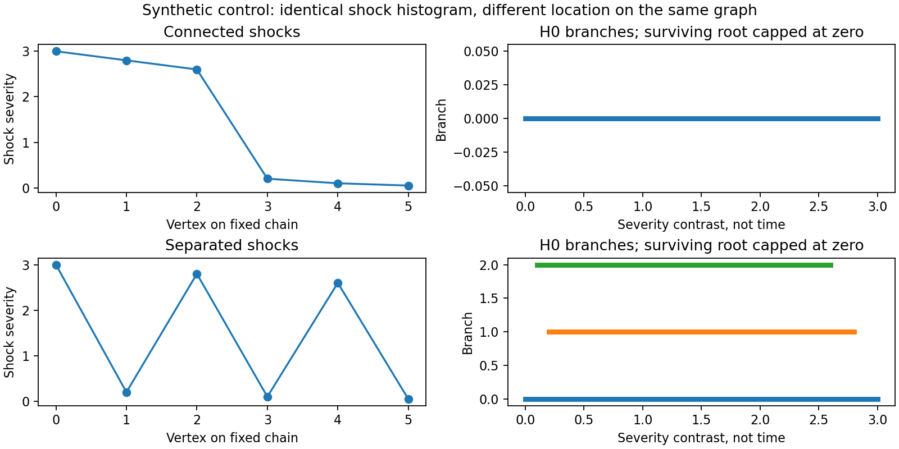
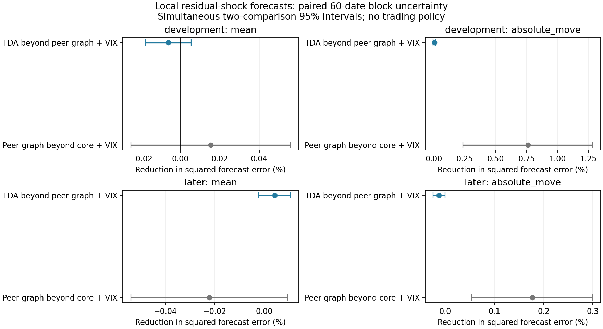
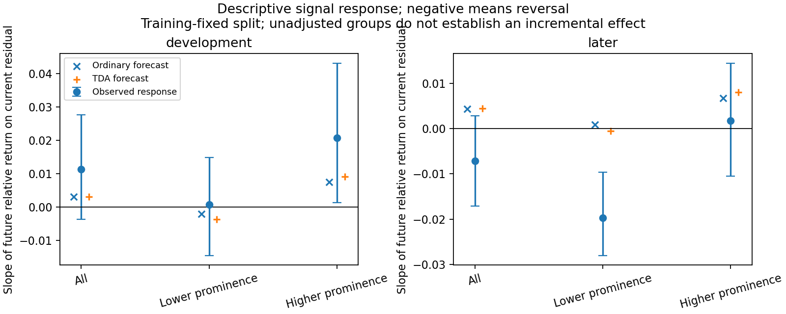
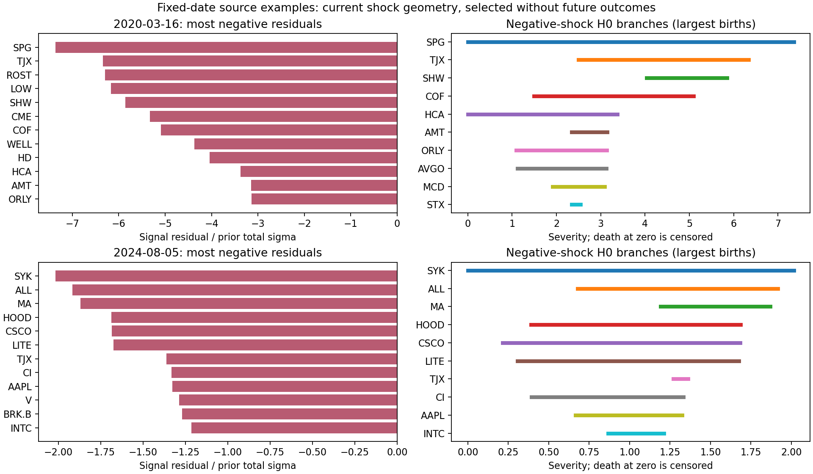

# Does the topology of today's residual shock predict reversal?

Executed November 5, 2026, following the user's authorization to test the first [alternative TDA use](../../literature/tda_alternative_uses_2026-11-05.md).

**This construction distinguishes connected from separated shocks, but adds essentially no useful return prediction beyond ordinary peer measures and VIX.** Its later mean-error improvement is 0.0043%, with a simultaneous 95% interval of [−0.0021%, +0.0107%]; earlier it worsens error by 0.0062%. For the separate absolute-move target, ordinary graph features help in both periods, while TDA's increment is negligible earlier and slightly adverse later.

The experiment changes the representation and prediction target, rather than rerunning the global next-20-session regime test. It predicts individual next-session relative stock returns using current local shock structure. It does not construct a new portfolio, change the frozen strategy, or introduce a trading-off rule. Outcomes remain gross/pre-fee.

## The representation and its meaning

Each day we reconstruct the existing expanded-stock SPY + three-PC strategy, including its 272-observation admission rule, 120-session factor fit, inverse total-variance weights and current close-to-close WLS residual. We divide each residual by the stock's prior total daily sigma, giving signed `z`.

The graph comes entirely from 120 prior sessions ending before the signal day. For each stock, take up to five peers with the strongest **positive SPY-residual correlations**, then symmetrize the selected edges. This is a fixed construction, without graph tuning against outcomes. The daily graphs have a median 711 undirected edges and are connected throughout this sample. Current signals and graph neighbors are distinct inputs: the signal removes the fitted three-PC exposure too.

For positive and negative shocks separately, start with the most severe same-sign residuals and progressively admit smaller shocks. Add a backbone edge as soon as both endpoints are present. New components are born at local severity peaks; when components meet, retain the one with the larger birth peak and record the younger component's death level. This is H0 persistence of the shock field on the graph, rather than the earlier filtration over correlation distance.

Two features are attached to each stock:

1. **Branch prominence:** its assigned peak's severity minus that branch's merge level. At activation, assign the stock to the oldest neighboring peak, or create a peak if none exists. Keep that assignment after subsequent merges.
2. **Branch support:** the number of vertices in that peak's component immediately before it merges, divided by admitted stocks. Components absorbed earlier contribute to that count, so branch supports need not form a disjoint partition.

Branches still alive when the positive-severity scan ends are capped at zero and explicitly flagged. Their zero endpoint is not an observed positive-level merger. Zero-signal vertices receive zero features. Ties use stock order. Lifetimes measure **residual severity contrast**, not days, statistical significance or evidence of forced selling.

The controlled chain example below holds the shock histogram fixed and changes only the locations of the shocks. The connected case has one branch; the separated case has three. Sign reflection, stock permutation with unique severities, amplitude scaling and boundary checks pass. This demonstrates a representation distinction, not a forecasting edge.



## Forecast design

Source features cover **2,446 signal dates** from February 2, 2017 through October 26, 2026, containing **469,308 stock events**. The first 504 dates form initial training. Forecasts cover **1,942 execution dates**, February 6, 2019–October 27, 2026: 1,234 development dates and 708 later dates, totaling **377,454 forecast stock events**. These are not independent stock-event observations; evaluation and resampling keep every stock on a date together.

| Model | Raw inputs | Including fixed signal interactions |
|---|---:|---:|
| Core + VIX | 14 | 27 |
| Peer graph + VIX | 20 | 39 |
| Peer graph + VIX + TDA | 22 | 43 |

Core controls include signed/absolute signal, prior volatility, sector shock averages, cross-sectional dispersion, past S&P volatility/return, residual PC1 share, VIX log level/change and fixed 20–30 indicator, and trailing strategy mean/RMS. VIX is the completed signal-day close, available before next-session entry. Graph controls add neighbor-average signed/absolute shocks, sign agreement, average neighbor correlation, degree and same-sign component size at the fixed one-sigma threshold. Sector labels are the existing present-day snapshot, not reconstructed historical classifications.

Every raw feature other than `z` also enters multiplied by `z`, identically across ordinary and TDA models. Thus topology can change the predicted signal response; ordinary controls receive the same interaction opportunity. Exact inputs are in the [pre-run specification](specification.json) and [expanded model configuration](forecast_configuration.json).

Expanding ridge fits use training-only population scaling, lambda 1, an unpenalized intercept and equal total weight for each date. Refit every 20 forecast dates, updating state features daily. Only completed prior stock outcomes enter a fit; the latest training execution may equal the refit signal date, since that intraday outcome has finished by signal close. Its next-session outcome never enters that fit. For the first 20 source dates, trailing strategy features use available earlier frozen trades; the first date has a zero fallback because that ledger has not started. Those rows are training only.

The **primary mean target** is the next session's raw open-to-close simple stock return, projected through formation-date WLS exposures and divided by formation-date total sigma. The projection uses future returns solely to calculate the outcome. It preserves the frozen neutral portfolio's P&L. The separate **risk target** is that normalized relative stock return's absolute value. This is stock-level absolute-move prediction, **not portfolio RMS**, downside-only risk or a portfolio allocation.

For each date, average squared error across admitted stocks, then average equally across dates. Target units are dimensionless prior-sigma units, so MSE is not bps². The signed-target baseline predicts zero; the absolute-target baseline predicts its expanding historical mean at the same refits. No outcome-selected setting or new weight rule was used.

## Mean-return results

| Model | Development MSE | Later MSE |
|---|---:|---:|
| Zero forecast | 0.3994421 | **0.4858705** |
| Core + VIX | 0.3994831 | 0.4859655 |
| Peer graph + VIX | **0.3994219** | 0.4860735 |
| Peer graph + VIX + TDA | 0.3994466 | 0.4860528 |

Relative to peer graph + VIX, TDA changes error by:

| Period | Reduction in MSE; positive is better | Simultaneous 95% interval |
|---|---:|---:|
| Development | −0.00618% | [−0.01781%, +0.00545%] |
| Later | +0.00427% | [−0.00215%, +0.01068%] |

The primary later paired loss difference is −0.00002075, interval [−0.00005193, +0.00001043]. This is tiny and unresolved. The zero-return benchmark has the lowest later point error; neither ordinary features nor this TDA addition gives a persuasive mean forecast here.

## Separate absolute-move results

| Model | Development MSE | Later MSE |
|---|---:|---:|
| Historical absolute-move mean | 0.2003963 | 0.2316505 |
| Core + VIX | 0.1849985 | 0.2232010 |
| Peer graph + VIX | 0.1835911 | **0.2228059** |
| Peer graph + VIX + TDA | **0.1835837** | 0.2228338 |

Ordinary graph features reduce error by **0.761% earlier** and **0.177% later**, relative to core + VIX. Their declared simultaneous intervals are [+0.235%, +1.287%] and [+0.054%, +0.300%], respectively. Within this fixed comparison, ordinary peer-shock context contributes information about the magnitude of future relative moves.

TDA adds only **+0.0040% earlier**, interval [−0.0074%, +0.0154%], and **−0.0125% later**, interval [−0.0246%, −0.0004%]. The tiny later worsening has an interval excluding zero under this bootstrap; it is not evidence of an economically substantial disadvantage. None of the absolute-move forecasts is negative.



## What the response plot does and does not show

The initial training panel fixes the branch-prominence median at **1.52936 sigma units**. No later outcomes set this boundary. Later stocks below that threshold have an observed response slope of **−0.0197**, pointwise interval [−0.0280, −0.0097], while the higher group has **+0.0017**, [−0.0105, +0.0144]. A negative slope means reversal: a signal of one sigma is associated with an opposite future relative move equal to roughly 0.0197 of that sigma in the lower group.

This is an unadjusted descriptive relationship. Earlier slopes are +0.0007 and +0.0207, and the chronological models add essentially no forecast accuracy. Group composition, signal size, sector/neighbor context and temporal changes can explain a raw split. These groups do not identify a validated stock-selection policy, and “lower prominence” is not synonymous with “isolated shock.”



Fixed-date examples retain named stocks and branch identities. On March 16, 2020, TJX, ROST and LOW are assigned to the TJX peak branch, whose prominence is 3.8413 and whose pre-merge component contains six of 188 admitted stocks. That traces the summary to actual observations; it does not establish a common economic cause or subsequent profit. The March 2020 and August 2024 dates were specified as historical illustrations before evaluating this run, not selected as representative random observations or prospective warnings.



## Uncertainty, limits and decision

Use 1,000 circular resamples of 60 dates, retaining all stocks together. Report maximum-standardized-deviation 95% bands across the two declared increments (ordinary graph beyond core, TDA beyond graph), separately by period and target. Forecasts are fixed during resampling. Response-group intervals are pointwise. There is no adjustment across periods, targets or past project research.

The universe consists of current survivors; sector labels are a current snapshot, daily vendor bars are price proxies, and all dates have been examined previously. Expanding chronological fitting is causal within that panel but does not make this a fresh holdout. One fixed graph and two local summaries do not test every possible use of local topology. The fixed VIX band inherits its earlier post-selection limitation.

**Retain the interpretable shock-map construction and the ordinary graph magnitude result. Do not promote this TDA representation as a return predictor or reweight stocks from its raw group plot.** The mean-return increment is negligible, and the TDA risk increment is not favorable consistently. Labeled relationship-failure tracking, Mapper and alternative portfolio construction remain distinct, unrun proposals. No automatic trading-off rule follows from predicting larger moves.

## Audit and reproduction

The independent audit checks all 2,446 dates against the frozen holdings/return ledger, all VIX timing, and source hashes. It independently reconstructs PCA/WLS/neighbor graphs on 18 dates, checks 36 complete positive/negative trees against threshold connected-component counts, and checks branch owners and supports. Boundary cases cover zero and disconnected graphs. CSV endpoint levels are snapped to their exact source severity values for strict pre-merge support checks, avoiding float-round-trip boundary errors.

All **294 model refits** and stock forecasts are reconstructed through a separate raw-coefficient ridge formulation; **12 selected weighted multioutput fits** also reproduce through sklearn. Maximum forecast discrepancy is 4.58e-14. All 15,536 daily loss rows, 16 metrics, eight paired comparisons and descriptive response tables/intervals are checked. The original holdings match exactly; original returns differ by at most 9.98e-17. See [audit.json](audit.json).

From the project root, using the existing `tda` environment:

```sh
/Users/derickshi/anaconda3/envs/tda/bin/python equity/experiments/tda_residual_shock.py
/Users/derickshi/anaconda3/envs/tda/bin/python equity/experiments/audit_tda_residual_shock.py
```

Artifacts: [specification](specification.json), [construction checks](construction_checks.json), [forecast metrics](forecast_metrics.csv), [paired uncertainty](paired_comparisons.csv), [daily losses](daily_losses.csv), [response summaries](response_summary.csv), [named examples](named_shock_examples.csv), [daily context](daily_context.csv), [fit diagnostics](fit_diagnostics.csv), [provenance](summary.json), [analysis source](../tda_residual_shock.py), [audit source](../audit_tda_residual_shock.py). Full state and stock-prediction arrays are preserved locally as `state_panel.npz` and `stock_predictions.npz`; those large reproducible files are ignored by Git.
