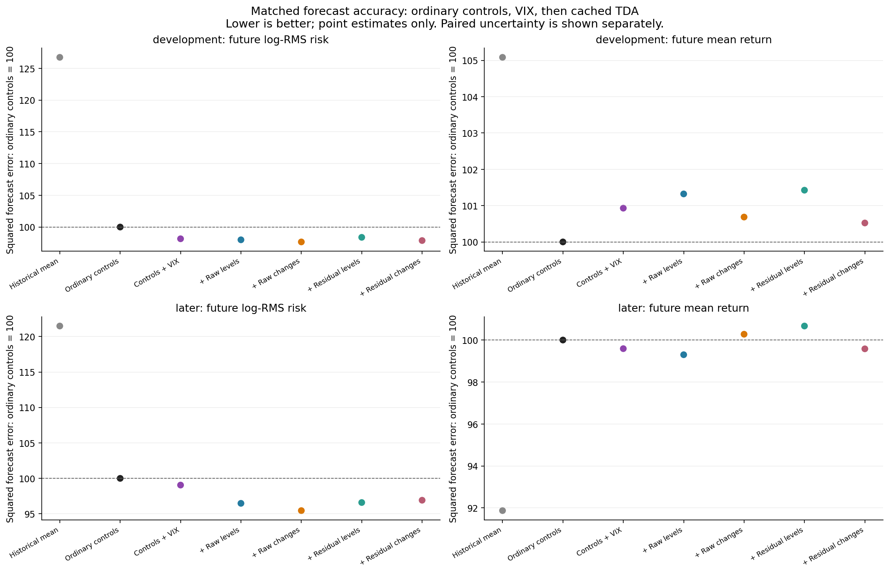
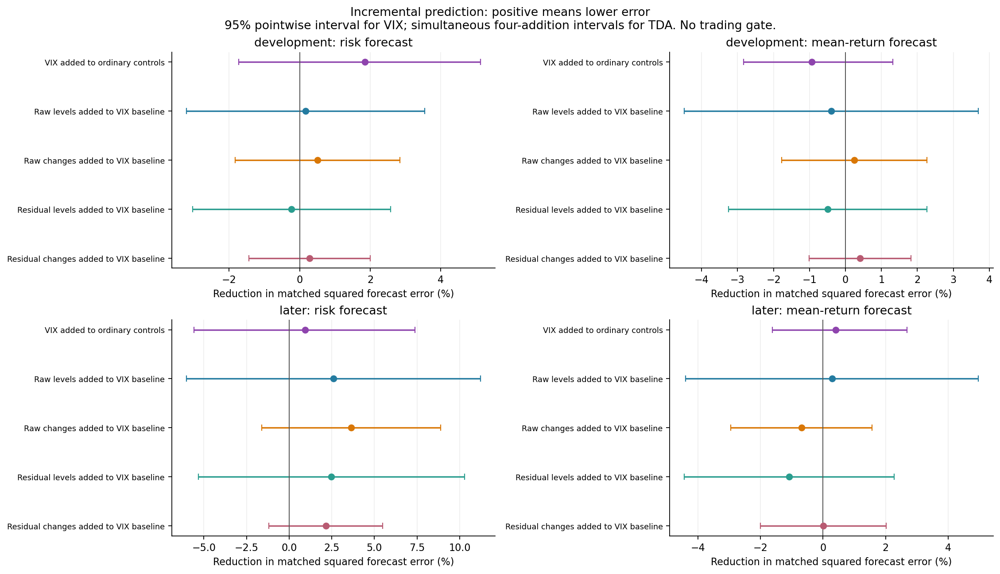
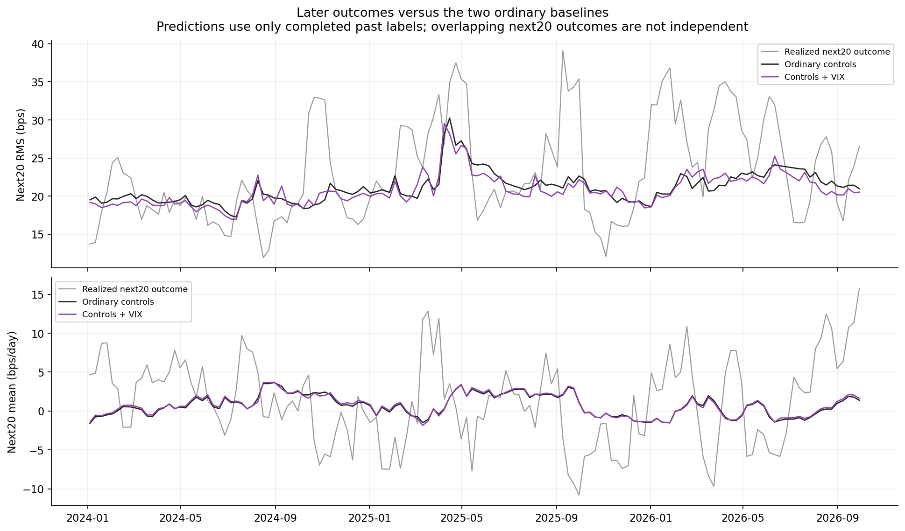

# Do cached TDA features add forecasting value beyond VIX?

Executed November 5, 2026, following the user's authorization of the [November 4 proposal](../../literature/tda_regimes_vix_2026-11-04/proposed_comparison.json).

**The modest later risk-forecast improvement survives adding VIX, but a reliable increment is not established.** VIX reduces later squared log-RMS forecast error by 0.95% relative to the original controls. Adding the four existing TDA feature sets reduces error a further 2.16–3.64% in point estimates. Every paired uncertainty interval includes zero. Mean-return forecasts show little benefit, and every feature model loses to the historical-mean forecast in the later period.

This comparison measures forecasts of the unchanged factor-neutral strategy. It does not change holdings, produce a new trading gate, or demonstrate lower realized portfolio risk. All strategy returns remain gross/pre-fee.

## What was compared

Every model uses identical prediction dates, targets and saved completed-label training memberships from [full-basket day states](../equity_full_basket_states/README.md). The original 490 cached anchors are retained, giving 379 forecast anchors. Of these, 233 development and 138 later anchors have complete, within-period outcomes; four split-crossing labels and four latest incomplete labels are not scored. Forecast formation dates run April 18, 2019–October 26, 2026. The later period starts in 2024 and has already been examined in prior research.

| Model | Inputs | Count |
|---|---|---:|
| Historical mean | Expanding mean of completed target labels | 0 |
| Ordinary controls | Existing volatility, correlation, covariance-change and strategy-history controls | 33 |
| Controls + VIX | Ordinary controls plus log VIX level, completed log VIX change, and fixed `20 <= VIX < 30` indicator | 36 |
| + Raw levels | Controls + VIX plus original raw-return H1 count, maximum lifetime and squared-lifetime sum | 39 |
| + Raw changes | Controls + VIX plus original raw diagram Wasserstein changes in return units/shape and change in squared-lifetime shape sum | 39 |
| + Residual levels | Controls + VIX plus original residual H1 count, maximum lifetime and squared-lifetime sum in shape units | 39 |
| + Residual changes | Controls + VIX plus original residual shape Wasserstein change and change in squared-lifetime shape sum | 38 |

The cached topology describes rolling 120-day clouds in 182 fixed stock coordinates, with the original five-session change construction. No topology was recomputed. Exact column names and memberships are in [executed_configuration.json](executed_configuration.json) and the original experiment.

VIX uses the last completed equity session before the first target execution, equal to `formation_date` on all 490 rows. Its change uses completed observations only, without forward filling. Cached topology retains its original `history_end`, one session older than formation; joining newer available VIX does not relabel topology as newer. The independent audit checks this alignment against the original VIX series and equity calendar.

Each fit uses expanding completed labels, at least 104 initially, training-only population means/standard deviations, and the original ridge penalty: mean squared error plus lambda 1 times squared standardized coefficients. The equivalent sklearn penalty is `alpha = number of training labels`. There is no new learner, penalty tuning, boundary tuning or model selection.

## Future risk

The target is **log of RMS daily strategy return over the next 20 sessions**, with returns measured in basis points. RMS includes gains and losses; it is not downside-only risk. The primary score is squared error of that log target. A percentage reduction in this score is neither a percentage return nor a percentage reduction in realized portfolio volatility.

| Model | Development log-risk MSE | Later log-risk MSE | Later reduction vs ordinary controls | Later reduction vs controls + VIX |
|---|---:|---:|---:|---:|
| Historical mean | 0.171532 | 0.084118 | −21.49% | −22.65% |
| Ordinary controls | 0.135339 | 0.069240 | 0.00% | −0.96% |
| Controls + VIX | 0.132836 | 0.068585 | 0.95% | 0.00% |
| + Raw levels | 0.132617 | 0.066802 | 3.52% | 2.60% |
| + Raw changes | 0.132164 | 0.066092 | 4.55% | 3.64% |
| + Residual levels | 0.133144 | 0.066881 | 3.41% | 2.48% |
| + Residual changes | 0.132459 | 0.067106 | 3.08% | 2.16% |

The primary later paired comparisons below subtract the controls + VIX squared error from the augmented squared error. **Negative favors the addition.** These are simultaneous 95% intervals across the four TDA additions within this period and target.

| Addition beyond VIX | Mean loss difference | Simultaneous 95% interval |
|---|---:|---:|
| Raw levels | −0.001783 | [−0.007698, +0.004132] |
| Raw changes | −0.002493 | [−0.006090, +0.001103] |
| Residual levels | −0.001704 | [−0.007064, +0.003656] |
| Residual changes | −0.001479 | [−0.003766, +0.000808] |

VIX's own later increment is −0.000655, pointwise 95% interval [−0.005105, +0.003857]. Earlier, VIX improves risk MSE by 1.85%, while the four TDA increments beyond VIX range from −0.23% to +0.51%. The later TDA point improvements are consequently stronger than the earlier ones. Raw changes have the best later point score here; this does not select a validated winner.

As a native-scale descriptive check, exponentiating the risk forecasts gives later RMS mean absolute errors of **4.844 bps** for ordinary controls, **4.790 bps** with VIX, and **4.720 bps** with raw changes. Exponentiating a conditional log forecast does not make it an unbiased forecast of conditional mean RMS.

## Future mean return

The separate target is the next 20 sessions' **average daily strategy return in bps**. It follows the frozen strategy's daily changing holdings, rather than holding the formation-day portfolio for 20 sessions. Returns are divided by total gross notional, long plus absolute short. At the saved unit-gross allocation, they are also account-equity returns; they are not returns on the long book alone.

| Model | Development mean MSE (bps²) | Later mean MSE (bps²) | Later reduction vs controls + VIX |
|---|---:|---:|---:|
| Historical mean | 79.2784 | **32.2774** | 7.75% |
| Ordinary controls | 75.4421 | 35.1325 | −0.41% |
| Controls + VIX | 76.1437 | 34.9882 | 0.00% |
| + Raw levels | 76.4398 | 34.8865 | 0.29% |
| + Raw changes | 75.9590 | 35.2297 | −0.69% |
| + Residual levels | 76.5173 | 35.3669 | −1.08% |
| + Residual changes | 75.8358 | 34.9852 | 0.01% |

VIX slightly improves later mean MSE versus ordinary controls (0.41%) but worsens it earlier (0.93%). TDA mean increments beyond VIX are small and mixed. All paired mean intervals span zero, as do all risk intervals, including pointwise intervals and the separate joint TDA + VIX versus ordinary-controls families. The historical-mean benchmark's favorable later point rank is included for context; it is not an additional validated superiority claim.

## Uncertainty and interpretation

The comparison reuses the original 1,000 circular bootstrap draws with blocks of 12 forecast anchors (approximately 60 trading sessions) and original period-specific seeds. Paired losses share the same resampled dates. TDA intervals use the maximum standardized bootstrap deviation over the four additions; VIX alone uses a percentile interval. Resampling is conditional on the saved forecasts, without refitting models. There is no adjustment across targets, periods, comparison families or the project's earlier experiments.

Overlapping 20-session outcomes are not 138 independent later observations. The current-survivor basket, examined history, small number of distinct stress episodes, and the 20–30 band's selection after inspecting earlier outcomes all limit generalization. These are exploratory chronological forecasts, not a fresh holdout.

The data therefore leave room for TDA to contain risk information beyond VIX and ordinary controls, but do not establish it. They give weaker support for predicting favorable mean-return regimes. Better risk detection should remain a separate claim from any future decision about exposure; this experiment implements no trading-off or sizing rule.







## Validation and reproduction

The [independent audit](audit.json) passed all 5,306 fits using sklearn scaling/ridge, all 28 metric rows and all 36 paired comparison rows. Maximum independent forecast discrepancy is 2.49e-14; maximum independently reconstructed interval discrepancy is 3.11e-15. Original historical-mean and ordinary-control forecasts reproduce within 1.39e-13. Completed outcome labels were checked against the frozen PCA return ledger, and protected sources remain unchanged.

From the project root, using the existing `tda` environment:

```sh
/Users/derickshi/anaconda3/envs/tda/bin/python equity/experiments/tda_vix_matched.py
/Users/derickshi/anaconda3/envs/tda/bin/python equity/experiments/audit_tda_vix_matched.py
```

Evidence: [pre-run specification](specification.json), [forecast metrics](forecast_metrics.csv), [paired differences and uncertainty](paired_comparisons.csv), [all forecasts](walk_forward_predictions.csv), [scored losses](scored_losses.csv), [fit diagnostics](fit_diagnostics.csv), [aligned inputs](state_features_with_vix.csv), [provenance and hashes](summary.json), [analysis source](../tda_vix_matched.py), [audit source](../audit_tda_vix_matched.py).
