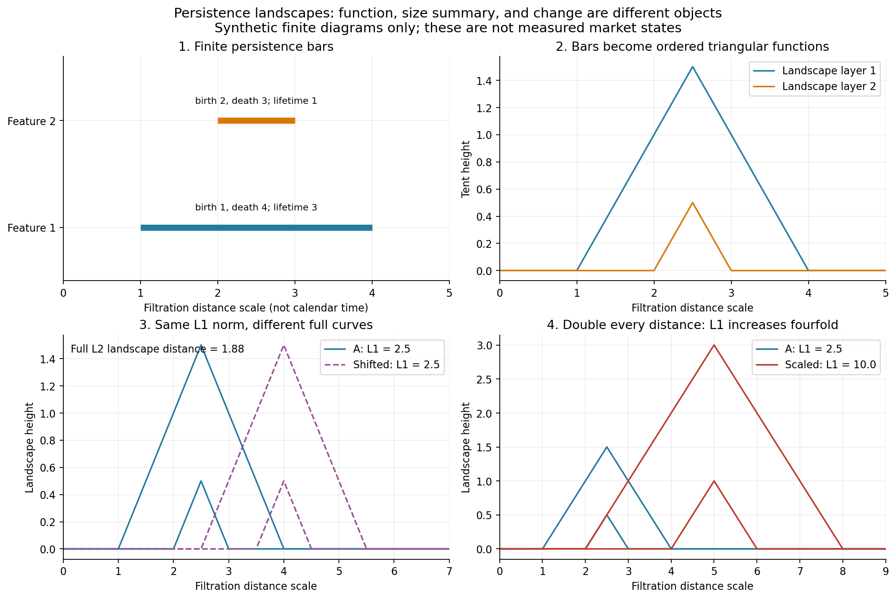
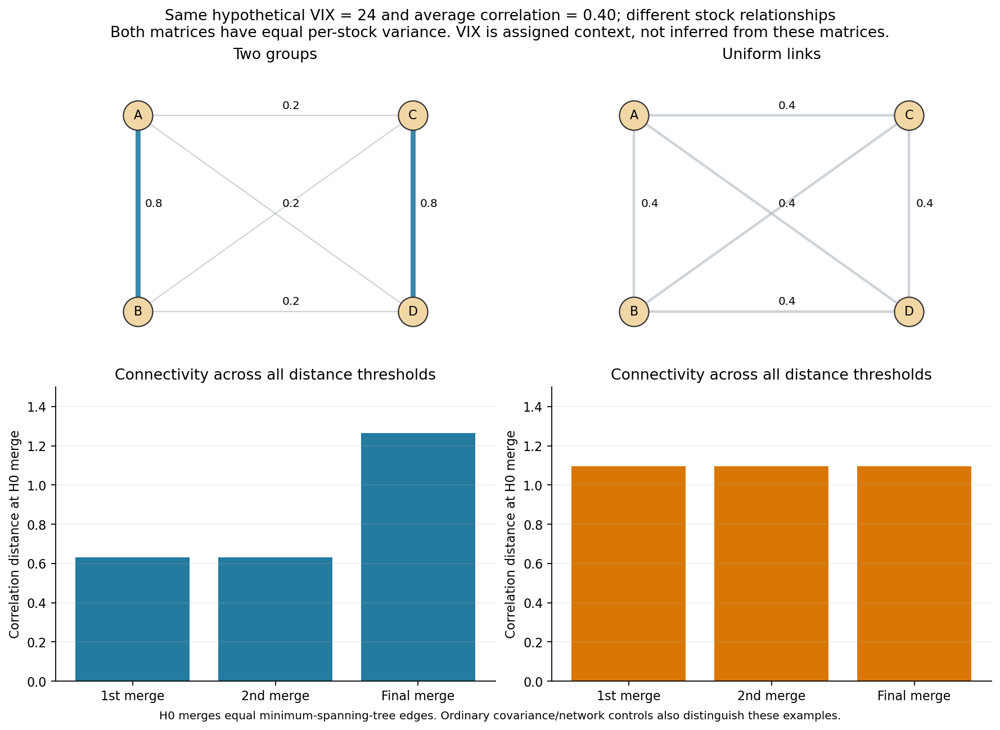
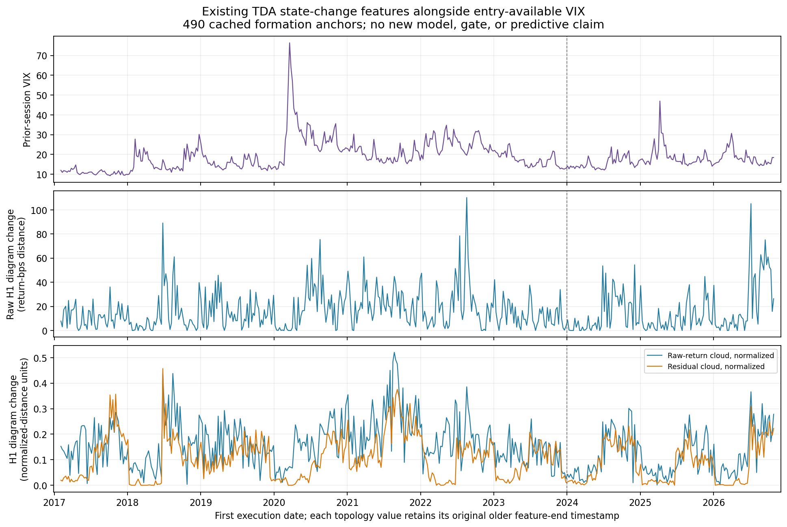

> **OUTDATED PROPOSAL STATUS — marked November 10, 2026.** The matched TDA-beyond-VIX comparison proposed in this November 4 review was completed November 5. Statements below that it remains unexecuted belong to the original review stage. Read the [executed comparison](../../experiments/tda_vix_matched/README.md) or entry 20 of the [consolidated research document](../../EQUITY_RESEARCH_LOG.md) for findings. The literature review, illustrations and cached context remain supporting evidence.

# TDA regimes, persistence landscapes and VIX: what the research supports

**Subsequent execution, November 5:** the user authorized the matched comparison proposed here. It is now [complete, with separate risk/mean results and an independent audit](../../experiments/tda_vix_matched/README.md). Later TDA risk-error point improvements beyond VIX are2.16–3.64%, with all intervals spanning zero; no trading policy changed. The review below preserves what was reviewed and proposed on November4; statements about an unexecuted comparison refer to that initial review date.

**Reviewed November 4, 2026. Regime dependence is a major research concern for the factor-neutral reversal strategy. Historical TDA studies offer concrete ways to describe changing market structure and, in some cases, improve risk forecasts or allocation. They do not automatically identify when our residual-reversal strategy has positive expected return. VIX should remain part of the ordinary state information against which TDA is evaluated.**

This partly revisits the [October 29 coordinate review](../tda_regimes_and_coordinate_design_2026-10-29.md) and [October 12 financial-TDA review](../../../literature/financial_tda_review_2026-10-12.md), now incorporating our completed full-basket experiments and November VIX work. It adds a primary-source recheck, mathematical illustrations, an implementation/timestamp finding in a public research example, and a feasible cached-feature/VIX alignment. **No new strategy backtest, forecasting model, or regime filter was fitted for this review.** The comparison proposed below remains unexecuted.

## 1. What would a useful regime mean for this strategy?

There are three different tasks:

| Task | What success would show | What it would not show |
|---|---|---|
| Describe the current state | Recent return distributions or stock relationships differ between environments | Advance warning or profitable exposure changes |
| Detect/predict a transition | A past-only score identifies a change, with useful false-alarm and lead-time behavior | That the strategy should stop or increase its positions |
| Forecast strategy outcomes | State information improves forecasts of our portfolio's future mean return or risk | An economic cause or a deployable benefit without measuring the actual policy |

For a factor-neutral strategy, a market decline is not the same target as a portfolio loss. Estimated beta neutrality does not imply constant conditional risk or constant expected reversal returns. A turbulent state can coincide with a strong rebound opportunity, poor reversals, or simply larger gains and losses. A stress detector therefore needs an independently measured mapping to this portfolio.

Our own evidence makes the distinction concrete: the PCA strategy earned +9.80% in 2020 and lost 12.68% in 2022, both elevated-VIX years. Its fixed 20–30 filter improves full-history point CAGR but underperforms always trading later and remains uncertain. See [VIX association/forecast analysis](../../experiments/factor_reversal_vix/README.md) and [the selected-band investigation](../../experiments/factor_vix_20_30/README.md). A regime explanation is plausible research territory, not an already established rescue of an unreliable unconditional signal.

## 2. How historical studies actually used TDA

These are selected relevant primary studies, not an exhaustive systematic review. Reported empirical successes are the authors' findings, not our replications. Source text was rechecked where available; access limitations are explicit.

### Gidea, 2017: a changing stock-correlation network

Each point is a Dow stock, with rolling correlation distance `sqrt(2(1-rho))`; the paper uses horizon parameter T=15. Thresholded graphs and persistent homology summarize how stocks connect, and diagram distances compare network states around 2007–08. The authors report pre-crisis structural changes. This is a multiscale **stock-relationship** construction, not a cloud of daily market states or a validated daily profit forecast. Its crisis case study motivates monitoring dependence changes without supplying a universal alarm. [Primary full text](https://arxiv.org/html/1701.06081), §3.

### Gidea and Katz, 2018: persistence landscapes of rolling return clouds

Each point is one day's four-index return vector. Windows contain 50 or 100 days; H1 diagrams become landscapes, then L1/L2 norm time series. Variance and low-frequency spectral behavior of those series are examined around the dot-com and global financial crises, alongside VIX. The authors find historical warning patterns. This establishes a concrete construction and stress association; selected-crisis plots are not a calibrated prospective alarm. Their increasing-variance simulations also illustrate that changing scale can drive a topological summary. [Primary full text](https://arxiv.org/html/1703.04385), §§3–4.

### Aguilar and Ensor, 2020: mean landscapes and structural-change tests

The authors analyze separate rolling clouds of four index returns and ten ETF-series returns, using 50-day windows. Landscapes, mean landscapes and permutation tests compare changing structure around the 2020 period. This moves beyond a single norm chart toward distributional comparisons. It remains a historical structural-change study; overlapping windows and the timestamp at which a full window becomes available require care before translating its figures/tests into an online strategy. [Publisher full text](https://www.scirp.org/journal/paperinformation?paperid=103953), §§2–4.

### Baitinger and Flegel, 2021: diagram change used for allocation

The accessible 2019 author preprint uses day points with ten or thirty industry-return coordinates. Consecutive 60-day diagrams are compared by Wasserstein distance, smoothed for 60 days and ranked against 60 month-end observations to set next-month S&P exposure. VIX is an explicit competing indicator. The authors report favorable out-of-sample allocation results. This is positive allocation precedent, at a different horizon and portfolio. Exact settings here are from the [author preprint](https://www.researchgate.net/publication/337857521_The_Better_Turbulence_Index_Forecasting_Adverse_Financial_Markets_Regimes_with_Persistent_Homology), §3.4; the [published 2021 article](https://link.springer.com/article/10.1007/s11408-020-00377-x) exposes only its abstract/preview. The preprint splices early VXO into its historical VIX benchmark.

### Ismail and coauthors, 2022: trends in landscape-derived indicators

Landscape L1 norms feed variance, autocorrelation and low-frequency power measures. Trends are used as warning signals. The paper chooses thresholds using observations before two known crises, then evaluates over the available history. Its reported warning/false-alarm results are mixed. Our methodological inference is that this setup is not an untouched chronological test of a threshold chosen before those events. It illustrates how an attractive retrospective warning can differ from prospective regime prediction. [Primary full text](https://www.frontiersin.org/journals/applied-mathematics-and-statistics/articles/10.3389/fams.2022.940133/full), Results and Table 2.

### Valdivia, 2023: an important generalization check

The paper revisits four-index, day-point landscape norms and finds that the earlier rising-warning pattern is inconsistent for later downturns. It then studies stocks as correlation-distance points, H0/H1/H2, and simpler persistence descriptors. The authors report more promising historical patterns with other summaries. This supports examining the point object and representation rather than assuming the classic landscape norm is a universal regime indicator. The alternatives also remain selected historical-event analyses. [Publisher](https://www.aimspress.com/article/doi/10.3934/QFE.2023019), [full paper](https://www.aimspress.com/aimspress-data/qfe/2023/3/PDF/QFE-07-03-019.pdf), especially §§3.1, 4 and Figure 1; relevant PDF pages were visually inspected.

### Souto, 2023: incremental realized-volatility forecasting

Recent multi-index return diagrams supply Wasserstein-change inputs to HAR-family and neural volatility models. The paper includes VIX and Fama–French controls in linear specifications and reports stronger gains for nonlinear/neural models during turbulent periods than for simple linear models. The target is index realized volatility, not our reversal profit. This is a relevant incremental-risk precedent, subject to independent implementation/timing verification; the public example needs correction before reuse, as detailed below. [Full paper](https://www.newswise.com/pdf_docs/170055790161323_1-s2.0-S2405918823000235-main.pdf), §§2.2, 4, 7 and Appendix A; [author repository](https://github.com/hugogobato/Topological-Tail-Dependence-Evidence-from-Forecasting-Realized-Volatility).

Taken together, these studies justify investigating multivariate structure and temporal change. None of the studies reviewed validates our particular factor-neutral portfolio or the user-selected VIX20–30 filter. Stronger claims about reliable crash prediction, causality, universal dimensional robustness or financial profits require separate evidence.

## 3. What a persistence landscape preserves

For one finite persistence interval with birth b and death d, draw a triangle: zero outside [b,d], rising from b to the midpoint and falling to d. At each filtration scale, the largest triangle height forms landscape layer1, the second largest layer2, and so on. These functions can be averaged or compared with functional distances; a single norm is a further compression. The horizontal axis is **filtration distance, not calendar time**. [Bubenik, 2015](https://arxiv.org/html/1207.6437), §§2–3, supplies the mathematical framework.

The synthetic illustration separates three quantities:

- **Full curve:** retains where features occur along the filtration scale and how landscape layers vary.
- **Norm of a curve:** summarizes its magnitude; different curves can have the same norm.
- **Distance between curves:** quantifies change between them; it can be positive when their individual norms agree.



An important redundancy is exact. For the **full, all-layer L1 landscape of finite intervals**:

`L1 = sum((death - birth)^2) / 4`.

That is [Bubenik's Proposition 2.5](https://arxiv.org/html/1207.6437). Our existing squared-lifetime scalar therefore already carries this information for its corresponding diagram. Multiplying it by one quarter does not create a new forecasting input after feature standardization. This does not say that a full landscape, a first-layer-only norm, or a truncated/grid representation is identical to that scalar; those retain/remove different information and need explicit definitions.

For the finite diagrams in our illustration, direct integration also verifies `L2^2 = sum(lifetime^3)/12`. Even that all-layer norm depends only on lifetimes, whereas a full landscape's horizontal location contains birth/death-scale information. An L2 landscape **distance** is different from either window's L2 **norm**.

If every return-cloud distance doubles, finite births and deaths double. L1 increases fourfold even if the geometry differs only by uniform scale. This matters for raw-return clouds: a large norm may partly duplicate ordinary volatility. Correlation-distance constructions instead discard positive per-stock scale changes by design. Raw versus normalized shape, with scale retained as an ordinary control, therefore asks a meaningful question. None of these mathematical facts establishes which representation forecasts profits.

## 4. What the other graphs would mean

| Representation | Observation and information | A legitimate distinction | Interpretation limit |
|---|---|---|---|
| Rolling day-return cloud | One day is a vector of asset returns | Different configurations of joint daily moves | An unordered cloud discards the ordering of those days |
| Correlation network / H0 hierarchy / MST | One stock is a vertex; edge distances come from recent co-movement | Persistent groups versus broadly similar connections | H0 merges equal MST edges; this is not information beyond the full correlation matrix |
| H1 diagram, landscape or image | Multiscale features of the chosen cloud/network | Features at different scales, lifetimes or locations | A loop is not an arbitrage, reversal cycle or economic cause by itself |
| Diagram/landscape change series | Compare already-computed representations across dated windows | Quiet structure versus recent reorganization | Entering/leaving observations, outliers and scale changes can move the score |
| State graph or Mapper-style display | Group similar historical states; connect overlaps or chronological transitions | Repeated configurations and observed transitions | Display choices can determine groups; coloring by future profits does not validate a predictive regime |

The last row is a proposed visualization option, not a claim that the finance papers above establish Mapper-based profitability. A simpler clustering/change-point model is an essential competing explanation. If using a state graph, fit scaling and states on training history and assign later observations without rebuilding the whole map using future data. Date arrows must be added from chronology; they are not automatically present in a Rips loop.

Our prior lagged-factor cloud preserves some adjacency but is invariant under reversing time and swapping coordinate blocks. It does not directly distinguish the direction of a transition. Keeping VIX's completed change alongside topology is a simpler way to supply some directional context, although our existing VIX-change forecast results are weak.

## 5. Why VIX remains important

VIX and TDA can supply different kinds of state information. VIX is an option-implied broad-market volatility measure; a stock-network representation describes relationships within the basket. Their possible complementarity is a hypothesis to test, not an inference from different names.

For example, assign two hypothetical environments the same VIX24 and the same mean stock correlation0.40. In one, two pairs have strong internal connections and weak connections across pairs; in the other, all pairs have correlation0.40. Their H0 connection patterns differ. The matrices below are positive definite and have the same per-stock variance. **VIX is assigned context here, not computed from these four hypothetical stocks.**



This example does not establish a unique TDA advantage: eigenvalue/network/covariance summaries can distinguish the matrices too. It explains the intended question: **at comparable VIX and realized volatility, does the arrangement or instability of stock relationships add information about our strategy's future outcomes?**

Use VIX first as a separately scaled input/control, alongside realized volatility, correlations, factor concentration, strategy history and covariance change. Appending an unscaled VIX value such as24 to return coordinates around0.01 would arbitrarily dominate distances. A joint return/VIX geometry is possible, but it requires a reason for the mixed coordinates and past-only scaling, plus a comparison using those same inputs without TDA.

Both the classic landscape study and the turbulence-allocation preprint explicitly consider VIX. The forecasting study above includes VIX controls too. Treating VIX as a competing/complementary state input is therefore consistent with the prior literature, rather than a concession that topology has failed.

## 6. What we have already tested

We should not repeat an old construction under a new name:

| Completed local test | Object / representation | Current result |
|---|---|---|
| [Scalar persistence regimes](../../experiments/equity_persistence_regimes/README.md) | Stock-loading cloud and lagged-factor cloud; scalar persistence features | No established incremental mean/gate improvement |
| [Persistence images](../../experiments/equity_persistence_images/README.md) | A richer encoding of the same stock-loading diagrams | No established benefit; did not test a full-basket day-cloud landscape |
| [Full-basket states](../../experiments/equity_full_basket_states/README.md) | 120 days ×182 stock coordinates, raw/residual geometry, levels and five-session H1 diagram changes | Later risk-error reductions2.2–3.4%, with all incremental simultaneous intervals including zero; mean/gates do not improve convincingly |
| [VIX comparison](../../experiments/factor_reversal_vix/README.md) | Entry-available VIX alongside ordinary market controls | Clearer risk association than mean; small uncertain incremental risk-forecast gain |
| [20–30 filter](../../experiments/factor_vix_20_30/README.md) | Fixed selected band applied to original trades | Favorable full curve, concentrated profits and weaker later comparison; no established gate |

The full-basket test already included raw and normalized diagram changes. Its baseline had33 ordinary predictors including scale, realized volatility, covariance change, correlation and MST statistics, but **not VIX**. The modest3.4% figure is lower risk-forecast error, not3.4% lower realized strategy risk. These results do not justify discarding every TDA construction, nor calling another Wasserstein-change test entirely new.

The most direct remaining comparison is the **increment of cached TDA features after adding VIX to that ordinary baseline**. It has not yet been run. A full landscape curve on the full-basket day cloud also remains a different encoding from the tested scalar levels, but it should be considered only after stating which distinction the old summaries lose and why it might matter for the target.

## 7. Concrete proposed comparison, not yet executed

[Machine-readable proposal](proposed_comparison.json). This records a design recommendation; no new forecasting comparison was run in this review.

Reuse the original strategy, full-basket windows, forecast anchors, completed-label training memberships, regularization and all four declared TDA additions. Do not choose RawChange merely because it had the best earlier point error. Compare:

1. **Ordinary controls:** the existing33 controls.
2. **Ordinary controls + VIX:** add log previous-session VIX, its completed log change, and the already-selected20–30 indicator. The latter remains an exploratory control because it was selected from these outcomes.
3. **Ordinary controls + VIX + TDA:** add each original raw/residual level/change feature set and compare on exactly matched dates.

Keep the targets separate: primary **next20-session portfolio RMS risk**, secondary **next20-session average portfolio return**. Use only training labels whose full outcome window has finished. Report paired risk/mean forecast losses and uncertainty; if an exposure rule is eventually evaluated, count every cash day and compare with constant reduced exposure. Do not turn lower risk error directly into a claim about higher profits.

For a regime description, an informative secondary question is whether observations inside the same20–30 VIX band differ by multivariate state/structure, and whether that distinction predicts future outcomes. Define the state construction and validation before fitting it; do not select profitable clusters from a whole-history graph. The failed explicit-band forecast and all previous examined dates remain part of the evidence.

The proposal preserves the previous experiment's information timestamps. Its cached topology feature end often precedes the formation date. VIX can use the last completed equity-session close before `first_execution`; do not silently retimestamp the topology to that later close. The aligned panel below retains both dates. Because the outcome history has already been examined, even a chronological rerun would remain exploratory; future observations or suitable independent data are needed for confirmation.

## 8. Available inputs are now concretely aligned

[cached_tda_vix_context.csv](cached_tda_vix_context.csv) joins all **490 existing topology anchors** to entry-available VIX, with no missing rows and no future-return labels in the output. [Validation](context_validation.json) pins unchanged source hashes and the two information timestamps. This is an alignment/visualization, **not a new forecast or backtest**.



The topological signals are the original120-day raw/residual day-cloud H1 changes over five sessions. Separate raw-bps and normalized-distance plots make their scale conventions explicit. Visual differences or coincidences in this plot do not measure incremental predictive value; that requires the proposed matched models.

## 9. A public implementation caveat before reusing research code

The public PH-RV example at the [commit cited by Souto's paper](https://github.com/hugogobato/Topological-Tail-Dependence-Evidence-from-Forecasting-Realized-Volatility/blob/4e4ae5fcdeb692228c009d70d1316bd9e24dced3/Persistent%20Homology%20for%20Realized%20Volatility%20(PH-RV)%20algorithm.py) was inspected without execution. It compares two separated20-return windows, uses H0 arrays in the distance call, and assigns the result an intermediate date. The later window therefore contains closes after the assigned date. Reuse requires timestamp and dimension conventions to be corrected explicitly. This is a finding about that illustrative file, **not a replication or blanket invalidation of the paper's separate empirical results**. The file's hash is recorded in the review provenance.

## 10. Reproduction and evidence boundaries

The literature statements above are source-based, local research results are linked to their executed artifacts, the network/barcode examples are synthetic, and the new model comparison is a proposal. No performance result is inferred from the illustrations or from historical regime labels alone.

```sh
conda run --no-capture-output -n tda python equity/literature/tda_regimes_vix_2026-11-04/illustrations.py
conda run --no-capture-output -n tda python equity/literature/tda_regimes_vix_2026-11-04/assemble_context.py
```

[Illustration checks](illustration_checks.json) verify the finite-landscape identities, equal-norm shift distinction, scale response, positive-definite example correlation matrices and their connectivity. [Context validation](context_validation.json) checks row completeness, prior-session timing and protected source hashes. [Review provenance](review_provenance.json) records sources/access, the inspected code commit and evidence types. The existing mathematical [matched-mean/covariance illustration](../../../literature/matched_moments_demo.png) is another useful controlled example; it is not financial forecasting evidence either.
