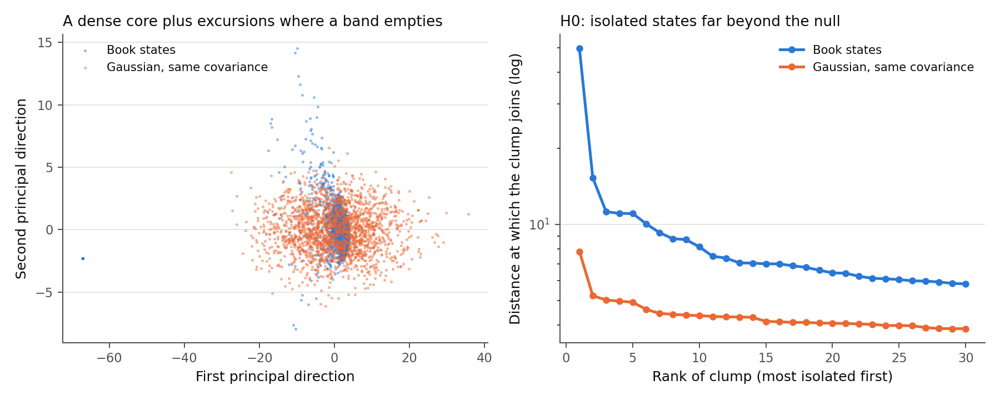

# Point clouds of book states

**Kalshi BTC perp · November 11 calibration, November 12–17 evaluation · November 18, 2026**

The earlier liquidity work treated the book as a picture (a price-by-time grid). Here each second of the book becomes **one point**, and we ask about the shape of the cloud those points make. This is the same tool as the equity study (each stock a point) and the BTC study (delay clouds of returns), used here on the order book for the first time.

**Finding: the cloud has real shape. It is a dense core of ordinary books, plus brief excursions in which one band of depth empties. But the topology of the cloud forecasts nothing that plain measures don't: they explain 89–97% of its persistence summaries, and the forecasting gain belongs to them.**

## How a second becomes a point

Each point has 10 numbers: log depth in five distance bands on each side of the midpoint (0–2, 2–5, 5–10, 10–20 and 20–25 bp), each scaled by its November 11 average and spread. A first look with all fifty 1-bp bins showed nothing: in 50 noisy dimensions the cloud was indistinguishable from a Gaussian blob, the usual problem of high dimensions. The coarse version was chosen before the forecasting test was run.

The comparison is always against a **Gaussian null**: random points with exactly the same averages, spreads and correlations. If the topology differs from that null, there is shape beyond what a covariance matrix describes.

## Part 1: global shape

From 2,000 seconds, sampled at least 30 s apart so that neighbouring seconds do not fake structure, we computed persistent homology. H0 tracks how isolated clumps of points are; H1 tracks loops. [Numbers](results/who_wins/book_cloud_global.csv)

| | Book states, Nov 11 | Gaussian nulls, Nov 11 | Book states, Nov 12–17 | Gaussian nulls, Nov 12–17 |
|---|---:|---:|---:|---:|
| Most isolated clump (H0, distance at which it joins) | 21.3 | 3.1–3.7 | 50.4 | 6.7–7.7 |
| Fifth most isolated | 5.7 | 2.8–3.0 | 11.1 | 5.0–5.6 |
| Total loop persistence (H1) | 161 | 361–372 | 234 | 498–519 |
| Two-cluster separation (silhouette) | 0.37 | 0.16–0.17 | 0.92 | 0.41–0.42 |

**What the shape is.** The isolated points are seconds when one band has nearly emptied. In 14% of seconds, at least one band sits more than four standard deviations below its normal depth. Usually it is the 2–5 bp band on either side, and the typical such "hole" lasts one second. The rest of the cloud is tighter than the Gaussian, with *fewer* loops than the null, because the excursions inflate the covariance that the null copies. [Hole statistics](results/who_wins/book_cloud_holes.json). Holes come before larger moves: the median move over the next 60 seconds is 5.4 bp after a hole starts, against 4.1 bp overall. The two clusters that a clustering method finds are mainly "thick book" against "thin book", with 30–40% less depth in every band. That is one continuous axis, not two regimes.

The plain description, "a near band is briefly empty", says the same thing as the H0 result, and it is easier to compute.

## Part 2: does the shape of a 5-minute window forecast the next 5 minutes?

This is the standard way topology is used on financial time series. Each non-overlapping 5-minute window gives 300 points. We summarize the window's cloud with H0 total persistence, H1 total persistence and the largest H1 loop. Each has **plain twins**: the cloud's total variance, the distance the points travel, its diameter, and the window's mean total depth. Targets are the next window's volatility (log realised variance of Kalshi's midpoint) and the next window's result for a market maker at the best quotes (1 s markout). The fit used November 12–14 (852 windows) and was scored on November 15–17 (861 windows). All settings were fixed in advance ([`l16_book_cloud.py`](studies/l16_book_cloud.py)). [Forecasts](results/who_wins/book_cloud_forecast.csv) · [Twin overlap](results/who_wins/book_cloud_twin_overlap.csv)

| Change in forecast error (negative is better) | Next 5 min volatility | Next 5 min maker result |
|---|---:|---:|
| Plain twins added to baseline | **−15.0%** (−23.3 to −6.3) | +8.3% (+3.7 to +13.7), worse |
| Topology added to baseline | −2.5% (−9.9 to +4.8) | +1.5% (+0.5 to +2.8), worse |
| **Topology added to baseline + twins (decisive)** | **−0.4%** (−1.3 to +0.5) | −0.4% (−2.2 to +1.2) |

The baseline is past volatility on Kalshi and Binance, spread, trade count and hour of day; it already explains 60% of next-window volatility. The twins explain 97% of H0 total persistence, 89% of H1 total and 64% of the largest loop.

- **A plain, usable result:** a window's average displayed depth, plus how much the book's shape moved around, improves the 5-minute volatility forecast by 15%. That is useful for a market maker setting spreads. Depth alone gives most of the gain: −8.5% by itself (−16.8 to +0.3), so on its own it is not quite statistically clear. More displayed depth goes with *more* later volatility (correlation 0.66), probably because both rise in busy hours.
- **The maker's result can't be forecast from book shape** at this scale; every addition makes the forecast worse.
- **Topology adds nothing once its twins are in.** This is the same pattern as the equity study (where total bar length equalled distance travelled minus range), the BTC delay clouds, and the band graph in [WHO_WINS](WHO_WINS.md) section 6.

## Limits

One week of one market. The 10-band summary is one choice, made after the 50-bin version showed only noise; other summaries could show other shapes. The 1,713 scored windows are enough to see a 15% gain but not a 1% one.
