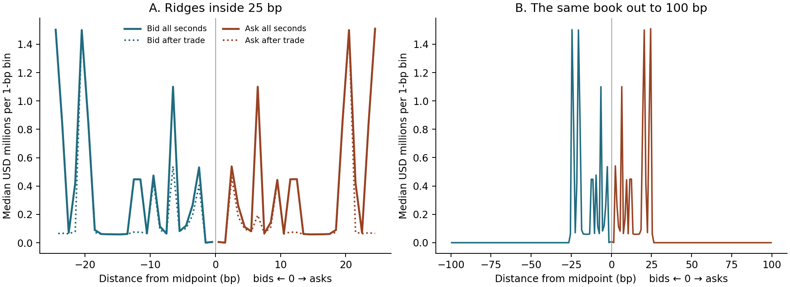
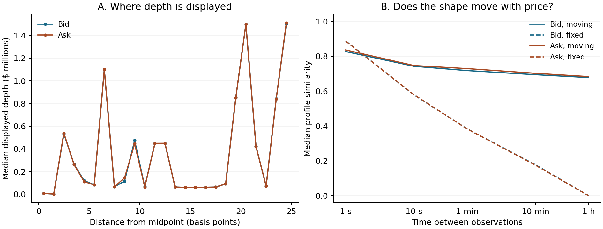
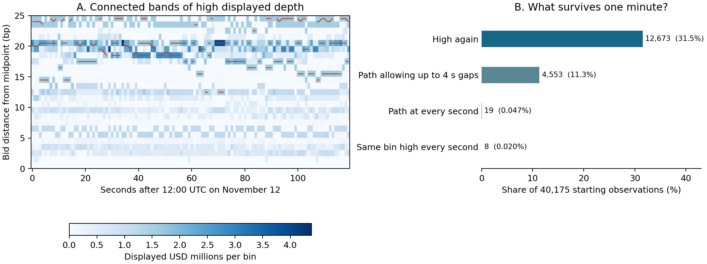
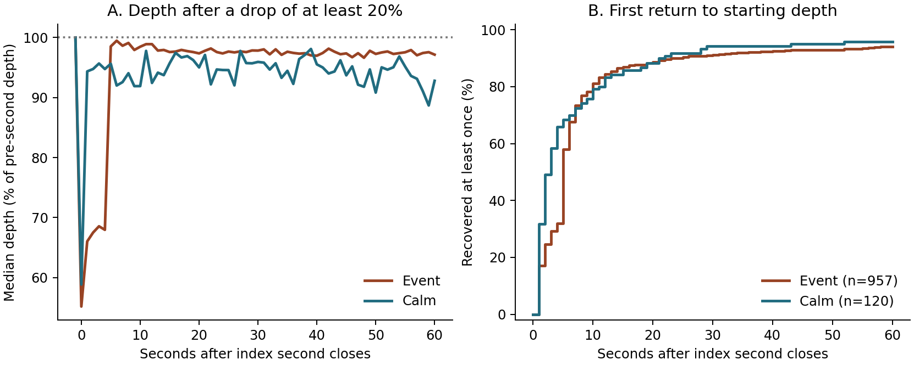
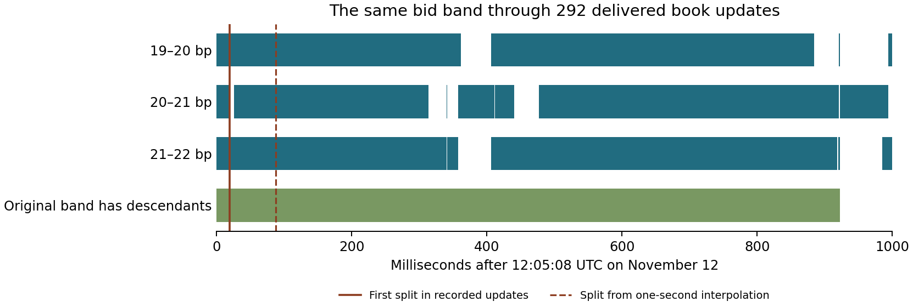
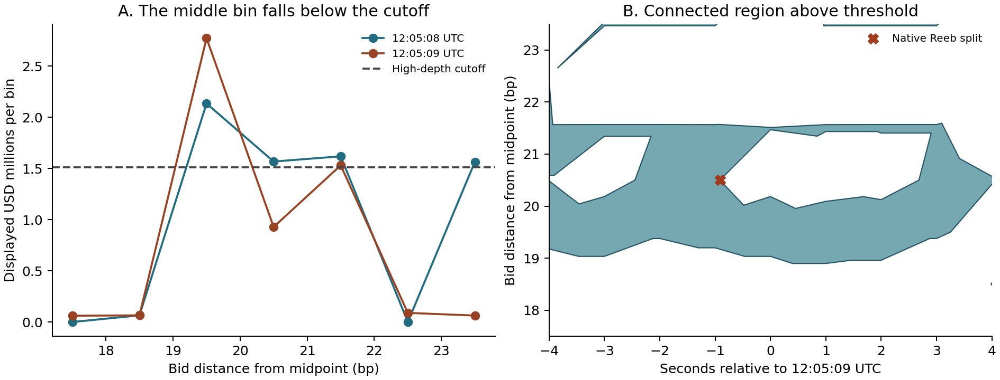

# What the BTC perp order book looks like

**Kalshi BTC perpetual (KXBTCPERP) · one week, November 11–17, 2026 UTC · studies by Astra, rewritten November 18**

This page describes the book itself: where displayed liquidity sits, how it moves, how it recovers after large trades, and what a Reeb graph of it shows. It is descriptive, not a trading test. The trading tests are in [WHO_WINS.md](WHO_WINS.md). Terms are defined in the [README glossary](README.md#words-used-throughout).

**What to remember**

1. Depth sits in a few narrow **ridges** at fixed *distances* from the midpoint (about 6–7, 20–21 and 24–25 bp), with almost empty valleys between them. The same shape appears on both sides.
2. The ridges **move with the price.** Measured from the midpoint, the book looks almost the same a minute later; measured at fixed prices, it has mostly changed. [WHO_WINS](WHO_WINS.md) later found why: market makers re-price the whole ladder off Binance.
3. After a large trade, depth near the *new* midpoint is back within about 5 seconds. Depth at the *original* prices is not, because the liquidity moved with the price rather than being refilled in place.
4. The band graph (a discrete time-Reeb graph) describes all this correctly, but its events are mostly caused by the midpoint moving. Band age does not help forecast which depth will still be there a minute later; the exact distance from the midpoint does.

## How the data were prepared

- **Rebuilding the book.** The recorder saved the exchange's full book once, then every change ("delta") to it, plus every trade. Replaying the deltas in order rebuilds the book at any moment. All 118,446 full books the recorder saved along the way matched the replay exactly, over 205.7 million deltas.
- **Snapshots.** The book was saved at the end of every second, using the time the recorder *received* each message, so that each snapshot holds only what a trader could have known then. That gives 604,196 usable seconds.
- **Gaps.** One 2.6-second reconnect (November 12, 08:50:57–08:51:00 UTC) is marked missing, and any window crossing it is dropped.
- **Calibration day.** November 11 was used only to set cutoffs, which were then frozen. November 12–17 is the period that is scored.
- **Grid.** Depth is summed in 1-bp bins of distance from the midpoint, out to 25 bp on each side (100 bp for the wide profile), in US dollars.

## 1. Where the depth sits

In the median book, the two tallest bins on each side are **20–21 bp and 24–25 bp** from the midpoint, each holding about **$1.50 million**. The bin between them (22–23 bp) holds only about **$70,000**. A third, inner ridge at **6–7 bp** holds about **$1.10 million**, while its neighbour at 7–8 bp holds about $64,000. Bids and asks look like mirror images. [Depth by distance](results/book_shape/depth_profile.csv) · [Wider profile](results/refill/extended_profile.csv)



How often are both outer ridges actually visible at the same time on both sides? We allowed each ridge to shift by one bin, required both peaks to exceed the November 11 upper-quartile depth (about $840,000), and required the valley between them to be less than half the smaller peak. Under those rules, both sides showed two ridges in **66.7%** of minute snapshots. The rate falls to **43.6%** at the end of a second containing a large trade, and is back to **66.9%** five seconds later. [Ridge counts](results/refill/outer_peaks.csv)

**The deep ridges are almost never traded against.** On November 12–17:

- **Where volume fills:** 61% of traded volume filled within 0.5 bp of the midpoint, 85% within 2 bp, and only 0.01% at 20 bp or more. That last group is 19 fills, in 3 seconds, all on November 12–13.
- **How few orders reach that deep:** of 915,000 taker orders, only 4 reached 20 bp.
- **How small orders are:** the typical order is 195 contracts (about $1,400). Even the largest 0.1%, about 23,000 contracts or $170k, are far smaller than the roughly $3m in one ridge.

The ridges are filled only when the whole price drifts through them, which happens rarely ([WHO_WINS](WHO_WINS.md) §4). [Trade distances](results/followups/trade_distance.csv) · [Order sizes](results/followups/summary.json)

For context: an earlier study of BTC/USD spot books also found symmetric bid and ask profiles with a hump away from the best quote, at about 1% there (Schnaubelt, Rende and Krauss, 2019). The narrow 0.20–0.25% ridges here are specific to this venue and week.

## 2. The ridges move with the price

To check this, we compared each book with the book some time later. Shape similarity is measured with **cosine similarity**: 1 means the same proportions of depth in each bin, 0 means no overlap. The comparison was done in two frames:

- **moving frame:** bins measured from each moment's own midpoint;
- **fixed frame:** bins held at the original prices.

| Time apart | Fixed prices | Distance from midpoint |
|---|---:|---:|
| 1 second | 0.89 | 0.83–0.84 |
| 1 minute | 0.38 | 0.72–0.73 |

Over one second the price hardly moves, so the fixed frame looks slightly better. By one minute the fixed-price book has mostly changed, while the midpoint-relative shape has held. As a control, *yesterday's* book at the same minute already matches today's midpoint-relative shape at 0.61–0.62, so much of the shape is a standing pattern. [Frame comparison](results/book_shape/coordinate_similarity.csv) · [Previous-day control](results/book_shape/previous_day_control.csv)



**Interpretation, added after the Binance comparison:** Kalshi's price follows Binance's with a slope of 0.99 ([WHO_WINS](WHO_WINS.md) §1). The simplest reading is that market makers quote a fixed ladder of sizes at fixed distances around a price taken from Binance, and move the whole ladder when Binance moves.

## 3. Bands and the band graph

**Definitions.**

- A bin is **high** if its depth is above the 90th percentile of all November 11 bins: **$1.51 million** per 1-bp bin on bids and $1.52 million on asks. The 75th and 97.5th percentiles were run as checks.
- A **band** is a run of neighbouring high bins on one side at one second.
- Bands in consecutive seconds are **linked** if they share at least one bin.
- This gives a graph over time. Its events are a band **appearing** (birth), **disappearing** (death), one band becoming two (**split**) and two becoming one (**merge**).

This is a discrete version of a **time-Reeb graph**: at each moment, each connected piece of the high-depth region becomes one point, and the points are joined across time. No smoothing is applied.

**Control.** Take the starting book, freeze its shape, and slide it along with the observed midpoint. Measured from the midpoint, this frozen book has **zero** events, as it should. Measured at fixed prices, it has 16 births and 16 deaths in a two-minute window, purely from the sliding. The real book had 128 births and 127 deaths over the same two minutes, measured from the midpoint. [Graph controls](results/book_shape/graph_controls.json)

**How long do bands last?** Start from every high bin at the start of a minute (40,175 cases) and ask four questions:

| At the 90th-percentile cutoff | Cases |
|---|---:|
| High bin at the start of a minute | 40,175 |
| Same bin high again 60 s later | 12,673 (31.5%) |
| …and joined to the start by a chain of high bands, allowing dips up to 4 s | 4,553 |
| …joined by a chain of high bands with no dips at all | 19 |
| …the bin itself high in every one of the 60 seconds | 8 |

So depth at a given distance usually *comes back*, but almost never as one continuous band. Brief dips below the cutoff break nearly every chain. From a minute boundary, the median time until a band and all its descendants are gone is **two seconds**. Bands disappear far more often when the midpoint moves: in 15.7% of seconds when it moves less than 0.25 bp, against 76.1% when it moves 1 bp or more. [Path counts](results/book_shape/band_paths.csv) · [Lifetimes](results/refill/lineage_life.csv) · [Transitions](results/refill/graph_transitions.csv)



**Does band age tell you which depth will still be there in a minute?** Raw rates suggest it might. A bin was high again a minute later 29.3% of the time on bands under 5 seconds old, 38.9% at 5–29 seconds and 47.6% at 30 seconds or more, though the oldest group has only 393 cases. To test it fairly, we built simple lookup-table forecasts from earlier days only. They were scored with the **Brier score**, the average squared gap between the forecast probability and what happened (0 or 1); lower is better.

| What the forecast knows | Brier score |
|---|---:|
| Side, depth and exact distance (1-bp bin) | **0.195135** |
| …plus how long the bin itself has been high | 0.195075 |
| …plus the band's age in the graph | 0.195261 (worse) |

Band age adds nothing once the exact distance is known. The ridges sit at particular distances, and that is what carries the information. [Scores](results/book_shape/band_scores.csv) · [By day](results/book_shape/band_scores_daily.csv)

## 4. What happens after a large trade

**Method.**

- **Large trade:** a single print of at least **1,851 contracts** (0.185 BTC), the November 11 top 1%. Only isolated ones count: no other large print in the previous 60 seconds and all large prints in the second in one direction. That leaves **1,791** events.
- **Matched quiet second:** each event is paired with a second in the same hour that had no large print. The pair must match on the same side of the book, starting depth, the location of the deepest bin within 5 bp, spread, and recent volatility.
- **Measurement:** displayed depth within 5 bp on the passive side, meaning the side the trade hit. [Selection](results/refill/selection.json) · [Match balance](results/refill/match_balance.csv)

**Results.**

- Depth within 5 bp fell by at least 20% during the second in **53.4%** of large-trade events and **6.7%** of quiet seconds, a difference of **46.7 percentage points** (95% interval 43.4–50.2). Against ordinary same-side trades instead of quiet seconds, the difference is 40.8 points. [Comparison](results/refill/depletion_comparison.csv)
- Among events with that 20% drop, half had regained their starting depth within **5 seconds**, and 94.1% within a minute. Requiring the recovery to hold for three seconds moves the median to 13 seconds. [Recovery](results/refill/recovery.csv)
- **Where you measure matters most.** Five seconds after the trade, depth within 5 bp of the **new** midpoint was **99.8%** of its starting level. At the **original** prices it was **65.6%**. After 60 seconds the figures were 98.6% and 50.4%. [Two frames](results/refill/fixed_price_refill.csv)
- The traded volume explains only a small part of the loss. At the original prices, displayed depth fell by about **10 times** the volume that actually traded there (median). Most of the drop is orders being cancelled or moved, not filled. [Flows](results/refill/fixed_price_flows.csv)



**Does the price come back? No.** The table follows the midpoint from the second before each large trade, signed so that positive means "in the direction the large trader traded". [Price paths](results/followups/large_trade_path.csv)

| Seconds after | Kalshi | Binance, same window | Matched quiet second (Kalshi) |
|---:|---:|---:|---:|
| 0 | +2.0 bp | +1.8 bp | 0.0 bp |
| 5 | +2.0 bp | +1.9 bp | 0.0 bp |
| 60 | +1.5 bp | +1.7 bp | +0.3 bp |
| 300 | +2.1 bp | +2.2 bp | +1.0 bp |

The price steps about 2 bp in the trade's direction and stays there. There is no bounce-back as the effect of the order fades. Binance moved by the same amount in the same second, in the same direction in 77% of events. When Binance was flat or moved the other way (417 events), Kalshi moved slightly *against* the large trade (−0.7 bp). So the large trade mostly accompanies a price change discovered on Binance; it doesn't cause one. The quiet control drifts about +1 bp over 5 minutes from background trend, so the lasting effect of a large-trade second is roughly 1–1.3 bp.

What this means for a trader: if you follow the price, depth is back almost at once. If you wait at a fixed price, much of it never comes back there. A trade does not knock liquidity down and wait for it to refill. The price has moved for good, and market makers re-quote their ladder around the new price. (Jeremy Large, 2007, studied the same recovery question on the London Stock Exchange.)

## 5. A Reeb split, message by message

A one-second snapshot can hide what happened inside the second. For every split in the band graph (869 at the main cutoff), we replayed the 241,429 raw updates inside that second to see exactly when, and why, the band broke. [All 869 replays](results/refill/all_split_replays.csv)

**Example: November 12, 12:05:08 UTC, bid band at 19–22 bp.** A *new ask* order (199 contracts at $72,851) lowered the midpoint by $0.50. The bid orders did not change at all. But because the bins are measured from the midpoint, the bid depth was reassigned across the bin edges. The middle bin dropped to $1,090 and the band "split". [Example detail](results/refill/event_by_event_splits.json)



Across all 869:

- In 667 the band's lineage split at least once inside the second. **92.4%** of those first splits happened on an update that moved the midpoint. **47.1%** happened on an update to the *other* side of the book, so nothing on the band's own side changed.
- By the end of the second, the original band reached both children in 30.5% of cases, one child in 22.0%, and neither in 47.5%.
- Only 8% of split seconds had a Binance move of 1 bp or more, against 17% of all seconds ([WHO_WINS](WHO_WINS.md)). Splits are small flickers of the top quotes, not real price moves.

**Is it the midpoint formula? No.** The midpoint here is the plain one, (best bid + best ask) / 2, with no size weighting. As a check we rebuilt the grid from the **microprice**, (best bid × ask size + best ask × bid size) / (bid size + ask size). It leans toward the thinner side and is often suggested as a steadier "fair price". Each grid got its own November 11 cutoffs, and nothing else changed. [Comparison](results/followups/microprice_splits.csv)

| Reference price | Changes in this share of seconds | Splits at 90% cutoff (bid / ask) | Band deaths, bid |
|---|---:|---:|---:|
| Midpoint | 87% | 489 / 380 | 419,984 |
| Microprice | 96% | 487 / 373 | 439,211 |

The microprice moves *more* often, because the sizes at the best quotes change even more often than the prices. Split counts are unchanged and deaths rise about 5%. The artifact doesn't come from one particular formula: any reference price tied to the best quotes moves almost every second and reshuffles orders across bin edges. (Splits are rare at this cutoff anyway, about 870 against 420,000 deaths per side.)

**The construction matters.** The continuous Reeb graph computed with TTK interpolates depth between snapshots. Over the first minute of every scored hour it found **892** interior splits, or 999 with the mesh triangles drawn the other way, where the one-second linking rule found **14**. Both pass independent checks of their component and cycle counts; they simply answer different questions. [TTK windows](results/refill/native_reeb_windows.csv) · [Checks](results/refill/verification.json)



## 6. The first Reeb graph test (November 5 pilot)

Before the week-long capture, a 25-hour recording was used to compute continuous time-Reeb graphs with TTK. That run used $10 price bins, Gaussian smoothing and a fixed depth cutoff. Every graph passed its checks, but the **cycle count depended heavily on the settings**: from 0 to 34 on the bid side across bin size, cutoff and smoothing. A fixed profile that was only slid along with the price still produced **13 cycles** after smoothing. That is why the week-long study uses unsmoothed data, cutoffs frozen in advance, and the sliding-profile control every time, and why cycle counts are never treated as findings. [Pilot report](experiments/btc_archive_initial_2026_11_05/README.md)

## Limits

One week of one market. Everything depends on the grid (1-bp bins, one-second snapshots) and the cutoff. A band that dips just below the cutoff, or shifts by one bin, breaks a chain even if the liquidity is still there. The public feed shows total size per price level, not individual orders, so no statement here identifies who placed or cancelled anything.

## Reproduce

From `liquidity/studies/` with the `tda` Python (`/Users/derickshi/anaconda3/envs/tda/bin/python`) and the raw capture on disk:

```sh
python l01_snapshots.py      # rebuild end-of-second books; checks every saved book (C++ helper replay_book.cpp)
python l02_describe.py       # depth profile, frame comparison (section 1-2)
python l03_band_age.py       # band graph, paths, age forecasts (section 3)
python check_book_shape.py   # independent re-computation of the above
python l04_trade_tape.py     # individual trades, reconciled with the books
python l05_refill.py         # large trades and matched quiet seconds (section 4)
python l06_book_breaks.py    # ridges, transitions, lifetimes
python l07_native_reeb.py    # continuous TTK Reeb graphs (section 5)
python l08_split_replay.py   # message-level replay of one split
python l09_audit_splits.py   # all 869 splits
python check_refill.py       # independent checks
python l18_followups.py      # microprice check, price path after large trades, trade distances (after l11-l12)
```
