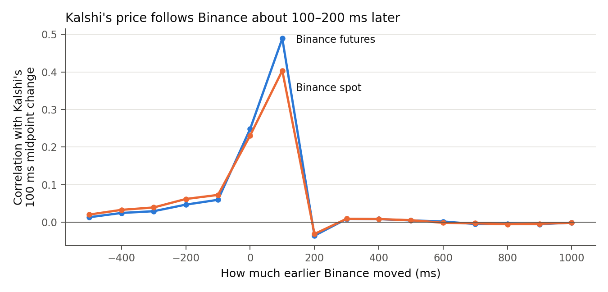
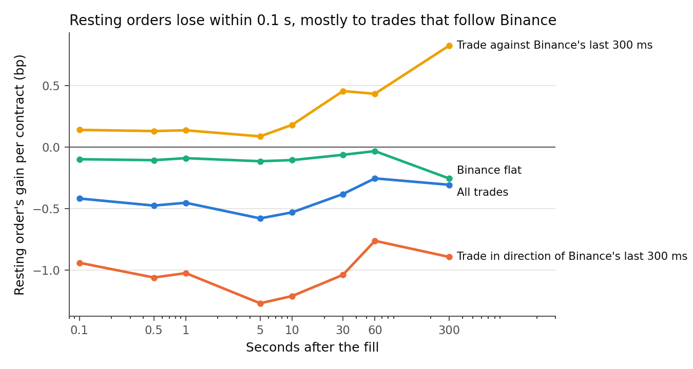
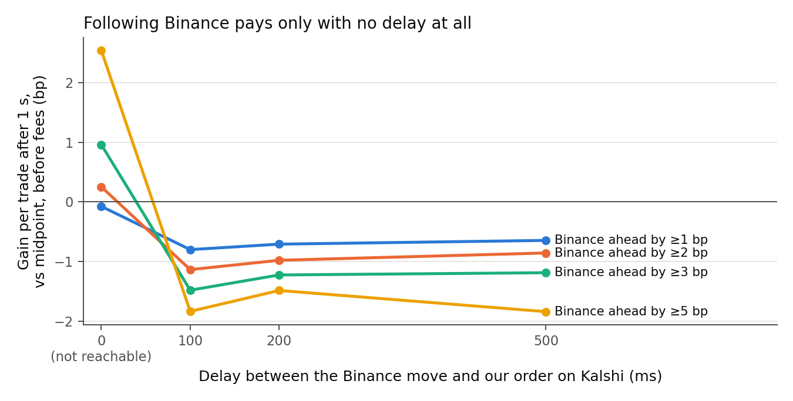

# Who makes money against this book, and why

**Kalshi BTC perpetual (KXBTCPERP) and Binance BTCUSDT · scored November 12–17, 2026 UTC · before fees**

The short version: **Kalshi's BTC perp price is a copy of Binance's, delayed by about 100–200 milliseconds.** Traders who act on Binance's move inside that window take money from resting orders on Kalshi. Anyone slower than about 100 ms finds no edge in either direction. The order book's own shape adds only a little, and the band graph adds nothing beyond plain counts. Pulling quotes after Binance moves helps only with a reaction faster than about 100 ms. This also explains two earlier liquidity findings: the depth profile holds its shape relative to the moving midpoint, and the Reeb-graph bands break up as the price moves.

Words used below:

- **bp (basis point):** 0.01% of price. One Kalshi tick ($1/BTC) is about 0.14 bp. The median spread is 0.46 bp.
- **Resting order / maker:** an order sitting in the book. **Taker:** the order that trades against it.
- **Markout:** what a filled resting order is worth some time later. It is the fill price compared with the midpoint at that later time, signed so that positive means the resting order gained. It already includes the spread the resting order earned at the fill.
- **Binance gap:** how far Binance has moved in the last 100–1,000 ms beyond Kalshi's own move.
- **Correlation at a lag:** pair each Kalshi price change with Binance's change some time earlier. A high correlation at "100 ms earlier" means Kalshi tends to repeat what Binance did 100 ms before.
- **Variance explained (R²):** the share of the ups and downs in a target that a forecast accounts for. 0% is no better than guessing the average.

## How it was measured

- **Quotes.** The Kalshi book was replayed from every update (every saved checkpoint matched). Best bid and ask were saved at the end of every 100 ms of receipt time, and again just before every trade.
- **Pre-trade quote.** "Just before a trade" means the book after every update stamped with an *earlier* exchange millisecond, because within one millisecond the trade message can arrive before or after the book updates it caused. With this rule, 96% of taker orders' first fills sit exactly at the pre-trade best quote, a check that the rule works.
- **Binance.** Binance's last trade price was put on the same 100 ms clock. The two clocks are independent, so lags are good to about ±50 ms.
- **Scoring.** Everything is scored on November 12–17. The first 10 seconds of each hour are excluded, because receipt times lag by about 5 seconds while the recorder rotates files. Fits use November 12–14 and are scored on 15–17. 95% intervals resample whole hours.
- **No tuning after the fact.** Thresholds, delays and holding times were chosen before results were seen, and every setting tested is reported.

## 1. Binance moves first; Kalshi follows 100–200 ms later

We compared Kalshi's midpoint change in each 100 ms window with Binance's change in earlier and later windows. The link peaks when Binance moved **100 ms earlier** (correlation 0.49 for futures, 0.40 for spot) and is gone after 200 ms. Over one second, Binance futures explain **75%** of the variance of Kalshi's price changes, with a slope of 0.99. Over a minute the correlation is 0.99. [Lags](results/who_wins/leadlag.csv) · [Summary](results/who_wins/summary.json)



**Does Kalshi ever lead?** Barely. Kalshi's move against Binance's *later* move correlates at most 0.06 (Binance 100 ms later), against 0.49 the other way round.

**Do the price levels differ?** Yes, by a steady offset rather than a lag. Kalshi's midpoint sits a median **$34 below Binance futures** (middle 90% of the time: $10 to $55 below) and **$64 below Binance spot** ($39 to $86 below). The gap is under $100 about 99% of the time and drifts slowly, from 2.4 to 6.2 bp below futures in daily averages. Likely causes are funding-rate differences, USD versus USDT pricing, and the cost of moving money between exchanges. The *changes* line up at a slope of 0.99; section 8 tests whether the gap's wobbles can be traded. [Gap](results/followups/summary.json)

Kalshi's own published reference index does not help. It moves **one second after** the perp (correlation 0.78), so it carries nothing the book has not already shown.

## 2. Resting orders lose almost immediately, mostly to traders following Binance

At the moment of a fill, a resting order is on average 0.92 bp better than the pre-trade midpoint. Within **0.1 s** the midpoint has moved past it: the markout is **−0.42 bp** (95% interval −0.52 to −0.32). It is still −0.25 bp after a minute. Resting orders lost on every one of the six days. [Markouts](results/who_wins/markouts.csv) · [By day](results/who_wins/markouts_daily_1s.csv)

The loss depends almost entirely on what Binance did in the 300 ms before the trade:

| Kalshi trade, compared with Binance's last 300 ms | Share of volume | Resting order's markout after 1 s |
|---|---:|---:|
| Same direction as Binance's move | 44% | **−1.02 bp** (−1.37 to −0.72) |
| Binance flat | 35% | −0.09 bp (−0.14 to −0.04) |
| Opposite direction to Binance | 21% | **+0.14 bp** (−0.08 to +0.34) |



Order size tells the same story. The largest takers (5,000+ contracts, i.e. 0.5+ BTC; 32% of volume) cost resting orders 1.3 bp after 1 s. Medium orders (1,000–5,000 contracts) were the only size group that resting orders gained from (+0.17 bp after 1 s).

**What this means for trading:** a market maker here would have to see Binance's moves and get out of the way within about 100 ms. Section 7 tests exactly that. At a realistic delay it barely helps, and even an instant reaction leaves a small loss.

## 3. Seeing Binance late does not help a taker

The test: whenever Binance futures moved at least X bp more than Kalshi in the last 100 ms, buy or sell on Kalshi at the best quote after a delay, then value the position at Kalshi's midpoint one second later. [Results](results/who_wins/slow_taker.csv)

| Binance ahead by at least | Trades | No delay (not reachable) | 100 ms delay | 500 ms delay |
|---|---:|---:|---:|---:|
| 1 bp | 104,136 | −0.07 bp | −0.80 bp | −0.65 bp |
| 2 bp | 23,312 | +0.26 bp | −1.14 bp | −0.86 bp |
| 3 bp | 6,425 | +0.96 bp | −1.48 bp | −1.19 bp |
| 5 bp | 1,282 | +2.54 bp | −1.84 bp | −1.84 bp |



At a 100 ms delay every version loses, and every 95% interval excludes zero. Two things happen together. Kalshi has already caught up, and the spread at those moments has widened from the usual 0.46 bp to **1–3 bp**. The zero-delay column means acting at the very end of the same 100 ms window in which Binance moved. It is not reachable in practice: the signal has to travel from Binance, widely reported to run in Tokyo, to Kalshi in the US. It shows the edge that the fastest traders compete for.

## 4. No distance from the midpoint is reliably safe for a slow resting order

Every 10 seconds we placed a fixed-price buy *d* bp below and a sell *d* bp above the midpoint, left them for 60 seconds, and scored each fill 60 seconds later. "Filled" means a trade printed through our price. The optimistic rule, where a print at our price counts as a fill, gives similar numbers. [Results](results/who_wins/resting_orders.csv)

- Within 5 bp, fills lose 0.75–0.83 bp, on every day.
- At **20–25 bp**, where the book's two large depth ridges sit, the average fill gains +0.2 to +1.0 bp. That comes entirely from November 12 (+5.5 to +8.1 bp) and November 13 (+1.8 to +4.6 bp) and is negative or near zero on the other four days. The 95% intervals include zero, and only 2–3% of orders fill.

So the deep ridges are not a free lunch for a slow trader. They pay off only in sharp moves that reverse, and this week had two such days.

## 5. The book's own shape adds a little, but not enough to trade

At each second we fitted the next 1, 5 and 10 seconds of Kalshi price change with straight-line fits. The fits used November 12–14 and were scored on November 15–17. The plain book measure is depth imbalance within 5 bp: (bid depth − ask depth) / total. [Results](results/who_wins/predictability.csv)

| What the fit knows | Share of next-1 s move explained (out of sample) |
|---|---:|
| Book imbalance within 5 bp | 1.25% |
| Binance gap over the last 100, 300 and 1,000 ms | 3.58% |
| Both | 4.02% |

Imbalance carries information that Binance does not, but its largest effects are small. The most imbalanced 10% of seconds move about 0.2 bp over the next 1–5 seconds, smaller than the 0.23 bp half-spread a taker pays to enter. Imbalance at the very top of the book predicts nothing; the signal sits 2–5 bp out.

## 6. The band graph adds nothing once plain measures are known

This is the decisive topology test for the liquidity part. The band features come from Astra's time-Reeb graph of high-depth bands: band deaths, splits, births and merges in the last 5 seconds, the number of bands, and the mean age of the current bands. Each has a **plain twin** carrying the same information without connectivity: how many depth bins rose above or fell below the cutoff, how many bins are high, and how much depth changed. We forecast two things, the direction of the next 1, 5 and 10 s, and how much the price will move over the next 10 and 60 s (volatility, which is what a market maker sets quotes by). The fit used November 12–14 and was scored on 15–17. All settings were written down before any results ([`l14_band_features.py`](studies/l14_band_features.py)). [Results](results/who_wins/band_vs_plain.csv) · [Twin overlap](results/who_wins/band_twin_overlap.csv)

| Forecast | Baseline explains | Adding band features to baseline + twins: change in error |
|---|---:|---:|
| Direction, next 1 s | 4.05% | +0.007% (+0.001 to +0.013), slightly worse |
| Direction, next 10 s | 0.42% | −0.001% (−0.014 to +0.011) |
| Volatility, next 10 s | 58.7% | +0.02% (−0.04 to +0.08) |
| Volatility, next 60 s | 71.2% | +0.24% (+0.09 to +0.37), worse |

Negative is better. The plain twins explain 81% of the variation in band deaths and births and 72% of the band count. Splits and merges have little in common with the twins, but they carry no forecasting value either. The baseline for volatility is strong because past volatility on Kalshi and Binance explains most of the future level. The band graph is a correct description of the book, but it holds no extra information for trading.

## 7. Pulling quotes after Binance moves does not rescue a market maker

The test: a small market maker always sits at Kalshi's best bid and ask. Its fills are the real trades at the best quote (995,000 prints), scored as in section 2. After every Binance futures move of at least X bp within a 100 ms window, it pulls quotes for 300 ms, starting after a reaction delay. The primary setting was fixed in advance: X = 1 bp, a 100 ms delay, and pulling only the side the move threatens (the ask after a rise). The signal needs roughly 75 ms just to reach the US, so a shorter delay is optimistic. [Results](results/who_wins/quote_filter.csv) · [`l15_quote_filter.py`](studies/l15_quote_filter.py)

| Filter on 1 bp Binance moves | Volume kept | Markout after 1 s |
|---|---:|---:|
| No filter | 100% | −0.22 bp (−0.32 to −0.15) |
| **Pull threatened side, 100 ms delay (primary)** | 93% | **−0.22 bp** (−0.27 to −0.17) |
| Pull threatened side, 200 ms delay | 95% | −0.21 bp |
| Pull threatened side, no delay (from the next 100 ms window) | 83% | −0.07 bp (−0.12 to −0.04) |

At a realistic delay the filter changes almost nothing. The damaging trades arrive in the same 100 ms window as the Binance move or the next one, which is exactly the peak in section 1. Even the no-delay version still loses before fees, and so does every 0.5 bp and 2 bp variant. Making markets on this venue is a speed contest decided in well under 100 ms. With public data and a typical connection, the profitable conclusion is not to quote here at all.

## 8. A slow, hedged trade on the Kalshi–Binance gap also loses

The idea: Kalshi's price runs a few bp below Binance's, and the gap wobbles around its own average. When it stretches, sell the rich market and buy the cheap one, then wait for it to close. This needs no speed. Fair value is Binance plus the trailing 60 s average gap. We tested a midpoint signal and an *executable* signal: buy only if Kalshi's actual ask is X bp below fair value, sell only if its bid is X bp above. Entry came 200 ms or 1 s later, holds lasted 10, 60 or 300 s, and the exit paid Kalshi's spread. All 48 settings were fixed in advance. [Results](results/who_wins/gap_trade.csv) · [`l17_gap_trade.py`](studies/l17_gap_trade.py)

- The gap does revert: about 70% of a deviation from its 60 s average closes within a minute.
- **Every setting loses, and every 95% interval excludes zero.** The best case was an executable gap of 0.5 bp, entered after 200 ms and held 5 minutes. It earns +0.56 bp before the exit, then pays about 0.46 bp to cross Kalshi's spread and ends at **−0.18 bp** per trade (−0.28 to −0.09). Results are the same in both halves of the week.
- Large midpoint gaps are mostly a pulled quote. One side of the book is missing and the midpoint is distorted: the spread at entry is 1–4 bp, and losses reach −2 to −15 bp. Large executable gaps (≥ 2 bp) have already flipped sign by the time a 200 ms trader arrives.

## How this connects to the topology results

- **Why the book keeps its shape relative to the midpoint** ([BOOK_SHAPE §2](BOOK_SHAPE.md)): market makers re-price the whole ladder off Binance. Kalshi moves with Binance at a slope of 0.99, so depth measured from the midpoint keeps its shape, while depth at fixed prices decays.
- **What the Reeb-graph splits are** ([BOOK_SHAPE §5](BOOK_SHAPE.md)): the 869 traced splits happened in *quieter* seconds than usual. Only 8% coincided with a Binance move of at least 1 bp, against 17% of all seconds. Splits come from small flickers in the quotes at the top of the book. Real price moves (Binance moves) end bands outright. Here too the plain measure (Binance's move) explains the topological event.
- **Point clouds of book states** ([BOOK_CLOUD.md](BOOK_CLOUD.md)) show real shape, a core plus brief one-band holes, but they forecast nothing beyond plain depth measures.
- **Does the graph forecast anything?** No (section 6). Its useful content is shared with simple bin counts, which matches the project-wide pattern: topology points at real structure, and a plain measure of the same thing ties or beats it.

## Limits

- One week of one market. Each figure uses 100 ms windows, and the Binance and recorder clocks are independent, so lags are reliable to about ±50 ms, not to the millisecond.
- Markouts average over all fills. A real resting order's result also depends on its place in the queue, which this public feed does not show.
- Everything is before fees. Kalshi's perp fee schedule was not checked. The spread is a trading cost and is included wherever a strategy crosses it.
- Binance data: free public daily trade files from `data.binance.vision`, checksums verified, stored in `market_data/datasets/btc_binance_aggtrades_2026-11-11_17/raw/` (git-ignored).

## Reproduce

From `liquidity/studies/` with the `tda` Python, after Astra's `l01_snapshots.py`:

```sh
python l10_reference_tape.py   # Kalshi reference index from ticker messages (~2.5 min)
python l11_bbo_tape.py         # best quotes every 100 ms and before every trade; checks all checkpoints (~30 s)
python l12_binance_grid.py     # Binance prices every 100 ms
python l13_who_wins.py         # sections 1-5 (~10 s)
python l14_band_features.py    # section 6
python l15_quote_filter.py     # section 7
python l17_gap_trade.py        # section 8
python l16_book_cloud.py       # point clouds, see BOOK_CLOUD.md (~1 min)
```
