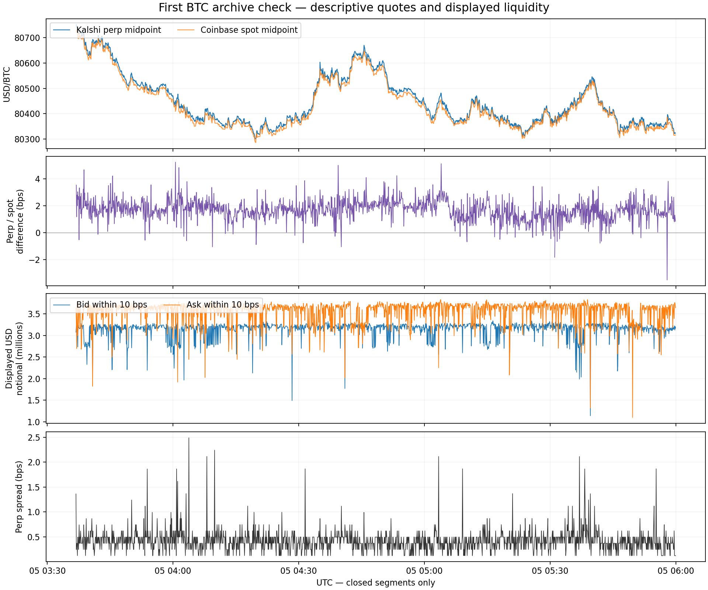
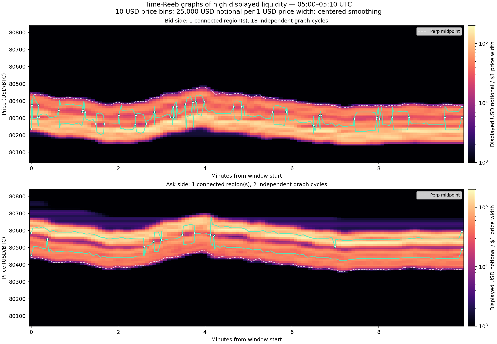
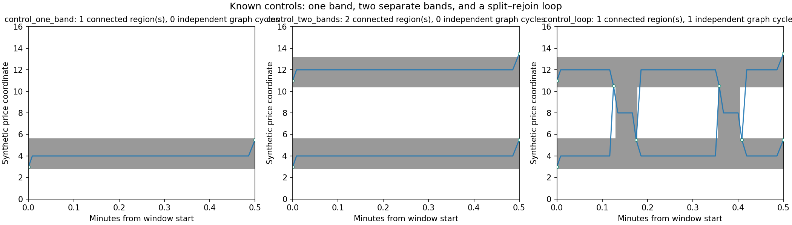
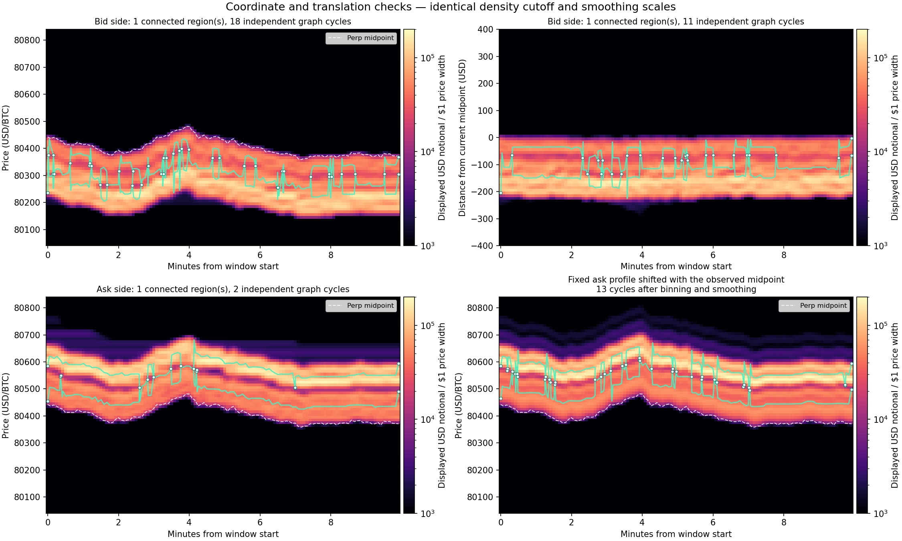

# First continuous BTC archive analysis and Reeb graphs

**Result:** the closed data replay correctly, the perp and spot prices co-move, and the book contains visible depth bands that move with the market. Actual time-Reeb graphs can summarize their connectivity. **Their cycle counts are sensitive to binning/smoothing, and a translated fixed profile can create cycles after processing. No predictive TDA advantage is established.**

This is an exploratory/development analysis, performed in `tda`. Collection was left running. The immutable input list is in [closed_segment_validation.json](closed_segment_validation.json); live `.partial` files were excluded. For current collector health use [ACTIVE_CAPTURE.json](../../../btc/ACTIVE_CAPTURE.json) and its referenced fresh status, not this historical report.

## What was checked


| Item | Recorded/validated |
|---|---:|
| Perp book deltas | 1,552,329 |
| Public perp trades | 14,868 |
| Perp full-book checkpoints | **1,703 / 1,703 matched independent replay** |
| Coinbase reference samples | 17,175 |
| Closed files | **6 / 6 passed gzip, SHA-256, and row-count checks** |
| Perp hour transitions | **Both carried books and sequence IDs matched exactly** |
| Recorded perp gaps/reconstruction errors | 0 |
| Coinbase disconnections | 1; recovered after **2.261 seconds** |
| Closed compressed storage | 59.34 MB; 551.72 MB uncompressed |

Coinbase's interruption was 04:58:10.085–04:58:12.346 UTC (11:58 p.m. November 4 locally). Its gap markers were preserved. Sixteen reference rows had quote age over two seconds; freshness filters exclude stale observations from the aligned comparison. The recorded `missed_sample_slots` counter alone is not a full outage measure: reconnect intervals have explicit gap markers and can lack samples.

## Initial market observations



- Perp midpoint went from **$80,751.50 to $80,323.50/BTC**, approximately **−0.53%**. The lowest saved checkpoint midpoint was $80,301.
- Median perp-versus-spot midpoint difference was **+1.70 bps**, about $14/BTC at these prices.
- Aligned five-second midpoint-return correlation was **0.623**, using 1,714 paired returns. This describes this short interval; different quote timing and freshness affect it. It does not establish lead/lag, arbitrage, cointegration, or a forecasting relationship.
- Median displayed depth was **351.27 BTC / $28.22m** across both sides. Within 10 bps of midpoint, combined displayed notional had median **$6.82m**, ranging from **$2.46m to $7.09m** at checkpoints.
- Best-bid-plus-best-ask displayed notional had median **$2,136**; median spread was **0.373 bps**, approximately $3/BTC.
- Recorded public executions totaled **269.5439 BTC / $21.686m**, with zero duplicate trade IDs. That is turnover over time, distinct from simultaneous resting depth.

The depth is concentrated in bands behind the best quote. Nearby depth sometimes drops sharply even while the broader book remains large. These observations do not identify the participants, classify every decrease as a cancellation/execution, or establish a cause for a price move.

Alignment is backwards/as-of on a five-second clock. A perp checkpoint can be at most 7.5 seconds old. The previous Coinbase sample must be within one second, and the total age of its quote at the comparison time must be at most two seconds. Missing observations are left missing; returns do not fill through missing rows. Raw source and receipt clocks remain separate. See [aligned_5s.csv](aligned_5s.csv), [perp_checkpoints.csv](perp_checkpoints.csv), and [summary.json](summary.json).

## Which Reeb graph was computed?

**This is a Reeb graph of time on a high-depth region**, computed by the installed native TTK `ttkReebGraphCmd`. All project Python ran in `tda`; no package or replacement environment was installed. [TTK Reeb-graph implementation](https://topology-tool-kit.github.io/doc/html/classttkReebGraph.html).


1. Sample the previously reconstructed books on a five-second clock, separately for bids and asks. The [selected books and observation clocks](chosen_books.json) retain source sequence IDs and exact quantities.
2. Put displayed USD notional into fixed **$10/BTC price bins**, over a fixed window approximately $400 either side of the first midpoint. The window stays inside the outer span of the reported full book. Divide by bin width so cutoffs can be compared with $20 bins.
3. For the primary display, apply centered Gaussian smoothing with standard deviations **$10 in price and five seconds in time**. This is retrospective smoothing, not causal feature preprocessing.
4. Keep regions with density at least **25,000 USD notional per $1/BTC price width**, equivalent to **$250,000 per $10 bin** before interpolation. Clip a consistently triangulated grid at this cutoff, retaining its piecewise-linear superlevel domain.
5. Use **time** as the scalar function. At each time, collapse each connected price interval inside this high-depth domain to a point. The Reeb graph records where these intervals appear, connect, separate, and disappear. Bid and ask domains are kept separate.

A graph cycle can represent **two high-depth bands splitting and later reconnecting**. It is not a cycle in BTC returns and is not an identified order moving through the book. This differs from a depth-scalar merge tree, whose branch lifetimes measure depth contrast. Here time is the filter, and source coordinates supply temporal extent; boundaries can censor starts/ends.



Bright areas are greater smoothed displayed notional density. The white dashed line is the perp midpoint. Green edges and nodes show Reeb connectivity. Edge positions use mean source-segmentation vertex coordinates within time bins; their drawn geometry is a layout, not an execution path or an order trajectory. The raw native graph nodes/arcs and segmented mesh are retained under `reeb/`, ready for ParaView. Each case also has a readable `graph.json`.

## Checks and the important limitation



Known inputs passed: one band gives one component/no cycle; two disjoint bands give two components/no cycle; two bands with two connecting bridges give one component/one cycle. For **all 17 real/sensitivity/control cases**, graph component/cycle counts matched independent clipped-mesh connectivity and Euler-characteristic calculations. Display reductions contract zero-time arcs and suppress degree-two nodes while preserving components/cycles and parallel edges. Uniformly multiplying density and its cutoff by three leaves the clipped domain unchanged. [Validation](reeb_validation.json).

Those checks establish that the computation matches the specified construction. They do not establish a useful financial feature. The [sensitivity table](reeb_sensitivity.csv) illustrates why:

| Case | Components | Independent cycles |
|---|---:|---:|
| Bid, $10 bins, smoothed, lower density cutoff 10k | 1 | 0 |
| Bid, $10 bins, smoothed, cutoff 25k | 1 | 18 |
| Bid, $20 bins, smoothed, cutoff 25k | 1 | 14 |
| Bid, $10 bins, no smoothing, cutoff 25k | 28 | 34 |
| Bid, $10 bins, smoothed, cutoff 50k | 17 | 2 |
| Ask, $10 bins, smoothed, cutoff 25k | 1 | 2 |
| Ask, $10 bins, no smoothing, cutoff 25k | 17 | 27 |
| **Fixed initial ask profile, shifted with observed midpoint**, then binned/smoothed | **1** | **13** |

The last row is a control: the underlying profile shape is held fixed. Its nontrivial graph shows that **translation combined with discretization, interpolation, and centered smoothing can create cycles without any underlying change in profile shape**. That control does not reproduce the actual ask graph, and it does not prove every real cycle is an artifact; it rules out treating cycle count alone as evidence of liquidity reorganization.



The profiles also look much more stable when re-binned around the contemporaneous midpoint. Median cosine similarity to the first smoothed profile changes from **0.65 to 0.97 for bids**, and **0.54 to 0.94 for asks**. Cosine similarity measures normalized shape and can conceal changes in total size. This is evidence for checking ordinary profile translation before assigning meaning to topology—not a claim about a specific market maker or identical resting orders. [Coordinate metrics](coordinate_checks.json).

Simply relabeling coordinates on an unchanged continuous domain would not change its time-Reeb topology. Here the coordinate comparison **re-bins and re-smooths** in the moving frame, changing the numerical scalar field. Its different graph is preprocessing sensitivity, not new information created by a coordinate change. At the primary cutoff, bid cycles change 18→11 and ask cycles 2→4 in the moving-frame calculation; centering does not universally reduce cycle counts.

## Decision and next useful step

The data are usable for descriptive book reconstruction and the proposed liquidity study. Reeb graphs provide a compact account of connectivity at a declared depth cutoff. **Raw graph complexity is not yet a stable research feature.**

Next, use midpoint-relative grids alongside fixed-price grids, predeclare binning/cutoffs, and compare graph descriptors with ordinary connected-band counts, depth gaps, band width, imbalance, and profile-translation/size controls using the same inputs. For any prediction experiment, use past-only smoothing and a defined target/horizon, and evaluate on genuinely later observations. Do not choose the best historical graph setting as a new holdout result.

All of these hours and parameter checks are development data. A few hours and many correlated book messages do not constitute many independent market episodes. The collector remains separate from this analysis; no order actions or further source subscriptions were performed.

## Reproduce from the frozen archive

From the project root, with the recorded source files available:

```sh
conda activate tda
python liquidity/experiments/btc_archive_initial_2026_11_05.py
python liquidity/experiments/btc_reeb_graphs_2026_11_05.py
python liquidity/experiments/btc_reeb_report_2026_11_05.py
```

The first script uses the frozen validation manifest rather than selecting new files from the evolving recorder. The second calls the already installed compiled TTK executable with one thread and preserves the native VTK outputs. The last reads those outputs in `tda`, validates topology, and renders the figures. [Data preparation source](../btc_archive_initial_2026_11_05.py), [clipping/TTK source](../btc_reeb_graphs_2026_11_05.py), [graph validation/plot source](../btc_reeb_report_2026_11_05.py). Source/runtime hashes are in [provenance.json](provenance.json).
