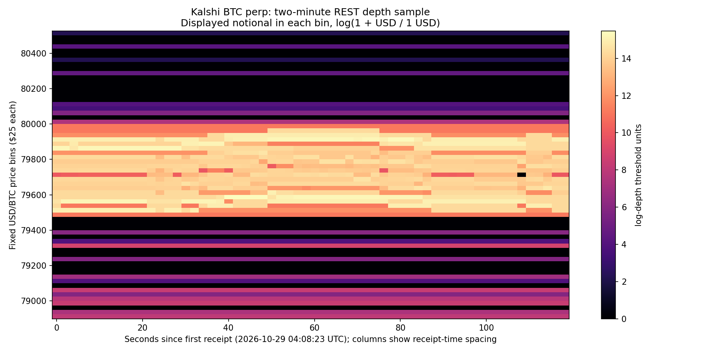

# Initial real BTC liquidity features

Executed October 29, 2026 with [btc_liquidity_features.py](../btc_liquidity_features.py). This adds a real-data feasibility pilot; it does not demonstrate a predictor.

- `binance_depth_baselines.parquet`: **89,220** historical snapshot rows, cumulative bid/ask notional, imbalance at 1–5%, and annular totals. Preserve the [two observed outages](../../../market_data/datasets/btc_binance_2024_2026-10-27/depth_time_gaps.csv); these are not uniform, gap-free time samples.
- `kalshi_quote_baselines_1m.parquet`: **208,328** quote-boundary rows, converted USD/BTC bid/ask, midpoint, spread, volume and open interest. Retains missing/null source information; not a past L2 book.
- `kalshi_live_baselines.csv`: **60** successful REST snapshots over two minutes, with spread, level counts, depth and imbalance at 10/25/50/100 basis points. Prices were sorted explicitly; API arrays were not assumed best-first.

`kalshi_grid.npz` stores a **65×60** price-by-receipt-time grid. Fixed $25/BTC bins span approximately ±1% around the first midpoint. Each value sums reported displayed USD notional in that bin; quantities and contract prices are converted using saved metadata. Nonobserved outer regions and failed observations are unavailable, not zero. The snapshot endpoint's `depth=0` is used for all reported levels. The grid is sample-specific: the first midpoint is its anchor, not a future-trained parameter.

H0 persistence uses the superlevel sets of `log(1 + notional / 1 USD)` on a **four-neighbor vertex grid**. There are **115 finite branches and one essential component** in this sample. This is actual elder-rule H0 persistence, not the earlier threshold-only closed-square demonstration and not cubical H1. Its component counts match independent `scipy.ndimage.label` checks at 31 real thresholds and on synthetic tie/disconnection examples.

Each [branch](kalshi_grid_h0_branches.json) retains its peak price/time and distance from the contemporaneous midpoint, merging component's price width, observed time span, latest source observation, and recency at window end. Lifetime is log-depth **contrast**, not seconds; time span comes from coordinates separately. Bounds can cover a nonrectangular component and are not an order's identity or continuous lifetime. A strong branch might also be explained by ordinary large displayed depth. No recovery target or predictive comparison has been evaluated.

The raw source is a bounded two-minute REST recording, with no exchange event timestamps or delivery sequences. It misses changes between polls. The recorder exited; no continuous collection service is running. Full journal and failures are retained. The script rejects time gaps over five seconds for this small-grid construction; a longer study needs segmentation and explicit missingness handling. See [summary and limitations](summary.json) and [source assessment](../../../btc/DATA_SOURCES.md).
