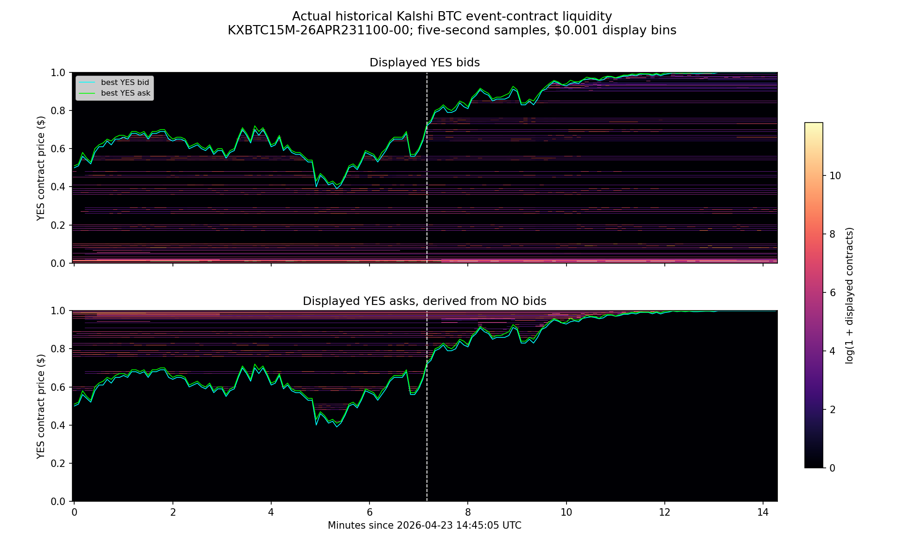

# What the actual historical order-book data looks like

**Out of the current requested scope.** The user clarified that they already know their recorded books and are not asking to study 15-minute events. This artifact is retained as provenance of earlier misdirected assistant work. Do not use it as an answer to external historical-book availability or continue this direction without an explicit request. Follow [AGENTS.md](../../../AGENTS.md) and [external historical access tests](../../../btc/EXTERNAL_HISTORICAL_BOOKS.md).

Reconstructed October 29, 2026 from an existing HFT archive file using [historical_book_preview.py](../historical_book_preview.py). No network requests, trading code or order actions were used.

**Historical books are available locally.** The full [archive inventory](../../../market_data/datasets/hft_kalshi_archive_inventory/README.md) covers 176 BTC 15-minute binary-contract files. The separate new BTC-perp capture and historical perp candles are different instruments/data objects. Long historical Kalshi perp multilevel backfill remains unestablished; that does not mean historical BTC depth is unavailable in general.

For this preview, select the longest recorded interval among audited single-snapshot files, without selecting on depth or topology. It is `KXBTC15M-26APR231100-00`: one snapshot followed by **118,271 book deltas**. Reconstruct exact decimal quantities, then sample the book every five seconds. No decreasing recorded book timestamps or sequence gaps were encountered. Exact selected prices remain unrounded; the image separately groups depth into declared $0.001 display bins, preserving total depth in every displayed column.

Each panel has **time horizontally**, **YES event-contract price vertically**, and **displayed contract quantity as color**, transformed by `log(1 + quantity)`. The upper panel shows YES bids. The lower panel shows YES asks derived from complementary NO bids. Cyan/green lines show the best YES bid/ask. The white dashed line identifies the exact book table below. Horizontal bands show displayed depth at a price over sampled observations; they do not prove that the same original order remained there. Black cells represent zero quantity in the replayed displayed book at these samples.

The image spans **April 23, 2026 14:45:05–14:59:20 UTC**, or **10:45:05–10:59:20 a.m. Indianapolis time**. At **14:52:15 UTC / 10:52:15 a.m. Indianapolis time**:

| YES bid price | Bid contracts | YES ask price | Ask contracts |
|---:|---:|---:|---:|
| $0.7200 | 37.23 | $0.7300 | 165.61 |
| $0.7100 | 2,938.29 | $0.7400 | 89.00 |
| $0.7000 | 106.00 | $0.7500 | 810.23 |
| $0.6900 | 289.00 | $0.7600 | 2,487.97 |
| $0.6800 | 75.00 | $0.7700 | 95.00 |

These are prices and quantities for the **binary contract**, not USD/BTC prices or BTC quantities. The selected full book contains **97 bid and 53 implied ask levels**, retained in [selected_book_exact.csv](selected_book_exact.csv). [Top levels](selected_top_levels.json), [depth arrays](depth_grid.npz), and [coverage/validation](summary.json) are also saved.

The raw data is newline-delimited JSON despite `.csv` filenames. Its public records include initial snapshots, signed quantity changes at individual prices, and executions. For example, an actual archived delta in a different April session has side `no`, price `0.0010`, and delta `1000.00`: add 1,000 contracts to aggregate displayed NO-bid quantity at that price. A negative delta removes quantity; it does not by itself identify cancellation versus execution. Public trade messages separately record execution price, size, taker side and timestamp. Private historical fill payloads are excluded from this preview.

For topology, the field is now concrete: displayed quantity as a function of price and past observation time. The picture can support concentration/merge analysis and comparison with depth, gaps and imbalance. It does not yet establish predictive value. Five-second sampling can miss short events, event timestamps do not provide original local delivery times, and a binary contract's expiry/bounded prices change the interpretation relative to BTC perps.
