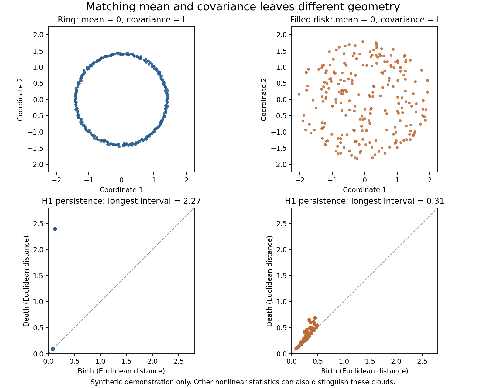

# TDA for financial time series: evidence, limitations, and research opportunities

Review date: October 12, 2026. This is a targeted scoping review of primary papers, with emphasis on arXiv and accessible journal articles. It is not an exhaustive systematic review or an independent replication. Searches covered persistent homology, financial time series, crashes, volatility, financial networks, portfolios, liquidity, order flow, delay embeddings, and recent temporal/multiparameter methods. Results below are author-reported unless explicitly described as our mathematical deduction or proposed experiment.

**Explanatory update: October 14, 2026.** Added a prior-work overview, a feature-to-insight explanation, and a reassessment of the three studies. Foundational sources and selected financial papers were checked again for these additions; the original paper-by-paper review retains its stated access limitations. This update is not a new exhaustive literature search.

**Working conclusion:** TDA is a plausible representation of market state, with repeated descriptive evidence around stress and some controlled forecasting improvements. Evidence for a universal crash alarm, dependable return prediction, or profitable execution is much weaker. The research opportunity is to establish *when a particular topological construction adds value beyond appropriate statistical and geometric alternatives*.

**Project status:** the agreed initial scope is three small studies of asset dependence, BTC features, and liquidity organization. The authoritative [starting point](../START_HERE.md) records that scope and open choices. This review is supporting evidence; its candidate projects below are not additional commitments.

**Reading guide:** §2 begins with what previous TDA work has actually been about, including examples outside finance. §3 explains how individual features can become analytical insights. §5 begins with our current assessment of the research idea. The detailed bibliography is retained for checking evidence.

## 1. What the methods actually measure

Persistent homology tracks connected components (H0), loops (H1), and higher-dimensional holes as a threshold changes. A persistence diagram records birth/death thresholds. A long interval means survival across filtration scales; it does **not** mean survival for that many seconds or days.

The representation chosen before computing homology determines the economic question:

| Construction | What is a point or cell? | Possible interpretation | Main limitation |
|---|---|---|---|
| Multivariate return cloud | One timestamp's vector of returns across assets | Geometry of joint market states during a window | Permuting timestamps leaves the cloud unchanged |
| Delay embedding | A vector such as `(r_t, r_{t-τ}, …, r_{t-(m-1)τ})` | Local trajectory geometry and repeating patterns | Sensitive to delay, dimension, window, and normalization |
| Correlation-network filtration | Assets as vertices; distances derived from rolling correlations | Organization of inter-asset dependence at different thresholds | All information is a function of the correlation matrix |
| Recurrence/distance image | Similarity between observations or embedded states | Patches and cycles in recurrence structure | Metric and image construction can dominate the answer |
| Cubical persistence on a depth grid | Displayed liquidity over relative price and past time | Connected liquidity regions and persistent gaps | Requires a reliable book and a justified time/price metric |
| Temporal/zigzag persistence | A sequence of related complexes with additions/removals | Evolution of structural features between observations | Added complexity does not automatically improve prediction |

Common outputs are landscape norms, persistent entropy, interval counts, Betti curves, persistence images, and bottleneck/Wasserstein distances between diagrams. Scalar summaries are easy to model but discard information; images retain more structure but add tuning and dimensionality.

[Perea and Harer's sliding-window work](https://arxiv.org/abs/1307.6188) gives a mathematical foundation for detecting periodic structure in appropriate signals. That foundation does not establish that noisy financial series satisfy the assumptions needed to reconstruct a deterministic market attractor. [Persistence images](https://jmlr.org/papers/v18/16-337.html) are established feature representations, so applying them to a new asset is not by itself a new method. [Stable multiparameter vectorizations](https://arxiv.org/abs/2306.03801) offer additional machinery, but their mathematical properties do not establish financial effectiveness.

## 2. What the financial literature has found

### Prior work in context: what has TDA been used to learn?

TDA includes several approaches with different purposes. Persistent homology measures multiscale components and holes; Mapper constructs a summary of how locally clustered groups connect; merge trees organize components of scalar-field level sets. A result from one construction does not automatically justify another.

Some representative work outside finance makes the usefulness easier to see:

| Prior work | Object and method | Analytical payoff |
|---|---|---|
| [Singh, Mémoli, and Carlsson, Mapper (2007)](https://diglib.eg.org/items/d4e204e8-5dd2-4b5d-bccd-5da3c4a1e925) | High-dimensional observations; overlapping local clusters connected into a simplicial summary | Inspect how groups connect and branch, rather than view only a flat partition. The summary depends on the lens, cover, and clustering choices. |
| [Nicolau, Levine, and Carlsson, breast-cancer data (2011)](https://doi.org/10.1073/pnas.1102826108) | Tumor gene-expression observations; a topology-based representation | Identified a molecularly distinct subgroup with favorable observed survival. Here the proposed insight is a subgroup whose biological/outcome characteristics can be investigated. This historical finding alone does not establish clinical utility. |
| [Perea and Harer, sliding windows (2013 preprint / 2015 journal)](https://arxiv.org/abs/1307.6188) | Time-delay point clouds; H1 persistence | Quantify periodicity through the geometry of sampled states, with theoretical results and signal/gene-expression examples. This supplies an interpretable signal property to test. |
| [Gardner et al., grid-cell activity (2022)](https://www.nature.com/articles/s41586-021-04268-7) | Simultaneously recorded neural activity; persistent cohomology and decoded coordinates | Found toroidal population structure consistent with a two-dimensional continuous-attractor model. Coordinates related to animal position, and structure persisted across environments and behavioral states. Topology helped test an existing mechanistic account of a neural population. |

The lesson is that usefulness often comes from **identifying a scientific object or constraining an explanation**: a subgroup, a recurring trajectory, or a population state space. Predictive features are another use, with a separate standard of evidence. These examples are selected illustrations, not a survey of all TDA applications, and their success does not transfer automatically to markets.

Within finance, the prior work reviewed below falls into the following tasks:

| Financial task | Representative work | What it establishes or attempts | Connection to our studies |
|---|---|---|---|
| Historical stress and regime description | [Gidea–Katz](https://arxiv.org/abs/1703.04385); [cryptocurrency transitions](https://arxiv.org/abs/1809.00695) | Return-cloud and delay-cloud summaries change around selected market episodes | Background for BTC features; descriptive changes need a separate forecasting test |
| Organization of asset relationships | [Gidea's financial networks](https://arxiv.org/abs/1701.06081) | Rolling correlation-derived topology describes changing dependence | Closest construction to the equity peer study; no direct validation of our residual-reversal hypothesis |
| Forecasting with additional features | [Souto's realized-volatility study](https://www.newswise.com/pdf_docs/170055790161323_1-s2.0-S2405918823000235-main.pdf); [de Jesus Jr. et al.](https://link.springer.com/article/10.1007/s00521-024-10787-x) | Test whether PH summaries improve particular forecasting models; gains are conditional | Examples of the comparison needed if BTC becomes a prediction study |
| Classification, allocation, and trading | Majumdar–Laha; Baitinger–Flegel; later portfolios and barcode strategies in §2C | Classify series or use topological scores in decisions, with varying validation quality | Establishes substantial prior art; using PH in a financial model is insufficient novelty |
| Order flow and liquidity | [Labyad's thesis](https://www.maths.ox.ac.uk/system/files/media/S%20Labyad.pdf); the studies in §2D | Describe microstructure relationships or test incremental outcome prediction, including reported null results | Relevant prior art, but not validation of our annotated price–time depth construction |

Thus the field already includes crisis description, dependence networks, periodicity/regime characterization, forecast augmentation, portfolio decisions, and microstructure. Our possible contribution must identify a specific useful distinction, comparison, or limitation within that landscape. The following entries provide the evidence and qualifications behind this map.

### A. Stress, bubbles, and regime changes: the most repeated finding

**Gidea and Katz, [*Landscapes of Crashes*](https://arxiv.org/abs/1703.04385), 2017 preprint / 2018 Physica A.** Full-text methods/results inspected. Sliding clouds of four U.S. index returns, Vietoris–Rips H1, and landscape norms change near the dot-com and global financial crises. This is foundational evidence that market stress can alter return-cloud geometry. The experiments are retrospective analyses of selected episodes rather than a calibrated, prospectively validated crash alarm. Importantly, the paper also obtains increasing norms from increasing-variance Gaussian simulations: scale alone can produce the qualitative signal.

**Gidea, [*Topological Data Analysis of Critical Transitions in Financial Networks*](https://arxiv.org/abs/1701.06081), 2017.** Full text inspected. Rolling correlation networks of Dow stocks are converted to clique filtrations, and distances between persistence diagrams change around the 2007–08 crisis. This studies *assets and their relationships*, unlike clouds of timestamped returns. Useful as a multiscale network summary; it does not add information beyond the complete input correlation matrix or establish prospective warning accuracy across many crises.

**Gidea et al., [*Topological Recognition of Critical Transitions in Time Series of Cryptocurrencies*](https://arxiv.org/abs/1809.00695), 2018 preprint / 2020 Physica A.** Full-text relevant sections inspected. Delay embeddings, landscapes, and clustering identify changing behavior in BTC, ETH, LTC, and XRP around the 2017–18 boom/crash. The clustering uses price/return information alongside topological summaries. Accordingly, historical regime separation should not be read as an isolated incremental forecasting benefit from topology.

**Aguilar and Ensor, [*Topology Data Analysis Using Mean Persistence Landscapes in Financial Crashes*](https://content.scirp.org/pdf/jmf_2020110516015268.pdf), Journal of Mathematical Finance, 2020.** Primary abstract/method excerpts inspected. Four U.S. indices and ten ETF sectors from 2010–2020 are analyzed with landscape summaries and permutation tests comparing windows. This extends visual crisis examples toward statistical testing of changing structure. It remains a historical structural-change study, not a demonstrated incremental forecast. A replication should verify exchangeability assumptions and dependence handling for overlapping windows rather than equate a small permutation p-value with predictive usefulness.

**Ruiz-Ortiz et al., [*A Persistent-Homology-Based Turbulence Index…*](https://arxiv.org/abs/2203.05603), 2022, revised 2023.** Abstract and review/method sections inspected. This combines a short literature overview with a proposed index and examples involving U.S., Mexican, and Japanese indices during major disruptions. It is a useful entry point and replication lead, with linked code/data, rather than a definitive comparison against modern forecasting baselines. Distinguish its proposed index from the other authors' constructions summarized in its review.

**Akingbade et al., [*Why Topological Data Analysis Detects Financial Bubbles?*](https://arxiv.org/abs/2304.06877), 2023 preprint / related 2024 journal article.** Full-text relevant sections inspected. A log-periodic power-law singularity model supplies a heuristic mechanism: accelerating oscillations and growth change embedded geometry. Synthetic examples and hourly Bitcoin observations support this particular explanation. It is conditional on the bubble model and retrospective segmentation; it is not a theorem that all bubbles, crises, or profitable warning signals have detectable topology.

**Yao et al., [*Change Point Detection in Financial Market Using TDA*](https://www.mdpi.com/2079-8954/13/10/875), Systems, 2025.** Primary abstract and indexed methods/results inspected; full direct access was blocked. The study examines 26 stocks over 12 years and compares topological change-point indicators with conventional methods, including rolling standard deviation and PELT/HMM approaches. Reported historical-event detection improvements warrant replication. Event definitions, consensus rules, thresholds, and matching tolerances must be audited before interpreting change-point detection as early warning.

**Guritanu et al., [*Topological Machine Learning for Financial Crisis Detection*](https://doi.org/10.3390/computers14100408), Computers, 2025.** Primary indexed methods/results inspected; direct full access was blocked. Across four canonical crises, the reported detector anticipates two and has F1 about 0.50 under its event-matching protocol. H0-only performance is close to the full construction, whereas H1-only produces many false alarms. This is particularly useful counterevidence to the assumption that loops necessarily carry the essential financial signal. Causal feature computation still needs separate out-of-sample threshold/tuning validation.

### B. Incremental volatility/forecasting evidence: promising, conditional

**Rudkin, Qiu, and Dłotko, [*Uncertainty, Volatility and the Persistence Norms of Financial Time Series*](https://arxiv.org/abs/2110.00098), 2021 preprint.** Full-text relevant sections inspected. Four-index return clouds and several window sizes are compared with financial and macroeconomic uncertainty measures. Conditional associations with financial uncertainty remain in some volatility-controlled specifications, with weaker additional value for macro uncertainty. This supports studying a distinct *association*, but contemporaneous regression does not establish future forecast improvement, causal information, or robustness to all nonlinear statistical controls.

**Souto, [*Topological Tail Dependence: Evidence from Forecasting Realized Volatility*](https://www.sciencedirect.com/science/article/pii/S2405918823000235), Journal of Finance and Data Science, 2023.** Author-paper [full PDF](https://www.newswise.com/pdf_docs/170055790161323_1-s2.0-S2405918823000235-main.pdf) inspected. Topological diagram changes augment HAR-family and neural realized-volatility models for U.S. indices, with European robustness tests and chronological evaluation. Gains depend on model and period: stronger nonlinear/crisis-period results coexist with limited full-sample gains in simpler HAR specifications. This is among the more useful positive precedents because it asks an incremental forecasting question and evaluates volatility losses rather than showing only a crisis chart. Author [implementation](https://github.com/hugogobato/Topological-Tail-Dependence-Evidence-from-Forecasting-Realized-Volatility) is linked.

**de Jesus Jr. et al., [*Enhancing Financial Time Series Forecasting through TDA*](https://link.springer.com/article/10.1007/s00521-024-10787-x), Neural Computing and Applications, published January 2025.** Full text inspected. Delay-embedding entropy, amplitude, and counts augment N-BEATS across 32 scenarios involving six cryptocurrencies and four conventional instruments. Compared with several alternative feature sets, TDA has the lowest reported MAE in 18 scenarios and RMSE in 19. These are encouraging controlled feature comparisons, not uniform dominance or trading-profit evidence. Replication should audit whether interpolation, outlier handling, normalization, and denoising use only information available at prediction time; leakage is a question to investigate, not a finding established here. MAPE is also problematic for returns near zero.

**Akingbade, [*Null-Validated Topological Signatures of Financial Market Dynamics*](https://arxiv.org/abs/2602.00383), 2026, v2 July 31; arXiv lists a related journal DOI.** Full text inspected. BTC and S&P 500 daily delay-cloud landscapes are compared with stochastic volatility, sentiment controls, shuffled series, and phase-randomized surrogates. Departures from these nulls support sensitivity to temporal organization beyond the selected controls. They do not yet demonstrate forecasting value. Overlapping windows, pointwise surrogate envelopes, global standardization, and nulls that do not preserve local heteroskedasticity complicate stronger interpretations. A fitted fat-tailed volatility null and chronological predictive test would materially strengthen this line of work.

### C. Clustering, allocation, and trading: separate tasks with different evidence

**Baitinger and Flegel, [*The Better Turbulence Index? Forecasting Adverse Financial Markets Regimes with Persistent Homology*](https://link.springer.com/article/10.1007/s11408-020-00377-x), Financial Markets and Portfolio Management, 2021.** Publisher abstract, notes, and appendix preview inspected; main text requires subscription. The authors report an out-of-sample PH turbulence strategy outperforming strategies using other turbulence indicators, with parameter sensitivity tests. This is an important positive investment/risk precedent and deserves a full replication. The accessible preview does not permit an independent audit of all timing, tuning, and execution assumptions; it should not be dismissed as merely a retrospective crash chart or adopted as universal superiority.

**Majumdar and Laha, [*Clustering and Classification of Time Series Using TDA with Applications to Finance*](https://www.sciencedirect.com/science/article/pii/S095741742030676X), Expert Systems with Applications, 2020.** Primary abstract/introduction inspected. SOM/TDA and random-forest/TDA methods are tested on simulated processes and financial classification examples. This supports representation learning and classification as applications; sector/process classification is a different target from future returns. Detailed performance and splitting procedures need full replication before generalizing the claims.

**de Favereau de Jeneret and Diamantis, [*Topology of Currencies*](https://arxiv.org/abs/2510.19306), October 2025 preprint.** Full text inspected. Persistence-based features cluster 13 monthly currency-return series, with improved reported internal clustering scores. Internal silhouette scores in different feature spaces are not directly evidence of more accurate forecasts or economically correct groups. Crucially, its robustness table explicitly contains illustrative placeholders pending a fuller study; those entries must not be cited as completed empirical robustness tests.

**Goel et al., [*Class of Topological Portfolios: Are They Better than Classical Portfolios?*](https://arxiv.org/abs/2601.03974), January 2026; authors describe it as pre-accepted in Financial Innovation.** Full-text relevant sections inspected. Rolling portfolio experiments use persistence-derived asset risk measures across 462 S&P 500 stocks and compare classical allocation rules, with transaction-cost sensitivity. This is a promising application to risk regularization, but the objective is effectively a diagonal asset-risk penalty rather than a full dependence model. A replication should audit point-in-time constituent selection, compare inverse-volatility/shrinkage allocation, and verify the stated cost conventions. Complete-history stock selection can introduce survivorship bias.

**Sharma et al., [*Mixup Barcodes for Topology-Aware Financial Decision Making*](https://arxiv.org/abs/2610.12396), October 8, 2026 preprint.** Full text inspected. Diagram distances, mixup disruption, and entropy changes control Golden Cross position sizes on SPY and BTC. Reported improvements are explicitly **in-sample**, with embedding settings selected from 72 combinations by in-sample Sharpe. Walk-forward evaluation is future work. The relational construction is an interesting method lead; the performance is not evidence of an independently validated trading edge.

### D. Microstructure/liquidity: relevant to our interests, but less established

**Labyad, [*Topological Persistence in Market Micro Structure*](https://www.maths.ox.ac.uk/system/files/media/S%20Labyad.pdf), Oxford MSc thesis, 2018.** Relevant full-text sections inspected. LOBSTER messages for seven Nasdaq stocks over 106 trading days are used to study relationships among stocks and order types. This establishes prior art for topological order-flow analysis, but its descriptive co-occurrence structure is different from price-by-time depth recovery and is not a validated execution strategy.

**Karpov, [*A Pre-Registered Controlled Null…*](https://papers.ssrn.com/sol3/papers.cfm?abstract_id=6938398), June 2026, revised August.** Primary indexed abstract inspected; full text blocked, preregistration and code not independently audited. Across roughly 47 days of Hyperliquid data, several H0/H1 constructions reportedly provide essentially no incremental maker-order reversal discrimination against a rich conventional feature set. The narrow market, horizon, and feed assumptions limit generalization, but this directly challenges weak-baseline claims for order-book topology.

**Karpov, [*Does Temporal Topology Add Information Beyond Static Snapshots?*](https://papers.ssrn.com/sol3/papers.cfm?abstract_id=7002981), July 2026, revised August.** Primary indexed abstract inspected; full text blocked. Purged/embargoed tests on BTC, ETH, and SOL reportedly find no significant primary zigzag-over-static improvement. Some static-topology gains against a compact baseline shrink when order-flow dynamics and volatility controls are added; positive cases concentrate in a shared volatility episode. Treat this as specific author-reported negative evidence, not proof that every temporal filtration is useless.

**Moroke and Metsileng, [*GEODEX / Geodesic Execution Slippage*](https://www.mdpi.com/1099-4300/28/6/705), Entropy, 2026.** Accessible [preprint](https://www.preprints.org/manuscript/202605.0757) inspected. Combines geometric execution modeling and a PH alarm using crypto data with daily L2 observations. Its PH ablation reports a modest contribution, but the response includes a modeled/proxy execution quantity rather than observed individual order fills. It should not be treated as validation of tick-level fill prediction or of a general geometric law of liquidity.

### E. New tools worth watching, without assuming a financial advantage

[*Global and Local Topology-Aware Attention…*](https://arxiv.org/abs/2605.03163), May 2026, incorporates persistence/Euler-based biases into forecasting. Full-text relevant results inspected. Gains on topology-aligned synthetic tasks are informative; a representative S&P 500 volatility evaluation retains the unmodified baseline for stronger deep models under its validation guard. This is a reminder to inspect dataset-specific results rather than aggregate benchmark wins.

[*PHINN*](https://arxiv.org/abs/2606.15452), June 2026, proposes topology-conditioned rare-event/outlier generation. Full-text relevant sections inspected. Matching topological summaries could help stress-test models, but does not establish that generated financial events have realistic tails, leverage effects, cross-asset dependence, or execution dynamics. Proprietary/restricted parts of the study limit independent replication.

## 3. What can TDA provide beyond ordinary statistics?

### The missing bridge: feature → distinction → insight → use

Understanding that H1 counts loops leaves an essential question unanswered: **why should a loop in this particular data object matter?** Its meaning comes from the observations, coordinates, metric, and filtration. A loop in a correlation network, a delay cloud, and a depth grid refers to three different things.

A useful explanation has four parts:

1. **Feature:** what exactly was measured, and in which units?
2. **Distinction:** which two plausible configurations does it separate?
3. **Insight:** what statement about the observed system becomes clearer?
4. **Use:** what hypothesis, grouping, diagnosis, or forecast does that statement support?

The first two parts can be demonstrated synthetically. The third needs source observations and domain reasoning. A predictive fourth part needs held-out evidence. Computing a barcode supplies only part of this chain.

| Feature/construction | Distinction it can measure | Possible insight or use | What would weaken that interpretation? |
|---|---|---|---|
| H0 merge hierarchy of asset distances | Assets that join tightly versus groups connected only at larger distance thresholds | Identify which peer assignments remain similar over a range of cuts; investigate whether those peers give meaningful return residuals | Single-linkage chaining, unstable correlations, or conventional groups explaining residuals equally well |
| Prominent H1 interval in a delay cloud | A sampled trajectory surrounding a gap versus states filling that gap | Evidence of recurring trajectory geometry at the chosen lag and window; compare oscillatory episodes | Scale, sparse samples, stochastic oscillations, or spectral/recurrence measures accounting for the same distinction |
| H0 branches of superlevel depth | Separate concentrations versus small bumps on one concentration | Identify regions to annotate and compare for breadth, recency, and subsequent depletion | Peak prominence, connected-component analysis, and duration features doing the same job more simply |
| Cubical H1 of superlevel depth | Enclosed low-depth pockets versus filled or boundary-connected regions | Locate a particular form of depletion for source inspection | Economically important gaps being open to the boundary; geometry dominated by binning |
| Diagram distance across windows | A change in the multiscale configuration | Identify episodes worth investigating or propose a change indicator | Scale changes, moving boundaries, or ordinary change detectors accounting for the movement |

These are construction-specific possibilities, not verified financial conclusions.

### Three examples of a change in analytical thinking

**Equity peers: replace one fixed partition with a hierarchy to examine.** A sector label assigns a stock to one group. A labeled distance hierarchy lets us ask whether a small set stays together as the similarity threshold relaxes, and whether a stock sits near a group boundary. That can expose ambiguity in a peer definition before fitting relative-return residuals. Threshold persistence within one window is different from stability across dates; test both separately. The useful object is the labeled hierarchy. A scalar H0 norm would discard much of the peer information. Since Rips H0 is single linkage, the research must explain what examining multiple scales or dates contributes beyond ordinary hierarchical clustering. It does not establish that deviations subsequently reverse.

**BTC: distinguish amplitude from organization of sampled states.** For an ideal signal `x_t = A cos(ωt)`, the two-coordinate cloud `(x_t, x_{t−τ})` follows an ellipse when `sin(ωτ) ≠ 0`; with adequate coverage and sampling, H1 can capture its loop. At a degenerate lag the ellipse collapses toward a line. Thus the interpretation depends on lag and coverage, not just “the signal is periodic.” [Perea–Harer](https://arxiv.org/abs/1307.6188) develops the broader periodicity connection. A noisy series with similar variance can instead occupy the center. The analytical question becomes “does this window have organized recurrence beyond the selected stochastic controls?” Ordinary persistence of the unordered cloud does not tell us direction, phase, or the next return. Autocorrelation, spectra, and recurrence statistics are essential comparisons.

**Liquidity: distinguish amount from organization.** In our [synthetic depth example](../liquidity/experiments/depth_topology_demo.png), matched totals and identical final snapshots conceal different organization over the observed window. Component structure exposes continuous bands versus separated patches. A tree can identify candidate concentrations, and source timestamps/price coordinates can tell us whether they are broad, recent, and near the quote. This motivates a test of whether organization is associated with future depth recovery. That economic link remains a hypothesis. Run lengths and turnover also distinguish the example, and depth persistence itself measures contrast in quantity units, not duration.

### What the popular summaries retain and discard

The longest interval emphasizes one prominent feature. A Betti curve gives counts at each threshold. A landscape norm aggregates interval sizes and sacrifices their identities. Persistent entropy, commonly the Shannon entropy of normalized finite interval lengths, measures how evenly those lengths are distributed; equal lengths can have high entropy in a very regular example. It is not intrinsically market uncertainty. A persistence image provides a vector encoding locations in birth–persistence space for a learner; its pixels do not acquire economic meaning automatically. [Adams et al.](https://jmlr.org/papers/v18/16-337.html) establishes this vectorization as a method.

Every compression should be justified by the question. Peer membership requires asset labels and merger ancestry. A liquidity explanation requires links to source regions. A model coefficient on one persistence-image pixel does not recover either of those. “Important to the fitted model,” “traceable to observations,” and “explained by an economic mechanism” are distinct achievements.

**Our working criterion for usefulness:** can we state a consequential distinction in ordinary language, show that the feature tracks it under controls, and demonstrate why retaining that distinction helps the intended analysis? A reproducible descriptive insight can satisfy this criterion without return prediction. A complex feature whose only explanation is that its score changed has not yet done so.

### A useful representation, rather than an extra source of information

Mean, variance, and correlation do not uniquely determine a distribution's support. Two clouds can have identical sample mean and covariance while one forms a ring and the other fills its center. PH can distinguish those configurations. We constructed a reproducible synthetic demonstration with exactly matched first two sample moments:

[Script](matched_moments_demo.py) and [numerical output](matched_moments_demo.json). Both clouds have 240 points, sample mean zero and covariance identity. Their longest H1 intervals are approximately 2.27 and 0.31. This demonstrates representational capability, **not financial predictive effectiveness**. Other nonlinear statistics also distinguish them.

TDA can summarize multiscale connectivity, recurrence geometry, and changes between configurations without reducing everything to a single predetermined threshold. For finite data and a constrained model, that compression may improve estimation or make a particular mechanism easier to inspect.

But topology is itself statistical feature extraction. If `Z = PH(X)` is computed deterministically from market history `X`, it contains no additional information beyond the full history. It may add information *relative to an incomplete baseline*, or provide an inductive bias that helps a learner exploit information already present. A flexible statistical model may capture the same structure without PH.

Consequently, compare against nonlinear dependence measures, recurrence summaries, nearest-neighbor/density statistics, principal components, spectral features, and sequence models—not only volatility. For H0 of a Rips filtration, finite death scales encode minimum-spanning-tree/single-linkage connectivity, making MST summaries particularly relevant cheap alternatives.

### A concrete scale confound: our mathematical deduction

For a finite persistence diagram and the full landscape on an unrestricted filtration axis,

`||λ||₁ = ¼ Σᵢ (dᵢ − bᵢ)²`.

Each barcode interval contributes a triangular tent of area one quarter of its squared lifetime. Rescaling a Euclidean point cloud by `a > 0` rescales its birth/death thresholds by `a`. Therefore its landscape L1 norm scales by **a²**, the same homogeneity degree as variance. More generally the landscape Lp norm scales by `a^(1 + 1/p)`. A fixed truncated numerical grid need not obey these identities exactly.

Thus a rising landscape norm can partly be a nonlinear presentation of increasing return scale. That does not invalidate it as a risk feature; it changes the claim that must be tested. Compare raw, trailing-volatility-normalized, covariance-whitened, and rank/copula-based constructions. These variants remove different economically relevant information, so retain the removed scale/covariance as baseline predictors rather than assume normalization solves everything.

### Three interpretive traps

1. **A correlation filtration cannot reveal information absent from its correlation matrix.** Clique complexes may have higher-dimensional simplices, but those are determined by pairwise edge thresholds. A useful multiscale summary is not automatically evidence of higher-order statistical dependence.
2. **Geometry does not automatically identify temporal direction.** A return cloud ignores ordering. Ordinary univariate delay-cloud persistence also cannot generally distinguish time reversal: reversing time reverses delay coordinates, an isometry of the cloud. Direction, causality, and lead-lag require additional constructions and explicit tests.
3. **Stability is a conditional mathematical guarantee.** Stability to specified small geometric perturbations does not imply invariance to changing scale, sampling frequency, missing data, window size, or nonstationarity. Nor does it give a loop an economic interpretation.

## 4. How convincing claims should be evaluated

Four levels of evidence should remain separate:

| Claim | Required evidence |
|---|---|
| Structure changes around stress | Reproducible descriptive measurements and sensitivity checks |
| Structure differs from a statistical null | Nulls preserving relevant alternative explanations, with dependence-aware inference |
| Structure improves prediction | Chronological held-out comparison against appropriate baselines |
| Structure supports a trading/execution policy | Additional spread, fee, latency, inventory, fill, and capacity analysis |

Shuffling preserves marginal values but destroys volatility clustering and dependence. Phase randomization preserves a global spectrum, but generally changes the marginal distribution and local volatility organization. IAAFT better preserves the marginal and spectrum, yet does not guarantee preservation of volatility clustering. A useful null suite includes fitted fat-tailed GARCH/stochastic-volatility models, dependence-preserving resampling, and explicit regime controls. Null rejection is not a forecast, causal explanation, or profit result.

Overlapping windows produce serially dependent features even for independent raw inputs. Residual autocorrelation after regressing on volatility is therefore insufficient evidence of a new market mechanism. Thousands of overlapping daily examples may still contain only a few independent crises. Use block-based uncertainty, episode-aware evaluation, and explicit sensitivity to overlap.

For a convincing project:

1. Define a primary target and horizon first. Future realized volatility, tail exceedance, and liquidity recovery are different targets.
2. Use the same learner and comparable tuning budgets for statistical-only and statistical-plus-PH models. Include a raw-history model and cheaper geometric alternatives where feasible.
3. Fit every scaler, feature representation, residualization, interpolation rule, and selection step within training data. Require causal preprocessing for each timestamp.
4. Use chronological rolling/expanding evaluation. Purge shared input/label intervals across split boundaries; keep a final period untouched. Group related event/expiry contracts together.
5. Evaluate across several calm/stress periods and instruments. Report conditional gains and failures, not only the best parameter set.
6. Use appropriate scores: QLIKE and error metrics for volatility; calibration and precision–recall for rare events; time-to-recovery methods for unresolved episodes. For alarms, report false alarms and delays under predeclared event definitions.
7. Delay trading interpretation until forecast evidence is established. Quote touches and paper fills do not demonstrate passive execution.

## 5. Research possibilities suggested by this review

These are our proposed questions, not results established by the literature or claims of confirmed novelty. A narrower prior-art search is required once a construction and target are chosen.

### Reassessment of our three-study idea — October 14, 2026

**Assessment:** the framework is strong for learning how representations work. It becomes a coherent research contribution if it explains which distinctions each representation retains, when those distinctions matter, and when cheaper alternatives suffice. Three demonstrations or three weak prediction gains would not, by themselves, establish that contribution.

The common question should remain: **when does multiscale organization provide a useful summary beyond the chosen conventional analysis?** The interesting outcome can be a better explanation of data organization, a reproducible limitation, or a conditional predictive improvement. Success should be defined for each study rather than require all three to forecast returns.

| Study | Current judgment | First claim worth investigating |
|---|---|---|
| Equity peers | Feasible, economically concrete, but H0 overlaps heavily with established clustering | Does examining the labeled hierarchy across scales and dates expose peer ambiguity or useful residual behavior beyond sector and conventional clustering choices? |
| BTC delay features | Clearest teaching exercise for feature meaning; easy to confuse geometry with scale or generic oscillation | Which controlled properties change the selected feature, and which survive volatility, spectral, and recurrence comparisons on real windows? |
| Annotated liquidity structure | Most direct visual link from topology to identifiable source regions; greatest data/implementation burden | Can a few branches summarize broad, recent concentrations reproducibly, and does that summary help explain depletion/recovery beyond conventional duration and flow measures? |

These judgments concern different advantages; they do not select a pilot order or main application. The liquidity study has a particularly tangible interpretation, but that is not evidence of stronger predictive performance or established novelty. The equity study could show that ordinary clustering is sufficient. The BTC study could show that a selected norm mainly tracks volatility. Those results would be informative if the comparisons are careful and the conclusions specific.

The next specification should start with a pair of configurations we want to distinguish, then select a feature. For each study, record one example where topology should help, one confound where it should not justify the desired interpretation, and one simpler competitor. This puts the research question ahead of a menu of feature names. Existing synthetic demonstrations support this reasoning; no real-data financial advantage has been demonstrated here.

### Candidate: when does scale-controlled topology improve risk forecasts?

**Question:** Does PH add held-out information about future volatility or tail risk once scale, fat tails, dependence, and temporal overlap are controlled? Does its value depend on the market regime?

Use multivariate return clouds and/or a small delay construction. Compare raw PH with trailing scale-normalized and rank-based PH. Baselines should include realized-volatility history, jumps/tails, correlation/eigenvalue summaries, HAR/GARCH where appropriate, and a comparable nonlinear learner. Train-only residualization can test a topology component orthogonal to conventional inputs.

Start with one horizon and two markets. A reproducible result that the benefit exists only during a specified regime—or disappears under stronger controls—is meaningful research. Simply reproducing elevated norms before a famous crash would contribute much less. This question has the strongest connection to existing positive evidence and feasible data.

### Candidate: local depth geometry and liquidity resilience

**Question:** Does the spatial/temporal organization of displayed depth predict durable recovery after depletion, beyond present depth and recent order-flow dynamics?

Represent a trailing depth window as a relative-price-by-time grid; compute cubical persistence of depth or a carefully defined liquidity deficit. H0 connectivity might be sufficient. Track corresponding source regions to connect features with an observable book mechanism, rather than interpret an abstract H1 loop as trading activity.

Possible targets are time until executable displayed depth recovers, or future displayed book-walk cost for a fixed quantity. Compare with current walk cost, spreads, cumulative depth, imbalance, multilevel OFI, gaps, cancellations/refills, episode duration, MST summaries, and sequence models. Removing size information while normalizing the grid would be inappropriate if size is part of the target.

Existing negative order-flow results make this a riskier project. Its scientific case would come from a specific representation, interpretable mechanism, and strong comparison. A price-by-time grid can encode time direction, but that must be checked rather than inferred from PH alone. Displayed depth excludes hidden liquidity and does not identify exact queue position.

### Candidate: transfer across market structures

**Question:** Which topological effects survive across equities, crypto, and bounded prediction-market contracts after matching volatility, tick scale, sampling, and expiry effects?

Apply one frozen representation and risk target across domains, or test domain transfer with carefully matched units. Determine whether gains reflect general temporal organization or market-specific mechanics. A Kalshi-specific feature may still be useful even if it does not transfer. This is a stronger scientific question than adding numerous asset classes merely for coverage.

### More speculative: options-surface structure

Strike-by-expiry implied-volatility or executable bid/ask surfaces provide a natural geometric object. A project could investigate changes beyond ordinary skew/term-structure/PCA summaries, or duration of localized surface dislocations. However, smoothing, sparsity, stale quotes, and static arbitrage constraints are strong alternatives. The targeted review did not establish a convincing PH advantage for this particular options task. Require authentic quotes and comparison with standard surface models before treating it as a leading direction.

Multiparameter persistence (for example density and temporal persistence) or zigzag methods could extend a well-defined question. Their novelty alone is insufficient justification: simpler constructions and strong negative precedents should come first.

## 6. Only then: which data and asset classes fit?

The literature does **not** require full order books for most existing financial TDA questions. Prices/returns support the more mature stress and forecasting experiments. Multilevel depth is required for a project specifically about depth organization or displayed execution costs.

| Research question | Sensible initial data | Why / limitation |
|---|---|---|
| Incremental risk forecasting | Synchronized equity/ETF returns plus BTC/ETH | Long histories and repeated regimes; no order API required |
| Cross-asset state geometry | Equity, bond, gold, sector ETF basket | Accessible exposure proxies; ETF books are not books of the underlying assets |
| Intraday realized volatility | Minute or finer price/trade history | Daily squared returns are not the same as intraday realized variance |
| Depth recovery | Venue-specific crypto or Kalshi depth and trades | Must record/reconstruct reliably; short probe proves access, not a historical research dataset |
| Traditional equity depth | Exchange-specific historical feeds or institution/vendor access | Stock top-of-book feeds cannot reconstruct full depth; one venue is not the whole U.S. market |
| Options geometry | Authentic historical option chains/quotes with documented provenance | Latest indicative snapshots are unsuitable for actual liquidity/arbitrage tests |
| Futures/FX extension | Session/roll-aware futures data; documented FX venue feeds | Roll adjustments, fees, and OTC fragmentation require extra care |

For an initial return basket, SPY, QQQ, IWM, XLF, XLK, TLT/IEF, and GLD are possible **design examples**, not investment recommendations. Choose a small diverse set rather than many strongly overlapping equity products. Align sessions and timestamps, handle corporate actions consistently, and distinguish price changes from total returns. Crypto's continuous calendar needs an explicit alignment convention.

Our [Alpaca access notes](../market_data/README.md) establish historical stock trades/quotes and live crypto depth for the tested account. Historical consolidated SIP access worked on the tested dates; latest SIP did not. The stock feed provides L1, while the crypto stream supplies multilevel displayed depth. The sample files are feasibility evidence, not enough for long-horizon evaluation. Confirm current entitlements and adequate historical coverage before scaling the study.

For Kalshi binary event contracts, repeated contract families and observable ladders are possible settings. Control for bounded prices, time to expiry, and event-specific information. These comments do not describe Kalshi perpetual futures; see [the product distinction](../START_HERE.md#data-status--measured-october-12-2026). Cross-strike consistency requires genuinely comparable nested payoffs; unrelated markets cannot simply be placed into an arbitrage ladder. Sports are unnecessary. Crypto books offer another depth setting; the same venue/feed assumptions must be maintained through collection and evaluation.

Options access is a separate constraint: our latest OPRA request was rejected for an unsigned agreement; latest indicative quotes are modified. Historical options responses succeeded, but their exact feed provenance must be verified before a surface study. Daily institutional option datasets could support risk-surface research without providing execution-quality books. See the existing access notes for the measured endpoints and documentation links.

**Possible starting points, once a question is selected:** a risk-forecast replication can use return data; a depth study needs a recorder/data audit and an observable liquidity target; an interpretability study can begin with controlled synthetic examples. No such sequence has been agreed. Scientific interest, the desired contribution, adequate observations, and credible comparisons should inform the choice. Order submission is not required for initial feature research.

For the current three-study plan, see [START_HERE.md](../START_HERE.md). No pilot ordering is selected; risk/crisis modeling is not a required project. Merge-tree and liquidity interpretations are developed in the [technical note](merge_trees_and_return_pilots_2026-10-12.md).

## 7. Revisiting Erin's original reading list

- **Start with** [1703.04385](https://arxiv.org/abs/1703.04385) for the classic construction, and [2203.05603](https://arxiv.org/abs/2203.05603) for orientation and a reproducible index lead.
- **Then read** [the Springer forecasting study](https://link.springer.com/article/10.1007/s00521-024-10787-x) alongside Souto's realized-volatility paper to understand controlled positive evidence.
- [*Shape of Data: Topology Meets Analytics…*](https://arxiv.org/abs/2511.13503) is better treated as a conceptual/application primer than the strongest efficacy evidence.
- [The 2026 Procedia paper](https://www.sciencedirect.com/science/article/pii/S1877050926011865) reports large EUR/USD forecasting/trading improvements in its primary indexed abstract. Full experimental details were not accessible in this review; do not adopt those numbers without auditing splitting, costs, and parameter selection.
- [The 2025 ACM investment paper](https://doi.org/10.1145/3746709.3746803) is a nearby delay-embedding/landscape trading application. Accessible indexed material did not provide a sufficiently clear held-out comparison for it to lead this evidence assessment.

For a compact reading order: classic crashes → scale/volatility-controlled uncertainty paper → realized-volatility forecasting → N-BEATS feature comparison → Baitinger–Flegel turbulence allocation → 2026 null-validation study → the two order-flow null studies. Together these explain both why the topic is interesting and what a convincing contribution still needs.
