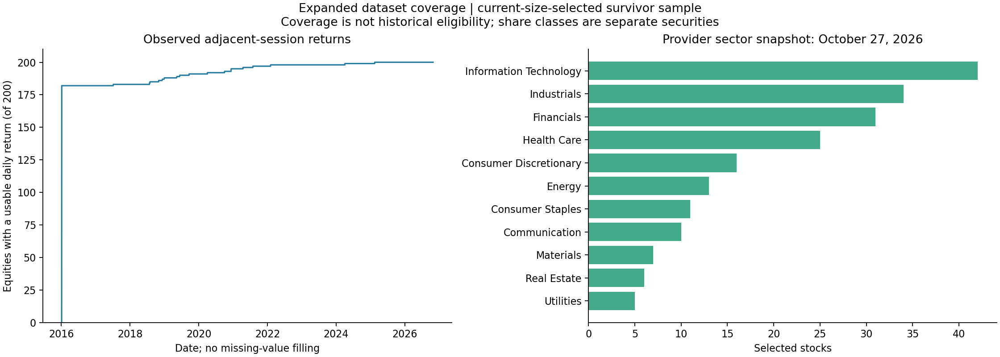

# Expanded daily equity panel: 200 stocks plus SPY

Collected October 28, 2026. This adds cross-sectional breadth to the original 30-stock study. It does not change its data or results, establish mean reversion, or create an untouched time holdout. **No new trading experiment or fee model was run.**

## What is saved

- **200 US-listed equity securities plus SPY**, all original 30 stocks retained, covering all eleven provider sector categories.
- Requested January 1, 2016–October 27, 2026; observed calendar **January 4, 2016–October 27, 2026**, **2,720 sessions**.
- **526,828 bars in each adjustment mode**, 1,053,656 rows across raw and all-adjusted files. All **53 pages per mode** were consumed.
- **182 equities** have every session observed. The other **18** have shorter leading histories. There are **zero internal missing sessions** in the downloaded stock/benchmark series. First observed dates do not necessarily identify IPO dates; corporate reorganizations and symbol-mapping coverage can matter.
- Original 30-stock-plus-SPY overlapping raw and adjusted OHLC observations match exactly: **84,320 bars checked in each mode, zero changed**. The original dataset's file hashes remain unchanged.

The [independent audit](independent_audit.json) verifies the saved responses, selection, close matrices, coverage, and return calculations. [Manifest](manifest.json), [frozen plan](collection_plan.json), [selection audit](selection_audit.json), and [file checksums](sha256.json) retain provenance.



## Universe rule fixed before history collection

Use the [official iShares IVV holdings download](https://www.ishares.com/us/products/239726/ishares-core-s-p-500-etf/latest-holdings.csv), dated **October 27, 2026** in the saved response. Retain equity holdings with active, tradable US-equity entries in Alpaca's asset snapshot. Rank by published USD market value descending, then symbol ascending for ties; take 200. Union the original 30 equities and add SPY separately. All original names already appear in the selected 200, so the union adds no extras.

Ranking uses market value rather than rounded published weights. Missing source weight metadata stays missing. Share-class ticker spaces map to Alpaca dots, e.g. `BRK B` to `BRK.B`, then are checked against the active asset master. Multiple listed share classes remain separate securities; **200 securities does not mean 200 independent companies**.

The source contains 505 equity rows; 504 pass the current active/tradable asset check. `HOLX` fails that check and is recorded in the selection audit. No name was replaced because of its historical returns, missing history, strategy profit, or topological appearance.

This is a **current-size-selected survivor sample**, not historical S&P 500 membership or historical eligibility. Snapshot weights, sectors, and tradability are not point-in-time records for earlier dates. Fund size ranking is not itself a measured liquidity screen. The separate [recent liquidity proxy](recent_60_session_liquidity_proxy.csv) reports median raw daily close times volume over the last sixty sessions, not exact traded dollar volume or an execution guarantee.

## Files

| File | Meaning |
|---|---|
| [universe.csv](universe.csv) | Frozen securities, provider ticker/name/sector/weight, active asset metadata, original-basket flags and legacy manual group |
| [coverage.csv](coverage.csv) | Per-symbol first/last observed date, bar count, leading/internal/trailing gaps |
| [bars_raw.csv](bars_raw.csv) | Unadjusted vendor daily OHLCV, trade count, VWAP, original timestamp |
| [bars_all.csv](bars_all.csv) | Vendor split/dividend/spin-off adjusted daily OHLCV |
| [close_raw.csv](close_raw.csv), [close_all.csv](close_all.csv) | Calendar-aligned close matrices, 201 columns plus date |
| [returns_simple.csv](returns_simple.csv), [returns_log.csv](returns_log.csv) | Adjacent-session adjusted close returns; decimal fractions, not percentages |
| [large_adjusted_return_flags.json](large_adjusted_return_flags.json) | 72 absolute adjusted simple-return observations above 25%; flagged, not silently removed |
| [sector_counts.csv](sector_counts.csv) | Selected counts under current provider sector labels |
| [ivv_holdings_source.csv](ivv_holdings_source.csv) | Unmodified public holdings snapshot including provider date |
| `response_raw_*.json.gz`, `response_all_*.json.gz` | Complete paginated API responses with request parameters, compressed; no authentication headers |
| [requests.jsonl](requests.jsonl), [holdings_retrieval.json](holdings_retrieval.json) | Read-only request provenance and public-source retrieval metadata |
| `alpaca_active_assets.json.gz`, [calendar.json](calendar.json) | Current instrument metadata and requested historical trading calendar |
| `spy_pre2016_probe.json.gz` | Read-only earlier-history availability probe |

## Earlier history and missingness

A separate **SPY-only** SIP daily request for January 2000–December 2015 returned **zero bars**, with no additional page token. That measures this account/feed/query, not every security or every vendor. The broader panel therefore retains the existing 2016-onward date range rather than claiming older coverage.

Prices and returns are **never forward-filled, backfilled, or set to zero to complete the panel**. The first return is missing for every stock. A return is present only if both that session's and the preceding calendar session's adjusted closes are observed. Keep missingness when loading the data:

```python
from pathlib import Path
import pandas as pd

dataset = Path("market_data/datasets/equity_daily_expanded_2016_2026-10-27")
universe = pd.read_csv(dataset / "universe.csv")
equities = universe.loc[universe.role.eq("equity"), "symbol"].tolist()
returns = pd.read_csv(dataset / "returns_log.csv", index_col="date", parse_dates=True)
stock_returns = returns[equities]  # Retains unavailable prehistory as NaN.
market_returns = returns["SPY"]
```

Do not drop every stock without a full 2016–2026 record simply to make a balanced matrix and then call that historical eligibility. Any next analysis needs a declared past-only admission/missingness rule. Do not mistake a shorter observed history for a proved IPO date.

## What this enables and what it does not

The larger basket makes broader peer structure, sector coverage, and sensitivity to universe composition testable. It does not create extra independent market histories, repair survivor selection, demonstrate a new TDA advantage, or restore 2024 onward as untouched data.

Two hundred stocks with 120 prior returns give a sample correlation matrix with rank at most 119 after centering. Correlation distances remain computable, but estimation uncertainty needs explicit treatment. Declare window lengths and any covariance regularization before the next structural comparison. Identity-target correlation shrinkage alone preserves pairwise distance ordering and therefore does not create a different fixed-K single-linkage peer hierarchy; it should not be advertised as a cure for chaining.

Daily bars use the vendor's aggregation, not independently verified regular-session auction prices. `all` adjustments are a vendor return proxy rather than an audited cash-dividend/corporate-action ledger. The 72 extreme-return flags require inspection before attributing any particular jump to economics or data error. No performance, causal explanation, or long-run equilibrium relationship was estimated in this collection.

## Reproduce

From `TDA_Research` in the TDA Python environment:

```sh
python market_data/download_equity_expanded.py --out market_data/datasets/equity_daily_expanded_2016_2026-10-27
python market_data/audit_equity_expanded.py --dataset market_data/datasets/equity_daily_expanded_2016_2026-10-27
```

The downloader reuses the saved provider/asset snapshot and validated cached pages on repeat execution. A fresh output directory fetches the then-current holdings; it refuses a provider snapshot later than this fixed history end, so a later reproduction should retain the archived snapshot or use a separately dated design. The public CSV URL itself is not an immutable archive.

Alpaca requests are authenticated **GETs only** to historical bars, assets, and calendar endpoints. The owner-only local credential file is outside the dataset and is never copied into outputs or logs. No account balances, positions, orders, paid plan changes, or subscriptions were requested. [Alpaca bars documentation](https://docs.alpaca.markets/us/reference/stockbars) documents symbol mapping, adjustments, and the total-per-page limit.
