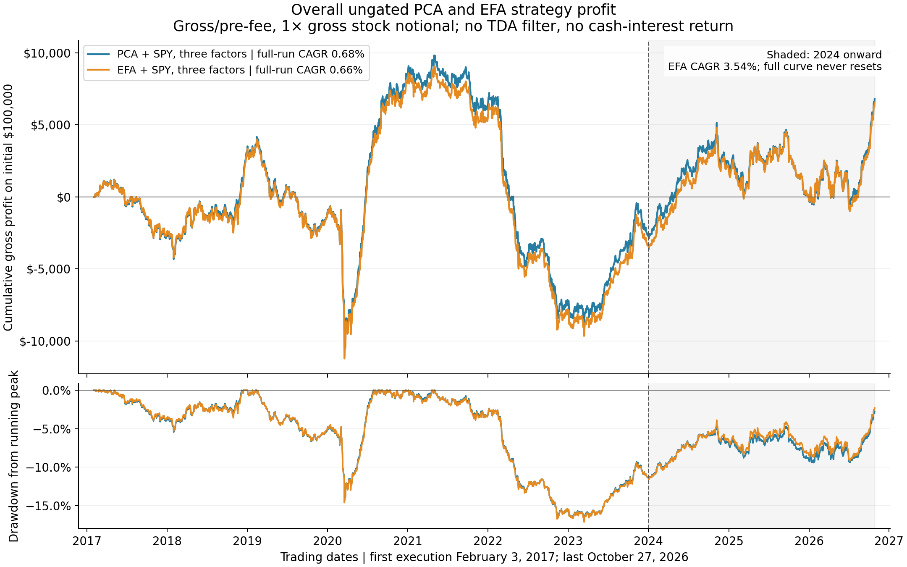
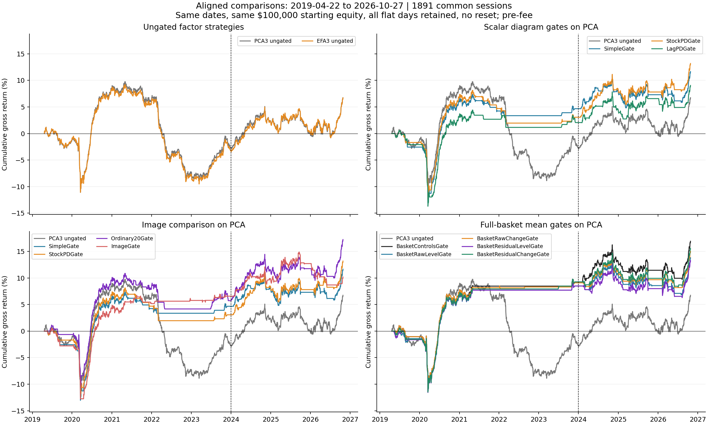
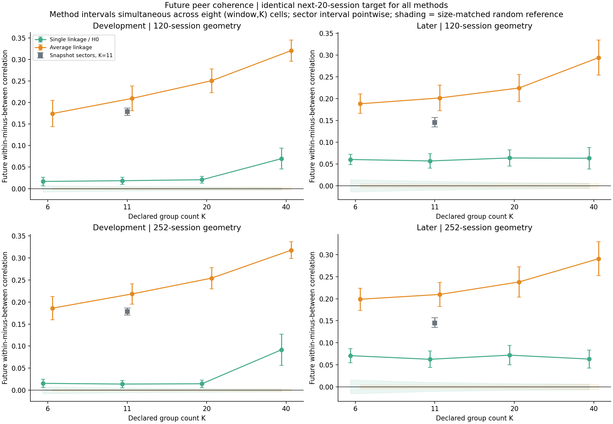
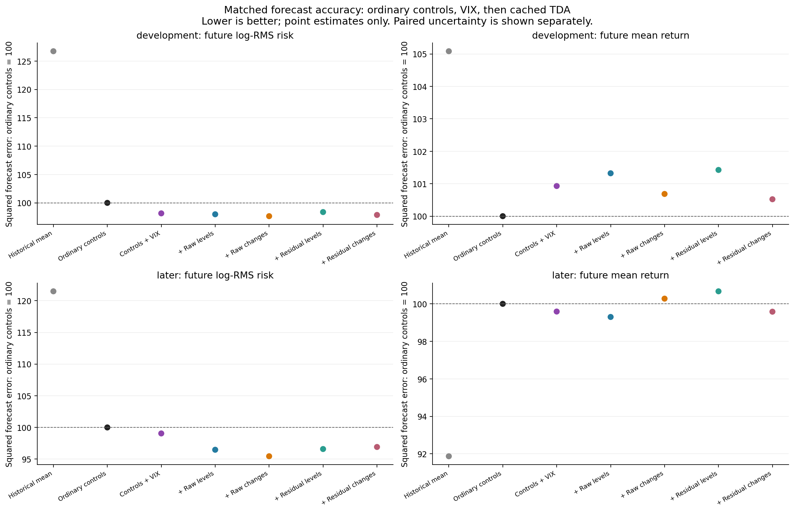
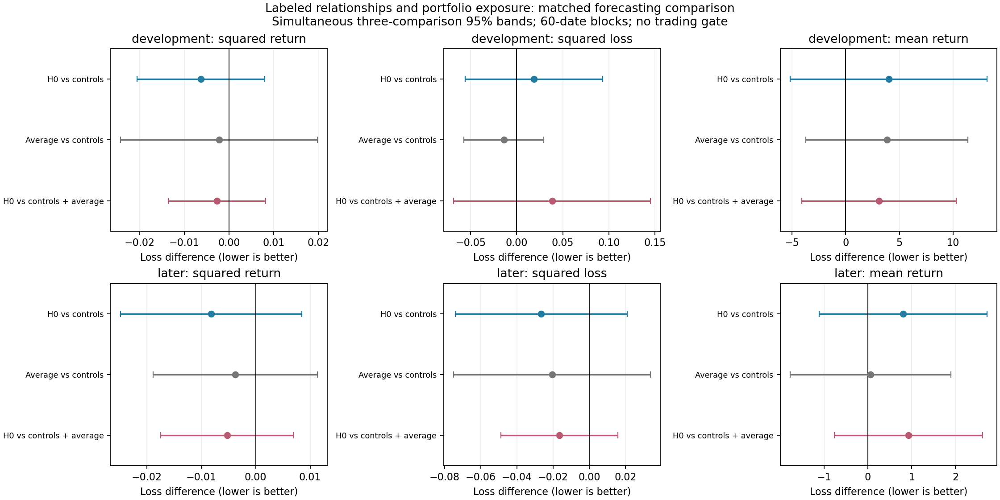
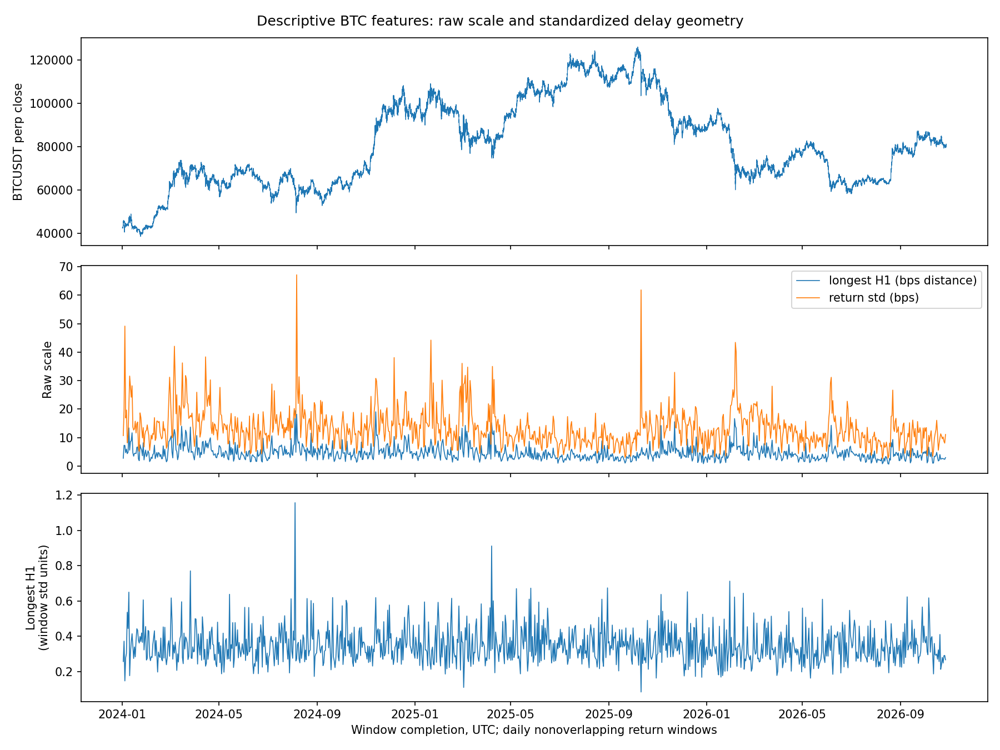
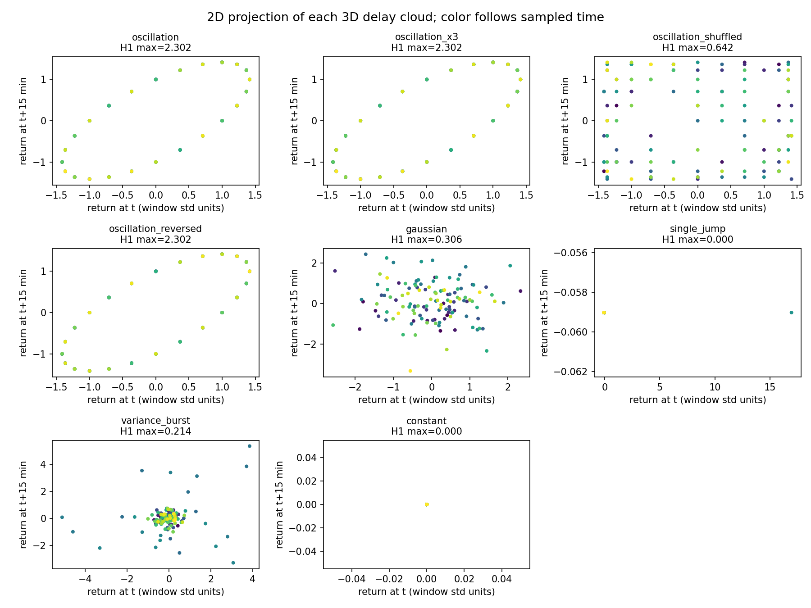
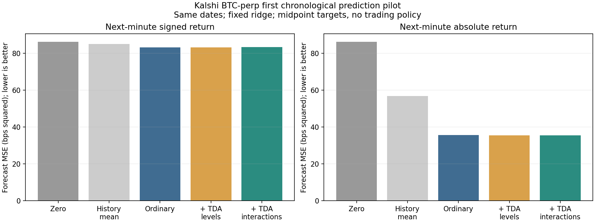
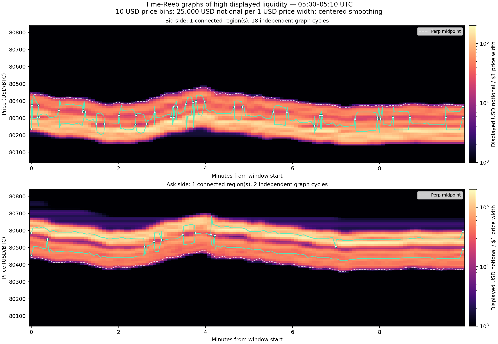
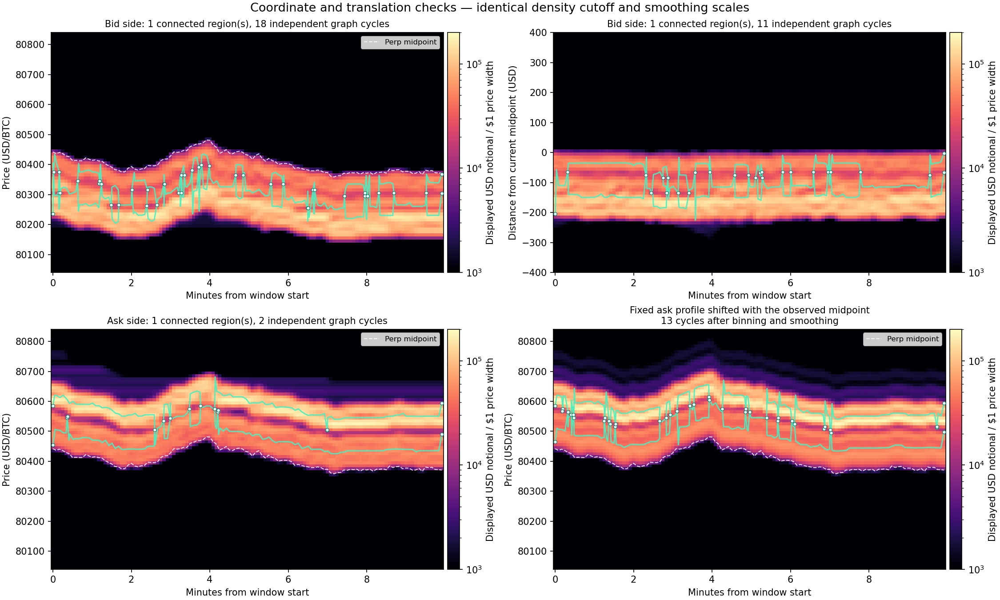

# Financial TDA research briefing

Prepared for a mentor discussion · November 5, 2026

We are studying whether topology provides useful descriptions of financial data and whether those descriptions help a defined task beyond conventional methods. The three studies use different objects: relationships among stocks, temporal patterns in BTC returns, and displayed liquidity across price and time.

**Current conclusion:** equity peer relationships persist, but we have not established a profitable residual-reversal signal or an incremental TDA trading advantage. Several equity risk forecasts have favorable but uncertain estimates. The first BTC return-prediction pilot establishes no added value from the tested TDA features. Liquidity experiments establish interpretable constructions and important limitations, without a predictive-performance test.

For a short discussion, start with the two equity performance graphs, then the three recent tests, and finish with the BTC and liquidity examples. Section 7 gives a quick point about every numbered equity investigation.

## 1 Equity strategy performance

### What the baseline strategy does

Using past data, estimate each stock's SPY and three common-factor exposures. Measure the part of the current return left unexplained by those exposures. Buy relative underperformers and short relative outperformers, using weighted-regression residuals and balancing the selected exposures. Enter at the next daily-bar open and exit at that day's close.

The expanded dataset contains 200 stocks plus SPY over January 2016–October 2026; 182 stocks have complete histories. The baseline starts trading in February 2017 after its history requirements. PCA and exploratory factor analysis, or EFA, are alternative ways to estimate the three factors.

### Full continuous profit before any TDA filter

**How to read it:** the top panel is compounded simulated dollar profit on an initial $100,000; the bottom is drawdown from the running peak. The curve does not reset in 2024. These are baseline strategies with no TDA timing filter.

| Period | PCA annualized compounded return | EFA annualized compounded return |
|---|---:|---:|
| February 2017–October 2026 | 0.68% | 0.66% |
| January 2024–October 2026 | 3.37% | 3.54% |

**Point to make:** the later improvement is real in the saved backtest, but it is only a subperiod. EFA barely changes the result, and its full-history maximum drawdown is 17.14%. Neither factor construction establishes a positive expected-return edge.

All portfolio results in this briefing are **simulated gross/pre-fee**, with no cash interest. At 1× gross, a $100,000 account initially holds roughly $50,000 long and $50,000 short. Dollar and estimated factor neutrality do not eliminate risk. Daily vendor-bar prices are execution proxies, not independently verified fills.

[Baseline report and return ledger](../equity/experiments/equity_efa_overall_profit/README.md)

### Did homology help decide when to trade

**How to read it:** all panels start April 22, 2019 and end October 27, 2026, using the same initial capital and all 1,891 sessions. Flat sections mean the gate stayed in cash. The dashed line marks 2024; capital does not reset there. The vertical axis is compounded total return, not annualized return.

For these gates, ridge regression forecast the next twenty sessions' average strategy return. Every five sessions, a positive forecast enabled the unchanged strategy for the next five sessions; otherwise it stayed flat.

| Policy on the same 708 sessions in 2024–October 2026 | Gross annualized compounded return | Annualized volatility | Days active |
|---|---:|---:|---:|
| Always trade PCA | 3.37% | 3.80% | 100.0% |
| Ordinary inputs only for the stock-diagram comparison | 2.33% | 3.18% | 67.2% |
| Same inputs plus three stock-diagram summaries | 3.39% | 3.21% | 69.4% |
| Same basic inputs plus a persistence image | 1.19% | 2.83% | 55.9% |
| Richer ordinary inputs for the day-cloud comparison | 2.44% | 3.12% | 67.9% |
| Same richer inputs plus raw day-diagram changes | 1.90% | 3.06% | 63.7% |

**Point to make:** the three-summary stock gate is the most favorable observed TDA trading result: similar later return to always trading, with less activity and lower volatility. Its improvement over its ordinary-control gate remains uncertain: +0.411 basis points per calendar day, simultaneous 95% interval [−0.213, +1.035]. The ordinary gate also lowers volatility. More diagram detail through an image did not improve the later result.

Each addition must be compared with its own control; the two ordinary-control rows use different feature sets. The 3.39% figure is for the later period, not the entire graph. On the common 2019-onward calendar, the stock-diagram gate's annualized compounded return is 1.66%, versus 1.48% for its ordinary gate.

[Aligned performance and definitions](../equity/EQUITY_VALIDATION.md) · [Three-summary test](../equity/experiments/equity_persistence_regimes/README.md) · [Image test](../equity/experiments/equity_persistence_images/README.md)

## 2 Equity peer relationships

**Question:** if groups are formed from past returns, do stocks in the same group continue moving more similarly than stocks in different groups?

**Mapping:** each stock is a point described by its past 120 or 252 returns, after fitting out SPY and normalizing its residual history. Distance is `sqrt(2 × (1 − correlation))`, exactly Euclidean distance between the normalized return vectors. Strongly positively correlated stocks are close; oppositely moving stocks are far apart.

**Technique:** H0 tracks connected components as the connection distance increases. Here that is single linkage: one short bridge can join two groups. Average linkage instead merges groups according to the average of all distances across their members. For example, if C is close to B but far from A, single linkage can add C to the A–B group sooner than average linkage.

**Result:** yes, both constructions retain future co-movement, but average linkage is the stronger tested grouping method. With 252 past sessions and eleven groups, the later average within-group minus between-group correlation over the next twenty sessions was:

| Group construction | Future correlation gap |
|---|---:|
| H0 or single linkage | 0.063 |
| Average linkage | 0.210 |
| Existing business-sector labels | 0.145 |

These are differences between ordinary Pearson correlations, not a special TDA correlation. Sector labels came from the saved October 27, 2026 iShares IVV holdings file. They are snapshot labels, not historically reconstructed classifications.

**Point to make:** peer structure persists, but that does not imply a relative loser catches up. H0 often chains most stocks into one large group; at the eleven-group cut it puts roughly 93% of the later basket together. Many smaller H0 branches are stable, but almost all also occur in average linkage. This is useful structural evidence without an incremental H0 advantage on the tested task.

[Expanded structural test](../equity/experiments/equity_expanded_structure/README.md)

## 3 How the homology output entered the tests

| Construction | Data object | Output used downstream | Test |
|---|---|---|---|
| Historical stock peers | Stock points in normalized return-history coordinates | Labeled H0 hierarchy and group memberships | Future correlation separation; earlier group-neutral portfolios |
| Stock-loading diagrams | 182 stocks with three eigenvalue-weighted PCA loading coordinates each | H0 merge-distance 90th percentile, longest H1 lifetime, sum of squared H1 lifetimes | Ridge forecast of future strategy mean; trading gate |
| Persistence images | Same stock-loading cloud | Sixteen H1 image values and four H0 bins | Same kind of return forecast and gate |
| Full-basket day clouds | 120 days, each with 182 stock-return coordinates | Loop counts/lifetimes and changes between diagrams | Separate risk and mean forecasts; mean-based gate |
| Current shocks on a peer graph | Named stocks with historical peer edges and current shock values | H0 branch prominence and support | Next-session relative-stock return and magnitude forecasts |
| Hierarchy attached to holdings | Named stock hierarchies with signed positions | Exposure and relationship-change summaries | Next-session portfolio risk and mean forecasts |

Most return forecasts used **ridge regression**, a linear model with coefficient shrinkage. The latest squared-return risk model used a regularized positive conditional-moment model with a log link and QLIKE objective. Feature construction itself is nonlinear; it is not all ordinary linear regression. No neural network, random forest or boosted-tree model was used in these tests.

An H1 lifetime is a range of distance scales, not calendar duration. A loop does not automatically identify an economic cycle or an arbitrage. The summaries were chosen geometric measurements whose predictive usefulness had to be tested.

## 4 Three recent equity tests

### Day-cloud risk forecasts beyond VIX

**Mapping and use:** each day is a vector of 182 stock returns. The preceding 120 days form a cloud. Vietoris–Rips H1 describes loops; fixed summaries describe their count/lifetimes and diagram changes over five sessions. We analyzed both raw returns and standardized returns after removing fitted SPY movement. Day order within each cloud is discarded.

Ridge regression used those summaries alongside volatility, correlation, covariance-change, strategy-history and VIX inputs. The primary target was log RMS of the strategy's next twenty daily returns. RMS measures move size; large gains and losses both increase it. Signed mean return was a separate target.

**How to read it:** ordinary-control forecast error is indexed to 100 in each panel; lower is better. Left panels measure risk error, right panels measure mean-return error. Top panels are earlier dates; bottom panels are 2024 onward. The chart shows point estimates; it does not show uncertainty.

**Result:** VIX reduced later risk-forecast error by 0.95%; four TDA additions reduced it a further 2.16–3.64%. Earlier increments were much smaller and mixed. Every declared paired interval included zero. Mean prediction barely improved; all feature models had worse later point error than a historical-mean forecast.

**Point to make:** there is a possible risk signal beyond VIX. Lower forecast error is not lower portfolio risk: this follow-up did not use risk forecasts to size or switch off positions. Later dates were already examined history.

[Matched VIX test](../equity/experiments/tda_vix_matched/README.md)

### Current residual shocks on the peer network

**Mapping and use:** connect each stock to its five strongest positively correlated historical SPY-residual peers. Place today's standardized SPY-plus-PCA residual shock on each node. For positive and negative shocks separately, admit the most severe values first and progressively include milder ones. H0 records shock groups merging.

Two summaries, branch prominence and pre-merge group size, describe how an excursion stands out and how broadly it is supported. Regularized regression tested whether they improve next-session relative-stock return forecasts beyond neighbors' ordinary shock statistics, sector context and VIX.

**Result:** TDA added only 0.0043% later return-error reduction, interval [−0.0021%, +0.0107%], and slightly worsened earlier error. Ordinary peer features helped predict absolute relative-move size in both periods; TDA did not materially strengthen that finding.

**Point to make:** connected versus scattered shocks are an interpretable distinction, but the two tested topological summaries did not establish catch-up prediction. No stock filter or new portfolio followed.

[Shock test and figures](../equity/experiments/tda_residual_shock/README.md)

### Changing relationships aligned with actual holdings

**Mapping and use:** build a labeled hierarchy from 120 sessions ending before the signal day, then another from a window ending five sessions earlier. Keep today's holdings and volatility adjustments fixed in both. The windows share 115 sessions.

At every grouping threshold, sum signed volatility-adjusted positions within each group, square those group exposures and combine them across thresholds. This measures cancellation versus alignment of positions. Features record current exposure, its change and holdings-weighted membership change. Average linkage gets matched features; ordinary inputs include covariance risk and VIX.

For example, with longs A/B and shorts C/D, related pairs A/C and B/D permit offsetting exposure. If the estimated pairs instead become A/B and C/D, positions align within pairs. This is a hypothetical representation check; covariance can also see the distinction.

**How to read it:** each dot is a difference in forecast loss against the named comparator. Left of zero favors the added features. The bars are simultaneous 95% intervals; every bar crosses zero. The red row tests H0 beyond both ordinary controls and average linkage. These are forecast scores, not percentage changes in portfolio risk.

**Result:** adding H0 beyond ordinary controls and average linkage modestly improved squared-return forecast scores in both periods, but every paired interval included zero. Downside results were mixed across periods. Signed-return forecasts slightly worsened.

**Point to make:** this is the clearest link from a hierarchy to actual portfolio exposure. We tested the features together, not a separately validated rule that declining cancellation predicts losses. Tomorrow's squared return was the risk target; no threshold changed trading or sizing.

[Holdings and relationship test](../equity/experiments/tda_relationship_exposure/README.md)

## 5 BTC temporal features

**Question:** what does persistence of a delay cloud measure beyond ordinary return volatility and temporal summaries?

**Mapping:** take a 24-hour window of five-minute BTCUSDT perpetual log returns. A point contains three returns separated by fifteen minutes. Compute Rips H0/H1 on at most 128 deterministically selected points, in both raw and within-window standardized units. This produced 1,030 daily feature rows over 2024–October 2026.

**Result:** longest raw H1 lifetime had Spearman correlation 0.820 with window return standard deviation; standardized lifetime had correlation −0.051. Raw persistence strongly reflected amplitude here. Standardization changed what the feature measured; it did not establish new predictive information.

**Point to make:** controlled oscillations produce organized loops; shuffling the same values changes the geometry, while uniform amplitude scaling disappears after standardization. Reversing time leaves the example's persistence unchanged. Ordinary spectral features also distinguish the oscillation from its shuffle.

This was a descriptive feature study. There were no forecast labels, trained prediction models, trading gates or P&L estimates. The useful output is a verified explanation of scale sensitivity and temporal-information loss.

[BTC feature pilot](../btc/experiments/initial_features/README.md)

### First Kalshi return prediction test

The subsequent November 5 test used 26 frozen closed Kalshi/Coinbase files, ten minutes of past five-second returns and a next-minute midpoint-return target. Ridge forecasts used ordinary return/volatility/spectrum/book/flow/spot inputs, then added standardized Rips summaries and interactions with recent signed return. After 180 completed training labels, there were 348 scored chronological forecasts. This is a short pilot, not a multi-day validation.

**Result:** signed-return MSE was 86.2602 for zero, 83.2255 for ordinary features and 83.3303 for the primary TDA addition. TDA slightly worsened signed error by 0.126%; its move-size error improved 0.361%. Both simultaneous intervals included zero. The levels-only TDA variant also established no increment. Ordinary inputs were more favorable for predicting magnitude than direction.

**Point to make:** the predictive pipeline now works, but the tested TDA features have not established additional forecasting value. No trading policy or P&L followed. Independent reconstruction passed all 72 feature-model target fits; source gaps and quote freshness were explicitly handled.

[Prediction report and uncertainty](../btc/experiments/kalshi_perp_return_prediction_2026_11_05/README.md)

## 6 Liquidity geometry and data readiness

### Depth concentrations on a price by time grid

The initial real-data pilot put displayed Kalshi BTC-perp notional on a 65-price-bin by 60-observation grid. H0 superlevel persistence progressively connects high-depth regions as the required depth decreases. Each branch retains peak price/time and component extent. It found 115 finite branches and one essential component, with component counts independently checked.

**Point to make:** we can trace a branch to source liquidity and separate depth contrast from elapsed time. This was a short polling sample, not an event-complete archive or a predictive test. The earlier synthetic closed-cell Betti demonstration was educational and did not implement general persistence pairing.

[Initial real liquidity pilot](../liquidity/experiments/btc_liquidity_features/README.md) · [Depth image](../liquidity/experiments/btc_liquidity_features/kalshi_depth_grid.png) · [Synthetic demonstration](../liquidity/experiments/depth_topology_demo.png)

### Reeb graphs of moving liquidity bands

**Mapping:** independently replay book updates, put displayed notional into price bins over time, retain a declared high-depth region, then compute a Reeb graph of time on that region. At each time, a connected price interval becomes a graph point. Edges and cycles describe bands appearing, separating, connecting and disappearing. These are actual native TTK Reeb graphs, distinct from the earlier depth-scalar H0 construction.

**Result:** controlled one-band, two-band and split/rejoin examples passed, and all 17 real/control/sensitivity cases matched independent topology checks. However, the primary bid cycle count changed from 18 to 14 with wider bins and to 34 without smoothing. A fixed ask profile, merely translated with price and then processed, produced 13 cycles despite unchanged underlying profile shape.

**Point to make:** graph complexity alone cannot establish liquidity reorganization. Motion, binning and smoothing must be controlled. Midpoint-relative re-binning made ordinary profile shapes substantially more stable. The centered-smoothed figures are retrospective; they cannot be used directly as causal prediction inputs. No future-price or execution-outcome prediction was tested.

[Archive and Reeb report](../liquidity/experiments/btc_archive_initial_2026_11_05/README.md)

### What data are available

| Completed data check | Verified output | Remaining limit |
|---|---|---|
| Free historical Deribit BTC perpetual day, January 1, 2025 | 15.45 million price-level rows, 50,816 trades, 1,440 reconstructed checkpoints; native-minute reconciliation | Whole-day native sequence continuity unverified; one day is a pilot |
| November 4 ten-minute Kalshi BTC-perp capture | 114,753 deltas, 1,327 trades; all 119 checkpoints independently replayed | Ten minutes cannot establish predictive value |
| First closed continuous Kalshi and Coinbase archive interval | 1.55 million perp deltas; all 1,703 checkpoints matched; six closed files validated; one marked spot reconnect | A few hours are a small number of market episodes; this is a frozen validation, not a current uptime claim |

The full continuous run subsequently stopped at the user's request on November 5 at 11:15:26 p.m. Indianapolis. All 52 files are finalized; all 11,467 checkpoints pass full exact-decimal replay. The 725.14 MiB archive retains reconnect and sampling gaps. [Final completion report](../btc/experiments/btc_archive_final_2026_11_05/README.md).

These establish usable reconstruction inputs for the two BTC studies. New recording builds future history; it does not backfill older Kalshi books. L2 records aggregated displayed price levels, not individual orders or queue positions. No paid data or trading orders were required for these pilots.

[Historical Deribit evidence](../market_data/datasets/btc_deribit_2025-01-01/README.md) · [Ten-minute validation](../market_data/samples/kalshi_btc_stream_2026-11-04_10min/README.md) · [Continuous archive validation](../liquidity/experiments/btc_archive_initial_2026_11_05/README.md)

## 7 Quick record of each equity investigation

Numbers match the [equity research log](../equity/EQUITY_RESEARCH_LOG.md). Implementation, reviews and audit work are identified separately from new empirical tests.

1. **Collect 30 stocks and inspect correlation:** visible peer structure survives fitting out SPY; descriptive evidence, not return prediction. [Report](../equity/experiments/equity_correlation_pca/README.md)
2. **Descriptive PCA:** a few directions explain much historical variance; this is reconstruction, not future-return accuracy. [Figures](../equity/experiments/equity_correlation_pca/03_pca_intuition.png)
3. **Verify the reversal construction:** holdings use minus the weighted residual, giving the selected neutrality constraints. Implementation verification, not an edge. [Math](../equity/literature/residual_mean_reversion_151_2026-10-28.md)
4. **Original daily backtest:** later mean gross returns −1.29 bps/day for SPY-only and −0.65 with three PCs; both uncertain. [Original gross graph](../equity/experiments/equity_residual_backtest/gross_report/01_gross_equity.png)
5. **Diagnose the initial weakness:** positive overnight reversal and too few PCs were not supported as simple explanations; no dependable trend/volatility gate found. [Profit and diagnostics](../equity/experiments/equity_residual_diagnostics/README.md)
6. **H0 peers versus conventional peers:** H0 equals single linkage here; chaining and singleton constraints matter; no positive later mean established. [Gross peer comparison](../equity/experiments/equity_h0_peers/04_gross_peer_comparison.png)
7. **Whole-hierarchy stability:** stable small branches exist, but nearly all are shared with average linkage. [Report](../equity/experiments/equity_h0_scale_robustness/README.md)
8. **Direct catch-up over 1, 5 and 20 sessions:** response slopes and event means remained uncertain; event returns are not a compounded overlapping-position strategy. [Response graph](../equity/experiments/equity_reversal_response/02_slopes_and_gross_event_returns.png)
9. **Expand structural tests to 200 stocks:** future peer coherence persists; average linkage outperforms H0 on all declared method comparisons. [Report](../equity/experiments/equity_expanded_structure/README.md)
10. **Broader PCA and reversal rerun:** later point returns improve relative to the original basket, but no reliable reversal edge or winning component count is established. [Gross profit](../equity/experiments/equity_expanded_pca_reversal/03_gross_profit.png)
11. **Three-summary persistence gates:** stock-loading and lagged-factor-transition diagrams enter return forecasts; stock-diagram points are favorable, incremental effects uncertain. [Gross gate curves](../equity/experiments/equity_persistence_regimes/01_gross_gate_profit.png)
12. **Persistence-image follow-up:** preserve more birth/lifetime detail; later forecast and gate performance worsen in point estimates. [Gross gate curves](../equity/experiments/equity_persistence_images/02_gross_gate_profit.png)
13. **Review published regime constructions:** clarified stock versus day points, truncation and preprocessing; literature/design review, not a new strategy test. [Review](../equity/literature/tda_regimes_and_coordinate_design_2026-10-29.md)
14. **Full-basket day clouds:** modest uncertain risk-error gains; separate mean-based gates fail to improve later point returns. [Gross gate curves](../equity/experiments/equity_full_basket_states/03_gross_gate_profit.png)
15. **Matched EFA versus PCA:** almost identical behavior and full-history performance; no established EFA advantage. [Matched profit curves](../equity/experiments/equity_efa_vs_pca/01_gross_profit.png)
16. **Separate index sell-off reversal check:** an approximation gives favorable optimistic same-close rebound means; causal next-open versions have mean intervals including zero. This is market-direction reversal, not the residual strategy or a homology test. [Timing and drawdown](../equity/experiments/index_selloff_reversal/timing_and_drawdown.png)
17. **VIX versus factor-strategy outcomes:** VIX relates more clearly to absolute return size than signed return; incremental forecasts remain uncertain. [Forecast comparison](../equity/experiments/factor_reversal_vix/04_forecast_comparison.png)
18. **Fixed VIX 20–30 trading band:** full PCA CAGR rises from 0.68% to 1.26%, but later falls from 3.37% to 1.21%; gains concentrate in particular episodes. Selected after earlier inspection; no validated gate. [Gross equity and drawdown](../equity/experiments/factor_vix_20_30/01_gate_equity_and_drawdown.png)
19. **Review TDA regimes alongside VIX:** literature/context work; the all-layer landscape L1 scalar duplicates squared-lifetime sum up to a constant. [Review](../equity/literature/tda_regimes_vix_2026-11-04/README.md)
20. **Matched TDA beyond VIX:** favorable later risk-error reductions persist in point estimates, with all paired intervals including zero; no policy changed. [Report](../equity/experiments/tda_vix_matched/README.md)
21. **Local shock topology:** essentially no added catch-up prediction; ordinary peer context helps predict move magnitude. [Forecast figure](../equity/experiments/tda_residual_shock/02_incremental_forecasts.png)
22. **Labeled relationship exposure:** a meaningful mapping from named stock groups to signed holdings; small uncertain risk-score increments and no mean-return gain. [Report](../equity/experiments/tda_relationship_exposure/README.md)

The separate [validation review](../equity/EQUITY_VALIDATION.md) reconciled periods, portfolios and units and independently rechecked saved results. Numerical consistency supports the implementation; it does not establish generalization or an economic mechanism.

## 8 Discussion points for the mentor

- **Most established:** historical stock groups retain future co-movement, with average linkage stronger than the tested H0 partitions.
- **Most interpretable recent construction:** attach named holdings to changing hierarchies and measure how exposure aligns or cancels across scales.
- **Most favorable TDA trading observation:** the stock-diagram gate's later return and volatility, accompanied by unresolved incremental uncertainty.
- **Most important representation lessons:** scale can dominate persistence; unlabeled diagrams lose position alignment; unordered day clouds lose temporal order; liquidity preprocessing can create graph cycles.
- **Open choice:** prioritize explaining a specific structural distinction, improving a risk forecast, or improving expected-return decisions. These require different targets and evidence. A new test should specify the distinction and conventional control before inspecting additional results.

The equity universe uses current survivors, evaluation dates have already been examined, and overlapping windows provide fewer independent episodes than row counts suggest. Confidence intervals are conditional, experiment-specific comparisons and do not correct for every project-wide research choice. No tested TDA trading or sizing policy is ready to claim as validated.

Figures are unchanged copies of saved project charts. [Figure provenance and checksums](figure_sources.json) records their originals. Detailed source reports retain specifications, numerical outputs and audits.
